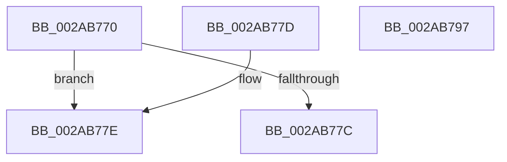

# MiIsPageInHugePfn

- RVA: `0x002AB770`–`0x002AB798` (길이 `40` bytes)
- VA: `0x00000001402AB770`
- 실행 섹션: `.text`
- PDB 이름 있음: `예`; PDB Function 태그: `아니요`
- unwind 정보 RVA: `0x000DB714`
- 디코드: `14`개 명령, `40/40` bytes 표시
- 미해석 바이트: `0` (있으면 어셈블리에 `.byte`로 보존)

> 이 문서는 커널 이미지의 기계어와 PDB 기호를 분석해 생성했습니다. 4번과 5번은 함수 원형과 자료형을 바이너리 사용 방식에서 추정한 C 해석이며 원본 소스 복구 결과는 아닙니다.

## 1. Dependencies

- 직접 호출 지점: **0**; 고유 호출 대상: **0**
- 직접 호출자로 확인된 함수: **11**
- RIP 상대 이미지 참조: **1**

### Outgoing calls
- 직접 디코드된 call 명령이 없습니다.

### Direct callers
- [MiDereferenceIoPages](MiDereferenceIoPages_function_002AB1B0.md) at `0x002AB257`
- [MiIsPageInIoHugeRangeTransition](MiIsPageInIoHugeRangeTransition_function_002AB7A0.md) at `0x002AB7A7`
- [MiValidateAndLockAweMapCountPage](../4B/MiValidateAndLockAweMapCountPage_function_004BD8F4.md) at `0x004BD9F4`
- [MmGetCacheAttributeEx](../67/MmGetCacheAttributeEx_function_00674F80.md) at `0x0067503D`
- [MiGetPageInHugePageBadStatus](../67/MiGetPageInHugePageBadStatus_function_00675ADC.md) at `0x00675AFE`
- [MiGetPageInHugePageBadStatus](../67/MiGetPageInHugePageBadStatus_function_00675ADC.md) at `0x00675B4E`
- [MiMarkHugePfnBad](../67/MiMarkHugePfnBad_function_00676744.md) at `0x00676873`
- [MiMarkHugePfnGood](../67/MiMarkHugePfnGood_function_00676BB0.md) at `0x00676C07`
- [MiUnlinkBadPages](../67/MiUnlinkBadPages_function_0067A6FC.md) at `0x0067A73F`
- [MiUpdateBadPfnIdentity](../67/MiUpdateBadPfnIdentity_function_0067A890.md) at `0x0067A8BD`
- [MmMarkPhysicalMemoryAsBad](../67/MmMarkPhysicalMemoryAsBad_function_0067AA50.md) at `0x0067AB2C`
- [MiDeleteStaleCacheMaps](../67/MiDeleteStaleCacheMaps_function_0067B780.md) at `0x0067B956`

### Static image references
- `0x002AB770` → RVA `0x00E300B8` (`.data`; read)

## 2. Other-region calls and transfers

- 다른 실행 섹션으로 향하는 call: **0**
- 별도 외부 분기/꼬리 이동을 확인하지 못했습니다.

## 3. Assembly (complete function range)

```asm
002AB770  48 8B 05 41 49 B8 00            mov rax, qword ptr [rip + 0xb84941]
002AB777  48 85 C0                        test rax, rax
002AB77A  75 02                           jne 0x1402ab77e
002AB77C  C3                              ret
002AB77D  CC                              int3
002AB77E  48 C1 E9 12                     shr rcx, 0x12
002AB782  81 E1 FF FF 3F 00               and ecx, 0x3fffff
002AB788  48 0F A3 08                     bt qword ptr [rax], rcx
002AB78C  0F 92 C1                        setb cl
002AB78F  33 C0                           xor eax, eax
002AB791  84 C9                           test cl, cl
002AB793  0F 95 C0                        setne al
002AB796  C3                              ret
002AB797  CC                              int3
```

## 4. C-style interpretation (structured pseudocode)

```c
__int64 __fastcall MiIsPageInHugePfn(__int64 a1)
{
    __int64 result;

    if (*(unsigned __int64 *)(v_rip + 12077377) != 0) goto loc_002AB77E;
    return *(unsigned __int64 *)(v_rip + 12077377);
loc_002AB77E:
    a1 = (a1) >> (18);
    a1 = (unsigned int)((a1) & (0x3FFFFFULL));
    a1 = (condition_is_below) ? 1 : 0;
    result = 0;
    result = ((unsigned __int8)(a1) != 0) ? 1 : 0;
    return result;
}
```

## 5. (Beta) C Style

```c
int64_t MiIsPageInHugePfn(int64_t Arg1)
{
    int64_t result;

    if (*(uint64_t *)(v_rip + 0xB84941) != 0) goto loc_002AB77E;
    return *(uint64_t *)(v_rip + 0xB84941);
loc_002AB77E:
    Arg1 = (Arg1) >> (18);
    Arg1 = (uint32_t)((Arg1) & (0x3FFFFFULL));
    Arg1 = (condition_is_below) ? 1 : 0;
    result = 0;
    result = ((uint8_t)(Arg1) != 0) ? 1 : 0;
    return result;
}
```

## 6. Execution-region graph

[열기: 2D/3D 그래프와 함수 탐색 컨트롤 패널](../../../control-panel.html?section=text&rva=0x002AB770&view=graph)

- 2D 그래프는 위에서 아래로 흐르고, 3D 그래프는 빈 공간을 드래그해 회전합니다. Shift+드래그는 이동, 휠은 확대·축소, 함수 노드 선택은 대상 보고서 이동입니다.

### Static fallback


