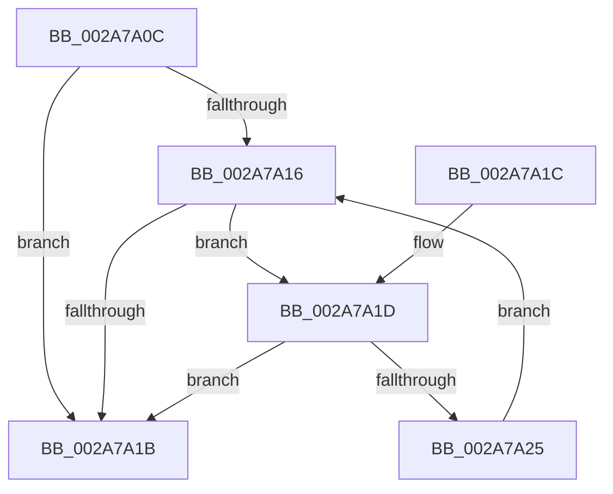

# MiLocateLockedVadEvent

- RVA: `0x002A7A0C`–`0x002A7A27` (길이 `27` bytes)
- VA: `0x00000001402A7A0C`
- 실행 섹션: `.text`
- PDB 이름 있음: `예`; PDB Function 태그: `아니요`
- unwind 정보 RVA: `0x000DB714`
- 디코드: `11`개 명령, `27/27` bytes 표시
- 미해석 바이트: `0` (있으면 어셈블리에 `.byte`로 보존)

> 이 문서는 커널 이미지의 기계어와 PDB 기호를 분석해 생성했습니다. 4번과 5번은 함수 원형과 자료형을 바이너리 사용 방식에서 추정한 C 해석이며 원본 소스 복구 결과는 아닙니다.

## 1. Dependencies

- 직접 호출 지점: **0**; 고유 호출 대상: **0**
- 직접 호출자로 확인된 함수: **34**
- RIP 상대 이미지 참조: **0**

### Outgoing calls
- 직접 디코드된 call 명령이 없습니다.

### Direct callers
- [MiCloneVads](../22/MiCloneVads_function_0022DC1C.md) at `0x0022E275`
- [MiCloneVads](../22/MiCloneVads_function_0022DC1C.md) at `0x0022E280`
- [MiInsertVad](../26/MiInsertVad_function_00265540.md) at `0x0026576D`
- [MiMarkMdlComplete](MiMarkMdlComplete_function_002A75D0.md) at `0x002A75F2`
- [MiFreeVadRange](MiFreeVadRange_function_002A77AC.md) at `0x002A7895`
- [MiFreeVadRange](MiFreeVadRange_function_002A77AC.md) at `0x002A78E5`
- [NtGetWriteWatch](NtGetWriteWatch_function_002A7CE0.md) at `0x002A7FD4`
- [MiMoveDirtyBitsToPfns](MiMoveDirtyBitsToPfns_function_002A8624.md) at `0x002A8969`
- [MiGetAweVadPartition](MiGetAweVadPartition_function_002A94E8.md) at `0x002A9528`
- [MiMapLockedPagesInUserSpaceHelper](MiMapLockedPagesInUserSpaceHelper_function_002ADFE0.md) at `0x002AE247`
- [MiInsertPhysicalPteMapping](MiInsertPhysicalPteMapping_function_002AE26C.md) at `0x002AE4C6`
- [MiComputeVadCharges](../2C/MiComputeVadCharges_function_002C3348.md) at `0x002C3462`
- [MiCommitExistingVad](../32/MiCommitExistingVad_function_0032A860.md) at `0x0032B440`
- [sub_0032D782](../32/Unknown_function_0032D782.md) at `0x0032DBEE`
- [sub_0032E327](../32/Unknown_function_0032E327.md) at `0x0032E39B`
- [MiCheckVirtualAddress](../32/MiCheckVirtualAddress_function_0032E4F0.md) at `0x0032E7B1`
- [MiCheckUserVirtualAddress](../48/MiCheckUserVirtualAddress_function_00488834.md) at `0x00488957`
- [sub_006F2D78](../6F/Unknown_function_006F2D78.md) at `0x006F2D8A`
- [MiApplyImageHotPatchRequest](../../page/80/MiApplyImageHotPatchRequest_function_008025AC.md) at `0x00802761`
- [MiCopyLargeVad](../../page/81/MiCopyLargeVad_function_008118A4.md) at `0x00811904`
- [MiCopyLargeVad](../../page/81/MiCopyLargeVad_function_008118A4.md) at `0x0081190F`
- [MiFreeToSubAllocatedRegion](../../page/87/MiFreeToSubAllocatedRegion_function_0087FB7C.md) at `0x0087FBC3`
- [MiFreeVirtualMemory](../../page/88/MiFreeVirtualMemory_function_00880268.md) at `0x00880631`
- [MiAllocateVirtualMemory](../../page/88/MiAllocateVirtualMemory_function_00883B40.md) at `0x00884083`
- [MiInitializePartialVad](../../page/88/MiInitializePartialVad_function_00887954.md) at `0x00887A09`
- [MiUnmapViewOfSection](../../page/88/MiUnmapViewOfSection_function_0088A4C4.md) at `0x0088A7D3`
- [MiUnmapViewOfSection](../../page/88/MiUnmapViewOfSection_function_0088A4C4.md) at `0x0088A820`
- [MiMarkPrivateImageCfgBits](../../page/8D/MiMarkPrivateImageCfgBits_function_008D07FC.md) at `0x008D08EB`
- [MmEnumerateAddressSpaceAndReferenceImages](../../page/97/MmEnumerateAddressSpaceAndReferenceImages_function_0097DD50.md) at `0x0097E0C8`
- [MiFillMapFileInfo](../../page/97/MiFillMapFileInfo_function_0097E15C.md) at `0x0097E33D`
- [MiAllocateChildVads](../../page/97/MiAllocateChildVads_function_0097E380.md) at `0x0097E50D`
- [MiAllocateNewSubAllocatedRegion](../../page/98/MiAllocateNewSubAllocatedRegion_function_00981EC0.md) at `0x00982035`
- [MmQueryVirtualMemory](../../page/9D/MmQueryVirtualMemory_function_009D9280.md) at `0x009D9CB3`
- [MmQueryVirtualMemory](../../page/9D/MmQueryVirtualMemory_function_009D9280.md) at `0x009D9FE5`
- [MiGetReadyInPageBlock](../../page/AB/MiGetReadyInPageBlock_function_00ABB398.md) at `0x00ABB3AC`
- [MiGetAweVadPageSize](../../page/AD/MiGetAweVadPageSize_function_00AD58F8.md) at `0x00AD591C`
- [MiCreateUserPhysicalView](../../page/AD/MiCreateUserPhysicalView_function_00ADA4B4.md) at `0x00ADA699`
- [sub_00B190F2](../../page/B1/Unknown_function_00B190F2.md) at `0x00B19113`
- [sub_00B2A146](../../page/B2/Unknown_function_00B2A146.md) at `0x00B2A26D`

### Static image references
- 디코드된 RIP-relative 메모리 참조가 없습니다.

## 2. Other-region calls and transfers

- 다른 실행 섹션으로 향하는 call: **0**
- 별도 외부 분기/꼬리 이동을 확인하지 못했습니다.

## 3. Assembly (complete function range)

```asm
002A7A0C  48 8B 41 38                     mov rax, qword ptr [rcx + 0x38]
002A7A10  48 83 E0 F0                     and rax, 0xfffffffffffffff0
002A7A14  74 05                           je 0x1402a7a1b
002A7A16  85 50 50                        test dword ptr [rax + 0x50], edx
002A7A19  74 02                           je 0x1402a7a1d
002A7A1B  C3                              ret
002A7A1C  CC                              int3
002A7A1D  48 8B 00                        mov rax, qword ptr [rax]
002A7A20  48 85 C0                        test rax, rax
002A7A23  74 F6                           je 0x1402a7a1b
002A7A25  EB EF                           jmp 0x1402a7a16
```

## 4. C-style interpretation (structured pseudocode)

```c
__int64 __fastcall MiLocateLockedVadEvent(__int64 a1)
{
    __int64 result;

    result = (*(unsigned __int64 *)(a1 + 56)) & (-16);
    if (condition_is_equal) goto loc_002A7A1B;
loc_002A7A16:
    if (((*(unsigned int *)(result + 80)) & ((unsigned int)(a2))) == 0) goto loc_002A7A1D;
loc_002A7A1B:
    return result;
loc_002A7A1D:
    if (*(unsigned __int64 *)(result) == 0) goto loc_002A7A1B;
    goto loc_002A7A16;
}
```

## 5. (Beta) C Style

```c
int64_t MiLocateLockedVadEvent(void *Arg1)
{
    uint8_t *arg1 = (uint8_t *)Arg1;

    int64_t result;

    result = (*(uint64_t *)(arg1 + 0x38)) & (-16);
    if (condition_is_equal) goto loc_002A7A1B;
loc_002A7A16:
    if (((*(uint32_t *)(result + 0x50)) & ((uint32_t)(a2))) == 0) goto loc_002A7A1D;
loc_002A7A1B:
    return result;
loc_002A7A1D:
    if (*(uint64_t *)(result) == 0) goto loc_002A7A1B;
    goto loc_002A7A16;
}
```

### 관측된 메모리 오프셋

구조체 형식이 확인되지 않은 접근은 인자 기준의 오프셋으로만 기록했습니다.

| 기준 인자 | 오프셋 표현 | 폭 (bit) | 접근 |
|---|---:|---:|---|
| `Arg1` | `+ 0x38` | `64` | `R` |

## 6. Execution-region graph

[열기: 2D/3D 그래프와 함수 탐색 컨트롤 패널](../../../control-panel.html?section=text&rva=0x002A7A0C&view=graph)

- 2D 그래프는 위에서 아래로 흐르고, 3D 그래프는 빈 공간을 드래그해 회전합니다. Shift+드래그는 이동, 휠은 확대·축소, 함수 노드 선택은 대상 보고서 이동입니다.

### Static fallback


