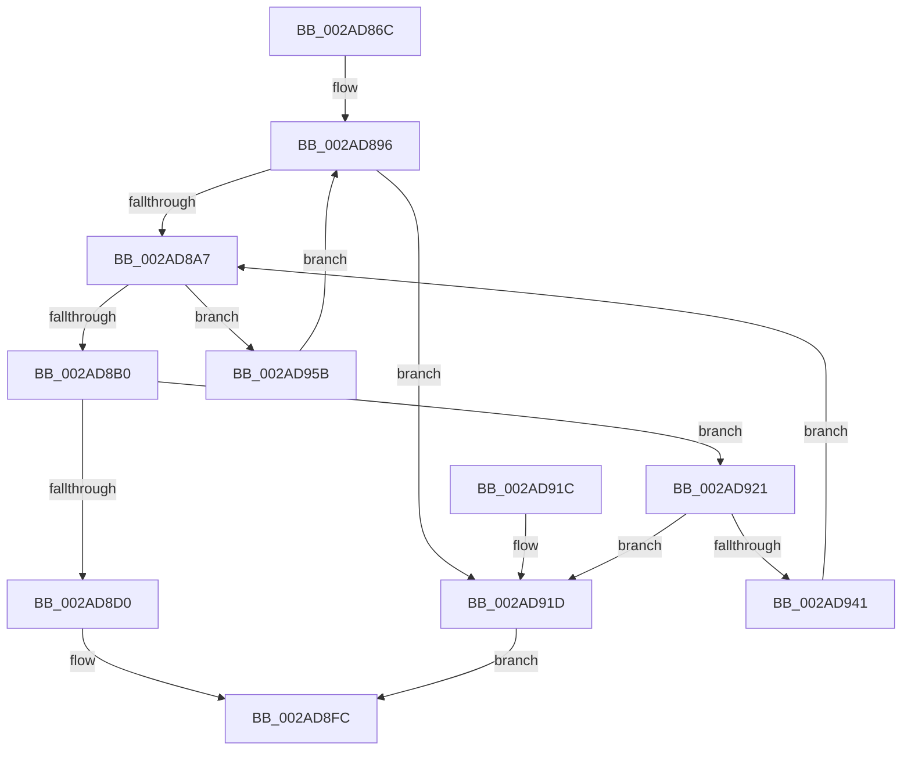

# MiLockActivePageTableInList

- RVA: `0x002AD86C`–`0x002AD968` (길이 `252` bytes)
- VA: `0x00000001402AD86C`
- 실행 섹션: `.text`
- PDB 이름 있음: `예`; PDB Function 태그: `아니요`
- unwind 정보 RVA: `0x0006D2DC`
- 디코드: `62`개 명령, `252/252` bytes 표시
- 미해석 바이트: `0` (있으면 어셈블리에 `.byte`로 보존)

> 이 문서는 커널 이미지의 기계어와 PDB 기호를 분석해 생성했습니다. 4번과 5번은 함수 원형과 자료형을 바이너리 사용 방식에서 추정한 C 해석이며 원본 소스 복구 결과는 아닙니다.

## 1. Dependencies

- 직접 호출 지점: **5**; 고유 호출 대상: **4**
- 직접 호출자로 확인된 함수: **1**
- RIP 상대 이미지 참조: **0**

### Outgoing calls
- `0x002AD899` → [ExAcquireSpinLockExclusiveAtDpcLevel](../24/ExAcquireSpinLockExclusiveAtDpcLevel_function_00248E80.md) (function, `0x00248E80`)
- `0x002AD8C7` → [MiTryLockPageTableUnordered](MiTryLockPageTableUnordered_function_002AD9D4.md) (function, `0x002AD9D4`)
- `0x002AD8F7` → [MiSetPfnOldestWsleLeafAge](../29/MiSetPfnOldestWsleLeafAge_function_00293AC4.md) (function, `0x00293AC4`)
- `0x002AD8FF` → [ExReleaseSpinLockExclusiveFromDpcLevel](../24/ExReleaseSpinLockExclusiveFromDpcLevel_function_002497E0.md) (function, `0x002497E0`)
- `0x002AD95E` → [ExReleaseSpinLockExclusiveFromDpcLevel](../24/ExReleaseSpinLockExclusiveFromDpcLevel_function_002497E0.md) (function, `0x002497E0`)

### Direct callers
- [MiFastTrimWorkingSet](MiFastTrimWorkingSet_function_002AD420.md) at `0x002AD48E`

### Static image references
- 디코드된 RIP-relative 메모리 참조가 없습니다.

## 2. Other-region calls and transfers

- 다른 실행 섹션으로 향하는 call: **0**
- 별도 외부 분기/꼬리 이동을 확인하지 못했습니다.

## 3. Assembly (complete function range)

```asm
002AD86C  48 89 5C 24 08                  mov qword ptr [rsp + 8], rbx
002AD871  48 89 6C 24 10                  mov qword ptr [rsp + 0x10], rbp
002AD876  48 89 74 24 18                  mov qword ptr [rsp + 0x18], rsi
002AD87B  57                              push rdi
002AD87C  48 83 EC 30                     sub rsp, 0x30
002AD880  0F B6 C2                        movzx eax, dl
002AD883  48 8B E9                        mov rbp, rcx
002AD886  48 8D 3C 40                     lea rdi, [rax + rax*2]
002AD88A  48 8B 41 10                     mov rax, qword ptr [rcx + 0x10]
002AD88E  48 8D 7F 08                     lea rdi, [rdi + 8]
002AD892  48 8D 3C F8                     lea rdi, [rax + rdi*8]
002AD896  48 8B CF                        mov rcx, rdi
002AD899  E8 E2 B5 F9 FF                  call 0x140248e80
002AD89E  48 8B 5F 08                     mov rbx, qword ptr [rdi + 8]
002AD8A2  48 85 DB                        test rbx, rbx
002AD8A5  74 76                           je 0x1402ad91d
002AD8A7  48 85 DB                        test rbx, rbx
002AD8AA  0F 84 AB 00 00 00               je 0x1402ad95b
002AD8B0  48 8B 73 08                     mov rsi, qword ptr [rbx + 8]
002AD8B4  48 B8 00 00 00 00 00 00 00 80   movabs rax, 0x8000000000000000
002AD8BE  48 0B F0                        or rsi, rax
002AD8C1  48 8B CD                        mov rcx, rbp
002AD8C4  48 8B D6                        mov rdx, rsi
002AD8C7  E8 08 01 00 00                  call 0x1402ad9d4
002AD8CC  85 C0                           test eax, eax
002AD8CE  74 51                           je 0x1402ad921
002AD8D0  4C 8B 03                        mov r8, qword ptr [rbx]
002AD8D3  48 8B D3                        mov rdx, rbx
002AD8D6  4C 8B 0B                        mov r9, qword ptr [rbx]
002AD8D9  48 8B CD                        mov rcx, rbp
002AD8DC  49 C1 E9 2D                     shr r9, 0x2d
002AD8E0  49 C1 E8 37                     shr r8, 0x37
002AD8E4  41 81 E1 FF 03 00 00            and r9d, 0x3ff
002AD8EB  41 80 E0 07                     and r8b, 7
002AD8EF  C7 44 24 20 01 00 00 00         mov dword ptr [rsp + 0x20], 1
002AD8F7  E8 C8 61 FE FF                  call 0x140293ac4
002AD8FC  48 8B CF                        mov rcx, rdi
002AD8FF  E8 DC BE F9 FF                  call 0x1402497e0
002AD904  48 8B 5C 24 40                  mov rbx, qword ptr [rsp + 0x40]
002AD909  48 8B C6                        mov rax, rsi
002AD90C  48 8B 74 24 50                  mov rsi, qword ptr [rsp + 0x50]
002AD911  48 8B 6C 24 48                  mov rbp, qword ptr [rsp + 0x48]
002AD916  48 83 C4 30                     add rsp, 0x30
002AD91A  5F                              pop rdi
002AD91B  C3                              ret
002AD91C  CC                              int3
002AD91D  33 F6                           xor esi, esi
002AD91F  EB DB                           jmp 0x1402ad8fc
002AD921  48 8B 43 10                     mov rax, qword ptr [rbx + 0x10]
002AD925  48 B9 FF FF FF FF FF 00 00 00   movabs rcx, 0xffffffffff
002AD92F  48 23 C1                        and rax, rcx
002AD932  48 B9 FF FF FF FF 3F 00 00 00   movabs rcx, 0x3fffffffff
002AD93C  48 3B C1                        cmp rax, rcx
002AD93F  74 DC                           je 0x1402ad91d
002AD941  48 8D 1C 40                     lea rbx, [rax + rax*2]
002AD945  48 C1 E3 04                     shl rbx, 4
002AD949  48 B8 00 00 00 00 00 DE FF FF   movabs rax, 0xffffde0000000000
002AD953  48 03 D8                        add rbx, rax
002AD956  E9 4C FF FF FF                  jmp 0x1402ad8a7
002AD95B  48 8B CF                        mov rcx, rdi
002AD95E  E8 7D BE F9 FF                  call 0x1402497e0
002AD963  E9 2E FF FF FF                  jmp 0x1402ad896
```

## 4. C-style interpretation (structured pseudocode)

```c
__int64 __fastcall MiLockActivePageTableInList(__int64 a1, unsigned __int8 a2)
{
    __int64 result;
    __int64 v_rbx;
    __int64 v_rsi;
    __int64 v_rsp;
    unsigned int v_stack_m18;
    unsigned __int64 v_stack_p10;
    unsigned __int64 v_stack_p18;
    unsigned __int64 v_stack_p8;

    v_stack_p8 = v_rbx;
    v_stack_p10 = v_rbp;
    v_stack_p18 = v_rsi;
    v_rsp = (v_rsp) - (48);
loc_002AD896:
    result = ExAcquireSpinLockExclusiveAtDpcLevel(*(unsigned __int64 *)(a1 + 16) + a2 + a2 * 2 + 8 * 8, a2, a3, a4);
    if (*(unsigned __int64 *)(*(unsigned __int64 *)(a1 + 16) + a2 + a2 * 2 + 8 * 8 + 8) == 0) goto loc_002AD91D;
loc_002AD8A7:
    if (*(unsigned __int64 *)(*(unsigned __int64 *)(a1 + 16) + a2 + a2 * 2 + 8 * 8 + 8) == 0) goto loc_002AD95B;
    v_rsi = (*(unsigned __int64 *)(*(unsigned __int64 *)(*(unsigned __int64 *)(a1 + 16) + a2 + a2 * 2 + 8 * 8 + 8) + 8)) | (result);
    result = MiTryLockPageTableUnordered(a1, v_rsi, a3, a4);
    if ((unsigned int)(result) == 0) goto loc_002AD921;
    a4 = (*(unsigned __int64 *)(*(unsigned __int64 *)(*(unsigned __int64 *)(a1 + 16) + a2 + a2 * 2 + 8 * 8 + 8))) >> (45);
    a3 = (*(unsigned __int64 *)(*(unsigned __int64 *)(*(unsigned __int64 *)(a1 + 16) + a2 + a2 * 2 + 8 * 8 + 8))) >> (55);
    a4 = (unsigned int)((a4) & (0x3FFULL));
    a3 = (unsigned __int8)((a3) & (7));
    v_stack_m18 = 1;
    result = MiSetPfnOldestWsleLeafAge(a1, *(unsigned __int64 *)(*(unsigned __int64 *)(a1 + 16) + a2 + a2 * 2 + 8 * 8 + 8), a3, a4);
loc_002AD8FC:
    result = ExReleaseSpinLockExclusiveFromDpcLevel(*(unsigned __int64 *)(a1 + 16) + a2 + a2 * 2 + 8 * 8, *(unsigned __int64 *)(*(unsigned __int64 *)(a1 + 16) + a2 + a2 * 2 + 8 * 8 + 8), a3, a4);
    v_rsp = (v_rsp) + (48);
    return v_rsi;
loc_002AD91D:
    v_rsi = 0;
    goto loc_002AD8FC;
loc_002AD921:
    result = (*(unsigned __int64 *)(v_stack_p8 + 16)) & (*(unsigned __int64 *)(a1 + 16) + a2 + a2 * 2 + 8 * 8);
    if (result == (*(unsigned __int64 *)(a1 + 16) + a2 + a2 * 2 + 8 * 8)) goto loc_002AD91D;
    v_rbx = (result + result * 2) << (4);
    v_rbx = (v_rbx) + (result);
    goto loc_002AD8A7;
loc_002AD95B:
    result = ExReleaseSpinLockExclusiveFromDpcLevel(*(unsigned __int64 *)(a1 + 16) + a2 + a2 * 2 + 8 * 8, *(unsigned __int64 *)(*(unsigned __int64 *)(a1 + 16) + a2 + a2 * 2 + 8 * 8 + 8), a3, a4);
    goto loc_002AD896;
}
```

## 5. (Beta) C Style

```c
int64_t MiLockActivePageTableInList(void *Arg1, void *Arg2)
{
    uint8_t *arg1 = (uint8_t *)Arg1;
    uint8_t *arg2 = (uint8_t *)Arg2;

    int64_t result;
    int64_t local_rbx;
    int64_t local_rsi;
    int64_t local_rsp;
    uint32_t v_stack_m18;
    uint64_t v_stack_p10;
    uint64_t v_stack_p18;
    uint64_t v_stack_p8;

    v_stack_p8 = local_rbx;
    v_stack_p10 = local_rbp;
    v_stack_p18 = local_rsi;
    local_rsp = (local_rsp) - (48);
loc_002AD896:
    result = ExAcquireSpinLockExclusiveAtDpcLevel(*(uint64_t *)(arg1 + 0x10) + Arg2 + Arg2 * 2 + 8 * 8, Arg2, a3, a4);
    if (*(uint64_t *)(*(uint64_t *)(arg1 + 0x10) + arg2 + arg2 * 2 + 0x8 * 8 + 0x8) == 0) goto loc_002AD91D;
loc_002AD8A7:
    if (*(uint64_t *)(*(uint64_t *)(arg1 + 0x10) + arg2 + arg2 * 2 + 0x8 * 8 + 0x8) == 0) goto loc_002AD95B;
    local_rsi = (*(uint64_t *)(*(uint64_t *)(*(uint64_t *)(arg1 + 0x10) + arg2 + arg2 * 2 + 0x8 * 8 + 0x8) + 0x8)) | (result);
    result = MiTryLockPageTableUnordered(Arg1, local_rsi, a3, a4);
    if ((uint32_t)(result) == 0) goto loc_002AD921;
    a4 = (*(uint64_t *)(*(uint64_t *)(*(uint64_t *)(arg1 + 0x10) + arg2 + arg2 * 2 + 0x8 * 8 + 0x8))) >> (45);
    a3 = (*(uint64_t *)(*(uint64_t *)(*(uint64_t *)(arg1 + 0x10) + arg2 + arg2 * 2 + 0x8 * 8 + 0x8))) >> (55);
    a4 = (uint32_t)((a4) & (0x3FFULL));
    a3 = (uint8_t)((a3) & (7));
    v_stack_m18 = 1;
    result = MiSetPfnOldestWsleLeafAge(Arg1, *(uint64_t *)(*(uint64_t *)(arg1 + 0x10) + arg2 + arg2 * 2 + 0x8 * 8 + 0x8), a3, a4);
loc_002AD8FC:
    result = ExReleaseSpinLockExclusiveFromDpcLevel(*(uint64_t *)(arg1 + 0x10) + Arg2 + Arg2 * 2 + 8 * 8, *(uint64_t *)(*(uint64_t *)(arg1 + 0x10) + arg2 + arg2 * 2 + 0x8 * 8 + 0x8), a3, a4);
    local_rsp = (local_rsp) + (48);
    return local_rsi;
loc_002AD91D:
    local_rsi = 0;
    goto loc_002AD8FC;
loc_002AD921:
    result = (*(uint64_t *)(v_stack_p8 + 0x10)) & (*(uint64_t *)(arg1 + 0x10) + Arg2 + Arg2 * 2 + 8 * 8);
    if (result == (*(uint64_t *)(arg1 + 0x10) + Arg2 + Arg2 * 2 + 8 * 8)) goto loc_002AD91D;
    local_rbx = (result + result * 2) << (4);
    local_rbx = (local_rbx) + (result);
    goto loc_002AD8A7;
loc_002AD95B:
    result = ExReleaseSpinLockExclusiveFromDpcLevel(*(uint64_t *)(arg1 + 0x10) + Arg2 + Arg2 * 2 + 8 * 8, *(uint64_t *)(*(uint64_t *)(arg1 + 0x10) + arg2 + arg2 * 2 + 0x8 * 8 + 0x8), a3, a4);
    goto loc_002AD896;
}
```

### 관측된 메모리 오프셋

구조체 형식이 확인되지 않은 접근은 인자 기준의 오프셋으로만 기록했습니다.

| 기준 인자 | 오프셋 표현 | 폭 (bit) | 접근 |
|---|---:|---:|---|
| `Arg1` | `+ 0x10` | `64` | `R` |
| `Arg2` | `+ 0x0 + rax*2` | `64` | `R` |
| `Arg2` | `+ 0x8` | `64` | `R` |

## 6. Execution-region graph

[열기: 2D/3D 그래프와 함수 탐색 컨트롤 패널](../../../control-panel.html?section=text&rva=0x002AD86C&view=graph)

- 2D 그래프는 위에서 아래로 흐르고, 3D 그래프는 빈 공간을 드래그해 회전합니다. Shift+드래그는 이동, 휠은 확대·축소, 함수 노드 선택은 대상 보고서 이동입니다.

### Static fallback


