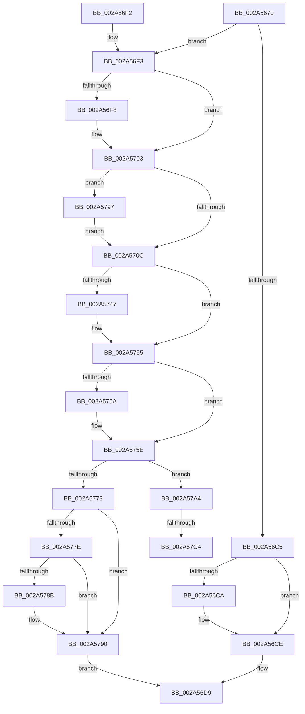

# MiLockAddressSpaceToo

- RVA: `0x002A5670`–`0x002A57D8` (길이 `360` bytes)
- VA: `0x00000001402A5670`
- 실행 섹션: `.text`
- PDB 이름 있음: `예`; PDB Function 태그: `예`
- unwind 정보 RVA: `0x00067CD4`
- 디코드: `98`개 명령, `360/360` bytes 표시
- 미해석 바이트: `0` (있으면 어셈블리에 `.byte`로 보존)

> 이 문서는 커널 이미지의 기계어와 PDB 기호를 분석해 생성했습니다. 4번과 5번은 함수 원형과 자료형을 바이너리 사용 방식에서 추정한 C 해석이며 원본 소스 복구 결과는 아닙니다.

## 1. Dependencies

- 직접 호출 지점: **10**; 고유 호출 대상: **7**
- 직접 호출자로 확인된 함수: **2**
- RIP 상대 이미지 참조: **0**

### Outgoing calls
- `0x002A56B8` → [KeAbPreAcquire](../21/KeAbPreAcquire_function_00210230.md) (function, `0x00210230`)
- `0x002A56FE` → [KeAbPostReleaseEx](../26/KeAbPostReleaseEx_function_00262210.md) (function, `0x00262210`)
- `0x002A5712` → [MiUnlockVad](MiUnlockVad_function_002A59C8.md) (function, `0x002A59C8`)
- `0x002A571D` → [LOCK_ADDRESS_SPACE](LOCK_ADDRESS_SPACE_function_002A4944.md) (function, `0x002A4944`)
- `0x002A5736` → [KeAbPreAcquire](../21/KeAbPreAcquire_function_00210230.md) (function, `0x00210230`)
- `0x002A5750` → [ExfAcquirePushLockExclusiveEx](../20/ExfAcquirePushLockExclusiveEx_function_0020FC90.md) (function, `0x0020FC90`)
- `0x002A578B` → [KiCheckForKernelApcDelivery](../2E/KiCheckForKernelApcDelivery_function_002E2C80.md) (function, `0x002E2C80`)
- `0x002A579A` → [MiUnlockNestedVad](../../page/A2/MiUnlockNestedVad_function_00A26BC4.md) (function, `0x00A26BC4`)
- `0x002A57B0` → [KeAbPreAcquire](../21/KeAbPreAcquire_function_00210230.md) (function, `0x00210230`)
- `0x002A57CD` → [ExfAcquirePushLockExclusiveEx](../20/ExfAcquirePushLockExclusiveEx_function_0020FC90.md) (function, `0x0020FC90`)

### Direct callers
- [MiDeleteVad](../../page/88/MiDeleteVad_function_00888C80.md) at `0x00888EDF`
- [MiPrepareVadDelete](../../page/A2/MiPrepareVadDelete_function_00A25E98.md) at `0x00A25F40`

### Static image references
- 디코드된 RIP-relative 메모리 참조가 없습니다.

## 2. Other-region calls and transfers

- 다른 실행 섹션으로 향하는 call: **1**
  - `0x002A579A` → [MiUnlockNestedVad](../../page/A2/MiUnlockNestedVad_function_00A26BC4.md) (`.text` → `PAGE`)
- call이 아닌 외부 분기/꼬리 이동: **2**
  - `0x002A57BE` → [sub_006DAEA8](../6D/Unknown_function_006DAEA8.md) (`tail-transfer`)
  - `0x002A57D3` → [sub_006DAEA8](../6D/Unknown_function_006DAEA8.md) (`tail-transfer`)

## 3. Assembly (complete function range)

```asm
002A5670  48 89 5C 24 08                  mov qword ptr [rsp + 8], rbx
002A5675  48 89 6C 24 10                  mov qword ptr [rsp + 0x10], rbp
002A567A  48 89 74 24 18                  mov qword ptr [rsp + 0x18], rsi
002A567F  57                              push rdi
002A5680  41 56                           push r14
002A5682  41 57                           push r15
002A5684  48 83 EC 20                     sub rsp, 0x20
002A5688  65 48 8B 1C 25 88 01 00 00      mov rbx, qword ptr gs:[0x188]
002A5691  48 8D B1 58 02 00 00            lea rsi, [rcx + 0x258]
002A5698  41 BF 01 00 00 00               mov r15d, 1
002A569E  49 8B F8                        mov rdi, r8
002A56A1  48 8B EA                        mov rbp, rdx
002A56A4  4C 8B F1                        mov r14, rcx
002A56A7  45 8B C7                        mov r8d, r15d
002A56AA  33 D2                           xor edx, edx
002A56AC  66 44 29 BB E6 01 00 00         sub word ptr [rbx + 0x1e6], r15w
002A56B4  48 8B CE                        mov rcx, rsi
002A56B7  90                              nop
002A56B8  E8 73 AB F6 FF                  call 0x140210230
002A56BD  F0 48 0F BA 2E 00               lock bts qword ptr [rsi], 0
002A56C3  72 2E                           jb 0x1402a56f3
002A56C5  48 85 C0                        test rax, rax
002A56C8  74 04                           je 0x1402a56ce
002A56CA  44 88 78 0A                     mov byte ptr [rax + 0xa], r15b
002A56CE  44 08 BB A8 05 00 00            or byte ptr [rbx + 0x5a8], r15b
002A56D5  41 8B C7                        mov eax, r15d
002A56D8  90                              nop
002A56D9  48 8B 5C 24 40                  mov rbx, qword ptr [rsp + 0x40]
002A56DE  48 8B 6C 24 48                  mov rbp, qword ptr [rsp + 0x48]
002A56E3  48 8B 74 24 50                  mov rsi, qword ptr [rsp + 0x50]
002A56E8  48 83 C4 20                     add rsp, 0x20
002A56EC  41 5F                           pop r15
002A56EE  41 5E                           pop r14
002A56F0  5F                              pop rdi
002A56F1  C3                              ret
002A56F2  CC                              int3
002A56F3  48 85 C0                        test rax, rax
002A56F6  74 0B                           je 0x1402a5703
002A56F8  48 8B D0                        mov rdx, rax
002A56FB  48 8B CE                        mov rcx, rsi
002A56FE  E8 0D CB FB FF                  call 0x140262210
002A5703  48 85 FF                        test rdi, rdi
002A5706  0F 85 8B 00 00 00               jne 0x1402a5797
002A570C  48 8B D5                        mov rdx, rbp
002A570F  48 8B CB                        mov rcx, rbx
002A5712  E8 B1 02 00 00                  call 0x1402a59c8
002A5717  49 8B D6                        mov rdx, r14
002A571A  48 8B CB                        mov rcx, rbx
002A571D  E8 22 F2 FF FF                  call 0x1402a4944
002A5722  66 FF 8B E6 01 00 00            dec word ptr [rbx + 0x1e6]
002A5729  48 83 C5 28                     add rbp, 0x28
002A572D  48 8B CD                        mov rcx, rbp
002A5730  45 33 C0                        xor r8d, r8d
002A5733  33 D2                           xor edx, edx
002A5735  90                              nop
002A5736  E8 F5 AA F6 FF                  call 0x140210230
002A573B  F0 48 0F BA 6D 00 00            lock bts qword ptr [rbp], 0
002A5742  48 8B F0                        mov rsi, rax
002A5745  73 0E                           jae 0x1402a5755
002A5747  4C 8B C5                        mov r8, rbp
002A574A  48 8B D0                        mov rdx, rax
002A574D  48 8B CD                        mov rcx, rbp
002A5750  E8 3B A5 F6 FF                  call 0x14020fc90
002A5755  48 85 F6                        test rsi, rsi
002A5758  74 04                           je 0x1402a575e
002A575A  44 88 7E 0A                     mov byte ptr [rsi + 0xa], r15b
002A575E  8B 83 A8 05 00 00               mov eax, dword ptr [rbx + 0x5a8]
002A5764  0F BA E8 07                     bts eax, 7
002A5768  89 83 A8 05 00 00               mov dword ptr [rbx + 0x5a8], eax
002A576E  48 85 FF                        test rdi, rdi
002A5771  75 31                           jne 0x1402a57a4
002A5773  90                              nop
002A5774  66 44 01 BB E6 01 00 00         add word ptr [rbx + 0x1e6], r15w
002A577C  75 12                           jne 0x1402a5790
002A577E  48 8D 83 98 00 00 00            lea rax, [rbx + 0x98]
002A5785  90                              nop
002A5786  48 39 00                        cmp qword ptr [rax], rax
002A5789  74 05                           je 0x1402a5790
002A578B  E8 F0 D4 03 00                  call 0x1402e2c80
002A5790  33 C0                           xor eax, eax
002A5792  E9 42 FF FF FF                  jmp 0x1402a56d9
002A5797  48 8B CF                        mov rcx, rdi
002A579A  E8 25 14 78 00                  call 0x140a26bc4
002A579F  E9 68 FF FF FF                  jmp 0x1402a570c
002A57A4  48 83 C7 28                     add rdi, 0x28
002A57A8  45 33 C0                        xor r8d, r8d
002A57AB  48 8B CF                        mov rcx, rdi
002A57AE  33 D2                           xor edx, edx
002A57B0  E8 7B AA F6 FF                  call 0x140210230
002A57B5  F0 48 0F BA 2F 00               lock bts qword ptr [rdi], 0
002A57BB  48 8B F0                        mov rsi, rax
002A57BE  0F 83 E4 56 43 00               jae 0x1406daea8
002A57C4  4C 8B C7                        mov r8, rdi
002A57C7  48 8B D0                        mov rdx, rax
002A57CA  48 8B CF                        mov rcx, rdi
002A57CD  E8 BE A4 F6 FF                  call 0x14020fc90
002A57D2  90                              nop
002A57D3  E9 D0 56 43 00                  jmp 0x1406daea8
```

## 4. C-style interpretation (structured pseudocode)

```c
__int64 __fastcall MiLockAddressSpaceToo(__int64 a1, __int64 a2, __int64 a3)
{
    __int64 result;
    __int64 v_rbp;
    __int64 v_rdi;
    __int64 v_rsp;
    unsigned __int64 v_stack_p10;
    unsigned __int64 v_stack_p18;
    unsigned __int64 v_stack_p8;

    v_stack_p8 = v_rbx;
    v_stack_p10 = v_rbp;
    v_stack_p18 = v_rsi;
    v_rsp = (v_rsp) - (32);
    a2 = 0;
    result = KeAbPreAcquire(a1 + 600, a2, 1, a4);
    if (condition_is_below) goto loc_002A56F3;
    if (result != 0) {
        *(unsigned __int8 *)(result + 10) = 1;
    }
loc_002A56D9:
    v_rsp = (v_rsp) + (32);
    return 1;
loc_002A56F3:
    result = 1;
    if (1 != 0) {
        a2 = 1;
        a1 = v_stack_p18;
        result = KeAbPostReleaseEx(a1, a2, 1, a4);
    }
    if (a3 != 0) goto loc_002A5797;
loc_002A570C:
    result = MiUnlockVad(v_stack_p8, v_stack_p10, 1, a4);
    result = LOCK_ADDRESS_SPACE(v_stack_p8, a1, 1, a4);
    v_rbp = (v_stack_p10) + (40);
    a3 = 0;
    a2 = 0;
    result = KeAbPreAcquire(v_rbp, a2, a3, a4);
    if (!(condition_is_above_or_equal)) {
        a3 = v_rbp;
        a2 = result;
        a1 = v_rbp;
        result = ExfAcquirePushLockExclusiveEx(a1, a2, a3, a4);
    }
    if (result != 0) {
        *(unsigned __int8 *)(result + 10) = 1;
    }
    *(unsigned int *)(v_stack_p8 + 1448) = (unsigned int)((unsigned int)(*(unsigned int *)(v_stack_p8 + 1448)));
    if (a3 != 0) goto loc_002A57A4;
    if (a3 != 0) goto loc_002A5790;
    result = v_stack_p8 + 152;
    if ((*(unsigned __int64 *)(v_stack_p8 + 152)) != (v_stack_p8 + 152)) {
        result = KiCheckForKernelApcDelivery(a1, a2, a3, a4);
    }
    result = 0;
    goto loc_002A56D9;
loc_002A5797:
    result = MiUnlockNestedVad(a3, a2, a3, a4);
    goto loc_002A570C;
loc_002A57A4:
    v_rdi = (a3) + (40);
    a3 = 0;
    a2 = 0;
    result = KeAbPreAcquire(v_rdi, a2, a3, a4);
    result = ExfAcquirePushLockExclusiveEx(v_rdi, result, v_rdi, a4);
}
```

## 5. (Beta) C Style

```c
int64_t MiLockAddressSpaceToo(void *Arg1, void *Arg2, int64_t Arg3)
{
    uint8_t *arg1 = (uint8_t *)Arg1;
    uint8_t *arg2 = (uint8_t *)Arg2;

    int64_t result;
    int64_t local_rbp;
    int64_t local_rdi;
    int64_t local_rsp;
    uint64_t v_stack_p10;
    uint64_t v_stack_p18;
    uint64_t v_stack_p8;

    v_stack_p8 = local_rbx;
    v_stack_p10 = local_rbp;
    v_stack_p18 = local_rsi;
    local_rsp = (local_rsp) - (32);
    Arg2 = 0;
    result = KeAbPreAcquire(Arg1 + 600, Arg2, 1, a4);
    if (condition_is_below) goto loc_002A56F3;
    if (result != 0) {
        *(uint8_t *)(result + 0xA) = 1;
    }
loc_002A56D9:
    local_rsp = (local_rsp) + (32);
    return 1;
loc_002A56F3:
    result = 1;
    if (1 != 0) {
        Arg2 = 1;
        Arg1 = v_stack_p18;
        result = KeAbPostReleaseEx(Arg1, Arg2, 1, a4);
    }
    if (Arg3 != 0) goto loc_002A5797;
loc_002A570C:
    result = MiUnlockVad(v_stack_p8, v_stack_p10, 1, a4);
    result = LOCK_ADDRESS_SPACE(v_stack_p8, Arg1, 1, a4);
    local_rbp = (v_stack_p10) + (40);
    Arg3 = 0;
    Arg2 = 0;
    result = KeAbPreAcquire(local_rbp, Arg2, Arg3, a4);
    if (!(condition_is_above_or_equal)) {
        Arg3 = local_rbp;
        Arg2 = result;
        Arg1 = local_rbp;
        result = ExfAcquirePushLockExclusiveEx(Arg1, Arg2, Arg3, a4);
    }
    if (result != 0) {
        *(uint8_t *)(result + 0xA) = 1;
    }
    *(uint32_t *)(v_stack_p8 + 0x5A8) = (uint32_t)((uint32_t)(*(uint32_t *)(v_stack_p8 + 0x5A8)));
    if (Arg3 != 0) goto loc_002A57A4;
    if (Arg3 != 0) goto loc_002A5790;
    result = v_stack_p8 + 152;
    if ((*(uint64_t *)(v_stack_p8 + 0x98)) != (v_stack_p8 + 152)) {
        result = KiCheckForKernelApcDelivery(Arg1, Arg2, Arg3, a4);
    }
    result = 0;
    goto loc_002A56D9;
loc_002A5797:
    result = MiUnlockNestedVad(Arg3, Arg2, Arg3, a4);
    goto loc_002A570C;
loc_002A57A4:
    local_rdi = (Arg3) + (40);
    Arg3 = 0;
    Arg2 = 0;
    result = KeAbPreAcquire(local_rdi, Arg2, Arg3, a4);
    result = ExfAcquirePushLockExclusiveEx(local_rdi, result, local_rdi, a4);
}
```

### 관측된 메모리 오프셋

구조체 형식이 확인되지 않은 접근은 인자 기준의 오프셋으로만 기록했습니다.

| 기준 인자 | 오프셋 표현 | 폭 (bit) | 접근 |
|---|---:|---:|---|
| `Arg1` | `+ 0x0` | `64` | `R/W` |
| `Arg1` | `+ 0x258` | `64` | `R` |
| `Arg2` | `+ 0x0` | `64` | `R/W` |

## 6. Execution-region graph

[열기: 2D/3D 그래프와 함수 탐색 컨트롤 패널](../../../control-panel.html?section=text&rva=0x002A5670&view=graph)

- 2D 그래프는 위에서 아래로 흐르고, 3D 그래프는 빈 공간을 드래그해 회전합니다. Shift+드래그는 이동, 휠은 확대·축소, 함수 노드 선택은 대상 보고서 이동입니다.

### Static fallback


