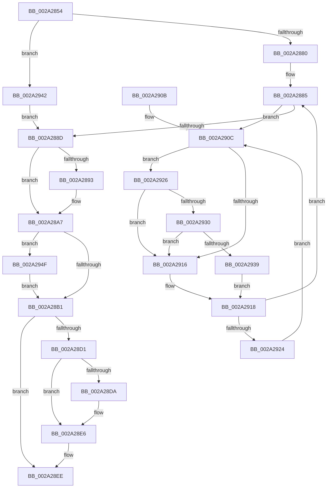

# MiLockAndDecrementShareCount

- RVA: `0x002A2854`–`0x002A2961` (길이 `269` bytes)
- VA: `0x00000001402A2854`
- 실행 섹션: `.text`
- PDB 이름 있음: `예`; PDB Function 태그: `아니요`
- unwind 정보 RVA: `0x000685D0`
- 디코드: `72`개 명령, `269/269` bytes 표시
- 미해석 바이트: `0` (있으면 어셈블리에 `.byte`로 보존)

> 이 문서는 커널 이미지의 기계어와 PDB 기호를 분석해 생성했습니다. 4번과 5번은 함수 원형과 자료형을 바이너리 사용 방식에서 추정한 C 해석이며 원본 소스 복구 결과는 아닙니다.

## 1. Dependencies

- 직접 호출 지점: **6**; 고유 호출 대상: **6**
- 직접 호출자로 확인된 함수: **24**
- RIP 상대 이미지 참조: **3**

### Outgoing calls
- `0x002A28B6` → [MiDecrementShareCountEx](../33/MiDecrementShareCountEx_function_00333F70.md) (function, `0x00333F70`)
- `0x002A28E1` → [KiLowerIrqlProcessIrqlFlags](../4F/KiLowerIrqlProcessIrqlFlags_function_004F5698.md) (function, `0x004F5698`)
- `0x002A2930` → [KiCheckVpBackingLongSpinWaitHypercall](../30/KiCheckVpBackingLongSpinWaitHypercall_function_0030F490.md) (function, `0x0030F490`)
- `0x002A293B` → [HvlNotifyLongSpinWait](../30/HvlNotifyLongSpinWait_function_0030F460.md) (function, `0x0030F460`)
- `0x002A2942` → [MiLockPageInline](../31/MiLockPageInline_function_0031A340.md) (function, `0x0031A340`)
- `0x002A2957` → [MiDecreaseUsedPtesInPfn](MiDecreaseUsedPtesInPfn_function_002A27AC.md) (function, `0x002A27AC`)

### Direct callers
- [MiDemoteCombinedPte](../22/MiDemoteCombinedPte_function_0022ABAC.md) at `0x0022AE9F`
- [MiCombineInitialInstance](../22/MiCombineInitialInstance_function_0022BC0C.md) at `0x0022C523`
- [MiResolveProtoCombine](../22/MiResolveProtoCombine_function_0022CD00.md) at `0x0022D0A9`
- [MiResolveProtoCombine](../22/MiResolveProtoCombine_function_0022CD00.md) at `0x0022D0B3`
- [MiHandleForkTransitionPte](../22/MiHandleForkTransitionPte_function_0022D34C.md) at `0x0022D777`
- [MiResolveTransitionFault](../28/MiResolveTransitionFault_function_00282940.md) at `0x002837DB`
- [MiOutPageSingleKernelStack](MiOutPageSingleKernelStack_function_002A1790.md) at `0x002A1984`
- [MiAddSystemPageTableToList](MiAddSystemPageTableToList_function_002A23A4.md) at `0x002A248A`
- [MmFreeIndependentPages](MmFreeIndependentPages_function_002A2510.md) at `0x002A2606`
- [MiMakeSystemCachePteValid](MiMakeSystemCachePteValid_function_002A35D8.md) at `0x002A3673`
- [MiReleaseInPageRefs](MiReleaseInPageRefs_function_002A4214.md) at `0x002A426B`
- [MiCreateSharedZeroPages](../2B/MiCreateSharedZeroPages_function_002B6318.md) at `0x002B66ED`
- [MiCompleteRestrictedImageFault](../2C/MiCompleteRestrictedImageFault_function_002C60D4.md) at `0x002C6471`
- [MiCompleteProtoPteFault](../34/MiCompleteProtoPteFault_function_00345710.md) at `0x00346234`
- [MiCompleteProtoPteFault](../34/MiCompleteProtoPteFault_function_00345710.md) at `0x0034630E`
- [MiCompleteProtoPteFault](../34/MiCompleteProtoPteFault_function_00345710.md) at `0x0034669E`
- [MiCompleteProtoPteFault](../34/MiCompleteProtoPteFault_function_00345710.md) at `0x003466B1`
- [MiDecommitLargePoolVa](../37/MiDecommitLargePoolVa_function_00377DD4.md) at `0x00377E4B`
- [MiIssueHardFault](../38/MiIssueHardFault_function_00380074.md) at `0x0038085F`
- [MiUnmapKernelScp](../4A/MiUnmapKernelScp_function_004A82E8.md) at `0x004A846C`
- [MiUnmapKernelScp](../4A/MiUnmapKernelScp_function_004A82E8.md) at `0x004A848C`
- [MiMarkBootGuardPage](../68/MiMarkBootGuardPage_function_0068643C.md) at `0x00686526`
- [MiMarkBootGuardPage](../68/MiMarkBootGuardPage_function_0068643C.md) at `0x00686532`
- [MiOutSwapFreeSoftWslePxe](../69/MiOutSwapFreeSoftWslePxe_function_00697928.md) at `0x00697962`
- [sub_006D7070](../6D/Unknown_function_006D7070.md) at `0x006D711E`
- [sub_006E82CE](../6E/Unknown_function_006E82CE.md) at `0x006E849A`
- [sub_006E82CE](../6E/Unknown_function_006E82CE.md) at `0x006E84A7`
- [MiCaptureSparsePages](../../page/80/MiCaptureSparsePages_function_0080BAF8.md) at `0x0080BB96`
- [MiClearStaleSecurePageMapping](../../init/C6/MiClearStaleSecurePageMapping_function_00C61CD8.md) at `0x00C61D57`
- [MiInitializeBootShadowStackPage](../../init/C6/MiInitializeBootShadowStackPage_function_00C67D8C.md) at `0x00C67EF7`
- [MiInitializeBootShadowStackPage](../../init/C6/MiInitializeBootShadowStackPage_function_00C67D8C.md) at `0x00C67F01`
- [MiFreeBootDriverPages](../../init/C7/MiFreeBootDriverPages_function_00C7695C.md) at `0x00C76B7B`

### Static image references
- `0x002A28D1` → RVA `0x00FC6D20` (`ALMOSTRO`; read)
- `0x002A290E` → RVA `0x00FC52AC` (`ALMOSTRO`; reference)
- `0x002A2926` → RVA `0x00FC6AB8` (`ALMOSTRO`; read)

## 2. Other-region calls and transfers

- 다른 실행 섹션으로 향하는 call: **0**
- 별도 외부 분기/꼬리 이동을 확인하지 못했습니다.

## 3. Assembly (complete function range)

```asm
002A2854  48 8B C4                        mov rax, rsp
002A2857  48 89 58 08                     mov qword ptr [rax + 8], rbx
002A285B  48 89 68 10                     mov qword ptr [rax + 0x10], rbp
002A285F  48 89 70 18                     mov qword ptr [rax + 0x18], rsi
002A2863  48 89 78 20                     mov qword ptr [rax + 0x20], rdi
002A2867  41 56                           push r14
002A2869  48 83 EC 20                     sub rsp, 0x20
002A286D  48 8D 59 18                     lea rbx, [rcx + 0x18]
002A2871  44 8B F2                        mov r14d, edx
002A2874  48 8B E9                        mov rbp, rcx
002A2877  F6 C2 02                        test dl, 2
002A287A  0F 84 C2 00 00 00               je 0x1402a2942
002A2880  40 B7 11                        mov dil, 0x11
002A2883  33 F6                           xor esi, esi
002A2885  F0 48 0F BA 2B 3F               lock bts qword ptr [rbx], 0x3f
002A288B  72 7F                           jb 0x1402a290c
002A288D  41 F6 C6 01                     test r14b, 1
002A2891  74 14                           je 0x1402a28a7
002A2893  48 8B 0B                        mov rcx, qword ptr [rbx]
002A2896  48 B8 00 00 00 00 00 00 00 40   movabs rax, 0x4000000000000000
002A28A0  48 0B C8                        or rcx, rax
002A28A3  48 89 4D 18                     mov qword ptr [rbp + 0x18], rcx
002A28A7  41 F6 C6 04                     test r14b, 4
002A28AB  0F 85 9E 00 00 00               jne 0x1402a294f
002A28B1  33 D2                           xor edx, edx
002A28B3  48 8B CD                        mov rcx, rbp
002A28B6  E8 B5 16 09 00                  call 0x140333f70
002A28BB  8B F0                           mov esi, eax
002A28BD  48 B8 FF FF FF FF FF FF FF 7F   movabs rax, 0x7fffffffffffffff
002A28C7  F0 48 21 03                     lock and qword ptr [rbx], rax
002A28CB  40 80 FF 02                     cmp dil, 2
002A28CF  73 1D                           jae 0x1402a28ee
002A28D1  83 3D 48 44 D2 00 00            cmp dword ptr [rip + 0xd24448], 0
002A28D8  74 0C                           je 0x1402a28e6
002A28DA  44 0F 20 C1                     mov rcx, cr8
002A28DE  40 8A D7                        mov dl, dil
002A28E1  E8 B2 2D 25 00                  call 0x1404f5698
002A28E6  40 0F B6 C7                     movzx eax, dil
002A28EA  44 0F 22 C0                     mov cr8, rax
002A28EE  48 8B 5C 24 30                  mov rbx, qword ptr [rsp + 0x30]
002A28F3  8B C6                           mov eax, esi
002A28F5  48 8B 74 24 40                  mov rsi, qword ptr [rsp + 0x40]
002A28FA  48 8B 6C 24 38                  mov rbp, qword ptr [rsp + 0x38]
002A28FF  48 8B 7C 24 48                  mov rdi, qword ptr [rsp + 0x48]
002A2904  48 83 C4 20                     add rsp, 0x20
002A2908  41 5E                           pop r14
002A290A  C3                              ret
002A290B  CC                              int3
002A290C  FF C6                           inc esi
002A290E  85 35 98 29 D2 00               test dword ptr [rip + 0xd22998], esi
002A2914  74 10                           je 0x1402a2926
002A2916  F3 90                           pause
002A2918  48 8B 03                        mov rax, qword ptr [rbx]
002A291B  48 85 C0                        test rax, rax
002A291E  0F 89 61 FF FF FF               jns 0x1402a2885
002A2924  EB E6                           jmp 0x1402a290c
002A2926  8B 05 8C 41 D2 00               mov eax, dword ptr [rip + 0xd2418c]
002A292C  A8 40                           test al, 0x40
002A292E  74 E6                           je 0x1402a2916
002A2930  E8 5B CB 06 00                  call 0x14030f490
002A2935  84 C0                           test al, al
002A2937  74 DD                           je 0x1402a2916
002A2939  8B CE                           mov ecx, esi
002A293B  E8 20 CB 06 00                  call 0x14030f460
002A2940  EB D6                           jmp 0x1402a2918
002A2942  E8 F9 79 07 00                  call 0x14031a340
002A2947  40 8A F8                        mov dil, al
002A294A  E9 3E FF FF FF                  jmp 0x1402a288d
002A294F  BA 01 00 00 00                  mov edx, 1
002A2954  48 8B CD                        mov rcx, rbp
002A2957  E8 50 FE FF FF                  call 0x1402a27ac
002A295C  E9 50 FF FF FF                  jmp 0x1402a28b1
```

## 4. C-style interpretation (structured pseudocode)

```c
__int64 __fastcall MiLockAndDecrementShareCount(__int64 a1, int a2)
{
    __int64 result;
    __int64 v_rsi;
    __int64 v_rsp;
    unsigned __int64 v_stack_p10;
    unsigned __int64 v_stack_p18;
    unsigned __int64 v_stack_p20;
    unsigned __int64 v_stack_p8;

    *(unsigned __int64 *)(v_rsp + 8) = v_rbx;
    *(unsigned __int64 *)(v_rsp + 16) = v_rbp;
    *(unsigned __int64 *)(v_rsp + 24) = v_rsi;
    *(unsigned __int64 *)(v_rsp + 32) = v_rdi;
    v_rsp = (v_rsp) - (32);
    if ((((unsigned __int8)(a2)) & (2)) == 0) goto loc_002A2942;
    v_rsi = 0;
loc_002A2885:
    if (condition_is_below) goto loc_002A290C;
loc_002A288D:
    if ((((unsigned __int8)((unsigned int)(a2))) & (1)) != 0) {
        a1 = *(unsigned __int64 *)(a1 + 24);
        a1 = (a1) | (v_rsp);
        *(unsigned __int64 *)(a1 + 24) = a1;
    }
    if ((((unsigned __int8)((unsigned int)(a2))) & (4)) != 0) goto loc_002A294F;
loc_002A28B1:
    a2 = 0;
    result = MiDecrementShareCountEx(a1, a2, a3, a4);
    if (17 >= 2) goto loc_002A28EE;
    if ((*(unsigned int *)(v_rip + 13780040)) != 0) {
        a1 = v_cr8;
        a2 = 17;
        result = KiLowerIrqlProcessIrqlFlags(a1, a2, a3, a4);
    }
loc_002A28EE:
    v_rsp = (v_rsp) + (32);
    return (unsigned int)((unsigned int)((unsigned int)((unsigned int)(result))));
loc_002A290C:
    v_rsi = (unsigned int)((v_stack_p18) + 1);
    if (((*(unsigned int *)(v_rip + 13773208)) & ((unsigned int)(v_rsi))) == 0) goto loc_002A2926;
loc_002A2916:
loc_002A2918:
    if (!sign_flag) goto loc_002A2885;
    goto loc_002A290C;
loc_002A2926:
    if ((((unsigned __int8)((unsigned int)(*(unsigned int *)(v_rip + 13779340)))) & (64)) == 0) goto loc_002A2916;
    result = KiCheckVpBackingLongSpinWaitHypercall(a1, a2, a3, a4);
    if ((unsigned __int8)(result) == 0) goto loc_002A2916;
    result = HvlNotifyLongSpinWait((unsigned int)((unsigned int)(v_rsi)), a2, a3, a4);
    goto loc_002A2918;
loc_002A2942:
    result = MiLockPageInline((unsigned int)((unsigned int)(v_rsi)), a2, a3, a4);
    goto loc_002A288D;
loc_002A294F:
    result = MiDecreaseUsedPtesInPfn(v_stack_p10, 1, a3, a4);
    goto loc_002A28B1;
}
```

## 5. (Beta) C Style

```c
int64_t MiLockAndDecrementShareCount(void *Arg1, int32_t Arg2)
{
    uint8_t *arg1 = (uint8_t *)Arg1;

    int64_t result;
    int64_t local_rsi;
    int64_t local_rsp;
    uint64_t v_stack_p10;
    uint64_t v_stack_p18;
    uint64_t v_stack_p20;
    uint64_t v_stack_p8;

    *(uint64_t *)(local_rsp + 0x8) = local_rbx;
    *(uint64_t *)(local_rsp + 0x10) = local_rbp;
    *(uint64_t *)(local_rsp + 0x18) = local_rsi;
    *(uint64_t *)(local_rsp + 0x20) = local_rdi;
    local_rsp = (local_rsp) - (32);
    if ((((uint8_t)(Arg2)) & (2)) == 0) goto loc_002A2942;
    local_rsi = 0;
loc_002A2885:
    if (condition_is_below) goto loc_002A290C;
loc_002A288D:
    if ((((uint8_t)((uint32_t)(Arg2))) & (1)) != 0) {
        Arg1 = *(uint64_t *)(arg1 + 0x18);
        Arg1 = (Arg1) | (local_rsp);
        *(void **)(arg1 + 0x18) = Arg1;
    }
    if ((((uint8_t)((uint32_t)(Arg2))) & (4)) != 0) goto loc_002A294F;
loc_002A28B1:
    Arg2 = 0;
    result = MiDecrementShareCountEx(Arg1, Arg2, a3, a4);
    if (17 >= 2) goto loc_002A28EE;
    if ((*(uint32_t *)(v_rip + 0xD24448)) != 0) {
        Arg1 = v_cr8;
        Arg2 = 17;
        result = KiLowerIrqlProcessIrqlFlags(Arg1, Arg2, a3, a4);
    }
loc_002A28EE:
    local_rsp = (local_rsp) + (32);
    return (uint32_t)((uint32_t)((uint32_t)((uint32_t)(result))));
loc_002A290C:
    local_rsi = (uint32_t)((v_stack_p18) + 1);
    if (((*(uint32_t *)(v_rip + 0xD22998)) & ((uint32_t)(local_rsi))) == 0) goto loc_002A2926;
loc_002A2916:
loc_002A2918:
    if (!sign_flag) goto loc_002A2885;
    goto loc_002A290C;
loc_002A2926:
    if ((((uint8_t)((uint32_t)(*(uint32_t *)(v_rip + 0xD2418C)))) & (64)) == 0) goto loc_002A2916;
    result = KiCheckVpBackingLongSpinWaitHypercall(Arg1, Arg2, a3, a4);
    if ((uint8_t)(result) == 0) goto loc_002A2916;
    result = HvlNotifyLongSpinWait((uint32_t)((uint32_t)(local_rsi)), Arg2, a3, a4);
    goto loc_002A2918;
loc_002A2942:
    result = MiLockPageInline((uint32_t)((uint32_t)(local_rsi)), Arg2, a3, a4);
    goto loc_002A288D;
loc_002A294F:
    result = MiDecreaseUsedPtesInPfn(v_stack_p10, 1, a3, a4);
    goto loc_002A28B1;
}
```

### 관측된 메모리 오프셋

구조체 형식이 확인되지 않은 접근은 인자 기준의 오프셋으로만 기록했습니다.

| 기준 인자 | 오프셋 표현 | 폭 (bit) | 접근 |
|---|---:|---:|---|
| `Arg1` | `+ 0x0` | `64` | `R` |
| `Arg1` | `+ 0x0` | `64` | `R/W` |
| `Arg1` | `+ 0x18` | `64` | `R` |
| `Arg1` | `+ 0x18` | `64` | `W` |

## 6. Execution-region graph

[열기: 2D/3D 그래프와 함수 탐색 컨트롤 패널](../../../control-panel.html?section=text&rva=0x002A2854&view=graph)

- 2D 그래프는 위에서 아래로 흐르고, 3D 그래프는 빈 공간을 드래그해 회전합니다. Shift+드래그는 이동, 휠은 확대·축소, 함수 노드 선택은 대상 보고서 이동입니다.

### Static fallback


