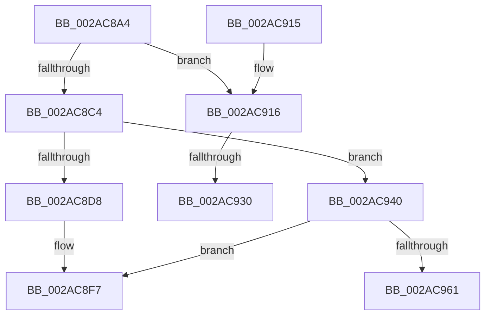

# MiLockIoPfnTree

- RVA: `0x002AC8A4`–`0x002AC96D` (길이 `201` bytes)
- VA: `0x00000001402AC8A4`
- 실행 섹션: `.text`
- PDB 이름 있음: `예`; PDB Function 태그: `예`
- unwind 정보 RVA: `0x0006D1EC`
- 디코드: `48`개 명령, `201/201` bytes 표시
- 미해석 바이트: `0` (있으면 어셈블리에 `.byte`로 보존)

> 이 문서는 커널 이미지의 기계어와 PDB 기호를 분석해 생성했습니다. 4번과 5번은 함수 원형과 자료형을 바이너리 사용 방식에서 추정한 C 해석이며 원본 소스 복구 결과는 아닙니다.

## 1. Dependencies

- 직접 호출 지점: **3**; 고유 호출 대상: **3**
- 직접 호출자로 확인된 함수: **13**
- RIP 상대 이미지 참조: **3**

### Outgoing calls
- `0x002AC8F2` → [ExAcquireSpinLockSharedAtDpcLevel](../24/ExAcquireSpinLockSharedAtDpcLevel_function_00248E30.md) (function, `0x00248E30`)
- `0x002AC935` → [KiRaiseIrqlProcessIrqlFlags](../4F/KiRaiseIrqlProcessIrqlFlags_function_004F56FC.md) (function, `0x004F56FC`)
- `0x002AC951` → [ExAcquireSpinLockExclusiveAtDpcLevel](../24/ExAcquireSpinLockExclusiveAtDpcLevel_function_00248E80.md) (function, `0x00248E80`)

### Direct callers
- [MiReferenceIoPages](../23/MiReferenceIoPages_function_0023C804.md) at `0x0023C939`
- [MiReferenceIoPages](../23/MiReferenceIoPages_function_0023C804.md) at `0x0023CA1F`
- [MiReferenceIoPages](../23/MiReferenceIoPages_function_0023C804.md) at `0x0023CBF1`
- [MiUnlockOpportunisticPagesInPageTable](MiUnlockOpportunisticPagesInPageTable_function_002AA88C.md) at `0x002AA940`
- [MiDereferenceIoPages](MiDereferenceIoPages_function_002AB1B0.md) at `0x002AB304`
- [MiDereferenceIoPages](MiDereferenceIoPages_function_002AB1B0.md) at `0x002AB672`
- [MiLookupIoPageNode](MiLookupIoPageNode_function_002AC5C8.md) at `0x002AC642`
- [MiMarkHugeRangeTransition](../43/MiMarkHugeRangeTransition_function_004374C0.md) at `0x004374F3`
- [MiCreateIoPageExclusion](../67/MiCreateIoPageExclusion_function_0067B638.md) at `0x0067B6B3`
- [MiDeleteStaleCacheMaps](../67/MiDeleteStaleCacheMaps_function_0067B780.md) at `0x0067B7F7`
- [MiDeleteStaleCacheMaps](../67/MiDeleteStaleCacheMaps_function_0067B780.md) at `0x0067BAAE`
- [MiFreezeIoPfnNode](../67/MiFreezeIoPfnNode_function_0067BDAC.md) at `0x0067BE11`
- [MiIsProbeActive](../67/MiIsProbeActive_function_0067C16C.md) at `0x0067C190`
- [MiMakeIoRangePermanent](../67/MiMakeIoRangePermanent_function_0067C29C.md) at `0x0067C2D0`
- [MiMarkHugeRangeIoPfnDeleted](../67/MiMarkHugeRangeIoPfnDeleted_function_0067C770.md) at `0x0067C793`
- [MiMarkHugeRangeIoPfnDeleted](../67/MiMarkHugeRangeIoPfnDeleted_function_0067C770.md) at `0x0067C84E`
- [MiRemoveIoPageExclusion](../67/MiRemoveIoPageExclusion_function_0067C91C.md) at `0x0067C92E`
- [sub_006DB1E0](../6D/Unknown_function_006DB1E0.md) at `0x006DB28C`

### Static image references
- `0x002AC923` → RVA `0x00FC6D20` (`ALMOSTRO`; read)
- `0x002AC940` → RVA `0x00E2DBF8` (`.data`; read)
- `0x002AC956` → RVA `0x00FC5000` (`ALMOSTRO`; read)

## 2. Other-region calls and transfers

- 다른 실행 섹션으로 향하는 call: **0**
- call이 아닌 외부 분기/꼬리 이동: **3**
  - `0x002AC92A` → [sub_006DB59E](../6D/Unknown_function_006DB59E.md) (`tail-transfer`)
  - `0x002AC93B` → [sub_006DB59E](../6D/Unknown_function_006DB59E.md) (`tail-transfer`)
  - `0x002AC968` → [sub_006DB59E + 0x16](../6D/Unknown_function_006DB59E.md) (`tail-transfer`)

## 3. Assembly (complete function range)

```asm
002AC8A4  48 8B C4                        mov rax, rsp
002AC8A7  48 89 58 08                     mov qword ptr [rax + 8], rbx
002AC8AB  48 89 68 10                     mov qword ptr [rax + 0x10], rbp
002AC8AF  48 89 70 18                     mov qword ptr [rax + 0x18], rsi
002AC8B3  48 89 78 20                     mov qword ptr [rax + 0x20], rdi
002AC8B7  41 56                           push r14
002AC8B9  48 83 EC 20                     sub rsp, 0x20
002AC8BD  8B F1                           mov esi, ecx
002AC8BF  F6 C1 04                        test cl, 4
002AC8C2  74 52                           je 0x1402ac916
002AC8C4  BF 11 00 00 00                  mov edi, 0x11
002AC8C9  BD 01 00 00 00                  mov ebp, 1
002AC8CE  40 84 F5                        test bpl, sil
002AC8D1  BE 80 02 00 00                  mov esi, 0x280
002AC8D6  74 68                           je 0x1402ac940
002AC8D8  65 48 8B 0C 25 20 00 00 00      mov rcx, qword ptr gs:[0x20]
002AC8E1  48 8B 91 38 88 00 00            mov rdx, qword ptr [rcx + 0x8838]
002AC8E8  48 8B 8A 48 01 00 00            mov rcx, qword ptr [rdx + 0x148]
002AC8EF  48 03 CE                        add rcx, rsi
002AC8F2  E8 39 C5 F9 FF                  call 0x140248e30
002AC8F7  48 8B 5C 24 30                  mov rbx, qword ptr [rsp + 0x30]
002AC8FC  40 8A C7                        mov al, dil
002AC8FF  48 8B 7C 24 48                  mov rdi, qword ptr [rsp + 0x48]
002AC904  48 8B 6C 24 38                  mov rbp, qword ptr [rsp + 0x38]
002AC909  48 8B 74 24 40                  mov rsi, qword ptr [rsp + 0x40]
002AC90E  48 83 C4 20                     add rsp, 0x20
002AC912  41 5E                           pop r14
002AC914  C3                              ret
002AC915  CC                              int3
002AC916  44 0F 20 C3                     mov rbx, cr8
002AC91A  BD 02 00 00 00                  mov ebp, 2
002AC91F  44 0F 22 C5                     mov cr8, rbp
002AC923  83 3D F6 A3 D1 00 00            cmp dword ptr [rip + 0xd1a3f6], 0
002AC92A  0F 84 6E EC 42 00               je 0x1406db59e
002AC930  40 8A D5                        mov dl, bpl
002AC933  8A CB                           mov cl, bl
002AC935  E8 C2 8D 24 00                  call 0x1404f56fc
002AC93A  90                              nop
002AC93B  E9 5E EC 42 00                  jmp 0x1406db59e
002AC940  4C 8B 35 B1 12 B8 00            mov r14, qword ptr [rip + 0xb812b1]
002AC947  49 8B 8E 78 01 00 00            mov rcx, qword ptr [r14 + 0x178]
002AC94E  48 03 CE                        add rcx, rsi
002AC951  E8 2A C5 F9 FF                  call 0x140248e80
002AC956  66 3B 2D A3 86 D1 00            cmp bp, word ptr [rip + 0xd186a3]
002AC95D  8B DD                           mov ebx, ebp
002AC95F  73 96                           jae 0x1402ac8f7
002AC961  49 81 C6 F8 02 00 00            add r14, 0x2f8
002AC968  E9 47 EC 42 00                  jmp 0x1406db5b4
```

## 4. C-style interpretation (structured pseudocode)

```c
__int64 __fastcall MiLockIoPfnTree(int a1)
{
    __int64 result;
    __int64 v_r14;
    __int64 v_rsp;
    unsigned __int64 v_stack_p10;
    unsigned __int64 v_stack_p18;
    unsigned __int64 v_stack_p20;
    unsigned __int64 v_stack_p8;

    *(unsigned __int64 *)(v_rsp + 8) = v_rbx;
    *(unsigned __int64 *)(v_rsp + 16) = v_rbp;
    *(unsigned __int64 *)(v_rsp + 24) = v_rsi;
    *(unsigned __int64 *)(v_rsp + 32) = v_rdi;
    v_rsp = (v_rsp) - (32);
    if ((((unsigned __int8)(a1)) & (4)) == 0) goto loc_002AC916;
    if (((1) & ((unsigned __int8)((unsigned int)(a1)))) == 0) goto loc_002AC940;
    a1 = (*(unsigned __int64 *)(*(unsigned __int64 *)(*(unsigned __int64 *)(gs_base + (0 + 32)) + 34872) + 328)) + (640);
    result = ExAcquireSpinLockSharedAtDpcLevel(a1, *(unsigned __int64 *)(*(unsigned __int64 *)(gs_base + (0 + 32)) + 34872), a3, a4);
loc_002AC8F7:
    v_rsp = (v_rsp) + (32);
    return 17;
loc_002AC916:
    result = KiRaiseIrqlProcessIrqlFlags((unsigned __int8)(v_cr8), 2, a3, a4);
loc_002AC940:
    a1 = (*(unsigned __int64 *)(*(unsigned __int64 *)(v_rip + 12063409) + 376)) + (v_stack_p18);
    result = ExAcquireSpinLockExclusiveAtDpcLevel(a1, 2, a3, a4);
    if (2 >= (*(unsigned __int16 *)(v_rip + 13731491))) goto loc_002AC8F7;
    v_r14 = (*(unsigned __int64 *)(v_rip + 12063409)) + (760);
}
```

## 5. (Beta) C Style

```c
int64_t MiLockIoPfnTree(int32_t Arg1)
{
    int64_t result;
    int64_t local_r14;
    int64_t local_rsp;
    uint64_t v_stack_p10;
    uint64_t v_stack_p18;
    uint64_t v_stack_p20;
    uint64_t v_stack_p8;

    *(uint64_t *)(local_rsp + 0x8) = local_rbx;
    *(uint64_t *)(local_rsp + 0x10) = local_rbp;
    *(uint64_t *)(local_rsp + 0x18) = local_rsi;
    *(uint64_t *)(local_rsp + 0x20) = local_rdi;
    local_rsp = (local_rsp) - (32);
    if ((((uint8_t)(Arg1)) & (4)) == 0) goto loc_002AC916;
    if (((1) & ((uint8_t)((uint32_t)(Arg1)))) == 0) goto loc_002AC940;
    Arg1 = (*(uint64_t *)(*(uint64_t *)(*(uint64_t *)(gs_base + (0 + 0x20)) + 0x8838) + 0x148)) + (640);
    result = ExAcquireSpinLockSharedAtDpcLevel(Arg1, *(uint64_t *)(*(uint64_t *)(gs_base + (0 + 0x20)) + 0x8838), a3, a4);
loc_002AC8F7:
    local_rsp = (local_rsp) + (32);
    return 17;
loc_002AC916:
    result = KiRaiseIrqlProcessIrqlFlags((uint8_t)(v_cr8), 2, a3, a4);
loc_002AC940:
    Arg1 = (*(uint64_t *)(*(uint64_t *)(v_rip + 0xB812B1) + 0x178)) + (v_stack_p18);
    result = ExAcquireSpinLockExclusiveAtDpcLevel(Arg1, 2, a3, a4);
    if (2 >= (*(uint16_t *)(v_rip + 0xD186A3))) goto loc_002AC8F7;
    local_r14 = (*(uint64_t *)(v_rip + 0xB812B1)) + (760);
}
```

## 6. Execution-region graph

[열기: 2D/3D 그래프와 함수 탐색 컨트롤 패널](../../../control-panel.html?section=text&rva=0x002AC8A4&view=graph)

- 2D 그래프는 위에서 아래로 흐르고, 3D 그래프는 빈 공간을 드래그해 회전합니다. Shift+드래그는 이동, 휠은 확대·축소, 함수 노드 선택은 대상 보고서 이동입니다.

### Static fallback


