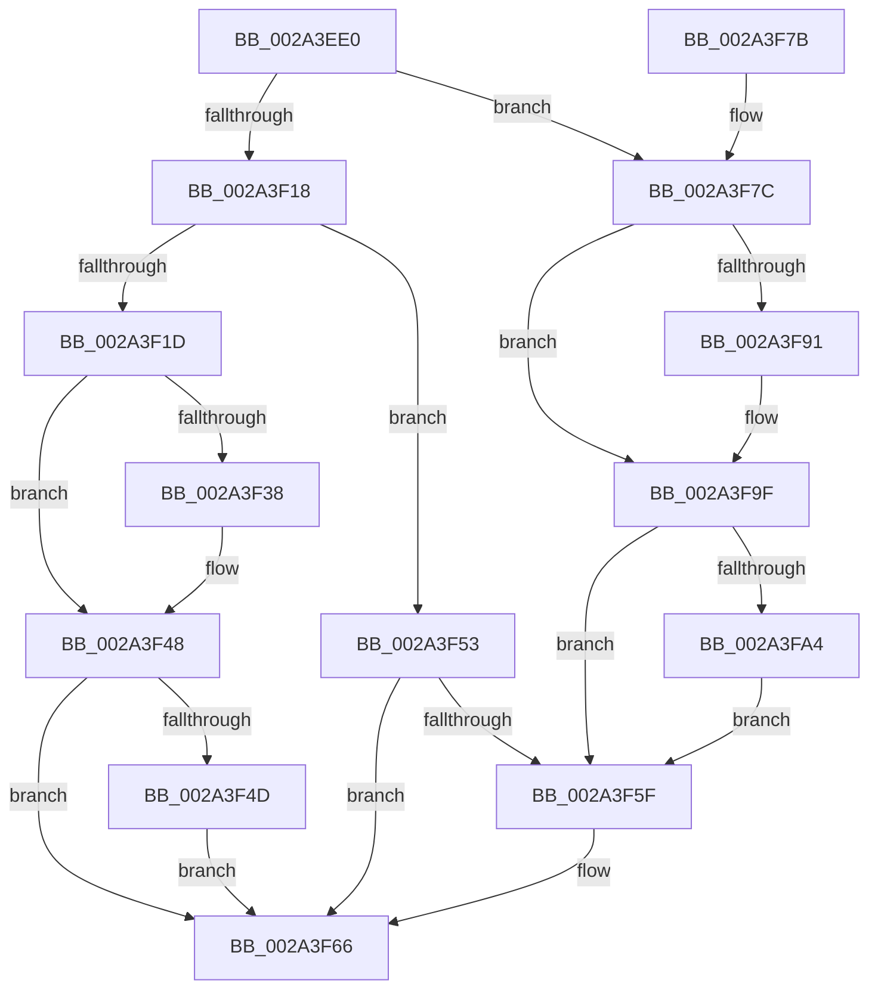

# MiLockLoaderEntry

- RVA: `0x002A3EE0`–`0x002A3FAA` (길이 `202` bytes)
- VA: `0x00000001402A3EE0`
- 실행 섹션: `.text`
- PDB 이름 있음: `예`; PDB Function 태그: `아니요`
- unwind 정보 RVA: `0x00068854`
- 디코드: `59`개 명령, `202/202` bytes 표시
- 미해석 바이트: `0` (있으면 어셈블리에 `.byte`로 보존)

> 이 문서는 커널 이미지의 기계어와 PDB 기호를 분석해 생성했습니다. 4번과 5번은 함수 원형과 자료형을 바이너리 사용 방식에서 추정한 C 해석이며 원본 소스 복구 결과는 아닙니다.

## 1. Dependencies

- 직접 호출 지점: **5**; 고유 호출 대상: **4**
- 직접 호출자로 확인된 함수: **6**
- RIP 상대 이미지 참조: **0**

### Outgoing calls
- `0x002A3F22` → [KeAbPreAcquire](../21/KeAbPreAcquire_function_00210230.md) (function, `0x00210230`)
- `0x002A3F43` → [ExfAcquirePushLockSharedEx](../21/ExfAcquirePushLockSharedEx_function_0021044C.md) (function, `0x0021044C`)
- `0x002A3F55` → [ExAcquireAutoExpandPushLockExclusive](../26/ExAcquireAutoExpandPushLockExclusive_function_00264B70.md) (function, `0x00264B70`)
- `0x002A3F81` → [KeAbPreAcquire](../21/KeAbPreAcquire_function_00210230.md) (function, `0x00210230`)
- `0x002A3F9A` → [ExfAcquirePushLockExclusiveEx](../20/ExfAcquirePushLockExclusiveEx_function_0020FC90.md) (function, `0x0020FC90`)

### Direct callers
- [MiLockLoadedDataTableEntry](MiLockLoadedDataTableEntry_function_002A38F4.md) at `0x002A3929`
- [MiEnumerateSystemImages](MiEnumerateSystemImages_function_002A3D40.md) at `0x002A3D9D`
- [MiProtectDriverSectionPte](../67/MiProtectDriverSectionPte_function_006706C0.md) at `0x006707D1`
- [MiBackSystemImageWithPagefile](../../page/7F/MiBackSystemImageWithPagefile_function_007F86E8.md) at `0x007F87F0`
- [MiBackSystemImageWithPagefile](../../page/7F/MiBackSystemImageWithPagefile_function_007F86E8.md) at `0x007F881B`
- [MiSplitDriverPage](../../page/7F/MiSplitDriverPage_function_007F8EB8.md) at `0x007F8F04`
- [MmFreeDriverInitialization](../../page/A4/MmFreeDriverInitialization_function_00A4AD08.md) at `0x00A4AD22`

### Static image references
- 디코드된 RIP-relative 메모리 참조가 없습니다.

## 2. Other-region calls and transfers

- 다른 실행 섹션으로 향하는 call: **0**
- 별도 외부 분기/꼬리 이동을 확인하지 못했습니다.

## 3. Assembly (complete function range)

```asm
002A3EE0  48 89 5C 24 10                  mov qword ptr [rsp + 0x10], rbx
002A3EE5  48 89 6C 24 18                  mov qword ptr [rsp + 0x18], rbp
002A3EEA  48 89 74 24 20                  mov qword ptr [rsp + 0x20], rsi
002A3EEF  57                              push rdi
002A3EF0  48 83 EC 20                     sub rsp, 0x20
002A3EF4  65 48 8B 34 25 88 01 00 00      mov rsi, qword ptr gs:[0x188]
002A3EFD  48 8D 99 E8 00 00 00            lea rbx, [rcx + 0xe8]
002A3F04  48 8B E9                        mov rbp, rcx
002A3F07  8B FA                           mov edi, edx
002A3F09  48 8B CB                        mov rcx, rbx
002A3F0C  66 FF 8E E6 01 00 00            dec word ptr [rsi + 0x1e6]
002A3F13  90                              nop
002A3F14  85 D2                           test edx, edx
002A3F16  74 64                           je 0x1402a3f7c
002A3F18  83 FA 02                        cmp edx, 2
002A3F1B  75 36                           jne 0x1402a3f53
002A3F1D  45 33 C0                        xor r8d, r8d
002A3F20  33 D2                           xor edx, edx
002A3F22  E8 09 C3 F6 FF                  call 0x140210230
002A3F27  48 8B F8                        mov rdi, rax
002A3F2A  B9 11 00 00 00                  mov ecx, 0x11
002A3F2F  33 C0                           xor eax, eax
002A3F31  F0 48 0F B1 0B                  lock cmpxchg qword ptr [rbx], rcx
002A3F36  74 10                           je 0x1402a3f48
002A3F38  4C 8B CB                        mov r9, rbx
002A3F3B  4C 8B C7                        mov r8, rdi
002A3F3E  33 D2                           xor edx, edx
002A3F40  48 8B CB                        mov rcx, rbx
002A3F43  E8 04 C5 F6 FF                  call 0x14021044c
002A3F48  48 85 FF                        test rdi, rdi
002A3F4B  74 19                           je 0x1402a3f66
002A3F4D  C6 47 0A 01                     mov byte ptr [rdi + 0xa], 1
002A3F51  EB 13                           jmp 0x1402a3f66
002A3F53  33 D2                           xor edx, edx
002A3F55  E8 16 0C FC FF                  call 0x140264b70
002A3F5A  83 FF 01                        cmp edi, 1
002A3F5D  7F 07                           jg 0x1402a3f66
002A3F5F  48 89 B5 F0 00 00 00            mov qword ptr [rbp + 0xf0], rsi
002A3F66  48 8B 5C 24 38                  mov rbx, qword ptr [rsp + 0x38]
002A3F6B  48 8B 6C 24 40                  mov rbp, qword ptr [rsp + 0x40]
002A3F70  48 8B 74 24 48                  mov rsi, qword ptr [rsp + 0x48]
002A3F75  48 83 C4 20                     add rsp, 0x20
002A3F79  5F                              pop rdi
002A3F7A  C3                              ret
002A3F7B  CC                              int3
002A3F7C  45 33 C0                        xor r8d, r8d
002A3F7F  33 D2                           xor edx, edx
002A3F81  E8 AA C2 F6 FF                  call 0x140210230
002A3F86  F0 48 0F BA 2B 00               lock bts qword ptr [rbx], 0
002A3F8C  48 8B F8                        mov rdi, rax
002A3F8F  73 0E                           jae 0x1402a3f9f
002A3F91  4C 8B C3                        mov r8, rbx
002A3F94  48 8B D0                        mov rdx, rax
002A3F97  48 8B CB                        mov rcx, rbx
002A3F9A  E8 F1 BC F6 FF                  call 0x14020fc90
002A3F9F  48 85 FF                        test rdi, rdi
002A3FA2  74 BB                           je 0x1402a3f5f
002A3FA4  C6 47 0A 01                     mov byte ptr [rdi + 0xa], 1
002A3FA8  EB B5                           jmp 0x1402a3f5f
```

## 4. C-style interpretation (structured pseudocode)

```c
__int64 __fastcall MiLockLoaderEntry(__int64 a1, int a2, int a3)
{
    __int64 result;
    __int64 v_rsp;
    unsigned __int64 v_stack_p10;
    unsigned __int64 v_stack_p18;
    unsigned __int64 v_stack_p20;

    v_stack_p10 = v_rbx;
    v_stack_p18 = v_rbp;
    v_stack_p20 = v_rsi;
    v_rsp = (v_rsp) - (32);
    if (a2 == 0) goto loc_002A3F7C;
    if (a2 != 2) goto loc_002A3F53;
    a3 = 0;
    a2 = 0;
    result = KeAbPreAcquire(a1 + 232, a2, a3, a4);
    result = 0;
    if (!(condition_is_equal)) {
        a4 = a1 + 232;
        a3 = 0;
        a2 = 0;
        a1 = a1 + 232;
        result = ExfAcquirePushLockSharedEx(a1, a2, a3, a4);
    }
    if (result == 0) goto loc_002A3F66;
    *(unsigned __int8 *)(result + 10) = 1;
    goto loc_002A3F66;
loc_002A3F53:
    a2 = 0;
    result = ExAcquireAutoExpandPushLockExclusive(a1, a2, a3, a4);
    if (((unsigned int)(result)) <= 1) {
        *(unsigned __int64 *)(a1 + 240) = *(unsigned __int64 *)(gs_base + (0 + 392));
    }
    v_rsp = (v_rsp) + (32);
    return result;
loc_002A3F7C:
    a3 = 0;
    a2 = 0;
    result = KeAbPreAcquire(a1, a2, a3, a4);
    if (!(condition_is_above_or_equal)) {
        a3 = v_stack_p10;
        a2 = result;
        a1 = v_stack_p10;
        result = ExfAcquirePushLockExclusiveEx(a1, a2, a3, a4);
    }
    if (result == 0) goto loc_002A3F5F;
    *(unsigned __int8 *)(result + 10) = 1;
    goto loc_002A3F5F;
}
```

## 5. (Beta) C Style

```c
int64_t MiLockLoaderEntry(void *Arg1, int32_t Arg2, int32_t Arg3)
{
    uint8_t *arg1 = (uint8_t *)Arg1;

    int64_t result;
    int64_t local_rsp;
    uint64_t v_stack_p10;
    uint64_t v_stack_p18;
    uint64_t v_stack_p20;

    v_stack_p10 = local_rbx;
    v_stack_p18 = local_rbp;
    v_stack_p20 = local_rsi;
    local_rsp = (local_rsp) - (32);
    if (Arg2 == 0) goto loc_002A3F7C;
    if (Arg2 != 2) goto loc_002A3F53;
    Arg3 = 0;
    Arg2 = 0;
    result = KeAbPreAcquire(Arg1 + 232, Arg2, Arg3, a4);
    result = 0;
    if (!(condition_is_equal)) {
        a4 = Arg1 + 232;
        Arg3 = 0;
        Arg2 = 0;
        Arg1 = Arg1 + 232;
        result = ExfAcquirePushLockSharedEx(Arg1, Arg2, Arg3, a4);
    }
    if (result == 0) goto loc_002A3F66;
    *(uint8_t *)(result + 0xA) = 1;
    goto loc_002A3F66;
loc_002A3F53:
    Arg2 = 0;
    result = ExAcquireAutoExpandPushLockExclusive(Arg1, Arg2, Arg3, a4);
    if (((uint32_t)(result)) <= 1) {
        *(uint64_t *)(arg1 + 0xF0) = *(uint64_t *)(gs_base + (0 + 0x188));
    }
    local_rsp = (local_rsp) + (32);
    return result;
loc_002A3F7C:
    Arg3 = 0;
    Arg2 = 0;
    result = KeAbPreAcquire(Arg1, Arg2, Arg3, a4);
    if (!(condition_is_above_or_equal)) {
        Arg3 = v_stack_p10;
        Arg2 = result;
        Arg1 = v_stack_p10;
        result = ExfAcquirePushLockExclusiveEx(Arg1, Arg2, Arg3, a4);
    }
    if (result == 0) goto loc_002A3F5F;
    *(uint8_t *)(result + 0xA) = 1;
    goto loc_002A3F5F;
}
```

### 관측된 메모리 오프셋

구조체 형식이 확인되지 않은 접근은 인자 기준의 오프셋으로만 기록했습니다.

| 기준 인자 | 오프셋 표현 | 폭 (bit) | 접근 |
|---|---:|---:|---|
| `Arg1` | `+ 0x0` | `64` | `R` |
| `Arg1` | `+ 0x0` | `64` | `R/W` |
| `Arg1` | `+ 0xE8` | `64` | `R` |
| `Arg1` | `+ 0xF0` | `64` | `W` |

## 6. Execution-region graph

[열기: 2D/3D 그래프와 함수 탐색 컨트롤 패널](../../../control-panel.html?section=text&rva=0x002A3EE0&view=graph)

- 2D 그래프는 위에서 아래로 흐르고, 3D 그래프는 빈 공간을 드래그해 회전합니다. Shift+드래그는 이동, 휠은 확대·축소, 함수 노드 선택은 대상 보고서 이동입니다.

### Static fallback


