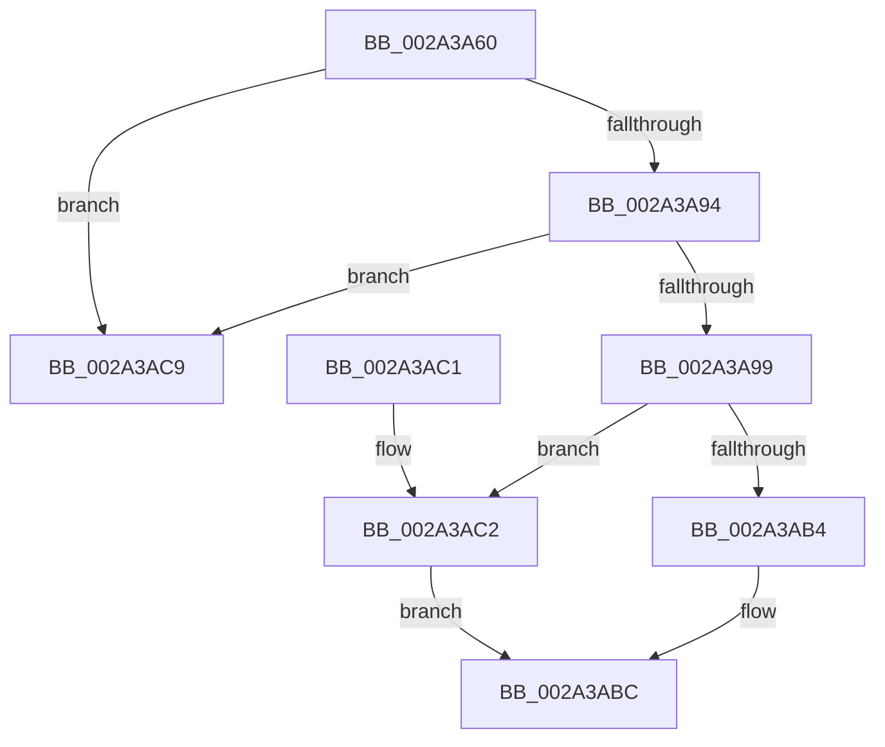

# MiLockPagableImageSection

- RVA: `0x002A3A60`–`0x002A3AE7` (길이 `135` bytes)
- VA: `0x00000001402A3A60`
- 실행 섹션: `.text`
- PDB 이름 있음: `예`; PDB Function 태그: `아니요`
- unwind 정보 RVA: `0x000687C0`
- 디코드: `36`개 명령, `135/135` bytes 표시
- 미해석 바이트: `0` (있으면 어셈블리에 `.byte`로 보존)

> 이 문서는 커널 이미지의 기계어와 PDB 기호를 분석해 생성했습니다. 4번과 5번은 함수 원형과 자료형을 바이너리 사용 방식에서 추정한 C 해석이며 원본 소스 복구 결과는 아닙니다.

## 1. Dependencies

- 직접 호출 지점: **3**; 고유 호출 대상: **3**
- 직접 호출자로 확인된 함수: **4**
- RIP 상대 이미지 참조: **0**

### Outgoing calls
- `0x002A3AB7` → [MiUnlockImageSection](MiUnlockImageSection_function_002A3AF0.md) (function, `0x002A3AF0`)
- `0x002A3AC2` → [MiLockImageSection](../../page/A4/MiLockImageSection_function_00A48D78.md) (function, `0x00A48D78`)
- `0x002A3AE1` → [KeBugCheckEx](../4F/KeBugCheckEx_function_004FD660.md) (function, `0x004FD660`)

### Direct callers
- [MmUnlockPagableImageSection](MmUnlockPagableImageSection_function_002A39F0.md) at `0x002A3A2C`
- [MmLockPagableSectionByHandle](../../page/A4/MmLockPagableSectionByHandle_function_00A4D1E0.md) at `0x00A4D222`
- [MmLockPagableDataSection](../../page/A7/MmLockPagableDataSection_function_00A73E80.md) at `0x00A73F0F`
- [MiLockPagableSections](../../init/C6/MiLockPagableSections_function_00C6C35C.md) at `0x00C6C3CD`

### Static image references
- 디코드된 RIP-relative 메모리 참조가 없습니다.

## 2. Other-region calls and transfers

- 다른 실행 섹션으로 향하는 call: **1**
  - `0x002A3AC2` → [MiLockImageSection](../../page/A4/MiLockImageSection_function_00A48D78.md) (`.text` → `PAGE`)
- 별도 외부 분기/꼬리 이동을 확인하지 못했습니다.

## 3. Assembly (complete function range)

```asm
002A3A60  48 83 EC 38                     sub rsp, 0x38
002A3A64  4C 8B D1                        mov r10, rcx
002A3A67  4C 8B CA                        mov r9, rdx
002A3A6A  8B 89 28 01 00 00               mov ecx, dword ptr [rcx + 0x128]
002A3A70  4C 8B DA                        mov r11, rdx
002A3A73  48 BA CD CC CC CC CC CC CC CC   movabs rdx, 0xcccccccccccccccd
002A3A7D  49 8B 82 20 01 00 00            mov rax, qword ptr [r10 + 0x120]
002A3A84  4C 2B C8                        sub r9, rax
002A3A87  49 C1 F9 03                     sar r9, 3
002A3A8B  4C 0F AF CA                     imul r9, rdx
002A3A8F  4C 3B D8                        cmp r11, rax
002A3A92  72 35                           jb 0x1402a3ac9
002A3A94  44 3B C9                        cmp r9d, ecx
002A3A97  73 30                           jae 0x1402a3ac9
002A3A99  41 8B C1                        mov eax, r9d
002A3A9C  48 8D 0C 40                     lea rcx, [rax + rax*2]
002A3AA0  49 8B 82 C8 00 00 00            mov rax, qword ptr [r10 + 0xc8]
002A3AA7  48 8D 14 88                     lea rdx, [rax + rcx*4]
002A3AAB  49 8B CA                        mov rcx, r10
002A3AAE  41 83 F8 01                     cmp r8d, 1
002A3AB2  74 0E                           je 0x1402a3ac2
002A3AB4  4D 8B C3                        mov r8, r11
002A3AB7  E8 34 00 00 00                  call 0x1402a3af0
002A3ABC  48 83 C4 38                     add rsp, 0x38
002A3AC0  C3                              ret
002A3AC1  CC                              int3
002A3AC2  E8 B1 52 7A 00                  call 0x140a48d78
002A3AC7  EB F3                           jmp 0x1402a3abc
002A3AC9  45 8B C0                        mov r8d, r8d
002A3ACC  BA 13 10 00 00                  mov edx, 0x1013
002A3AD1  48 89 4C 24 20                  mov qword ptr [rsp + 0x20], rcx
002A3AD6  4D 0B C3                        or r8, r11
002A3AD9  45 8B C9                        mov r9d, r9d
002A3ADC  B9 1A 00 00 00                  mov ecx, 0x1a
002A3AE1  E8 7A 9B 25 00                  call 0x1404fd660
002A3AE6  CC                              int3
```

## 4. C-style interpretation (structured pseudocode)

```c
__int64 __fastcall MiLockPagableImageSection(__int64 a1, __int64 a2, int a3)
{
    __int64 result;
    __int64 v_rsp;
    unsigned __int64 v_stack_p20;

    v_rsp = (v_rsp) - (56);
    a4 = (a2) - (*(unsigned __int64 *)(a1 + 288));
    a4 = (a4) >> (3);
    a4 = (a4) * (a2);
    if (a2 < (*(unsigned __int64 *)(a1 + 288))) goto loc_002A3AC9;
    if (((unsigned int)(a4)) >= ((unsigned int)((unsigned int)(*(unsigned int *)(a1 + 296))))) goto loc_002A3AC9;
    if (a3 == 1) goto loc_002A3AC2;
    result = MiUnlockImageSection(a1, *(unsigned __int64 *)(a1 + 200) + (unsigned int)((unsigned int)(a4)) + (unsigned int)((unsigned int)(a4)) * 2 * 4, a2, a4);
loc_002A3ABC:
    v_rsp = (v_rsp) + (56);
    return result;
loc_002A3AC2:
    result = MiLockImageSection(a1, *(unsigned __int64 *)(a1 + 200) + (unsigned int)((unsigned int)(a4)) + (unsigned int)((unsigned int)(a4)) * 2 * 4, a2, a4);
    goto loc_002A3ABC;
loc_002A3AC9:
    v_stack_p20 = a1;
    a3 = ((unsigned int)((unsigned int)(a2))) | (a2);
    result = KeBugCheckEx(26, (unsigned int)(0x1013ULL), a3, (unsigned int)((unsigned int)(a4)));
    return result;
}
```

## 5. (Beta) C Style

```c
int64_t MiLockPagableImageSection(void *Arg1, int64_t Arg2, int32_t Arg3)
{
    uint8_t *arg1 = (uint8_t *)Arg1;

    int64_t result;
    int64_t local_rsp;
    uint64_t v_stack_p20;

    local_rsp = (local_rsp) - (56);
    a4 = (Arg2) - (*(uint64_t *)(arg1 + 0x120));
    a4 = (a4) >> (3);
    a4 = (a4) * (Arg2);
    if (Arg2 < (*(uint64_t *)(arg1 + 0x120))) goto loc_002A3AC9;
    if (((uint32_t)(a4)) >= ((uint32_t)((uint32_t)(*(uint32_t *)(arg1 + 0x128))))) goto loc_002A3AC9;
    if (Arg3 == 1) goto loc_002A3AC2;
    result = MiUnlockImageSection(Arg1, *(uint64_t *)(arg1 + 0xC8) + (uint32_t)((uint32_t)(a4)) + (uint32_t)((uint32_t)(a4)) * 2 * 4, Arg2, a4);
loc_002A3ABC:
    local_rsp = (local_rsp) + (56);
    return result;
loc_002A3AC2:
    result = MiLockImageSection(Arg1, *(uint64_t *)(arg1 + 0xC8) + (uint32_t)((uint32_t)(a4)) + (uint32_t)((uint32_t)(a4)) * 2 * 4, Arg2, a4);
    goto loc_002A3ABC;
loc_002A3AC9:
    v_stack_p20 = Arg1;
    Arg3 = ((uint32_t)((uint32_t)(Arg2))) | (Arg2);
    result = KeBugCheckEx(26, (uint32_t)(0x1013ULL), Arg3, (uint32_t)((uint32_t)(a4)));
    return result;
}
```

### 관측된 메모리 오프셋

구조체 형식이 확인되지 않은 접근은 인자 기준의 오프셋으로만 기록했습니다.

| 기준 인자 | 오프셋 표현 | 폭 (bit) | 접근 |
|---|---:|---:|---|
| `Arg1` | `+ 0xC8` | `64` | `R` |
| `Arg1` | `+ 0x120` | `64` | `R` |
| `Arg1` | `+ 0x128` | `32` | `R` |

## 6. Execution-region graph

[열기: 2D/3D 그래프와 함수 탐색 컨트롤 패널](../../../control-panel.html?section=text&rva=0x002A3A60&view=graph)

- 2D 그래프는 위에서 아래로 흐르고, 3D 그래프는 빈 공간을 드래그해 회전합니다. Shift+드래그는 이동, 휠은 확대·축소, 함수 노드 선택은 대상 보고서 이동입니다.

### Static fallback


