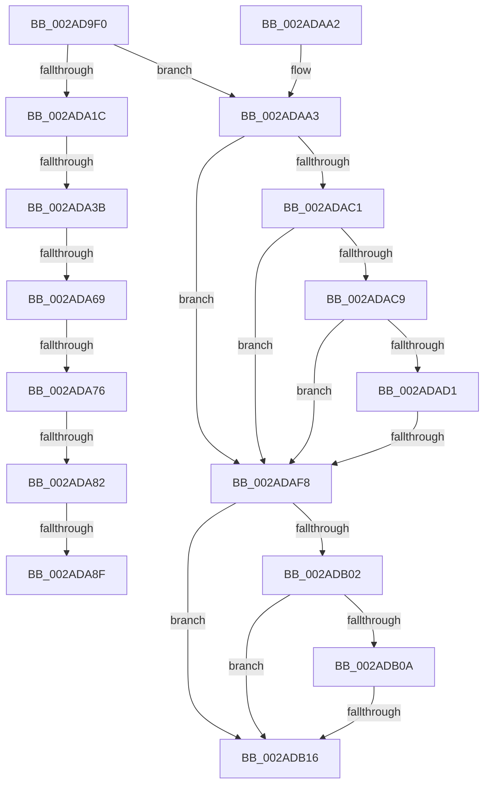

# MiLockPageTableInternal

- RVA: `0x002AD9F0`–`0x002ADB1C` (길이 `300` bytes)
- VA: `0x00000001402AD9F0`
- 실행 섹션: `.text`
- PDB 이름 있음: `예`; PDB Function 태그: `아니요`
- unwind 정보 RVA: `0x0006D304`
- 디코드: `76`개 명령, `300/300` bytes 표시
- 미해석 바이트: `0` (있으면 어셈블리에 `.byte`로 보존)

> 이 문서는 커널 이미지의 기계어와 PDB 기호를 분석해 생성했습니다. 4번과 5번은 함수 원형과 자료형을 바이너리 사용 방식에서 추정한 C 해석이며 원본 소스 복구 결과는 아닙니다.

## 1. Dependencies

- 직접 호출 지점: **0**; 고유 호출 대상: **0**
- 직접 호출자로 확인된 함수: **1**
- RIP 상대 이미지 참조: **1**

### Outgoing calls
- 직접 디코드된 call 명령이 없습니다.

### Direct callers
- [MiTryLockPageTableUnordered](MiTryLockPageTableUnordered_function_002AD9D4.md) at `0x002AD9DE`

### Static image references
- `0x002ADA69` → RVA `0x00FC6B06` (`ALMOSTRO`; read)

## 2. Other-region calls and transfers

- 다른 실행 섹션으로 향하는 call: **0**
- call이 아닌 외부 분기/꼬리 이동: **7**
  - `0x002ADA35` → [sub_002ADC0C](Unknown_function_002ADC0C.md) (`tail-transfer`)
  - `0x002ADA63` → [sub_002ADC0C + 0x46](Unknown_function_002ADC0C.md) (`tail-transfer`)
  - `0x002ADA70` → [sub_002ADC0C + 0x2C](Unknown_function_002ADC0C.md) (`tail-transfer`)
  - `0x002ADA7C` → [sub_002ADC0C + 0x76](Unknown_function_002ADC0C.md) (`tail-transfer`)
  - `0x002ADA89` → [sub_002ADC0C + 0x76](Unknown_function_002ADC0C.md) (`tail-transfer`)
  - `0x002ADAF2` → [sub_002ADE82](Unknown_function_002ADE82.md) (`tail-transfer`)
  - `0x002ADB10` → [sub_002ADD7F](Unknown_function_002ADD7F.md) (`tail-transfer`)

## 3. Assembly (complete function range)

```asm
002AD9F0  48 89 5C 24 20                  mov qword ptr [rsp + 0x20], rbx
002AD9F5  55                              push rbp
002AD9F6  56                              push rsi
002AD9F7  57                              push rdi
002AD9F8  41 56                           push r14
002AD9FA  41 57                           push r15
002AD9FC  48 83 EC 20                     sub rsp, 0x20
002ADA00  48 8B F2                        mov rsi, rdx
002ADA03  41 8B E8                        mov ebp, r8d
002ADA06  48 8B D1                        mov rdx, rcx
002ADA09  48 B8 68 DF BE 7D FB F6 FF FF   movabs rax, 0xfffff6fb7dbedf68
002ADA13  48 3B F0                        cmp rsi, rax
002ADA16  0F 85 87 00 00 00               jne 0x1402adaa3
002ADA1C  65 4C 8B 04 25 20 00 00 00      mov r8, qword ptr gs:[0x20]
002ADA25  45 33 F6                        xor r14d, r14d
002ADA28  8B 81 B8 00 00 00               mov eax, dword ptr [rcx + 0xb8]
002ADA2E  BB 01 00 00 00                  mov ebx, 1
002ADA33  24 0F                           and al, 0xf
002ADA35  0F 85 D1 01 00 00               jne 0x1402adc0c
002ADA3B  BF 02 00 00 00                  mov edi, 2
002ADA40  48 81 C2 B0 00 00 00            add rdx, 0xb0
002ADA47  8B C7                           mov eax, edi
002ADA49  48 8D 88 C4 09 00 00            lea rcx, [rax + 0x9c4]
002ADA50  48 8D 0C 48                     lea rcx, [rax + rcx*2]
002ADA54  4D 89 34 C8                     mov qword ptr [r8 + rcx*8], r14
002ADA58  49 8D 0C C8                     lea rcx, [r8 + rcx*8]
002ADA5C  48 89 51 08                     mov qword ptr [rcx + 8], rdx
002ADA60  90                              nop
002ADA61  23 EB                           and ebp, ebx
002ADA63  0F 84 E9 01 00 00               je 0x1402adc52
002ADA69  F6 05 96 90 D1 00 21            test byte ptr [rip + 0xd19096], 0x21
002ADA70  0F 85 C2 01 00 00               jne 0x1402adc38
002ADA76  0F 0D 0A                        prefetchw byte ptr [rdx]
002ADA79  44 39 32                        cmp dword ptr [rdx], r14d
002ADA7C  0F 85 00 02 00 00               jne 0x1402adc82
002ADA82  33 C0                           xor eax, eax
002ADA84  F0 48 0F B1 0A                  lock cmpxchg qword ptr [rdx], rcx
002ADA89  0F 85 F3 01 00 00               jne 0x1402adc82
002ADA8F  8B C3                           mov eax, ebx
002ADA91  48 8B 5C 24 68                  mov rbx, qword ptr [rsp + 0x68]
002ADA96  48 83 C4 20                     add rsp, 0x20
002ADA9A  41 5F                           pop r15
002ADA9C  41 5E                           pop r14
002ADA9E  5F                              pop rdi
002ADA9F  5E                              pop rsi
002ADAA0  5D                              pop rbp
002ADAA1  C3                              ret
002ADAA2  CC                              int3
002ADAA3  8B 81 B8 00 00 00               mov eax, dword ptr [rcx + 0xb8]
002ADAA9  49 B8 00 D0 BE 7D FB F6 FF FF   movabs r8, 0xfffff6fb7dbed000
002ADAB3  49 B9 FF DF BE 7D FB F6 FF FF   movabs r9, 0xfffff6fb7dbedfff
002ADABD  A8 0F                           test al, 0xf
002ADABF  75 37                           jne 0x1402adaf8
002ADAC1  49 8B C0                        mov rax, r8
002ADAC4  48 3B F0                        cmp rsi, rax
002ADAC7  72 2F                           jb 0x1402adaf8
002ADAC9  49 8B C1                        mov rax, r9
002ADACC  48 3B F0                        cmp rsi, rax
002ADACF  77 27                           ja 0x1402adaf8
002ADAD1  65 48 8B 04 25 88 01 00 00      mov rax, qword ptr gs:[0x188]
002ADADA  48 8B 88 B8 00 00 00            mov rcx, qword ptr [rax + 0xb8]
002ADAE1  48 8B 81 10 04 00 00            mov rax, qword ptr [rcx + 0x410]
002ADAE8  48 8B 88 68 05 00 00            mov rcx, qword ptr [rax + 0x568]
002ADAEF  48 85 C9                        test rcx, rcx
002ADAF2  0F 85 8A 03 00 00               jne 0x1402ade82
002ADAF8  8B 82 B8 00 00 00               mov eax, dword ptr [rdx + 0xb8]
002ADAFE  A8 0F                           test al, 0xf
002ADB00  74 14                           je 0x1402adb16
002ADB02  49 8B C0                        mov rax, r8
002ADB05  48 3B F0                        cmp rsi, rax
002ADB08  72 0C                           jb 0x1402adb16
002ADB0A  49 8B C1                        mov rax, r9
002ADB0D  48 3B F0                        cmp rsi, rax
002ADB10  0F 86 69 02 00 00               jbe 0x1402add7f
002ADB16  48 8B 1E                        mov rbx, qword ptr [rsi]
002ADB19  45 33 F6                        xor r14d, r14d
```

## 4. C-style interpretation (structured pseudocode)

```c
__int64 __fastcall MiLockPageTableInternal(__int64 a1, __int64 a2, int a3)
{
    __int64 result;
    __int64 v_r14;
    __int64 v_rbp;
    __int64 v_rsp;
    unsigned __int64 v_stack_p20;

    v_stack_p20 = v_rbx;
    v_rsp = (v_rsp) - (32);
    if (a2 != result) goto loc_002ADAA3;
    v_r14 = 0;
    result = (unsigned __int8)(((unsigned int)(*(unsigned int *)(a1 + 184))) & (15));
    a2 = (a1) + (176);
    *(unsigned __int64 *)(*(unsigned __int64 *)(gs_base + (0 + 32)) + 2 + 2 + 2500 * 2 * 8) = 0;
    *(unsigned __int64 *)(*(unsigned __int64 *)(gs_base + (0 + 32)) + 2 + 2 + 2500 * 2 * 8 + 8) = a2;
    v_rbp = (unsigned int)(((unsigned int)(a3)) & (1));
    result = 0;
    v_rsp = (v_rsp) + (32);
    return 1;
loc_002ADAA3:
    if ((((unsigned __int8)((unsigned int)(*(unsigned int *)(*(unsigned __int64 *)(gs_base + (0 + 32)) + 2 + 2 + 2500 * 2 * 8 + 184)))) & (15)) != 0) goto loc_002ADAF8;
    if (a2 < (*(unsigned __int64 *)(gs_base + (0 + 32)))) goto loc_002ADAF8;
    if (a2 > a4) goto loc_002ADAF8;
loc_002ADAF8:
    if ((((unsigned __int8)((unsigned int)(*(unsigned int *)(a2 + 184)))) & (15)) == 0) goto loc_002ADB16;
    if (a2 < (*(unsigned __int64 *)(gs_base + (0 + 32)))) goto loc_002ADB16;
loc_002ADB16:
    v_r14 = 0;
    return a4;
}
```

## 5. (Beta) C Style

```c
int64_t MiLockPageTableInternal(void *Arg1, int64_t Arg2, int32_t Arg3)
{
    uint8_t *arg1 = (uint8_t *)Arg1;

    int64_t result;
    int64_t local_r14;
    int64_t local_rbp;
    int64_t local_rsp;
    uint64_t v_stack_p20;

    v_stack_p20 = local_rbx;
    local_rsp = (local_rsp) - (32);
    if (Arg2 != result) goto loc_002ADAA3;
    local_r14 = 0;
    result = (uint8_t)(((uint32_t)(*(uint32_t *)(arg1 + 0xB8))) & (15));
    Arg2 = (Arg1) + (176);
    *(uint64_t *)(*(uint64_t *)(gs_base + (0 + 0x20)) + 0x2 + 0x2 + 0x9C4 * 2 * 8) = 0;
    *(uint64_t *)(*(uint64_t *)(gs_base + (0 + 0x20)) + 0x2 + 0x2 + 0x9C4 * 2 * 8 + 0x8) = Arg2;
    local_rbp = (uint32_t)(((uint32_t)(Arg3)) & (1));
    result = 0;
    local_rsp = (local_rsp) + (32);
    return 1;
loc_002ADAA3:
    if ((((uint8_t)((uint32_t)(*(uint32_t *)(*(uint64_t *)(gs_base + (0 + 0x20)) + 0x2 + 0x2 + 0x9C4 * 2 * 8 + 0xB8)))) & (15)) != 0) goto loc_002ADAF8;
    if (Arg2 < (*(uint64_t *)(gs_base + (0 + 0x20)))) goto loc_002ADAF8;
    if (Arg2 > a4) goto loc_002ADAF8;
loc_002ADAF8:
    if ((((uint8_t)((uint32_t)(*(uint32_t *)(Arg2 + 0xB8)))) & (15)) == 0) goto loc_002ADB16;
    if (Arg2 < (*(uint64_t *)(gs_base + (0 + 0x20)))) goto loc_002ADB16;
loc_002ADB16:
    local_r14 = 0;
    return a4;
}
```

### 관측된 메모리 오프셋

구조체 형식이 확인되지 않은 접근은 인자 기준의 오프셋으로만 기록했습니다.

| 기준 인자 | 오프셋 표현 | 폭 (bit) | 접근 |
|---|---:|---:|---|
| `Arg1` | `+ 0x0` | `8` | `R` |
| `Arg1` | `+ 0x0` | `32` | `R` |
| `Arg1` | `+ 0x0` | `64` | `R` |
| `Arg1` | `+ 0xB8` | `32` | `R` |

## 6. Execution-region graph

[열기: 2D/3D 그래프와 함수 탐색 컨트롤 패널](../../../control-panel.html?section=text&rva=0x002AD9F0&view=graph)

- 2D 그래프는 위에서 아래로 흐르고, 3D 그래프는 빈 공간을 드래그해 회전합니다. Shift+드래그는 이동, 휠은 확대·축소, 함수 노드 선택은 대상 보고서 이동입니다.

### Static fallback


