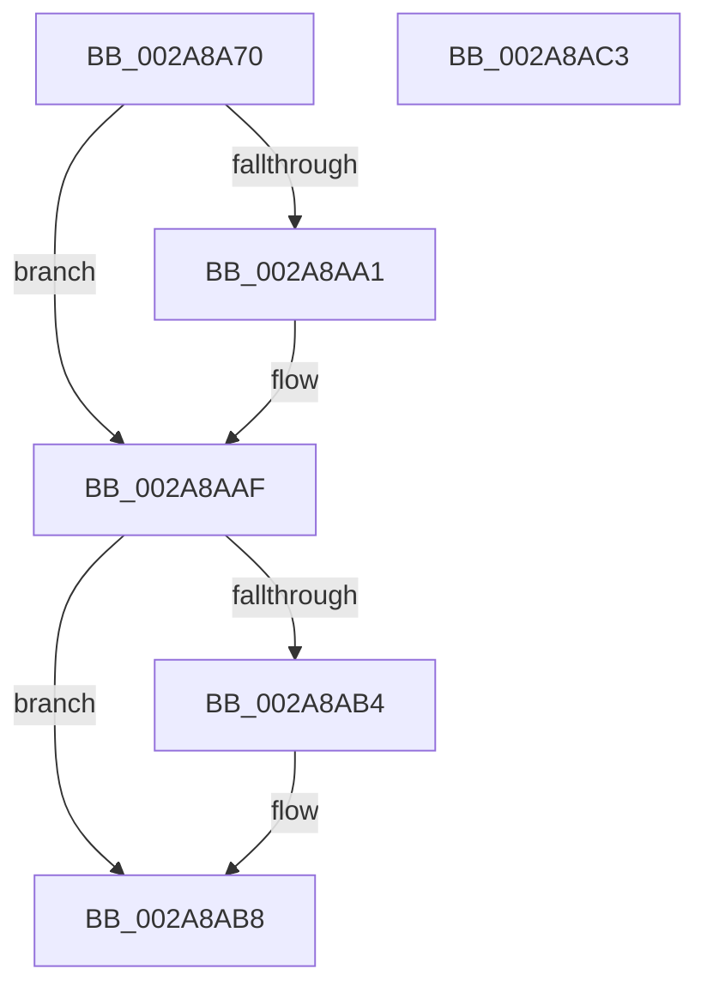

# MiLockWsSwapExclusive

- RVA: `0x002A8A70`–`0x002A8AC4` (길이 `84` bytes)
- VA: `0x00000001402A8A70`
- 실행 섹션: `.text`
- PDB 이름 있음: `예`; PDB Function 태그: `아니요`
- unwind 정보 RVA: `0x0005CAAC`
- 디코드: `25`개 명령, `84/84` bytes 표시
- 미해석 바이트: `0` (있으면 어셈블리에 `.byte`로 보존)

> 이 문서는 커널 이미지의 기계어와 PDB 기호를 분석해 생성했습니다. 4번과 5번은 함수 원형과 자료형을 바이너리 사용 방식에서 추정한 C 해석이며 원본 소스 복구 결과는 아닙니다.

## 1. Dependencies

- 직접 호출 지점: **2**; 고유 호출 대상: **2**
- 직접 호출자로 확인된 함수: **4**
- RIP 상대 이미지 참조: **0**

### Outgoing calls
- `0x002A8A91` → [KeAbPreAcquire](../21/KeAbPreAcquire_function_00210230.md) (function, `0x00210230`)
- `0x002A8AAA` → [ExfAcquirePushLockExclusiveEx](../20/ExfAcquirePushLockExclusiveEx_function_0020FC90.md) (function, `0x0020FC90`)

### Direct callers
- [MmOutSwapWorkingSet](MmOutSwapWorkingSet_function_002A6BC8.md) at `0x002A6D49`
- [MmOutSwapVirtualAddresses](MmOutSwapVirtualAddresses_function_002A8C30.md) at `0x002A8CFD`
- [MiTrimUnusedPageFileRegionsWorker](MiTrimUnusedPageFileRegionsWorker_function_002AA320.md) at `0x002AA3B4`
- [MiContractWsSwapPageFileWorker](../68/MiContractWsSwapPageFileWorker_function_0068B860.md) at `0x0068B8E5`

### Static image references
- 디코드된 RIP-relative 메모리 참조가 없습니다.

## 2. Other-region calls and transfers

- 다른 실행 섹션으로 향하는 call: **0**
- 별도 외부 분기/꼬리 이동을 확인하지 못했습니다.

## 3. Assembly (complete function range)

```asm
002A8A70  48 89 5C 24 08                  mov qword ptr [rsp + 8], rbx
002A8A75  57                              push rdi
002A8A76  48 83 EC 20                     sub rsp, 0x20
002A8A7A  66 FF 89 E6 01 00 00            dec word ptr [rcx + 0x1e6]
002A8A81  48 8D BA 98 04 00 00            lea rdi, [rdx + 0x498]
002A8A88  48 8B CF                        mov rcx, rdi
002A8A8B  45 33 C0                        xor r8d, r8d
002A8A8E  33 D2                           xor edx, edx
002A8A90  90                              nop
002A8A91  E8 9A 77 F6 FF                  call 0x140210230
002A8A96  F0 48 0F BA 2F 00               lock bts qword ptr [rdi], 0
002A8A9C  48 8B D8                        mov rbx, rax
002A8A9F  73 0E                           jae 0x1402a8aaf
002A8AA1  4C 8B C7                        mov r8, rdi
002A8AA4  48 8B D0                        mov rdx, rax
002A8AA7  48 8B CF                        mov rcx, rdi
002A8AAA  E8 E1 71 F6 FF                  call 0x14020fc90
002A8AAF  48 85 DB                        test rbx, rbx
002A8AB2  74 04                           je 0x1402a8ab8
002A8AB4  C6 43 0A 01                     mov byte ptr [rbx + 0xa], 1
002A8AB8  48 8B 5C 24 30                  mov rbx, qword ptr [rsp + 0x30]
002A8ABD  48 83 C4 20                     add rsp, 0x20
002A8AC1  5F                              pop rdi
002A8AC2  C3                              ret
002A8AC3  CC                              int3
```

## 4. C-style interpretation (structured pseudocode)

```c
__int64 __fastcall MiLockWsSwapExclusive(__int64 a1, __int64 a2, int a3)
{
    __int64 result;
    __int64 v_rsp;
    unsigned __int64 v_stack_p8;

    v_stack_p8 = v_rbx;
    v_rsp = (v_rsp) - (32);
    a3 = 0;
    a2 = 0;
    result = KeAbPreAcquire(a2 + 1176, a2, a3, a4);
    if (!(condition_is_above_or_equal)) {
        a3 = a2 + 1176;
        a2 = result;
        a1 = a2 + 1176;
        result = ExfAcquirePushLockExclusiveEx(a1, a2, a3, a4);
    }
    if (result != 0) {
        *(unsigned __int8 *)(result + 10) = 1;
    }
    v_rsp = (v_rsp) + (32);
    return result;
}
```

## 5. (Beta) C Style

```c
int64_t MiLockWsSwapExclusive(void *Arg1, void *Arg2, int32_t Arg3)
{
    uint8_t *arg1 = (uint8_t *)Arg1;
    uint8_t *arg2 = (uint8_t *)Arg2;

    int64_t result;
    int64_t local_rsp;
    uint64_t v_stack_p8;

    v_stack_p8 = local_rbx;
    local_rsp = (local_rsp) - (32);
    Arg3 = 0;
    Arg2 = 0;
    result = KeAbPreAcquire(Arg2 + 1176, Arg2, Arg3, a4);
    if (!(condition_is_above_or_equal)) {
        Arg3 = Arg2 + 1176;
        Arg2 = result;
        Arg1 = Arg2 + 1176;
        result = ExfAcquirePushLockExclusiveEx(Arg1, Arg2, Arg3, a4);
    }
    if (result != 0) {
        *(uint8_t *)(result + 0xA) = 1;
    }
    local_rsp = (local_rsp) + (32);
    return result;
}
```

### 관측된 메모리 오프셋

구조체 형식이 확인되지 않은 접근은 인자 기준의 오프셋으로만 기록했습니다.

| 기준 인자 | 오프셋 표현 | 폭 (bit) | 접근 |
|---|---:|---:|---|
| `Arg1` | `+ 0x1E6` | `16` | `R/W` |
| `Arg2` | `+ 0x0` | `64` | `R/W` |
| `Arg2` | `+ 0x498` | `64` | `R` |

## 6. Execution-region graph

[열기: 2D/3D 그래프와 함수 탐색 컨트롤 패널](../../../control-panel.html?section=text&rva=0x002A8A70&view=graph)

- 2D 그래프는 위에서 아래로 흐르고, 3D 그래프는 빈 공간을 드래그해 회전합니다. Shift+드래그는 이동, 휠은 확대·축소, 함수 노드 선택은 대상 보고서 이동입니다.

### Static fallback


