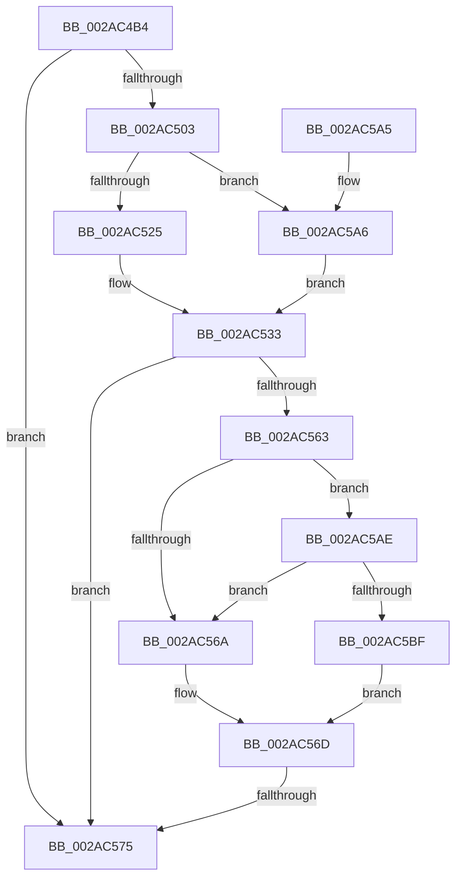

# MiLogTrimWs

- RVA: `0x002AC4B4`–`0x002AC5C1` (길이 `269` bytes)
- VA: `0x00000001402AC4B4`
- 실행 섹션: `.text`
- PDB 이름 있음: `예`; PDB Function 태그: `예`
- unwind 정보 RVA: `0x0006D158`
- 디코드: `67`개 명령, `269/269` bytes 표시
- 미해석 바이트: `0` (있으면 어셈블리에 `.byte`로 보존)

> 이 문서는 커널 이미지의 기계어와 PDB 기호를 분석해 생성했습니다. 4번과 5번은 함수 원형과 자료형을 바이너리 사용 방식에서 추정한 C 해석이며 원본 소스 복구 결과는 아닙니다.

## 1. Dependencies

- 직접 호출 지점: **1**; 고유 호출 대상: **1**
- 직접 호출자로 확인된 함수: **1**
- RIP 상대 이미지 참조: **3**

### Outgoing calls
- `0x002AC57F` → [_security_check_cookie](../6A/_security_check_cookie_function_006AC640.md) (function, `0x006AC640`)

### Direct callers
- [MiTrimWorkingSet](MiTrimWorkingSet_function_002AD134.md) at `0x002AD361`

### Static image references
- `0x002AC4DA` → RVA `0x00E0A740` (`.data`; read)
- `0x002AC4F1` → RVA `0x00E37618` (`.data`; read)
- `0x002AC503` → RVA `0x00E30088` (`.data`; read)

## 2. Other-region calls and transfers

- 다른 실행 섹션으로 향하는 call: **0**
- call이 아닌 외부 분기/꼬리 이동: **1**
  - `0x002AC56F` → [sub_006DB344](../6D/Unknown_function_006DB344.md) (`tail-transfer`)

## 3. Assembly (complete function range)

```asm
002AC4B4  48 8B C4                        mov rax, rsp
002AC4B7  48 89 58 10                     mov qword ptr [rax + 0x10], rbx
002AC4BB  48 89 70 18                     mov qword ptr [rax + 0x18], rsi
002AC4BF  48 89 78 20                     mov qword ptr [rax + 0x20], rdi
002AC4C3  55                              push rbp
002AC4C4  41 54                           push r12
002AC4C6  41 55                           push r13
002AC4C8  41 56                           push r14
002AC4CA  41 57                           push r15
002AC4CC  48 8D A8 18 FF FF FF            lea rbp, [rax - 0xe8]
002AC4D3  48 81 EC C0 01 00 00            sub rsp, 0x1c0
002AC4DA  48 8B 05 5F E2 B5 00            mov rax, qword ptr [rip + 0xb5e25f]
002AC4E1  48 33 C4                        xor rax, rsp
002AC4E4  48 89 85 B0 00 00 00            mov qword ptr [rbp + 0xb0], rax
002AC4EB  45 33 ED                        xor r13d, r13d
002AC4EE  49 8B D9                        mov rbx, r9
002AC4F1  4C 39 2D 20 B1 B8 00            cmp qword ptr [rip + 0xb8b120], r13
002AC4F8  49 8B F8                        mov rdi, r8
002AC4FB  48 8B F2                        mov rsi, rdx
002AC4FE  4C 8B D1                        mov r10, rcx
002AC501  74 72                           je 0x1402ac575
002AC503  48 8B 05 7E 3B B8 00            mov rax, qword ptr [rip + 0xb83b7e]
002AC50A  44 0F B7 81 AE 00 00 00         movzx r8d, word ptr [rcx + 0xae]
002AC512  4A 8B 0C C0                     mov rcx, qword ptr [rax + r8*8]
002AC516  41 8B 82 B8 00 00 00            mov eax, dword ptr [r10 + 0xb8]
002AC51D  A8 0F                           test al, 0xf
002AC51F  0F 85 81 00 00 00               jne 0x1402ac5a6
002AC525  45 8B 8A D0 FD FF FF            mov r9d, dword ptr [r10 - 0x230]
002AC52C  49 8D 92 38 FF FF FF            lea rdx, [r10 - 0xc8]
002AC533  48 8B 81 C0 4B 00 00            mov rax, qword ptr [rcx + 0x4bc0]
002AC53A  4D 8B BA 90 00 00 00            mov r15, qword ptr [r10 + 0x90]
002AC541  4D 8B A2 98 00 00 00            mov r12, qword ptr [r10 + 0x98]
002AC548  4C 8B 05 C9 B0 B8 00            mov r8, qword ptr [rip + 0xb8b0c9]
002AC54F  4C 8B B1 00 49 00 00            mov r14, qword ptr [rcx + 0x4900]
002AC556  4C 8B 99 A0 4C 00 00            mov r11, qword ptr [rcx + 0x4ca0]
002AC55D  41 83 38 05                     cmp dword ptr [r8], 5
002AC561  76 12                           jbe 0x1402ac575
002AC563  41 F6 40 10 01                  test byte ptr [r8 + 0x10], 1
002AC568  75 44                           jne 0x1402ac5ae
002AC56A  41 8A C5                        mov al, r13b
002AC56D  84 C0                           test al, al
002AC56F  0F 85 CF ED 42 00               jne 0x1406db344
002AC575  48 8B 8D B0 00 00 00            mov rcx, qword ptr [rbp + 0xb0]
002AC57C  48 33 CC                        xor rcx, rsp
002AC57F  E8 BC 00 40 00                  call 0x1406ac640
002AC584  4C 8D 9C 24 C0 01 00 00         lea r11, [rsp + 0x1c0]
002AC58C  49 8B 5B 38                     mov rbx, qword ptr [r11 + 0x38]
002AC590  49 8B 73 40                     mov rsi, qword ptr [r11 + 0x40]
002AC594  49 8B 7B 48                     mov rdi, qword ptr [r11 + 0x48]
002AC598  49 8B E3                        mov rsp, r11
002AC59B  41 5F                           pop r15
002AC59D  41 5E                           pop r14
002AC59F  41 5D                           pop r13
002AC5A1  41 5C                           pop r12
002AC5A3  5D                              pop rbp
002AC5A4  C3                              ret
002AC5A5  CC                              int3
002AC5A6  45 8B CD                        mov r9d, r13d
002AC5A9  49 8B D5                        mov rdx, r13
002AC5AC  EB 85                           jmp 0x1402ac533
002AC5AE  49 8B 48 18                     mov rcx, qword ptr [r8 + 0x18]
002AC5B2  48 8B C1                        mov rax, rcx
002AC5B5  83 E0 01                        and eax, 1
002AC5B8  48 3B C1                        cmp rax, rcx
002AC5BB  B0 01                           mov al, 1
002AC5BD  75 AB                           jne 0x1402ac56a
002AC5BF  EB AC                           jmp 0x1402ac56d
```

## 4. C-style interpretation (structured pseudocode)

```c
__int64 __fastcall MiLogTrimWs(__int64 a1, __int64 a2, __int64 a3, __int64 a4)
{
    __int64 result;
    __int64 v_r13;
    __int64 v_rsp;
    unsigned __int64 v_stack_m28;

    *(unsigned __int64 *)(v_rsp + 16) = v_rbx;
    *(unsigned __int64 *)(v_rsp + 24) = v_rsi;
    *(unsigned __int64 *)(v_rsp + 32) = v_rdi;
    v_rsp = (v_rsp) - (448);
    result = (*(unsigned __int64 *)(v_rip + 11919967)) ^ (v_rsp);
    *(unsigned __int64 *)(v_rsp - 232 + 176) = result;
    v_r13 = 0;
    if ((*(unsigned __int64 *)(v_rip + 12103968)) == 0) goto loc_002AC575;
    if ((((unsigned __int8)((unsigned int)(*(unsigned int *)(a1 + 184)))) & (15)) != 0) goto loc_002AC5A6;
loc_002AC533:
    if ((*(unsigned int *)(*(unsigned __int64 *)(v_rip + 12103881))) <= 5) goto loc_002AC575;
    if (((*(unsigned __int8 *)(*(unsigned __int64 *)(v_rip + 12103881) + 16)) & (1)) != 0) goto loc_002AC5AE;
loc_002AC56A:
loc_002AC56D:
loc_002AC575:
    a1 = (*(unsigned __int64 *)(v_rsp - 232 + 176)) ^ (v_rsp);
    result = _security_check_cookie(a1, a1 - 200, *(unsigned __int64 *)(v_rip + 12103881), (unsigned int)(*(unsigned int *)(a1 - 560)));
    return result;
loc_002AC5A6:
    goto loc_002AC533;
loc_002AC5AE:
    result = (unsigned int)((*(unsigned __int64 *)(*(unsigned __int64 *)(v_rip + 12103881) + 24)) & (1));
    if (result != (*(unsigned __int64 *)(*(unsigned __int64 *)(v_rip + 12103881) + 24))) goto loc_002AC56A;
    goto loc_002AC56D;
}
```

## 5. (Beta) C Style

```c
int64_t MiLogTrimWs(void *Arg1, int64_t Arg2, int64_t Arg3, int64_t Arg4)
{
    uint8_t *arg1 = (uint8_t *)Arg1;

    int64_t result;
    int64_t local_r13;
    int64_t local_rsp;
    uint64_t v_stack_m28;

    *(uint64_t *)(local_rsp + 0x10) = local_rbx;
    *(uint64_t *)(local_rsp + 0x18) = local_rsi;
    *(uint64_t *)(local_rsp + 0x20) = local_rdi;
    local_rsp = (local_rsp) - (448);
    result = (*(uint64_t *)(v_rip + 0xB5E25F)) ^ (local_rsp);
    *(uint64_t *)(local_rsp - 0xE8 + 0xB0) = result;
    local_r13 = 0;
    if ((*(uint64_t *)(v_rip + 0xB8B120)) == 0) goto loc_002AC575;
    if ((((uint8_t)((uint32_t)(*(uint32_t *)(arg1 + 0xB8)))) & (15)) != 0) goto loc_002AC5A6;
loc_002AC533:
    if ((*(uint32_t *)(*(uint64_t *)(v_rip + 0xB8B0C9))) <= 5) goto loc_002AC575;
    if (((*(uint8_t *)(*(uint64_t *)(v_rip + 0xB8B0C9) + 0x10)) & (1)) != 0) goto loc_002AC5AE;
loc_002AC56A:
loc_002AC56D:
loc_002AC575:
    Arg1 = (*(uint64_t *)(local_rsp - 0xE8 + 0xB0)) ^ (local_rsp);
    result = _security_check_cookie(Arg1, Arg1 - 200, *(uint64_t *)(v_rip + 0xB8B0C9), (uint32_t)(*(uint32_t *)(arg1 - 0x230)));
    return result;
loc_002AC5A6:
    goto loc_002AC533;
loc_002AC5AE:
    result = (uint32_t)((*(uint64_t *)(*(uint64_t *)(v_rip + 0xB8B0C9) + 0x18)) & (1));
    if (result != (*(uint64_t *)(*(uint64_t *)(v_rip + 0xB8B0C9) + 0x18))) goto loc_002AC56A;
    goto loc_002AC56D;
}
```

### 관측된 메모리 오프셋

구조체 형식이 확인되지 않은 접근은 인자 기준의 오프셋으로만 기록했습니다.

| 기준 인자 | 오프셋 표현 | 폭 (bit) | 접근 |
|---|---:|---:|---|
| `Arg1` | `- 0x230` | `32` | `R` |
| `Arg1` | `- 0xC8` | `64` | `R` |
| `Arg1` | `+ 0x90` | `64` | `R` |
| `Arg1` | `+ 0x98` | `64` | `R` |
| `Arg1` | `+ 0xAE` | `16` | `R` |
| `Arg1` | `+ 0xB8` | `32` | `R` |

## 6. Execution-region graph

[열기: 2D/3D 그래프와 함수 탐색 컨트롤 패널](../../../control-panel.html?section=text&rva=0x002AC4B4&view=graph)

- 2D 그래프는 위에서 아래로 흐르고, 3D 그래프는 빈 공간을 드래그해 회전합니다. Shift+드래그는 이동, 휠은 확대·축소, 함수 노드 선택은 대상 보고서 이동입니다.

### Static fallback


