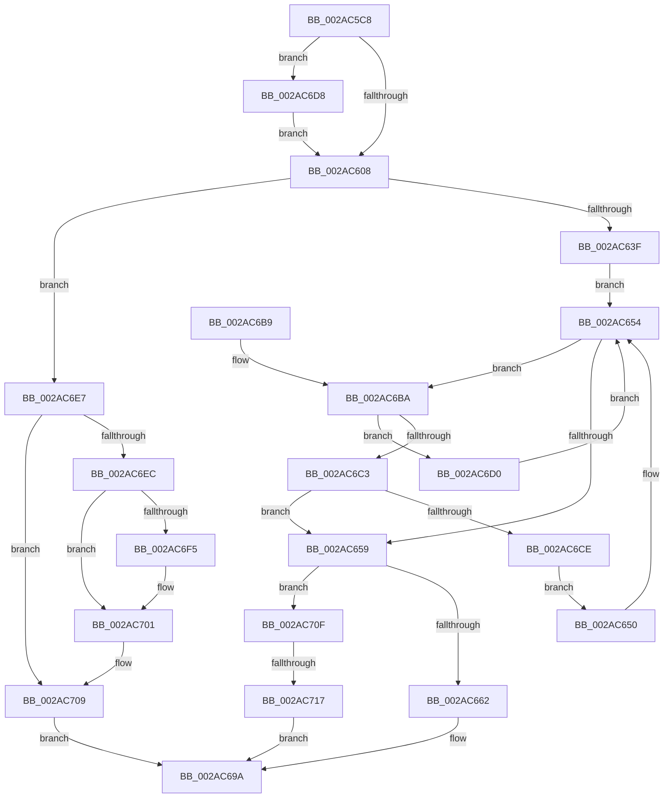

# MiLookupIoPageNode

- RVA: `0x002AC5C8`–`0x002AC71F` (길이 `343` bytes)
- VA: `0x00000001402AC5C8`
- 실행 섹션: `.text`
- PDB 이름 있음: `예`; PDB Function 태그: `예`
- unwind 정보 RVA: `0x0006D194`
- 디코드: `97`개 명령, `343/343` bytes 표시
- 미해석 바이트: `0` (있으면 어셈블리에 `.byte`로 보존)

> 이 문서는 커널 이미지의 기계어와 PDB 기호를 분석해 생성했습니다. 4번과 5번은 함수 원형과 자료형을 바이너리 사용 방식에서 추정한 C 해석이며 원본 소스 복구 결과는 아닙니다.

## 1. Dependencies

- 직접 호출 지점: **5**; 고유 호출 대상: **5**
- 직접 호출자로 확인된 함수: **5**
- RIP 상대 이미지 참조: **3**

### Outgoing calls
- `0x002AC62F` → [MiIoSpaceGetBounds](MiIoSpaceGetBounds_function_002AC728.md) (function, `0x002AC728`)
- `0x002AC642` → [MiLockIoPfnTree](MiLockIoPfnTree_function_002AC8A4.md) (function, `0x002AC8A4`)
- `0x002AC690` → [MiUnlockIoPfnTree](MiUnlockIoPfnTree_function_002AC7F8.md) (function, `0x002AC7F8`)
- `0x002AC6DD` → [KiRaiseIrqlProcessIrqlFlags](../4F/KiRaiseIrqlProcessIrqlFlags_function_004F56FC.md) (function, `0x004F56FC`)
- `0x002AC6FC` → [KiLowerIrqlProcessIrqlFlags](../4F/KiLowerIrqlProcessIrqlFlags_function_004F5698.md) (function, `0x004F5698`)

### Direct callers
- [MmProtectMdlSystemAddress](../22/MmProtectMdlSystemAddress_function_00227B50.md) at `0x00227E26`
- [MiInsertPhysicalPteMapping](MiInsertPhysicalPteMapping_function_002AE26C.md) at `0x002AE31B`
- [MiMapMdlWithLargePages](../4D/MiMapMdlWithLargePages_function_004D10B8.md) at `0x004D13F3`
- [MiMapMdlCommon](../67/MiMapMdlCommon_function_00674524.md) at `0x00674A42`
- [MmGetCacheAttributeEx](../67/MmGetCacheAttributeEx_function_00674F80.md) at `0x00675030`

### Static image references
- `0x002AC5FC` → RVA `0x00FC6D20` (`ALMOSTRO`; read)
- `0x002AC647` → RVA `0x00E372C0` (`.data`; read)
- `0x002AC662` → RVA `0x00E2DC38` (`.data`; read)

## 2. Other-region calls and transfers

- 다른 실행 섹션으로 향하는 call: **0**
- call이 아닌 외부 분기/꼬리 이동: **1**
  - `0x002AC711` → [sub_006DB4D8](../6D/Unknown_function_006DB4D8.md) (`tail-transfer`)

## 3. Assembly (complete function range)

```asm
002AC5C8  4C 8B DC                        mov r11, rsp
002AC5CB  49 89 5B 08                     mov qword ptr [r11 + 8], rbx
002AC5CF  49 89 6B 10                     mov qword ptr [r11 + 0x10], rbp
002AC5D3  49 89 73 18                     mov qword ptr [r11 + 0x18], rsi
002AC5D7  49 89 7B 20                     mov qword ptr [r11 + 0x20], rdi
002AC5DB  41 54                           push r12
002AC5DD  41 55                           push r13
002AC5DF  41 56                           push r14
002AC5E1  48 83 EC 50                     sub rsp, 0x50
002AC5E5  33 C0                           xor eax, eax
002AC5E7  8B EA                           mov ebp, edx
002AC5E9  49 89 43 D8                     mov qword ptr [r11 - 0x28], rax
002AC5ED  48 8B F1                        mov rsi, rcx
002AC5F0  44 0F 20 C3                     mov rbx, cr8
002AC5F4  44 8D 60 02                     lea r12d, [rax + 2]
002AC5F8  45 0F 22 C4                     mov cr8, r12
002AC5FC  39 05 1E A7 D1 00               cmp dword ptr [rip + 0xd1a71e], eax
002AC602  0F 85 D0 00 00 00               jne 0x1402ac6d8
002AC608  41 BA 11 00 00 00               mov r10d, 0x11
002AC60E  0F B6 FB                        movzx edi, bl
002AC611  41 3A DC                        cmp bl, r12b
002AC614  48 8D 4C 24 30                  lea rcx, [rsp + 0x30]
002AC619  48 8B D6                        mov rdx, rsi
002AC61C  41 0F 44 FA                     cmove edi, r10d
002AC620  45 8D 5A F4                     lea r11d, [r10 - 0xc]
002AC624  45 8B F3                        mov r14d, r11d
002AC627  45 8D 6A F0                     lea r13d, [r10 - 0x10]
002AC62B  45 0F 45 F5                     cmovne r14d, r13d
002AC62F  E8 F4 00 00 00                  call 0x1402ac728
002AC634  83 7C 24 44 03                  cmp dword ptr [rsp + 0x44], 3
002AC639  0F 85 A8 00 00 00               jne 0x1402ac6e7
002AC63F  41 8B CB                        mov ecx, r11d
002AC642  E8 5D 02 00 00                  call 0x1402ac8a4
002AC647  48 8B 1D 72 AC B8 00            mov rbx, qword ptr [rip + 0xb8ac72]
002AC64E  EB 04                           jmp 0x1402ac654
002AC650  48 8B 5B 08                     mov rbx, qword ptr [rbx + 8]
002AC654  48 85 DB                        test rbx, rbx
002AC657  75 61                           jne 0x1402ac6ba
002AC659  48 85 DB                        test rbx, rbx
002AC65C  0F 84 AD 00 00 00               je 0x1402ac70f
002AC662  8A 0D D0 15 B8 00               mov cl, byte ptr [rip + 0xb815d0]
002AC668  49 8B C5                        mov rax, r13
002AC66B  80 C1 F4                        add cl, 0xf4
002AC66E  41 8B D6                        mov edx, r14d
002AC671  48 D3 E0                        shl rax, cl
002AC674  41 2B C5                        sub eax, r13d
002AC677  23 C6                           and eax, esi
002AC679  2B 43 18                        sub eax, dword ptr [rbx + 0x18]
002AC67C  03 C0                           add eax, eax
002AC67E  8B C8                           mov ecx, eax
002AC680  83 E1 1F                        and ecx, 0x1f
002AC683  48 C1 E8 05                     shr rax, 5
002AC687  8B 5C 83 2C                     mov ebx, dword ptr [rbx + rax*4 + 0x2c]
002AC68B  D3 EB                           shr ebx, cl
002AC68D  40 8A CF                        mov cl, dil
002AC690  E8 63 01 00 00                  call 0x1402ac7f8
002AC695  83 E3 03                        and ebx, 3
002AC698  8B C3                           mov eax, ebx
002AC69A  4C 8D 5C 24 50                  lea r11, [rsp + 0x50]
002AC69F  49 8B 5B 20                     mov rbx, qword ptr [r11 + 0x20]
002AC6A3  49 8B 6B 28                     mov rbp, qword ptr [r11 + 0x28]
002AC6A7  49 8B 73 30                     mov rsi, qword ptr [r11 + 0x30]
002AC6AB  49 8B 7B 38                     mov rdi, qword ptr [r11 + 0x38]
002AC6AF  49 8B E3                        mov rsp, r11
002AC6B2  41 5E                           pop r14
002AC6B4  41 5D                           pop r13
002AC6B6  41 5C                           pop r12
002AC6B8  C3                              ret
002AC6B9  CC                              int3
002AC6BA  48 8B 43 18                     mov rax, qword ptr [rbx + 0x18]
002AC6BE  48 3B F0                        cmp rsi, rax
002AC6C1  72 0D                           jb 0x1402ac6d0
002AC6C3  48 05 00 02 00 00               add rax, 0x200
002AC6C9  48 3B F0                        cmp rsi, rax
002AC6CC  72 8B                           jb 0x1402ac659
002AC6CE  EB 80                           jmp 0x1402ac650
002AC6D0  48 8B 1B                        mov rbx, qword ptr [rbx]
002AC6D3  E9 7C FF FF FF                  jmp 0x1402ac654
002AC6D8  41 8A D4                        mov dl, r12b
002AC6DB  8A CB                           mov cl, bl
002AC6DD  E8 1A 90 24 00                  call 0x1404f56fc
002AC6E2  E9 21 FF FF FF                  jmp 0x1402ac608
002AC6E7  41 3A FA                        cmp dil, r10b
002AC6EA  74 1D                           je 0x1402ac709
002AC6EC  83 3D 2D A6 D1 00 00            cmp dword ptr [rip + 0xd1a62d], 0
002AC6F3  74 0C                           je 0x1402ac701
002AC6F5  44 0F 20 C1                     mov rcx, cr8
002AC6F9  40 8A D7                        mov dl, dil
002AC6FC  E8 97 8F 24 00                  call 0x1404f5698
002AC701  40 0F B6 C7                     movzx eax, dil
002AC705  44 0F 22 C0                     mov cr8, rax
002AC709  8B 44 24 40                     mov eax, dword ptr [rsp + 0x40]
002AC70D  EB 8B                           jmp 0x1402ac69a
002AC70F  85 ED                           test ebp, ebp
002AC711  0F 85 C1 ED 42 00               jne 0x1406db4d8
002AC717  8D 45 03                        lea eax, [rbp + 3]
002AC71A  E9 7B FF FF FF                  jmp 0x1402ac69a
```

## 4. C-style interpretation (structured pseudocode)

```c
__int64 __fastcall MiLookupIoPageNode(__int64 a1, int a2)
{
    __int64 result;
    __int64 v_r14;
    __int64 v_rbx;
    __int64 v_rdi;
    __int64 v_rsp;
    unsigned int v_stack_m10;
    unsigned __int64 v_stack_m18;
    unsigned int v_stack_m24;
    unsigned __int64 v_stack_m38;

    *(unsigned __int64 *)(v_rsp + 8) = v_rbx;
    *(unsigned __int64 *)(v_rsp + 16) = v_rbp;
    *(unsigned __int64 *)(v_rsp + 24) = v_rsi;
    *(unsigned __int64 *)(v_rsp + 32) = v_rdi;
    v_rsp = (v_rsp) - (80);
    result = 0;
    *(unsigned __int64 *)(v_rsp - 40) = 0;
    if ((*(unsigned int *)(v_rip + 13739806)) != 0) goto loc_002AC6D8;
loc_002AC608:
    v_rdi = (unsigned __int8)(v_cr8);
    if (((unsigned __int8)(v_cr8)) == ((unsigned __int8)(result + 2))) { v_rdi = 17; }
    v_r14 = (unsigned int)((unsigned int)(17 - 12));
    if (((unsigned __int8)(v_cr8)) != ((unsigned __int8)(result + 2))) { v_r14 = (unsigned int)(17 - 16); }
    result = MiIoSpaceGetBounds(v_stack_m38, a1, a3, a4);
    if (v_stack_m24 != 3) goto loc_002AC6E7;
    result = MiLockIoPfnTree((unsigned int)((unsigned int)(17 - 12)), a1, a3, a4);
    goto loc_002AC654;
loc_002AC650:
loc_002AC654:
    if (*(unsigned __int64 *)(*(unsigned __int64 *)(v_rip + 12102770) + 8) != 0) goto loc_002AC6BA;
loc_002AC659:
    if (*(unsigned __int64 *)(*(unsigned __int64 *)(v_rip + 12102770) + 8) == 0) goto loc_002AC70F;
    a1 = (unsigned __int8)((*(unsigned __int8 *)(v_rip + 12064208)) + (244));
    result = (17 - 16) << ((unsigned __int8)(a1));
    result = (unsigned int)((result) - ((unsigned int)(17 - 16)));
    result = (unsigned int)((result) & ((unsigned int)(a1)));
    result = (unsigned int)((result) - (*(unsigned int *)(*(unsigned __int64 *)(*(unsigned __int64 *)(v_rip + 12102770) + 8) + 24)));
    result = (unsigned int)((result) + ((unsigned int)(result)));
    a1 = (unsigned int)(((unsigned int)((unsigned int)(result))) & (31));
    result = (result) >> (5);
    v_rbx = (unsigned int)(((unsigned int)(*(unsigned int *)(*(unsigned __int64 *)(*(unsigned __int64 *)(v_rip + 12102770) + 8) + result * 4 + 44))) >> ((unsigned __int8)(a1)));
    result = MiUnlockIoPfnTree((unsigned __int8)(v_rdi), (unsigned int)((unsigned int)(v_r14)), a3, a4);
    v_rbx = (unsigned int)((v_rbx) & (3));
loc_002AC69A:
    return (unsigned int)((unsigned int)(v_rbx));
loc_002AC6BA:
    if ((*(unsigned __int64 *)(v_stack_m18 + 48)) < (*(unsigned __int64 *)(*(unsigned __int64 *)(v_stack_m18 + 32) + 24))) goto loc_002AC6D0;
    result = (*(unsigned __int64 *)(*(unsigned __int64 *)(v_stack_m18 + 32) + 24)) + (512);
    if ((*(unsigned __int64 *)(v_stack_m18 + 48)) < result) goto loc_002AC659;
    goto loc_002AC650;
loc_002AC6D0:
    goto loc_002AC654;
loc_002AC6D8:
    result = KiRaiseIrqlProcessIrqlFlags((unsigned __int8)(*(unsigned __int64 *)(*(unsigned __int64 *)(v_stack_m18 + 32))), (unsigned __int8)(result + 2), a3, a4);
    goto loc_002AC608;
loc_002AC6E7:
    if (((unsigned __int8)(*(unsigned __int64 *)(v_stack_m18 + 56))) == 17) goto loc_002AC709;
    if ((*(unsigned int *)(v_rip + 13739565)) != 0) {
        a1 = result + 2;
        a2 = (unsigned __int8)(*(unsigned __int64 *)(v_stack_m18 + 56));
        result = KiLowerIrqlProcessIrqlFlags(a1, a2, a3, a4);
    }
loc_002AC709:
    goto loc_002AC69A;
loc_002AC70F:
    goto loc_002AC69A;
}
```

## 5. (Beta) C Style

```c
int64_t MiLookupIoPageNode(int64_t Arg1, int32_t Arg2)
{
    int64_t result;
    int64_t local_r14;
    int64_t local_rbx;
    int64_t local_rdi;
    int64_t local_rsp;
    uint32_t v_stack_m10;
    uint64_t v_stack_m18;
    uint32_t v_stack_m24;
    uint64_t v_stack_m38;

    *(uint64_t *)(local_rsp + 0x8) = local_rbx;
    *(uint64_t *)(local_rsp + 0x10) = local_rbp;
    *(uint64_t *)(local_rsp + 0x18) = local_rsi;
    *(uint64_t *)(local_rsp + 0x20) = local_rdi;
    local_rsp = (local_rsp) - (80);
    result = 0;
    *(uint64_t *)(local_rsp - 0x28) = 0;
    if ((*(uint32_t *)(v_rip + 0xD1A71E)) != 0) goto loc_002AC6D8;
loc_002AC608:
    local_rdi = (uint8_t)(v_cr8);
    if (((uint8_t)(v_cr8)) == ((uint8_t)(result + 2))) { local_rdi = 17; }
    local_r14 = (uint32_t)((uint32_t)(17 - 12));
    if (((uint8_t)(v_cr8)) != ((uint8_t)(result + 2))) { local_r14 = (uint32_t)(17 - 16); }
    result = MiIoSpaceGetBounds(v_stack_m38, Arg1, a3, a4);
    if (v_stack_m24 != 3) goto loc_002AC6E7;
    result = MiLockIoPfnTree((uint32_t)((uint32_t)(17 - 12)), Arg1, a3, a4);
    goto loc_002AC654;
loc_002AC650:
loc_002AC654:
    if (*(uint64_t *)(*(uint64_t *)(v_rip + 0xB8AC72) + 0x8) != 0) goto loc_002AC6BA;
loc_002AC659:
    if (*(uint64_t *)(*(uint64_t *)(v_rip + 0xB8AC72) + 0x8) == 0) goto loc_002AC70F;
    Arg1 = (uint8_t)((*(uint8_t *)(v_rip + 0xB815D0)) + (244));
    result = (17 - 16) << ((uint8_t)(Arg1));
    result = (uint32_t)((result) - ((uint32_t)(17 - 16)));
    result = (uint32_t)((result) & ((uint32_t)(Arg1)));
    result = (uint32_t)((result) - (*(uint32_t *)(*(uint64_t *)(*(uint64_t *)(v_rip + 0xB8AC72) + 0x8) + 0x18)));
    result = (uint32_t)((result) + ((uint32_t)(result)));
    Arg1 = (uint32_t)(((uint32_t)((uint32_t)(result))) & (31));
    result = (result) >> (5);
    local_rbx = (uint32_t)(((uint32_t)(*(uint32_t *)(*(uint64_t *)(*(uint64_t *)(v_rip + 0xB8AC72) + 0x8) + result * 4 + 0x2C))) >> ((uint8_t)(Arg1)));
    result = MiUnlockIoPfnTree((uint8_t)(local_rdi), (uint32_t)((uint32_t)(local_r14)), a3, a4);
    local_rbx = (uint32_t)((local_rbx) & (3));
loc_002AC69A:
    return (uint32_t)((uint32_t)(local_rbx));
loc_002AC6BA:
    if ((*(uint64_t *)(v_stack_m18 + 0x30)) < (*(uint64_t *)(*(uint64_t *)(v_stack_m18 + 0x20) + 0x18))) goto loc_002AC6D0;
    result = (*(uint64_t *)(*(uint64_t *)(v_stack_m18 + 0x20) + 0x18)) + (512);
    if ((*(uint64_t *)(v_stack_m18 + 0x30)) < result) goto loc_002AC659;
    goto loc_002AC650;
loc_002AC6D0:
    goto loc_002AC654;
loc_002AC6D8:
    result = KiRaiseIrqlProcessIrqlFlags((uint8_t)(*(uint64_t *)(*(uint64_t *)(v_stack_m18 + 0x20))), (uint8_t)(result + 2), a3, a4);
    goto loc_002AC608;
loc_002AC6E7:
    if (((uint8_t)(*(uint64_t *)(v_stack_m18 + 0x38))) == 17) goto loc_002AC709;
    if ((*(uint32_t *)(v_rip + 0xD1A62D)) != 0) {
        Arg1 = result + 2;
        Arg2 = (uint8_t)(*(uint64_t *)(v_stack_m18 + 0x38));
        result = KiLowerIrqlProcessIrqlFlags(Arg1, Arg2, a3, a4);
    }
loc_002AC709:
    goto loc_002AC69A;
loc_002AC70F:
    goto loc_002AC69A;
}
```

## 6. Execution-region graph

[열기: 2D/3D 그래프와 함수 탐색 컨트롤 패널](../../../control-panel.html?section=text&rva=0x002AC5C8&view=graph)

- 2D 그래프는 위에서 아래로 흐르고, 3D 그래프는 빈 공간을 드래그해 회전합니다. Shift+드래그는 이동, 휠은 확대·축소, 함수 노드 선택은 대상 보고서 이동입니다.

### Static fallback


