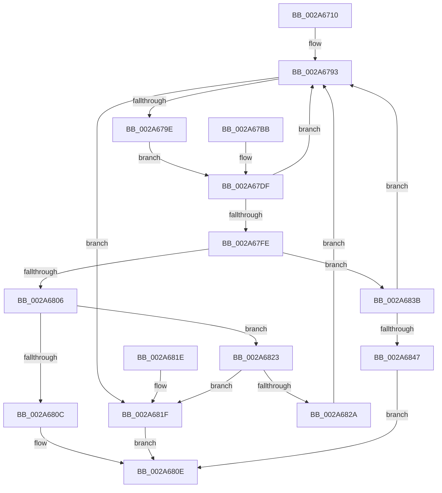

# MiMakeProtoLeafValid

- RVA: `0x002A6710`–`0x002A684B` (길이 `315` bytes)
- VA: `0x00000001402A6710`
- 실행 섹션: `.text`
- PDB 이름 있음: `예`; PDB Function 태그: `아니요`
- unwind 정보 RVA: `0x00068A88`
- 디코드: `88`개 명령, `315/315` bytes 표시
- 미해석 바이트: `0` (있으면 어셈블리에 `.byte`로 보존)

> 이 문서는 커널 이미지의 기계어와 PDB 기호를 분석해 생성했습니다. 4번과 5번은 함수 원형과 자료형을 바이너리 사용 방식에서 추정한 C 해석이며 원본 소스 복구 결과는 아닙니다.

## 1. Dependencies

- 직접 호출 지점: **4**; 고유 호출 대상: **4**
- 직접 호출자로 확인된 함수: **4**
- RIP 상대 이미지 참조: **0**

### Outgoing calls
- `0x002A67A4` → [MiUnlockPageTable](../21/MiUnlockPageTable_function_00216EC0.md) (function, `0x00216EC0`)
- `0x002A67AF` → [MiUnlockWorkingSetShared](../27/MiUnlockWorkingSetShared_function_0027D690.md) (function, `0x0027D690`)
- `0x002A67E2` → [MiLockWorkingSetShared](../27/MiLockWorkingSetShared_function_0027CBF0.md) (function, `0x0027CBF0`)
- `0x002A67F5` → [MiMakeSystemAddressValid](../27/MiMakeSystemAddressValid_function_0027FF70.md) (function, `0x0027FF70`)

### Direct callers
- [MiWalkVaRange](../24/MiWalkVaRange_function_00243BF0.md) at `0x00244ACD`
- [MiSplitPrivatePage](MiSplitPrivatePage_function_002A6210.md) at `0x002A65B1`
- [sub_002C3A7C](../2C/Unknown_function_002C3A7C.md) at `0x002C44BE`
- [MiProtectPrivateMemory](../2C/MiProtectPrivateMemory_function_002C45B0.md) at `0x002C4F3B`

### Static image references
- 디코드된 RIP-relative 메모리 참조가 없습니다.

## 2. Other-region calls and transfers

- 다른 실행 섹션으로 향하는 call: **0**
- 별도 외부 분기/꼬리 이동을 확인하지 못했습니다.

## 3. Assembly (complete function range)

```asm
002A6710  89 54 24 10                     mov dword ptr [rsp + 0x10], edx
002A6714  48 89 4C 24 08                  mov qword ptr [rsp + 8], rcx
002A6719  53                              push rbx
002A671A  56                              push rsi
002A671B  57                              push rdi
002A671C  41 54                           push r12
002A671E  41 55                           push r13
002A6720  41 56                           push r14
002A6722  41 57                           push r15
002A6724  48 83 EC 40                     sub rsp, 0x40
002A6728  45 8A E0                        mov r12b, r8b
002A672B  44 8B EA                        mov r13d, edx
002A672E  48 8B D9                        mov rbx, rcx
002A6731  65 48 8B 04 25 88 01 00 00      mov rax, qword ptr gs:[0x188]
002A673A  48 8B B0 B8 00 00 00            mov rsi, qword ptr [rax + 0xb8]
002A6741  48 81 C6 00 04 00 00            add rsi, 0x400
002A6748  48 89 74 24 28                  mov qword ptr [rsp + 0x28], rsi
002A674D  4C 8B F9                        mov r15, rcx
002A6750  49 C1 EF 09                     shr r15, 9
002A6754  48 B8 F8 FF FF FF 7F 00 00 00   movabs rax, 0x7ffffffff8
002A675E  4C 23 F8                        and r15, rax
002A6761  48 B9 00 00 00 00 80 F6 FF FF   movabs rcx, 0xfffff68000000000
002A676B  48 8B C1                        mov rax, rcx
002A676E  4C 03 F8                        add r15, rax
002A6771  4C 89 7C 24 20                  mov qword ptr [rsp + 0x20], r15
002A6776  4C 8B F3                        mov r14, rbx
002A6779  49 C1 E6 19                     shl r14, 0x19
002A677D  48 8B C1                        mov rax, rcx
002A6780  48 C1 E0 19                     shl rax, 0x19
002A6784  4C 2B F0                        sub r14, rax
002A6787  49 C1 FE 10                     sar r14, 0x10
002A678B  4C 89 B4 24 98 00 00 00         mov qword ptr [rsp + 0x98], r14
002A6793  48 8B 03                        mov rax, qword ptr [rbx]
002A6796  A8 01                           test al, 1
002A6798  0F 85 81 00 00 00               jne 0x1402a681f
002A679E  49 8B D7                        mov rdx, r15
002A67A1  48 8B CE                        mov rcx, rsi
002A67A4  E8 17 07 F7 FF                  call 0x140216ec0
002A67A9  41 8A D4                        mov dl, r12b
002A67AC  48 8B CE                        mov rcx, rsi
002A67AF  E8 DC 6E FD FF                  call 0x14027d690
002A67B4  33 FF                           xor edi, edi
002A67B6  49 8B 06                        mov rax, qword ptr [r14]
002A67B9  EB 24                           jmp 0x1402a67df
002A67BB  8B F8                           mov edi, eax
002A67BD  44 8B AC 24 88 00 00 00         mov r13d, dword ptr [rsp + 0x88]
002A67C5  48 8B 9C 24 80 00 00 00         mov rbx, qword ptr [rsp + 0x80]
002A67CD  4C 8B B4 24 98 00 00 00         mov r14, qword ptr [rsp + 0x98]
002A67D5  4C 8B 7C 24 20                  mov r15, qword ptr [rsp + 0x20]
002A67DA  48 8B 74 24 28                  mov rsi, qword ptr [rsp + 0x28]
002A67DF  48 8B CE                        mov rcx, rsi
002A67E2  E8 09 64 FD FF                  call 0x14027cbf0
002A67E7  44 8A E0                        mov r12b, al
002A67EA  45 33 C9                        xor r9d, r9d
002A67ED  44 8A C0                        mov r8b, al
002A67F0  33 D2                           xor edx, edx
002A67F2  48 8B CB                        mov rcx, rbx
002A67F5  E8 76 97 FD FF                  call 0x14027ff70
002A67FA  85 FF                           test edi, edi
002A67FC  79 95                           jns 0x1402a6793
002A67FE  81 FF 05 00 00 C0               cmp edi, 0xc0000005
002A6804  75 35                           jne 0x1402a683b
002A6806  41 83 FD 18                     cmp r13d, 0x18
002A680A  75 17                           jne 0x1402a6823
002A680C  8B C7                           mov eax, edi
002A680E  48 83 C4 40                     add rsp, 0x40
002A6812  41 5F                           pop r15
002A6814  41 5E                           pop r14
002A6816  41 5D                           pop r13
002A6818  41 5C                           pop r12
002A681A  5F                              pop rdi
002A681B  5E                              pop rsi
002A681C  5B                              pop rbx
002A681D  C3                              ret
002A681E  CC                              int3
002A681F  33 C0                           xor eax, eax
002A6821  EB EB                           jmp 0x1402a680e
002A6823  48 8B 03                        mov rax, qword ptr [rbx]
002A6826  A8 01                           test al, 1
002A6828  75 F5                           jne 0x1402a681f
002A682A  48 83 C8 08                     or rax, 8
002A682E  48 89 44 24 30                  mov qword ptr [rsp + 0x30], rax
002A6833  48 89 03                        mov qword ptr [rbx], rax
002A6836  E9 58 FF FF FF                  jmp 0x1402a6793
002A683B  81 FF 06 00 00 C0               cmp edi, 0xc0000006
002A6841  0F 85 4C FF FF FF               jne 0x1402a6793
002A6847  8B C7                           mov eax, edi
002A6849  EB C3                           jmp 0x1402a680e
```

## 4. C-style interpretation (structured pseudocode)

```c
__int64 __fastcall MiMakeProtoLeafValid(__int64 a1, int a2, unsigned __int8 a3, int a4)
{
    __int64 result;
    __int64 v_r14;
    __int64 v_r15;
    __int64 v_rdi;
    __int64 v_rsi;
    __int64 v_rsp;
    unsigned __int64 v_stack_m50;
    unsigned __int64 v_stack_m58;
    unsigned int v_stack_p10;
    unsigned __int64 v_stack_p20;
    unsigned __int64 v_stack_p30;
    unsigned __int64 v_stack_p8;

    v_stack_p10 = a2;
    v_stack_p8 = a1;
    v_rsp = (v_rsp) - (64);
    v_rsi = (*(unsigned __int64 *)(*(unsigned __int64 *)(gs_base + (0 + 392)) + 184)) + (0x400ULL);
    v_stack_m50 = v_rsi;
    v_r15 = (a1) >> (9);
    v_r15 = (v_r15) & (*(unsigned __int64 *)(gs_base + (0 + 392)));
    v_r15 = (v_r15) + (a1);
    v_stack_m58 = v_r15;
    v_r14 = (a1) << (25);
    result = (a1) << (25);
    v_r14 = (v_r14) - (result);
    v_r14 = (v_r14) >> (16);
    v_stack_p20 = v_r14;
loc_002A6793:
    if ((((unsigned __int8)(*(unsigned __int64 *)(a1))) & (1)) != 0) goto loc_002A681F;
    result = MiUnlockPageTable(v_rsi, v_r15, a3, a4);
    result = MiUnlockWorkingSetShared(v_rsi, a3, a3, a4);
    v_rdi = 0;
    goto loc_002A67DF;
loc_002A67DF:
    result = MiLockWorkingSetShared(v_rsi, a3, a3, a4);
    a4 = 0;
    a2 = 0;
    result = MiMakeSystemAddressValid(a1, a2, (unsigned __int8)(result), a4);
    if (!sign_flag) goto loc_002A6793;
    if (0 != 0xC0000005ULL) goto loc_002A683B;
    if (((unsigned int)((unsigned int)(a2))) != 24) goto loc_002A6823;
loc_002A680E:
    v_rsp = (v_rsp) + (64);
    return 0;
loc_002A681F:
    result = 0;
    goto loc_002A680E;
loc_002A6823:
    if ((((unsigned __int8)(*(unsigned __int64 *)(a1))) & (1)) != 0) goto loc_002A681F;
    result = (*(unsigned __int64 *)(a1)) | (8);
    v_stack_p30 = result;
    *(unsigned __int64 *)(a1) = result;
    goto loc_002A6793;
loc_002A683B:
    if (0 != 0xC0000006ULL) goto loc_002A6793;
    goto loc_002A680E;
}
```

## 5. (Beta) C Style

```c
int64_t MiMakeProtoLeafValid(void *Arg1, int32_t Arg2, uint8_t Arg3, int32_t Arg4)
{
    uint8_t *arg1 = (uint8_t *)Arg1;

    int64_t result;
    int64_t local_r14;
    int64_t local_r15;
    int64_t local_rdi;
    int64_t local_rsi;
    int64_t local_rsp;
    uint64_t v_stack_m50;
    uint64_t v_stack_m58;
    uint32_t v_stack_p10;
    uint64_t v_stack_p20;
    uint64_t v_stack_p30;
    uint64_t v_stack_p8;

    v_stack_p10 = Arg2;
    v_stack_p8 = Arg1;
    local_rsp = (local_rsp) - (64);
    local_rsi = (*(uint64_t *)(*(uint64_t *)(gs_base + (0 + 0x188)) + 0xB8)) + (0x400ULL);
    v_stack_m50 = local_rsi;
    local_r15 = (Arg1) >> (9);
    local_r15 = (local_r15) & (*(uint64_t *)(gs_base + (0 + 0x188)));
    local_r15 = (local_r15) + (Arg1);
    v_stack_m58 = local_r15;
    local_r14 = (Arg1) << (25);
    result = (Arg1) << (25);
    local_r14 = (local_r14) - (result);
    local_r14 = (local_r14) >> (16);
    v_stack_p20 = local_r14;
loc_002A6793:
    if ((((uint8_t)(*(uint64_t *)(arg1))) & (1)) != 0) goto loc_002A681F;
    result = MiUnlockPageTable(local_rsi, local_r15, Arg3, Arg4);
    result = MiUnlockWorkingSetShared(local_rsi, Arg3, Arg3, Arg4);
    local_rdi = 0;
    goto loc_002A67DF;
loc_002A67DF:
    result = MiLockWorkingSetShared(local_rsi, Arg3, Arg3, Arg4);
    Arg4 = 0;
    Arg2 = 0;
    result = MiMakeSystemAddressValid(Arg1, Arg2, (uint8_t)(result), Arg4);
    if (!sign_flag) goto loc_002A6793;
    if (0 != 0xC0000005ULL) goto loc_002A683B;
    if (((uint32_t)((uint32_t)(Arg2))) != 24) goto loc_002A6823;
loc_002A680E:
    local_rsp = (local_rsp) + (64);
    return 0;
loc_002A681F:
    result = 0;
    goto loc_002A680E;
loc_002A6823:
    if ((((uint8_t)(*(uint64_t *)(arg1))) & (1)) != 0) goto loc_002A681F;
    result = (*(uint64_t *)(arg1)) | (8);
    v_stack_p30 = result;
    *(uint64_t *)(arg1) = result;
    goto loc_002A6793;
loc_002A683B:
    if (0 != 0xC0000006ULL) goto loc_002A6793;
    goto loc_002A680E;
}
```

### 관측된 메모리 오프셋

구조체 형식이 확인되지 않은 접근은 인자 기준의 오프셋으로만 기록했습니다.

| 기준 인자 | 오프셋 표현 | 폭 (bit) | 접근 |
|---|---:|---:|---|
| `Arg1` | `+ 0x0` | `64` | `R` |
| `Arg1` | `+ 0x0` | `64` | `W` |

## 6. Execution-region graph

[열기: 2D/3D 그래프와 함수 탐색 컨트롤 패널](../../../control-panel.html?section=text&rva=0x002A6710&view=graph)

- 2D 그래프는 위에서 아래로 흐르고, 3D 그래프는 빈 공간을 드래그해 회전합니다. Shift+드래그는 이동, 휠은 확대·축소, 함수 노드 선택은 대상 보고서 이동입니다.

### Static fallback


