# MiMakePteClean

- RVA: `0x002A901C`–`0x002A93A1` (길이 `901` bytes)
- VA: `0x00000001402A901C`
- 실행 섹션: `.text`
- PDB 이름 있음: `예`; PDB Function 태그: `예`
- unwind 정보 RVA: `0x00068DB8`
- 디코드: `225`개 명령, `901/901` bytes 표시
- 미해석 바이트: `0` (있으면 어셈블리에 `.byte`로 보존)

> 이 문서는 커널 이미지의 기계어와 PDB 기호를 분석해 생성했습니다. 4번과 5번은 함수 원형과 자료형을 바이너리 사용 방식에서 추정한 C 해석이며 원본 소스 복구 결과는 아닙니다.

## 1. Dependencies

- 직접 호출 지점: **8**; 고유 호출 대상: **8**
- 직접 호출자로 확인된 함수: **2**
- RIP 상대 이미지 참조: **3**

### Outgoing calls
- `0x002A907E` → [MI_READ_PTE_LOCK_FREE](../28/MI_READ_PTE_LOCK_FREE_function_002828A0.md) (function, `0x002828A0`)
- `0x002A90B0` → [MiPteInShadowRange](../23/MiPteInShadowRange_function_0023FB00.md) (function, `0x0023FB00`)
- `0x002A9258` → [MiLockPageAndSetDirty](../28/MiLockPageAndSetDirty_function_002857A0.md) (function, `0x002857A0`)
- `0x002A92A3` → [MiCheckLinearProtectedPteAccessedBit](../29/MiCheckLinearProtectedPteAccessedBit_function_00292D80.md) (function, `0x00292D80`)
- `0x002A931C` → [qsort](../50/qsort_function_005009F0.md) (function, `0x005009F0`)
- `0x002A9324` → [MiCompressTbFlushList](MiCompressTbFlushList_function_002A93A8.md) (function, `0x002A93A8`)
- `0x002A9339` → [MiSanitizeShadowPxe](../29/MiSanitizeShadowPxe_function_00294B68.md) (function, `0x00294B68`)
- `0x002A9371` → [MiWritePteShadow](../29/MiWritePteShadow_function_00294EAC.md) (function, `0x00294EAC`)

### Direct callers
- [MiMoveDirtyBitsToPfns](MiMoveDirtyBitsToPfns_function_002A8624.md) at `0x002A879E`
- [sub_006DAFCA](../6D/Unknown_function_006DAFCA.md) at `0x006DB109`
- [sub_006DAFCA](../6D/Unknown_function_006DAFCA.md) at `0x006DB133`

### Static image references
- `0x002A90BD` → RVA `0x00FC6A88` (`ALMOSTRO`; read)
- `0x002A921D` → RVA `0x00E2DCE0` (`.data`; read)
- `0x002A9315` → RVA `0x00695890` (`MiTbFlushSort`; read)

## 2. Other-region calls and transfers

- 다른 실행 섹션으로 향하는 call: **0**
- call이 아닌 외부 분기/꼬리 이동: **2**
  - `0x002A9381` → [sub_006DB1A0](../6D/Unknown_function_006DB1A0.md) (`tail-transfer`)
  - `0x002A939C` → [sub_006DB1A0](../6D/Unknown_function_006DB1A0.md) (`tail-transfer`)

## 3. Assembly (complete function range)

```asm
002A901C  48 89 5C 24 10                  mov qword ptr [rsp + 0x10], rbx
002A9021  48 89 6C 24 18                  mov qword ptr [rsp + 0x18], rbp
002A9026  48 89 4C 24 08                  mov qword ptr [rsp + 8], rcx
002A902B  56                              push rsi
002A902C  57                              push rdi
002A902D  41 55                           push r13
002A902F  41 56                           push r14
002A9031  41 57                           push r15
002A9033  48 83 EC 20                     sub rsp, 0x20
002A9037  4C 8B 3A                        mov r15, qword ptr [rdx]
002A903A  49 8B F8                        mov rdi, r8
002A903D  49 83 E7 BD                     and r15, 0xffffffffffffffbd
002A9041  49 BD 00 00 00 00 80 F6 FF FF   movabs r13, 0xfffff68000000000
002A904B  4C 8B F2                        mov r14, rdx
002A904E  33 DB                           xor ebx, ebx
002A9050  49 8B CD                        mov rcx, r13
002A9053  48 8B F2                        mov rsi, rdx
002A9056  48 C1 E1 19                     shl rcx, 0x19
002A905A  48 C1 E6 19                     shl rsi, 0x19
002A905E  48 2B F1                        sub rsi, rcx
002A9061  48 C1 FE 10                     sar rsi, 0x10
002A9065  49 8B C5                        mov rax, r13
002A9068  48 BA FF FF FF FF FF F6 FF FF   movabs rdx, 0xfffff6ffffffffff
002A9072  48 3B F0                        cmp rsi, rax
002A9075  0F 83 00 03 00 00               jae 0x1402a937b
002A907B  49 8B CE                        mov rcx, r14
002A907E  E8 1D 98 FD FF                  call 0x1402828a0
002A9083  48 8B D8                        mov rbx, rax
002A9086  48 B9 FF FF FF FF FF FF FF 80   movabs rcx, 0x80ffffffffffffff
002A9090  48 B8 00 00 00 00 00 00 00 7F   movabs rax, 0x7f00000000000000
002A909A  33 ED                           xor ebp, ebp
002A909C  48 23 D8                        and rbx, rax
002A909F  49 8B C7                        mov rax, r15
002A90A2  48 23 C1                        and rax, rcx
002A90A5  49 8B CE                        mov rcx, r14
002A90A8  48 0B D8                        or rbx, rax
002A90AB  48 89 5C 24 50                  mov qword ptr [rsp + 0x50], rbx
002A90B0  E8 4B 6A F9 FF                  call 0x14023fb00
002A90B5  85 C0                           test eax, eax
002A90B7  0F 85 77 02 00 00               jne 0x1402a9334
002A90BD  48 0F BA 25 C2 D9 D1 00 24      bt qword ptr [rip + 0xd1d9c2], 0x24
002A90C6  0F 82 A9 01 00 00               jb 0x1402a9275
002A90CC  49 89 1E                        mov qword ptr [r14], rbx
002A90CF  85 ED                           test ebp, ebp
002A90D1  0F 85 94 02 00 00               jne 0x1402a936b
002A90D7  BB 01 00 00 00                  mov ebx, 1
002A90DC  39 5F 08                        cmp dword ptr [rdi + 8], ebx
002A90DF  0F 85 C8 01 00 00               jne 0x1402a92ad
002A90E5  BD FF 03 00 00                  mov ebp, 0x3ff
002A90EA  41 BD 00 0C 00 00               mov r13d, 0xc00
002A90F0  49 C7 C6 00 F0 FF FF            mov r14, 0xfffffffffffff000
002A90F7  45 33 D2                        xor r10d, r10d
002A90FA  44 8B 47 1C                     mov r8d, dword ptr [rdi + 0x1c]
002A90FE  45 85 C0                        test r8d, r8d
002A9101  74 75                           je 0x1402a9178
002A9103  8B 47 10                        mov eax, dword ptr [rdi + 0x10]
002A9106  A8 02                           test al, 2
002A9108  0F 85 CC 00 00 00               jne 0x1402a91da
002A910E  41 8D 40 FF                     lea eax, [r8 - 1]
002A9112  44 8B D8                        mov r11d, eax
002A9115  48 8B 44 C7 28                  mov rax, qword ptr [rdi + rax*8 + 0x28]
002A911A  49 85 C5                        test r13, rax
002A911D  75 2E                           jne 0x1402a914d
002A911F  4C 8B C8                        mov r9, rax
002A9122  48 8B C8                        mov rcx, rax
002A9125  4C 23 CD                        and r9, rbp
002A9128  49 23 CE                        and rcx, r14
002A912B  49 8D 51 01                     lea rdx, [r9 + 1]
002A912F  48 C1 E2 0C                     shl rdx, 0xc
002A9133  48 03 D1                        add rdx, rcx
002A9136  48 3B D6                        cmp rdx, rsi
002A9139  75 12                           jne 0x1402a914d
002A913B  49 8D 0C 19                     lea rcx, [r9 + rbx]
002A913F  49 3B C9                        cmp rcx, r9
002A9142  76 09                           jbe 0x1402a914d
002A9144  48 3B CD                        cmp rcx, rbp
002A9147  0F 86 A2 00 00 00               jbe 0x1402a91ef
002A914D  41 8D 40 FF                     lea eax, [r8 - 1]
002A9151  44 8B D8                        mov r11d, eax
002A9154  48 8B 44 C7 28                  mov rax, qword ptr [rdi + rax*8 + 0x28]
002A9159  49 85 C5                        test r13, rax
002A915C  75 1A                           jne 0x1402a9178
002A915E  4C 8B CB                        mov r9, rbx
002A9161  48 8B C8                        mov rcx, rax
002A9164  49 C1 E1 0C                     shl r9, 0xc
002A9168  49 23 CE                        and rcx, r14
002A916B  49 8D 14 31                     lea rdx, [r9 + rsi]
002A916F  48 3B CA                        cmp rcx, rdx
002A9172  0F 84 D2 01 00 00               je 0x1402a934a
002A9178  44 3B 47 0C                     cmp r8d, dword ptr [rdi + 0xc]
002A917C  0F 84 64 01 00 00               je 0x1402a92e6
002A9182  48 85 DB                        test rbx, rbx
002A9185  0F 84 81 00 00 00               je 0x1402a920c
002A918B  48 8D 43 FF                     lea rax, [rbx - 1]
002A918F  48 8B CE                        mov rcx, rsi
002A9192  48 3B C5                        cmp rax, rbp
002A9195  BA 00 04 00 00                  mov edx, 0x400
002A919A  48 0F 46 D3                     cmovbe rdx, rbx
002A919E  49 23 CE                        and rcx, r14
002A91A1  48 8D 42 FF                     lea rax, [rdx - 1]
002A91A5  48 23 C5                        and rax, rbp
002A91A8  48 0B C1                        or rax, rcx
002A91AB  48 8B CA                        mov rcx, rdx
002A91AE  4A 89 44 C7 28                  mov qword ptr [rdi + r8*8 + 0x28], rax
002A91B3  44 8B 47 1C                     mov r8d, dword ptr [rdi + 0x1c]
002A91B7  48 01 57 20                     add qword ptr [rdi + 0x20], rdx
002A91BB  41 FF C0                        inc r8d
002A91BE  48 C1 E1 0C                     shl rcx, 0xc
002A91C2  48 03 F1                        add rsi, rcx
002A91C5  44 89 47 1C                     mov dword ptr [rdi + 0x1c], r8d
002A91C9  48 2B DA                        sub rbx, rdx
002A91CC  74 B4                           je 0x1402a9182
002A91CE  44 3B 47 0C                     cmp r8d, dword ptr [rdi + 0xc]
002A91D2  0F 84 1F FF FF FF               je 0x1402a90f7
002A91D8  EB A8                           jmp 0x1402a9182
002A91DA  45 85 C0                        test r8d, r8d
002A91DD  74 99                           je 0x1402a9178
002A91DF  8B 47 10                        mov eax, dword ptr [rdi + 0x10]
002A91E2  A8 02                           test al, 2
002A91E4  0F 84 63 FF FF FF               je 0x1402a914d
002A91EA  EB 8C                           jmp 0x1402a9178
002A91EC  49 2B C1                        sub rax, r9
002A91EF  48 01 5F 20                     add qword ptr [rdi + 0x20], rbx
002A91F3  48 8D 0C 18                     lea rcx, [rax + rbx]
002A91F7  48 8B D1                        mov rdx, rcx
002A91FA  48 33 D0                        xor rdx, rax
002A91FD  48 81 E2 00 FC FF FF            and rdx, 0xfffffffffffffc00
002A9204  48 33 D1                        xor rdx, rcx
002A9207  4A 89 54 DF 28                  mov qword ptr [rdi + r11*8 + 0x28], rdx
002A920C  49 C1 EF 0C                     shr r15, 0xc
002A9210  48 B8 FF FF FF FF FF 00 00 00   movabs rax, 0xffffffffff
002A921A  4C 23 F8                        and r15, rax
002A921D  4C 3B 3D BC 4A B8 00            cmp r15, qword ptr [rip + 0xb84abc]
002A9224  77 37                           ja 0x1402a925d
002A9226  4B 8D 0C 7F                     lea rcx, [r15 + r15*2]
002A922A  48 C1 E1 04                     shl rcx, 4
002A922E  48 B8 28 00 00 00 00 DE FF FF   movabs rax, 0xffffde0000000028
002A9238  48 8B 04 01                     mov rax, qword ptr [rcx + rax]
002A923C  48 C1 E8 36                     shr rax, 0x36
002A9240  0F BA E0 00                     bt eax, 0
002A9244  73 17                           jae 0x1402a925d
002A9246  48 B8 00 00 00 00 00 DE FF FF   movabs rax, 0xffffde0000000000
002A9250  48 03 C8                        add rcx, rax
002A9253  BA 01 00 00 00                  mov edx, 1
002A9258  E8 43 C5 FD FF                  call 0x1402857a0
002A925D  48 8B 5C 24 58                  mov rbx, qword ptr [rsp + 0x58]
002A9262  48 8B 6C 24 60                  mov rbp, qword ptr [rsp + 0x60]
002A9267  48 83 C4 20                     add rsp, 0x20
002A926B  41 5F                           pop r15
002A926D  41 5E                           pop r14
002A926F  41 5D                           pop r13
002A9271  5F                              pop rdi
002A9272  5E                              pop rsi
002A9273  C3                              ret
002A9274  CC                              int3
002A9275  F6 C3 20                        test bl, 0x20
002A9278  0F 85 4E FE FF FF               jne 0x1402a90cc
002A927E  49 8B CD                        mov rcx, r13
002A9281  48 B8 00 00 00 00 40 00 00 00   movabs rax, 0x4000000000
002A928B  48 03 C8                        add rcx, rax
002A928E  4C 3B F1                        cmp r14, rcx
002A9291  0F 82 35 FE FF FF               jb 0x1402a90cc
002A9297  41 B8 80 00 00 00               mov r8d, 0x80
002A929D  48 8B D3                        mov rdx, rbx
002A92A0  49 8B CE                        mov rcx, r14
002A92A3  E8 D8 9A FE FF                  call 0x140292d80
002A92A8  E9 1F FE FF FF                  jmp 0x1402a90cc
002A92AD  8B 4F 10                        mov ecx, dword ptr [rdi + 0x10]
002A92B0  F6 C1 04                        test cl, 4
002A92B3  0F 85 2C FE FF FF               jne 0x1402a90e5
002A92B9  49 8B C5                        mov rax, r13
002A92BC  48 3B F0                        cmp rsi, rax
002A92BF  0F 82 20 FE FF FF               jb 0x1402a90e5
002A92C5  48 B8 FF FF FF FF FF F6 FF FF   movabs rax, 0xfffff6ffffffffff
002A92CF  48 8B C0                        mov rax, rax
002A92D2  48 3B F0                        cmp rsi, rax
002A92D5  0F 87 0A FE FF FF               ja 0x1402a90e5
002A92DB  83 C9 04                        or ecx, 4
002A92DE  89 4F 10                        mov dword ptr [rdi + 0x10], ecx
002A92E1  E9 FF FD FF FF                  jmp 0x1402a90e5
002A92E6  45 85 D2                        test r10d, r10d
002A92E9  74 13                           je 0x1402a92fe
002A92EB  80 7F 19 00                     cmp byte ptr [rdi + 0x19], 0
002A92EF  0F 85 17 FF FF FF               jne 0x1402a920c
002A92F5  C6 47 19 01                     mov byte ptr [rdi + 0x19], 1
002A92F9  E9 0E FF FF FF                  jmp 0x1402a920c
002A92FE  80 7F 19 00                     cmp byte ptr [rdi + 0x19], 0
002A9302  0F 85 04 FF FF FF               jne 0x1402a920c
002A9308  49 8B D0                        mov rdx, r8
002A930B  48 8D 4F 28                     lea rcx, [rdi + 0x28]
002A930F  41 B8 08 00 00 00               mov r8d, 8
002A9315  4C 8D 0D 74 C5 3E 00            lea r9, [rip + 0x3ec574]
002A931C  E8 CF 76 25 00                  call 0x1405009f0
002A9321  48 8B CF                        mov rcx, rdi
002A9324  E8 7F 00 00 00                  call 0x1402a93a8
002A9329  41 BA 01 00 00 00               mov r10d, 1
002A932F  E9 C6 FD FF FF                  jmp 0x1402a90fa
002A9334  48 8D 54 24 50                  lea rdx, [rsp + 0x50]
002A9339  E8 2A B8 FE FF                  call 0x140294b68
002A933E  48 8B 5C 24 50                  mov rbx, qword ptr [rsp + 0x50]
002A9343  8B E8                           mov ebp, eax
002A9345  E9 73 FD FF FF                  jmp 0x1402a90bd
002A934A  48 8B C8                        mov rcx, rax
002A934D  48 23 CD                        and rcx, rbp
002A9350  48 8D 14 19                     lea rdx, [rcx + rbx]
002A9354  48 3B D5                        cmp rdx, rbp
002A9357  0F 87 1B FE FF FF               ja 0x1402a9178
002A935D  48 3B D1                        cmp rdx, rcx
002A9360  0F 86 12 FE FF FF               jbe 0x1402a9178
002A9366  E9 81 FE FF FF                  jmp 0x1402a91ec
002A936B  48 8B D3                        mov rdx, rbx
002A936E  49 8B CE                        mov rcx, r14
002A9371  E8 36 BB FE FF                  call 0x140294eac
002A9376  E9 5C FD FF FF                  jmp 0x1402a90d7
002A937B  48 8B C2                        mov rax, rdx
002A937E  48 3B F0                        cmp rsi, rax
002A9381  0F 87 19 1E 43 00               ja 0x1406db1a0
002A9387  48 C1 E6 19                     shl rsi, 0x19
002A938B  FF C3                           inc ebx
002A938D  48 2B F1                        sub rsi, rcx
002A9390  48 C1 FE 10                     sar rsi, 0x10
002A9394  49 8B C5                        mov rax, r13
002A9397  48 3B F0                        cmp rsi, rax
002A939A  73 DF                           jae 0x1402a937b
002A939C  E9 FF 1D 43 00                  jmp 0x1406db1a0
```

## 4. C-style interpretation (structured pseudocode)

```c
__int64 __fastcall MiMakePteClean(__int64 a1, __int64 a2, __int64 a3)
{
    __int64 result;
    __int64 v_r10;
    __int64 v_r15;
    __int64 v_rbp;
    __int64 v_rbx;
    __int64 v_rsi;
    __int64 v_rsp;
    unsigned __int64 v_stack_p10;
    unsigned __int64 v_stack_p18;
    unsigned __int64 v_stack_p50;
    unsigned __int64 v_stack_p8;

    v_stack_p10 = v_rbx;
    v_stack_p18 = v_rbp;
    v_stack_p8 = a1;
    v_rsp = (v_rsp) - (32);
    v_r15 = (*(unsigned __int64 *)(a2)) & (-67);
    v_rbx = 0;
    a1 = (v_r13) << (25);
    v_rsi = (a2) << (25);
    v_rsi = (v_rsi) - (a1);
    v_rsi = (v_rsi) >> (16);
    if (v_rsi >= v_r13) goto loc_002A937B;
    result = MI_READ_PTE_LOCK_FREE(a2, a2, a3, a4);
    v_rbp = 0;
    v_rbx = (result) & (result);
    result = (v_r15) & (a2);
    v_rbx = (v_rbx) | (result);
    v_stack_p8 = v_rbx;
    result = MiPteInShadowRange(a2, a2, a3, a4);
    if ((unsigned int)(result) != 0) goto loc_002A9334;
loc_002A90BD:
    if (condition_is_below) goto loc_002A9275;
loc_002A90CC:
    *(unsigned __int64 *)(a2) = v_rbx;
    if (0 != 0) goto loc_002A936B;
loc_002A90D7:
    if ((*(unsigned int *)(a3 + 8)) != 1) goto loc_002A92AD;
loc_002A90E5:
loc_002A90F7:
    v_r10 = 0;
loc_002A90FA:
    if ((unsigned int)((unsigned int)(*(unsigned int *)(a3 + 28))) == 0) goto loc_002A9178;
    if ((((unsigned __int8)((unsigned int)(*(unsigned int *)(a3 + 16)))) & (2)) != 0) goto loc_002A91DA;
    if ((((unsigned int)(0xC00ULL)) & (*(unsigned __int64 *)(a3 + (unsigned int)(*(unsigned int *)(a3 + 28)) - 1 * 8 + 40))) != 0) goto loc_002A914D;
    a4 = (*(unsigned __int64 *)(a3 + (unsigned int)(*(unsigned int *)(a3 + 28)) - 1 * 8 + 40)) & ((unsigned int)(0x3FFULL));
    a1 = (*(unsigned __int64 *)(a3 + (unsigned int)(*(unsigned int *)(a3 + 28)) - 1 * 8 + 40)) & (0xFFFFFFFFFFFFF000ULL);
    a2 = (a4 + 1) << (12);
    a2 = (a2) + (a1);
    if (a2 != v_rsi) goto loc_002A914D;
    if ((a4 + 1 * 1) <= a4) goto loc_002A914D;
    if ((a4 + 1 * 1) <= ((unsigned int)(0x3FFULL))) goto loc_002A91EF;
loc_002A914D:
    if ((((unsigned int)(0xC00ULL)) & (*(unsigned __int64 *)(a3 + (unsigned int)(*(unsigned int *)(a3 + 28)) - 1 * 8 + 40))) != 0) goto loc_002A9178;
    a4 = (1) << (12);
    a1 = (*(unsigned __int64 *)(a3 + (unsigned int)(*(unsigned int *)(a3 + 28)) - 1 * 8 + 40)) & (0xFFFFFFFFFFFFF000ULL);
    if (a1 == (a4 + v_rsi * 1)) goto loc_002A934A;
loc_002A9178:
    if (((unsigned int)((unsigned int)(*(unsigned int *)(a3 + 28)))) == (*(unsigned int *)(a3 + 12))) goto loc_002A92E6;
loc_002A9182:
    if (1 == 0) goto loc_002A920C;
    a2 = (unsigned int)(0x400ULL);
    if ((1 - 1) <= ((unsigned int)(0x3FFULL))) { a2 = 1; }
    a1 = (v_rsi) & (0xFFFFFFFFFFFFF000ULL);
    result = (a2 - 1) & ((unsigned int)(0x3FFULL));
    result = (result) | (a1);
    *(unsigned __int64 *)(a3 + (unsigned int)(*(unsigned int *)(a3 + 28)) * 8 + 40) = result;
    a3 = (unsigned int)(((unsigned int)(*(unsigned int *)(a3 + 28))) + 1);
    a1 = (a2) << (12);
    v_rsi = (v_rsi) + (a1);
    *(unsigned int *)(a3 + 28) = (unsigned int)(a3);
    v_rbx = (1) - (a2);
    if (condition_is_equal) goto loc_002A9182;
    if (((unsigned int)(a3)) == (*(unsigned int *)(a3 + 12))) goto loc_002A90F7;
    goto loc_002A9182;
loc_002A91DA:
    if ((unsigned int)(a3) == 0) goto loc_002A9178;
    if ((((unsigned __int8)((unsigned int)(*(unsigned int *)(a3 + 16)))) & (2)) == 0) goto loc_002A914D;
    goto loc_002A9178;
loc_002A91EC:
    result = ((unsigned int)(*(unsigned int *)(a3 + 16))) - (a4);
loc_002A91EF:
    a2 = (result + v_rbx * 1) ^ (result);
    a2 = (a2) & (0xFFFFFFFFFFFFFC00ULL);
    a2 = (a2) ^ (result + v_rbx * 1);
    *(unsigned __int64 *)(a3 + (unsigned int)((unsigned int)((unsigned int)(*(unsigned int *)(a3 + 28)) - 1)) * 8 + 40) = a2;
loc_002A920C:
    v_r15 = (v_r15) >> (12);
    v_r15 = (v_r15) & (result);
    if (v_r15 > (*(unsigned __int64 *)(v_rip + 12077756))) goto loc_002A925D;
    a1 = (v_r15 + v_r15 * 2) << (4);
    result = (*(unsigned __int64 *)(a1 + result * 1)) >> (54);
    if (!(condition_is_above_or_equal)) {
        a1 = (a1) + (result);
        a2 = 1;
        result = MiLockPageAndSetDirty(a1, a2, a3, a4);
    }
    v_rsp = (v_rsp) + (32);
    return result;
loc_002A9275:
    if ((((unsigned __int8)(v_stack_p10)) & (32)) != 0) goto loc_002A90CC;
    a1 = ((unsigned int)(0xC00ULL)) + (result);
    if (0xFFFFFFFFFFFFF000ULL < a1) goto loc_002A90CC;
    result = MiCheckLinearProtectedPteAccessedBit(0xFFFFFFFFFFFFF000ULL, v_stack_p10, 128, a4);
    goto loc_002A90CC;
loc_002A92AD:
    if ((((unsigned __int8)((unsigned int)(*(unsigned int *)(a3 + 16)))) & (4)) != 0) goto loc_002A90E5;
    if (v_rsi < ((unsigned int)(0xC00ULL))) goto loc_002A90E5;
    if (v_rsi > ((unsigned int)(0xC00ULL))) goto loc_002A90E5;
    a1 = (unsigned int)(((unsigned int)(*(unsigned int *)(a3 + 16))) | (4));
    *(unsigned int *)(a3 + 16) = (unsigned int)(a1);
    goto loc_002A90E5;
loc_002A92E6:
    if (0 == 0) goto loc_002A92FE;
    if ((*(unsigned __int8 *)(a3 + 25)) != 0) goto loc_002A920C;
    *(unsigned __int8 *)(a3 + 25) = 1;
    goto loc_002A920C;
loc_002A92FE:
    if ((*(unsigned __int8 *)(a3 + 25)) != 0) goto loc_002A920C;
    result = qsort(a3 + 40, 128, 8, v_rip + 4113780);
    result = MiCompressTbFlushList(a3, 128, 8, v_rip + 4113780);
    goto loc_002A90FA;
loc_002A9334:
    result = MiSanitizeShadowPxe(a3, v_stack_p50, 8, v_rip + 4113780);
    goto loc_002A90BD;
loc_002A934A:
    a1 = (result) & ((unsigned int)((unsigned int)(result)));
    if ((a1 + v_stack_p50 * 1) > ((unsigned int)((unsigned int)(result)))) goto loc_002A9178;
    if ((a1 + v_stack_p50 * 1) <= a1) goto loc_002A9178;
    goto loc_002A91EC;
loc_002A936B:
    result = MiWritePteShadow(0xFFFFFFFFFFFFF000ULL, v_stack_p50, 8, v_rip + 4113780);
    goto loc_002A90D7;
loc_002A937B:
    v_rsi = (v_rsi) << (25);
    v_rbx = (unsigned int)((v_stack_p50) + 1);
    v_rsi = (v_rsi) - (0xFFFFFFFFFFFFF000ULL);
    v_rsi = (v_rsi) >> (16);
    if (v_rsi >= ((unsigned int)(0xC00ULL))) goto loc_002A937B;
}
```

## 5. (Beta) C Style

```c
int64_t MiMakePteClean(int64_t Arg1, void *Arg2, void *Arg3)
{
    uint8_t *arg2 = (uint8_t *)Arg2;
    uint8_t *arg3 = (uint8_t *)Arg3;

    int64_t result;
    int64_t local_r10;
    int64_t local_r15;
    int64_t local_rbp;
    int64_t local_rbx;
    int64_t local_rsi;
    int64_t local_rsp;
    uint64_t v_stack_p10;
    uint64_t v_stack_p18;
    uint64_t v_stack_p50;
    uint64_t v_stack_p8;

    v_stack_p10 = local_rbx;
    v_stack_p18 = local_rbp;
    v_stack_p8 = Arg1;
    local_rsp = (local_rsp) - (32);
    local_r15 = (*(uint64_t *)(arg2)) & (-67);
    local_rbx = 0;
    Arg1 = (local_r13) << (25);
    local_rsi = (Arg2) << (25);
    local_rsi = (local_rsi) - (Arg1);
    local_rsi = (local_rsi) >> (16);
    if (local_rsi >= local_r13) goto loc_002A937B;
    result = MI_READ_PTE_LOCK_FREE(Arg2, Arg2, Arg3, a4);
    local_rbp = 0;
    local_rbx = (result) & (result);
    result = (local_r15) & (Arg2);
    local_rbx = (local_rbx) | (result);
    v_stack_p8 = local_rbx;
    result = MiPteInShadowRange(Arg2, Arg2, Arg3, a4);
    if ((uint32_t)(result) != 0) goto loc_002A9334;
loc_002A90BD:
    if (condition_is_below) goto loc_002A9275;
loc_002A90CC:
    *(uint64_t *)(arg2) = local_rbx;
    if (0 != 0) goto loc_002A936B;
loc_002A90D7:
    if ((*(uint32_t *)(arg3 + 0x8)) != 1) goto loc_002A92AD;
loc_002A90E5:
loc_002A90F7:
    local_r10 = 0;
loc_002A90FA:
    if ((uint32_t)((uint32_t)(*(uint32_t *)(arg3 + 0x1C))) == 0) goto loc_002A9178;
    if ((((uint8_t)((uint32_t)(*(uint32_t *)(arg3 + 0x10)))) & (2)) != 0) goto loc_002A91DA;
    if ((((uint32_t)(0xC00ULL)) & (*(uint64_t *)(arg3 + (uint32_t)(*(uint32_t *)(arg3 + 0x1C)) - 0x1 * 8 + 0x28))) != 0) goto loc_002A914D;
    a4 = (*(uint64_t *)(arg3 + (uint32_t)(*(uint32_t *)(arg3 + 0x1C)) - 0x1 * 8 + 0x28)) & ((uint32_t)(0x3FFULL));
    Arg1 = (*(uint64_t *)(arg3 + (uint32_t)(*(uint32_t *)(arg3 + 0x1C)) - 0x1 * 8 + 0x28)) & (0xFFFFFFFFFFFFF000ULL);
    Arg2 = (a4 + 1) << (12);
    Arg2 = (Arg2) + (Arg1);
    if (Arg2 != local_rsi) goto loc_002A914D;
    if ((a4 + 1 * 1) <= a4) goto loc_002A914D;
    if ((a4 + 1 * 1) <= ((uint32_t)(0x3FFULL))) goto loc_002A91EF;
loc_002A914D:
    if ((((uint32_t)(0xC00ULL)) & (*(uint64_t *)(arg3 + (uint32_t)(*(uint32_t *)(arg3 + 0x1C)) - 0x1 * 8 + 0x28))) != 0) goto loc_002A9178;
    a4 = (1) << (12);
    Arg1 = (*(uint64_t *)(arg3 + (uint32_t)(*(uint32_t *)(arg3 + 0x1C)) - 0x1 * 8 + 0x28)) & (0xFFFFFFFFFFFFF000ULL);
    if (Arg1 == (a4 + local_rsi * 1)) goto loc_002A934A;
loc_002A9178:
    if (((uint32_t)((uint32_t)(*(uint32_t *)(arg3 + 0x1C)))) == (*(uint32_t *)(arg3 + 0xC))) goto loc_002A92E6;
loc_002A9182:
    if (1 == 0) goto loc_002A920C;
    Arg2 = (uint32_t)(0x400ULL);
    if ((1 - 1) <= ((uint32_t)(0x3FFULL))) { Arg2 = 1; }
    Arg1 = (local_rsi) & (0xFFFFFFFFFFFFF000ULL);
    result = (Arg2 - 1) & ((uint32_t)(0x3FFULL));
    result = (result) | (Arg1);
    *(uint64_t *)(arg3 + (uint32_t)(*(uint32_t *)(arg3 + 0x1C)) * 8 + 0x28) = result;
    Arg3 = (uint32_t)(((uint32_t)(*(uint32_t *)(arg3 + 0x1C))) + 1);
    Arg1 = (Arg2) << (12);
    local_rsi = (local_rsi) + (Arg1);
    *(uint32_t *)(arg3 + 0x1C) = (uint32_t)(Arg3);
    local_rbx = (1) - (Arg2);
    if (condition_is_equal) goto loc_002A9182;
    if (((uint32_t)(Arg3)) == (*(uint32_t *)(arg3 + 0xC))) goto loc_002A90F7;
    goto loc_002A9182;
loc_002A91DA:
    if ((uint32_t)(Arg3) == 0) goto loc_002A9178;
    if ((((uint8_t)((uint32_t)(*(uint32_t *)(arg3 + 0x10)))) & (2)) == 0) goto loc_002A914D;
    goto loc_002A9178;
loc_002A91EC:
    result = ((uint32_t)(*(uint32_t *)(arg3 + 0x10))) - (a4);
loc_002A91EF:
    Arg2 = (result + local_rbx * 1) ^ (result);
    Arg2 = (Arg2) & (0xFFFFFFFFFFFFFC00ULL);
    Arg2 = (Arg2) ^ (result + local_rbx * 1);
    *(void **)(arg3 + (uint32_t)((uint32_t)((uint32_t)(*(uint32_t *)(arg3 + 0x1C)) - 0x1)) * 8 + 0x28) = Arg2;
loc_002A920C:
    local_r15 = (local_r15) >> (12);
    local_r15 = (local_r15) & (result);
    if (local_r15 > (*(uint64_t *)(v_rip + 0xB84ABC))) goto loc_002A925D;
    Arg1 = (local_r15 + local_r15 * 2) << (4);
    result = (*(uint64_t *)(Arg1 + result * 1)) >> (54);
    if (!(condition_is_above_or_equal)) {
        Arg1 = (Arg1) + (result);
        Arg2 = 1;
        result = MiLockPageAndSetDirty(Arg1, Arg2, Arg3, a4);
    }
    local_rsp = (local_rsp) + (32);
    return result;
loc_002A9275:
    if ((((uint8_t)(v_stack_p10)) & (32)) != 0) goto loc_002A90CC;
    Arg1 = ((uint32_t)(0xC00ULL)) + (result);
    if (0xFFFFFFFFFFFFF000ULL < Arg1) goto loc_002A90CC;
    result = MiCheckLinearProtectedPteAccessedBit(0xFFFFFFFFFFFFF000ULL, v_stack_p10, 128, a4);
    goto loc_002A90CC;
loc_002A92AD:
    if ((((uint8_t)((uint32_t)(*(uint32_t *)(arg3 + 0x10)))) & (4)) != 0) goto loc_002A90E5;
    if (local_rsi < ((uint32_t)(0xC00ULL))) goto loc_002A90E5;
    if (local_rsi > ((uint32_t)(0xC00ULL))) goto loc_002A90E5;
    Arg1 = (uint32_t)(((uint32_t)(*(uint32_t *)(arg3 + 0x10))) | (4));
    *(uint32_t *)(arg3 + 0x10) = (uint32_t)(Arg1);
    goto loc_002A90E5;
loc_002A92E6:
    if (0 == 0) goto loc_002A92FE;
    if ((*(uint8_t *)(arg3 + 0x19)) != 0) goto loc_002A920C;
    *(uint8_t *)(arg3 + 0x19) = 1;
    goto loc_002A920C;
loc_002A92FE:
    if ((*(uint8_t *)(arg3 + 0x19)) != 0) goto loc_002A920C;
    result = qsort(Arg3 + 40, 128, 8, v_rip + 4113780);
    result = MiCompressTbFlushList(Arg3, 128, 8, v_rip + 4113780);
    goto loc_002A90FA;
loc_002A9334:
    result = MiSanitizeShadowPxe(Arg3, v_stack_p50, 8, v_rip + 4113780);
    goto loc_002A90BD;
loc_002A934A:
    Arg1 = (result) & ((uint32_t)((uint32_t)(result)));
    if ((Arg1 + v_stack_p50 * 1) > ((uint32_t)((uint32_t)(result)))) goto loc_002A9178;
    if ((Arg1 + v_stack_p50 * 1) <= Arg1) goto loc_002A9178;
    goto loc_002A91EC;
loc_002A936B:
    result = MiWritePteShadow(0xFFFFFFFFFFFFF000ULL, v_stack_p50, 8, v_rip + 4113780);
    goto loc_002A90D7;
loc_002A937B:
    local_rsi = (local_rsi) << (25);
    local_rbx = (uint32_t)((v_stack_p50) + 1);
    local_rsi = (local_rsi) - (0xFFFFFFFFFFFFF000ULL);
    local_rsi = (local_rsi) >> (16);
    if (local_rsi >= ((uint32_t)(0xC00ULL))) goto loc_002A937B;
}
```

### 관측된 메모리 오프셋

구조체 형식이 확인되지 않은 접근은 인자 기준의 오프셋으로만 기록했습니다.

| 기준 인자 | 오프셋 표현 | 폭 (bit) | 접근 |
|---|---:|---:|---|
| `Arg2` | `+ 0x0` | `64` | `R` |
| `Arg3` | `+ 0x8` | `32` | `R` |
| `Arg3` | `+ 0xC` | `32` | `R` |
| `Arg3` | `+ 0x10` | `32` | `R` |
| `Arg3` | `+ 0x10` | `32` | `W` |
| `Arg3` | `+ 0x19` | `8` | `R` |
| `Arg3` | `+ 0x19` | `8` | `W` |
| `Arg3` | `+ 0x1C` | `32` | `R` |
| `Arg3` | `+ 0x1C` | `32` | `W` |
| `Arg3` | `+ 0x20` | `64` | `R/W` |
| `Arg3` | `+ 0x28` | `64` | `R` |
| `Arg3` | `+ 0x28 + r11*8` | `64` | `W` |
| `Arg3` | `+ 0x28 + r8*8` | `64` | `W` |
| `Arg3` | `+ 0x28 + rax*8` | `64` | `R` |

## 6. Execution-region graph

[열기: 2D/3D 그래프와 함수 탐색 컨트롤 패널](../../../control-panel.html?section=text&rva=0x002A901C&view=graph)

- 2D 그래프는 위에서 아래로 흐르고, 3D 그래프는 빈 공간을 드래그해 회전합니다. Shift+드래그는 이동, 휠은 확대·축소, 함수 노드 선택은 대상 보고서 이동입니다.

### Static fallback

```mermaid
flowchart TD
  bb_002A901C[BB_002A901C]
  bb_002A907B[BB_002A907B]
  bb_002A90BD[BB_002A90BD]
  bb_002A90CC[BB_002A90CC]
  bb_002A90D7[BB_002A90D7]
  bb_002A90E5[BB_002A90E5]
  bb_002A90F7[BB_002A90F7]
  bb_002A90FA[BB_002A90FA]
  bb_002A9103[BB_002A9103]
  bb_002A910E[BB_002A910E]
  bb_002A911F[BB_002A911F]
  bb_002A913B[BB_002A913B]
  bb_002A9144[BB_002A9144]
  bb_002A914D[BB_002A914D]
  bb_002A915E[BB_002A915E]
  bb_002A9178[BB_002A9178]
  bb_002A9182[BB_002A9182]
  bb_002A918B[BB_002A918B]
  bb_002A91CE[BB_002A91CE]
  bb_002A91D8[BB_002A91D8]
  bb_002A91DA[BB_002A91DA]
  bb_002A91DF[BB_002A91DF]
  bb_002A91EA[BB_002A91EA]
  bb_002A91EC[BB_002A91EC]
  bb_002A91EF[BB_002A91EF]
  bb_002A920C[BB_002A920C]
  bb_002A9226[BB_002A9226]
  bb_002A9246[BB_002A9246]
  bb_002A925D[BB_002A925D]
  bb_002A9274[BB_002A9274]
  bb_002A9275[BB_002A9275]
  bb_002A927E[BB_002A927E]
  bb_002A9297[BB_002A9297]
  bb_002A92AD[BB_002A92AD]
  bb_002A92B9[BB_002A92B9]
  bb_002A92C5[BB_002A92C5]
  bb_002A92DB[BB_002A92DB]
  bb_002A92E6[BB_002A92E6]
  bb_002A92EB[BB_002A92EB]
  bb_002A92F5[BB_002A92F5]
  bb_002A92FE[BB_002A92FE]
  bb_002A9308[BB_002A9308]
  bb_002A9334[BB_002A9334]
  bb_002A934A[BB_002A934A]
  bb_002A935D[BB_002A935D]
  bb_002A9366[BB_002A9366]
  bb_002A936B[BB_002A936B]
  bb_002A937B[BB_002A937B]
  bb_002A9387[BB_002A9387]
  bb_002A939C[BB_002A939C]
  bb_002A901C -->|branch| bb_002A937B
  bb_002A901C -->|fallthrough| bb_002A907B
  bb_002A907B -->|branch| bb_002A9334
  bb_002A907B -->|fallthrough| bb_002A90BD
  bb_002A90BD -->|branch| bb_002A9275
  bb_002A90BD -->|fallthrough| bb_002A90CC
  bb_002A90CC -->|branch| bb_002A936B
  bb_002A90CC -->|fallthrough| bb_002A90D7
  bb_002A90D7 -->|branch| bb_002A92AD
  bb_002A90D7 -->|fallthrough| bb_002A90E5
  bb_002A90E5 -->|flow| bb_002A90F7
  bb_002A90F7 -->|flow| bb_002A90FA
  bb_002A90FA -->|branch| bb_002A9178
  bb_002A90FA -->|fallthrough| bb_002A9103
  bb_002A9103 -->|branch| bb_002A91DA
  bb_002A9103 -->|fallthrough| bb_002A910E
  bb_002A910E -->|branch| bb_002A914D
  bb_002A910E -->|fallthrough| bb_002A911F
  bb_002A911F -->|branch| bb_002A914D
  bb_002A911F -->|fallthrough| bb_002A913B
  bb_002A913B -->|branch| bb_002A914D
  bb_002A913B -->|fallthrough| bb_002A9144
  bb_002A9144 -->|branch| bb_002A91EF
  bb_002A9144 -->|fallthrough| bb_002A914D
  bb_002A914D -->|branch| bb_002A9178
  bb_002A914D -->|fallthrough| bb_002A915E
  bb_002A915E -->|branch| bb_002A934A
  bb_002A915E -->|fallthrough| bb_002A9178
  bb_002A9178 -->|branch| bb_002A92E6
  bb_002A9178 -->|fallthrough| bb_002A9182
  bb_002A9182 -->|branch| bb_002A920C
  bb_002A9182 -->|fallthrough| bb_002A918B
  bb_002A918B -->|branch| bb_002A9182
  bb_002A918B -->|fallthrough| bb_002A91CE
  bb_002A91CE -->|branch| bb_002A90F7
  bb_002A91CE -->|fallthrough| bb_002A91D8
  bb_002A91D8 -->|branch| bb_002A9182
  bb_002A91DA -->|branch| bb_002A9178
  bb_002A91DA -->|fallthrough| bb_002A91DF
  bb_002A91DF -->|branch| bb_002A914D
  bb_002A91DF -->|fallthrough| bb_002A91EA
  bb_002A91EA -->|branch| bb_002A9178
  bb_002A91EC -->|flow| bb_002A91EF
  bb_002A91EF -->|flow| bb_002A920C
  bb_002A920C -->|branch| bb_002A925D
  bb_002A920C -->|fallthrough| bb_002A9226
  bb_002A9226 -->|branch| bb_002A925D
  bb_002A9226 -->|fallthrough| bb_002A9246
  bb_002A9246 -->|flow| bb_002A925D
  bb_002A9274 -->|flow| bb_002A9275
  bb_002A9275 -->|branch| bb_002A90CC
  bb_002A9275 -->|fallthrough| bb_002A927E
  bb_002A927E -->|branch| bb_002A90CC
  bb_002A927E -->|fallthrough| bb_002A9297
  bb_002A9297 -->|branch| bb_002A90CC
  bb_002A92AD -->|branch| bb_002A90E5
  bb_002A92AD -->|fallthrough| bb_002A92B9
  bb_002A92B9 -->|branch| bb_002A90E5
  bb_002A92B9 -->|fallthrough| bb_002A92C5
  bb_002A92C5 -->|branch| bb_002A90E5
  bb_002A92C5 -->|fallthrough| bb_002A92DB
  bb_002A92DB -->|branch| bb_002A90E5
  bb_002A92E6 -->|branch| bb_002A92FE
  bb_002A92E6 -->|fallthrough| bb_002A92EB
  bb_002A92EB -->|branch| bb_002A920C
  bb_002A92EB -->|fallthrough| bb_002A92F5
  bb_002A92F5 -->|branch| bb_002A920C
  bb_002A92FE -->|branch| bb_002A920C
  bb_002A92FE -->|fallthrough| bb_002A9308
  bb_002A9308 -->|branch| bb_002A90FA
  bb_002A9334 -->|branch| bb_002A90BD
  bb_002A934A -->|branch| bb_002A9178
  bb_002A934A -->|fallthrough| bb_002A935D
  bb_002A935D -->|branch| bb_002A9178
  bb_002A935D -->|fallthrough| bb_002A9366
  bb_002A9366 -->|branch| bb_002A91EC
  bb_002A936B -->|branch| bb_002A90D7
  bb_002A937B -->|fallthrough| bb_002A9387
  bb_002A9387 -->|branch| bb_002A937B
  bb_002A9387 -->|fallthrough| bb_002A939C
```


