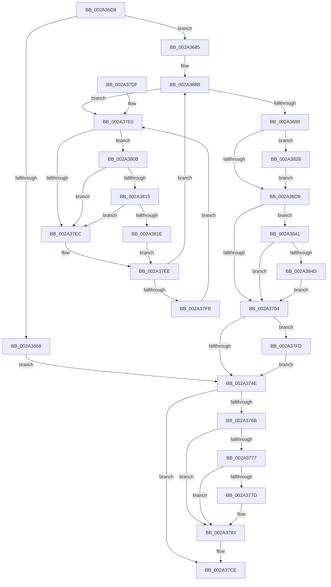

# MiMakeSystemCachePteValid

- RVA: `0x002A35D8`–`0x002A3856` (길이 `638` bytes)
- VA: `0x00000001402A35D8`
- 실행 섹션: `.text`
- PDB 이름 있음: `예`; PDB Function 태그: `아니요`
- unwind 정보 RVA: `0x00068768`
- 디코드: `160`개 명령, `638/638` bytes 표시
- 미해석 바이트: `0` (있으면 어셈블리에 `.byte`로 보존)

> 이 문서는 커널 이미지의 기계어와 PDB 기호를 분석해 생성했습니다. 4번과 5번은 함수 원형과 자료형을 바이너리 사용 방식에서 추정한 C 해석이며 원본 소스 복구 결과는 아닙니다.

## 1. Dependencies

- 직접 호출 지점: **12**; 고유 호출 대상: **12**
- 직접 호출자로 확인된 함수: **1**
- RIP 상대 이미지 참조: **5**

### Outgoing calls
- `0x002A3638` → [MiLockWorkingSetOptimal](../23/MiLockWorkingSetOptimal_function_00238FC0.md) (function, `0x00238FC0`)
- `0x002A3648` → [MiGetContainingPageTable](../34/MiGetContainingPageTable_function_003467F0.md) (function, `0x003467F0`)
- `0x002A3673` → [MiLockAndDecrementShareCount](MiLockAndDecrementShareCount_function_002A2854.md) (function, `0x002A2854`)
- `0x002A373C` → [MiAllocateWsle](../33/MiAllocateWsle_function_003332C0.md) (function, `0x003332C0`)
- `0x002A3761` → [MiUnlockWorkingSetOptimal](../23/MiUnlockWorkingSetOptimal_function_00238DFC.md) (function, `0x00238DFC`)
- `0x002A3797` → [MiReferenceControlAreaFileWithTag](../34/MiReferenceControlAreaFileWithTag_function_00348390.md) (function, `0x00348390`)
- `0x002A37A9` → [MiStartingOffset](../34/MiStartingOffset_function_003482E0.md) (function, `0x003482E0`)
- `0x002A37BA` → [PfSnLogPageFault](../34/PfSnLogPageFault_function_00344950.md) (function, `0x00344950`)
- `0x002A37C9` → [ObFastDereferenceObjectDeferDelete](../23/ObFastDereferenceObjectDeferDelete_function_002378C0.md) (function, `0x002378C0`)
- `0x002A3815` → [KiCheckVpBackingLongSpinWaitHypercall](../30/KiCheckVpBackingLongSpinWaitHypercall_function_0030F490.md) (function, `0x0030F490`)
- `0x002A3821` → [HvlNotifyLongSpinWait](../30/HvlNotifyLongSpinWait_function_0030F460.md) (function, `0x0030F460`)
- `0x002A3834` → [MiMakeValidPte](../2C/MiMakeValidPte_function_002C5590.md) (function, `0x002C5590`)

### Direct callers
- [MmCopyToCachedPage](../34/MmCopyToCachedPage_function_00347B44.md) at `0x00347F37`

### Static image references
- `0x002A36D9` → RVA `0x00E2EE84` (`.data`; read)
- `0x002A3741` → RVA `0x00E67248` (`.data`; read)
- `0x002A376B` → RVA `0x00E2DC80` (`.data`; read)
- `0x002A37E3` → RVA `0x00FC52AC` (`ALMOSTRO`; reference)
- `0x002A380B` → RVA `0x00FC6AB8` (`ALMOSTRO`; read)

## 2. Other-region calls and transfers

- 다른 실행 섹션으로 향하는 call: **0**
- 별도 외부 분기/꼬리 이동을 확인하지 못했습니다.

## 3. Assembly (complete function range)

```asm
002A35D8  4C 8B DC                        mov r11, rsp
002A35DB  45 89 4B 20                     mov dword ptr [r11 + 0x20], r9d
002A35DF  49 89 4B 08                     mov qword ptr [r11 + 8], rcx
002A35E3  53                              push rbx
002A35E4  55                              push rbp
002A35E5  56                              push rsi
002A35E6  57                              push rdi
002A35E7  41 54                           push r12
002A35E9  41 55                           push r13
002A35EB  41 56                           push r14
002A35ED  41 57                           push r15
002A35EF  48 83 EC 48                     sub rsp, 0x48
002A35F3  4D 8B E8                        mov r13, r8
002A35F6  41 C6 43 10 00                  mov byte ptr [r11 + 0x10], 0
002A35FB  49 C1 ED 0C                     shr r13, 0xc
002A35FF  48 B8 FF FF FF FF FF 00 00 00   movabs rax, 0xffffffffff
002A3609  4C 23 E8                        and r13, rax
002A360C  48 BF 00 00 00 00 00 DE FF FF   movabs rdi, 0xffffde0000000000
002A3616  49 8B D8                        mov rbx, r8
002A3619  4C 8B E2                        mov r12, rdx
002A361C  4A 8D 2C 6D 00 00 00 00         lea rbp, [r13*2]
002A3624  49 03 ED                        add rbp, r13
002A3627  48 C1 E5 04                     shl rbp, 4
002A362B  48 8B C7                        mov rax, rdi
002A362E  4D 8D 43 10                     lea r8, [r11 + 0x10]
002A3632  48 03 E8                        add rbp, rax
002A3635  45 33 F6                        xor r14d, r14d
002A3638  E8 83 59 F9 FF                  call 0x140238fc0
002A363D  49 8B CC                        mov rcx, r12
002A3640  48 89 84 24 A0 00 00 00         mov qword ptr [rsp + 0xa0], rax
002A3648  E8 A3 31 0A 00                  call 0x1403467f0
002A364D  48 8D 34 40                     lea rsi, [rax + rax*2]
002A3651  48 C1 E6 04                     shl rsi, 4
002A3655  48 8B D7                        mov rdx, rdi
002A3658  49 8B 3C 24                     mov rdi, qword ptr [r12]
002A365C  41 8D 46 01                     lea eax, [r14 + 1]
002A3660  48 03 F2                        add rsi, rdx
002A3663  40 84 F8                        test al, dil
002A3666  74 1D                           je 0x1402a3685
002A3668  45 33 FF                        xor r15d, r15d
002A366B  8D 50 01                        lea edx, [rax + 1]
002A366E  33 F6                           xor esi, esi
002A3670  48 8B CD                        mov rcx, rbp
002A3673  E8 DC F1 FF FF                  call 0x1402a2854
002A3678  48 8B 9C 24 90 00 00 00         mov rbx, qword ptr [rsp + 0x90]
002A3680  E9 C9 00 00 00                  jmp 0x1402a374e
002A3685  45 33 FF                        xor r15d, r15d
002A3688  4C 8B F0                        mov r14, rax
002A368B  F0 48 0F BA 6E 18 3F            lock bts qword ptr [rsi + 0x18], 0x3f
002A3692  0F 82 48 01 00 00               jb 0x1402a37e0
002A3698  48 8B 46 18                     mov rax, qword ptr [rsi + 0x18]
002A369C  48 8D 48 01                     lea rcx, [rax + 1]
002A36A0  4C 8B C1                        mov r8, rcx
002A36A3  4C 33 C0                        xor r8, rax
002A36A6  48 B8 00 00 00 00 00 00 00 C0   movabs rax, 0xc000000000000000
002A36B0  4C 23 C0                        and r8, rax
002A36B3  48 B8 FF FF FF FF FF FF FF 7F   movabs rax, 0x7fffffffffffffff
002A36BD  4C 33 C1                        xor r8, rcx
002A36C0  4C 89 46 18                     mov qword ptr [rsi + 0x18], r8
002A36C4  F0 48 21 46 18                  lock and qword ptr [rsi + 0x18], rax
002A36C9  41 BE 00 00 00 00               mov r14d, 0
002A36CF  40 F6 C7 08                     test dil, 8
002A36D3  0F 85 4F 01 00 00               jne 0x1402a3828
002A36D9  0F B6 05 A4 B7 B8 00            movzx eax, byte ptr [rip + 0xb8b7a4]
002A36E0  48 81 E3 FB FE FF FF            and rbx, 0xfffffffffffffefb
002A36E7  BF 01 00 00 00                  mov edi, 1
002A36EC  48 23 C7                        and rax, rdi
002A36EF  48 C1 E0 08                     shl rax, 8
002A36F3  48 0B C3                        or rax, rbx
002A36F6  F6 84 24 A8 00 00 00 08         test byte ptr [rsp + 0xa8], 8
002A36FE  0F 85 3D 01 00 00               jne 0x1402a3841
002A3704  4C 8B 7D 08                     mov r15, qword ptr [rbp + 8]
002A3708  48 B9 00 00 00 00 00 00 00 80   movabs rcx, 0x8000000000000000
002A3712  4C 21 74 24 30                  and qword ptr [rsp + 0x30], r14
002A3717  4C 0B F9                        or r15, rcx
002A371A  48 8B 9C 24 90 00 00 00         mov rbx, qword ptr [rsp + 0x90]
002A3722  45 33 C9                        xor r9d, r9d
002A3725  44 21 74 24 28                  and dword ptr [rsp + 0x28], r14d
002A372A  48 8B CB                        mov rcx, rbx
002A372D  48 8B 75 10                     mov rsi, qword ptr [rbp + 0x10]
002A3731  4C 8B C5                        mov r8, rbp
002A3734  49 8B D4                        mov rdx, r12
002A3737  48 89 44 24 20                  mov qword ptr [rsp + 0x20], rax
002A373C  E8 7F FB 08 00                  call 0x1403332c0
002A3741  44 39 35 00 3B BC 00            cmp dword ptr [rip + 0xbc3b00], r14d
002A3748  0F 85 AF 00 00 00               jne 0x1402a37fd
002A374E  44 8A 84 24 98 00 00 00         mov r8b, byte ptr [rsp + 0x98]
002A3756  48 8B CB                        mov rcx, rbx
002A3759  48 8B 94 24 A0 00 00 00         mov rdx, qword ptr [rsp + 0xa0]
002A3761  E8 96 56 F9 FF                  call 0x140238dfc
002A3766  45 85 F6                        test r14d, r14d
002A3769  74 63                           je 0x1402a37ce
002A376B  48 8B 05 0E A5 B8 00            mov rax, qword ptr [rip + 0xb8a50e]
002A3772  48 85 C0                        test rax, rax
002A3775  74 0C                           je 0x1402a3783
002A3777  40 F6 C6 10                     test sil, 0x10
002A377B  75 06                           jne 0x1402a3783
002A377D  48 F7 D0                        not rax
002A3780  48 23 F0                        and rsi, rax
002A3783  48 C1 FE 10                     sar rsi, 0x10
002A3787  BD 4D 6D 53 63                  mov ebp, 0x63536d4d
002A378C  45 33 C0                        xor r8d, r8d
002A378F  8B D5                           mov edx, ebp
002A3791  48 8B 3E                        mov rdi, qword ptr [rsi]
002A3794  48 8B CF                        mov rcx, rdi
002A3797  E8 F4 4B 0A 00                  call 0x140348390
002A379C  41 83 C8 FF                     or r8d, 0xffffffff
002A37A0  49 8B D7                        mov rdx, r15
002A37A3  48 8B CE                        mov rcx, rsi
002A37A6  48 8B D8                        mov rbx, rax
002A37A9  E8 32 4B 0A 00                  call 0x1403482e0
002A37AE  41 B8 04 00 00 00               mov r8d, 4
002A37B4  48 8B D0                        mov rdx, rax
002A37B7  48 8B CB                        mov rcx, rbx
002A37BA  E8 91 11 0A 00                  call 0x140344950
002A37BF  48 8D 4F 40                     lea rcx, [rdi + 0x40]
002A37C3  44 8B C5                        mov r8d, ebp
002A37C6  48 8B D3                        mov rdx, rbx
002A37C9  E8 F2 40 F9 FF                  call 0x1402378c0
002A37CE  48 83 C4 48                     add rsp, 0x48
002A37D2  41 5F                           pop r15
002A37D4  41 5E                           pop r14
002A37D6  41 5D                           pop r13
002A37D8  41 5C                           pop r12
002A37DA  5F                              pop rdi
002A37DB  5E                              pop rsi
002A37DC  5D                              pop rbp
002A37DD  5B                              pop rbx
002A37DE  C3                              ret
002A37DF  CC                              int3
002A37E0  45 03 FE                        add r15d, r14d
002A37E3  44 85 3D C2 1A D2 00            test dword ptr [rip + 0xd21ac2], r15d
002A37EA  74 1F                           je 0x1402a380b
002A37EC  F3 90                           pause
002A37EE  48 8B 46 18                     mov rax, qword ptr [rsi + 0x18]
002A37F2  48 85 C0                        test rax, rax
002A37F5  0F 89 90 FE FF FF               jns 0x1402a368b
002A37FB  EB E3                           jmp 0x1402a37e0
002A37FD  48 0F BA E6 0A                  bt rsi, 0xa
002A3802  44 0F 42 F7                     cmovb r14d, edi
002A3806  E9 43 FF FF FF                  jmp 0x1402a374e
002A380B  8B 05 A7 32 D2 00               mov eax, dword ptr [rip + 0xd232a7]
002A3811  A8 40                           test al, 0x40
002A3813  74 D7                           je 0x1402a37ec
002A3815  E8 76 BC 06 00                  call 0x14030f490
002A381A  84 C0                           test al, al
002A381C  74 CE                           je 0x1402a37ec
002A381E  41 8B CF                        mov ecx, r15d
002A3821  E8 3A BC 06 00                  call 0x14030f460
002A3826  EB C6                           jmp 0x1402a37ee
002A3828  41 B8 01 00 00 20               mov r8d, 0x20000001
002A382E  49 8B D5                        mov rdx, r13
002A3831  49 8B CC                        mov rcx, r12
002A3834  E8 57 1D 02 00                  call 0x1402c5590
002A3839  48 8B D8                        mov rbx, rax
002A383C  E9 98 FE FF FF                  jmp 0x1402a36d9
002A3841  48 0F BA 65 28 35               bt qword ptr [rbp + 0x28], 0x35
002A3847  0F 83 B7 FE FF FF               jae 0x1402a3704
002A384D  48 83 E0 BD                     and rax, 0xffffffffffffffbd
002A3851  E9 AE FE FF FF                  jmp 0x1402a3704
```

## 4. C-style interpretation (structured pseudocode)

```c
__int64 __fastcall MiMakeSystemCachePteValid(__int64 a1, __int64 a2, __int64 a3, int a4)
{
    __int64 result;
    __int64 v_r13;
    __int64 v_r14;
    __int64 v_r15;
    __int64 v_rbp;
    __int64 v_rbx;
    __int64 v_rsi;
    __int64 v_rsp;
    unsigned __int64 v_stack_m58;
    unsigned int v_stack_m60;
    unsigned __int64 v_stack_m68;
    unsigned __int8 v_stack_p10;
    unsigned __int64 v_stack_p18;
    unsigned __int8 v_stack_p20;
    unsigned __int64 v_stack_p8;

    *(unsigned int *)(v_rsp + 32) = a4;
    *(unsigned __int64 *)(v_rsp + 8) = a1;
    v_rsp = (v_rsp) - (72);
    *(unsigned __int8 *)(v_rsp + 16) = 0;
    v_r13 = (a3) >> (12);
    v_r13 = (v_r13) & (result);
    v_rbp = (v_r13 * 2) + (v_r13);
    v_rbp = (v_rbp) << (4);
    v_rbp = (v_rbp) + (v_rdi);
    v_r14 = 0;
    result = MiLockWorkingSetOptimal(a1, a2, v_rsp + 16, a4);
    v_stack_p18 = result;
    result = MiGetContainingPageTable(a2, a2, v_rsp + 16, a4);
    v_rsi = (result + result * 2) << (4);
    v_rsi = (v_rsi) + (v_rdi);
    if ((((unsigned __int8)(v_r14 + 1)) & ((unsigned __int8)(*(unsigned __int64 *)(a2)))) == 0) goto loc_002A3685;
    v_r15 = 0;
    v_rsi = 0;
    result = MiLockAndDecrementShareCount(v_rbp, v_r14 + 1 + 1, v_rsp + 16, a4);
    goto loc_002A374E;
loc_002A3685:
    v_r15 = 0;
loc_002A368B:
    if (condition_is_below) goto loc_002A37E0;
    a3 = (*(unsigned __int64 *)(v_rsi + 24) + 1) ^ (*(unsigned __int64 *)(v_rsi + 24));
    a3 = (a3) & (*(unsigned __int64 *)(v_rsi + 24));
    a3 = (a3) ^ (*(unsigned __int64 *)(v_rsi + 24) + 1);
    *(unsigned __int64 *)(v_rsi + 24) = a3;
    if ((((unsigned __int8)(*(unsigned __int64 *)(a2))) & (8)) != 0) goto loc_002A3828;
loc_002A36D9:
    v_rbx = (v_stack_p8) & (-261);
    result = (*(unsigned __int8 *)(v_rip + 12105636)) & (1);
    result = (result) << (8);
    result = (result) | (v_rbx);
    if (((v_stack_p20) & (8)) != 0) goto loc_002A3841;
loc_002A3704:
    v_r15 = (*(unsigned __int64 *)(v_rbp + 8)) | (*(unsigned __int64 *)(v_rsi + 24) + 1);
    a4 = 0;
    v_stack_m68 = result;
    result = MiAllocateWsle(v_stack_p8, a2, v_rbp, a4);
    if ((*(unsigned int *)(v_rip + 12335872)) != 0) goto loc_002A37FD;
loc_002A374E:
    result = MiUnlockWorkingSetOptimal(v_stack_p8, v_stack_p18, v_stack_p10, a4);
    if (0 == 0) goto loc_002A37CE;
    if (*(unsigned __int64 *)(v_rip + 12100878) == 0) goto loc_002A3783;
    result = *(unsigned __int64 *)(v_rip + 12100878);
    v_rsi = *(unsigned __int64 *)(v_rbp + 16);
    if ((((unsigned __int8)(*(unsigned __int64 *)(v_rbp + 16))) & (16)) == 0) {
        result = ~(*(unsigned __int64 *)(v_rip + 12100878));
        v_rsi = (*(unsigned __int64 *)(v_rbp + 16)) & (result);
    }
    v_rsi = (v_rsi) >> (16);
    a3 = 0;
    result = MiReferenceControlAreaFileWithTag(*(unsigned __int64 *)(v_rsi), (unsigned int)((unsigned int)((unsigned int)(0x63536D4DULL))), a3, a4);
    a3 = (unsigned int)((a3) | (0xFFFFFFFFULL));
    result = MiStartingOffset(v_rsi, v_r15, a3, a4);
    result = PfSnLogPageFault(result, result, 4, a4);
    result = ObFastDereferenceObjectDeferDelete(*(unsigned __int64 *)(v_rsi) + 64, result, (unsigned int)((unsigned int)((unsigned int)(0x63536D4DULL))), a4);
loc_002A37CE:
    v_rsp = (v_rsp) + (72);
    return result;
loc_002A37E0:
    v_r15 = (unsigned int)((v_r15) + (0));
    if (((*(unsigned int *)(v_rip + 13769410)) & ((unsigned int)(v_r15))) == 0) goto loc_002A380B;
loc_002A37EC:
loc_002A37EE:
    if (!sign_flag) goto loc_002A368B;
    goto loc_002A37E0;
loc_002A37FD:
    v_r14 = 0;
    if (condition_is_below) { v_r14 = (unsigned int)(*(unsigned __int64 *)(v_rsi)); }
    goto loc_002A374E;
loc_002A380B:
    if ((((unsigned __int8)((unsigned int)(*(unsigned int *)(v_rip + 13775527)))) & (64)) == 0) goto loc_002A37EC;
    result = KiCheckVpBackingLongSpinWaitHypercall(*(unsigned __int64 *)(v_rsi) + 64, result, (unsigned int)((unsigned int)((unsigned int)(0x63536D4DULL))), a4);
    if ((unsigned __int8)(result) == 0) goto loc_002A37EC;
    result = HvlNotifyLongSpinWait((unsigned int)((unsigned int)(v_r15)), result, (unsigned int)((unsigned int)((unsigned int)(0x63536D4DULL))), a4);
    goto loc_002A37EE;
loc_002A3828:
    result = MiMakeValidPte(a2, v_r13, (unsigned int)(0x20000001ULL), a4);
    goto loc_002A36D9;
loc_002A3841:
    if (condition_is_above_or_equal) goto loc_002A3704;
    result = (result) & (-67);
    goto loc_002A3704;
}
```

## 5. (Beta) C Style

```c
int64_t MiMakeSystemCachePteValid(int64_t Arg1, void *Arg2, int64_t Arg3, int32_t Arg4)
{
    uint8_t *arg2 = (uint8_t *)Arg2;

    int64_t result;
    int64_t local_r13;
    int64_t local_r14;
    int64_t local_r15;
    int64_t local_rbp;
    int64_t local_rbx;
    int64_t local_rsi;
    int64_t local_rsp;
    uint64_t v_stack_m58;
    uint32_t v_stack_m60;
    uint64_t v_stack_m68;
    uint8_t v_stack_p10;
    uint64_t v_stack_p18;
    uint8_t v_stack_p20;
    uint64_t v_stack_p8;

    *(uint32_t *)(local_rsp + 0x20) = Arg4;
    *(uint64_t *)(local_rsp + 0x8) = Arg1;
    local_rsp = (local_rsp) - (72);
    *(uint8_t *)(local_rsp + 0x10) = 0;
    local_r13 = (Arg3) >> (12);
    local_r13 = (local_r13) & (result);
    local_rbp = (local_r13 * 2) + (local_r13);
    local_rbp = (local_rbp) << (4);
    local_rbp = (local_rbp) + (local_rdi);
    local_r14 = 0;
    result = MiLockWorkingSetOptimal(Arg1, Arg2, local_rsp + 16, Arg4);
    v_stack_p18 = result;
    result = MiGetContainingPageTable(Arg2, Arg2, local_rsp + 16, Arg4);
    local_rsi = (result + result * 2) << (4);
    local_rsi = (local_rsi) + (local_rdi);
    if ((((uint8_t)(local_r14 + 1)) & ((uint8_t)(*(uint64_t *)(arg2)))) == 0) goto loc_002A3685;
    local_r15 = 0;
    local_rsi = 0;
    result = MiLockAndDecrementShareCount(local_rbp, local_r14 + 1 + 1, local_rsp + 16, Arg4);
    goto loc_002A374E;
loc_002A3685:
    local_r15 = 0;
loc_002A368B:
    if (condition_is_below) goto loc_002A37E0;
    Arg3 = (*(uint64_t *)(local_rsi + 0x18) + 1) ^ (*(uint64_t *)(local_rsi + 0x18));
    Arg3 = (Arg3) & (*(uint64_t *)(local_rsi + 0x18));
    Arg3 = (Arg3) ^ (*(uint64_t *)(local_rsi + 0x18) + 1);
    *(uint64_t *)(local_rsi + 0x18) = Arg3;
    if ((((uint8_t)(*(uint64_t *)(arg2))) & (8)) != 0) goto loc_002A3828;
loc_002A36D9:
    local_rbx = (v_stack_p8) & (-261);
    result = (*(uint8_t *)(v_rip + 0xB8B7A4)) & (1);
    result = (result) << (8);
    result = (result) | (local_rbx);
    if (((v_stack_p20) & (8)) != 0) goto loc_002A3841;
loc_002A3704:
    local_r15 = (*(uint64_t *)(local_rbp + 0x8)) | (*(uint64_t *)(local_rsi + 0x18) + 1);
    Arg4 = 0;
    v_stack_m68 = result;
    result = MiAllocateWsle(v_stack_p8, Arg2, local_rbp, Arg4);
    if ((*(uint32_t *)(v_rip + 0xBC3B00)) != 0) goto loc_002A37FD;
loc_002A374E:
    result = MiUnlockWorkingSetOptimal(v_stack_p8, v_stack_p18, v_stack_p10, Arg4);
    if (0 == 0) goto loc_002A37CE;
    if (*(uint64_t *)(v_rip + 0xB8A50E) == 0) goto loc_002A3783;
    result = *(uint64_t *)(v_rip + 0xB8A50E);
    local_rsi = *(uint64_t *)(local_rbp + 0x10);
    if ((((uint8_t)(*(uint64_t *)(local_rbp + 0x10))) & (16)) == 0) {
        result = ~(*(uint64_t *)(v_rip + 0xB8A50E));
        local_rsi = (*(uint64_t *)(local_rbp + 0x10)) & (result);
    }
    local_rsi = (local_rsi) >> (16);
    Arg3 = 0;
    result = MiReferenceControlAreaFileWithTag(*(uint64_t *)(local_rsi), (uint32_t)((uint32_t)((uint32_t)(0x63536D4DULL))), Arg3, Arg4);
    Arg3 = (uint32_t)((Arg3) | (0xFFFFFFFFULL));
    result = MiStartingOffset(local_rsi, local_r15, Arg3, Arg4);
    result = PfSnLogPageFault(result, result, 4, Arg4);
    result = ObFastDereferenceObjectDeferDelete(*(uint64_t *)(local_rsi) + 64, result, (uint32_t)((uint32_t)((uint32_t)(0x63536D4DULL))), Arg4);
loc_002A37CE:
    local_rsp = (local_rsp) + (72);
    return result;
loc_002A37E0:
    local_r15 = (uint32_t)((local_r15) + (0));
    if (((*(uint32_t *)(v_rip + 0xD21AC2)) & ((uint32_t)(local_r15))) == 0) goto loc_002A380B;
loc_002A37EC:
loc_002A37EE:
    if (!sign_flag) goto loc_002A368B;
    goto loc_002A37E0;
loc_002A37FD:
    local_r14 = 0;
    if (condition_is_below) { local_r14 = (uint32_t)(*(uint64_t *)(local_rsi)); }
    goto loc_002A374E;
loc_002A380B:
    if ((((uint8_t)((uint32_t)(*(uint32_t *)(v_rip + 0xD232A7)))) & (64)) == 0) goto loc_002A37EC;
    result = KiCheckVpBackingLongSpinWaitHypercall(*(uint64_t *)(local_rsi) + 64, result, (uint32_t)((uint32_t)((uint32_t)(0x63536D4DULL))), Arg4);
    if ((uint8_t)(result) == 0) goto loc_002A37EC;
    result = HvlNotifyLongSpinWait((uint32_t)((uint32_t)(local_r15)), result, (uint32_t)((uint32_t)((uint32_t)(0x63536D4DULL))), Arg4);
    goto loc_002A37EE;
loc_002A3828:
    result = MiMakeValidPte(Arg2, local_r13, (uint32_t)(0x20000001ULL), Arg4);
    goto loc_002A36D9;
loc_002A3841:
    if (condition_is_above_or_equal) goto loc_002A3704;
    result = (result) & (-67);
    goto loc_002A3704;
}
```

### 관측된 메모리 오프셋

구조체 형식이 확인되지 않은 접근은 인자 기준의 오프셋으로만 기록했습니다.

| 기준 인자 | 오프셋 표현 | 폭 (bit) | 접근 |
|---|---:|---:|---|
| `Arg2` | `+ 0x0` | `64` | `R` |

## 6. Execution-region graph

[열기: 2D/3D 그래프와 함수 탐색 컨트롤 패널](../../../control-panel.html?section=text&rva=0x002A35D8&view=graph)

- 2D 그래프는 위에서 아래로 흐르고, 3D 그래프는 빈 공간을 드래그해 회전합니다. Shift+드래그는 이동, 휠은 확대·축소, 함수 노드 선택은 대상 보고서 이동입니다.

### Static fallback


