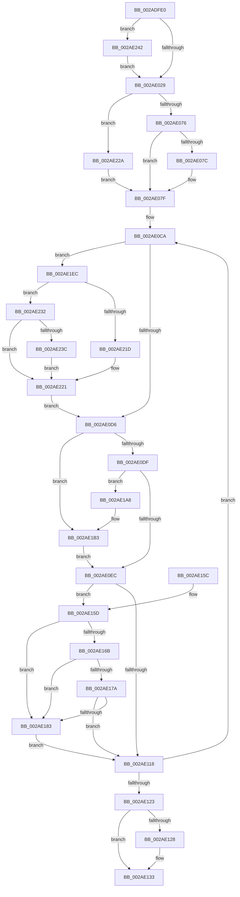

# MiMapLockedPagesInUserSpaceHelper

- RVA: `0x002ADFE0`–`0x002AE263` (길이 `643` bytes)
- VA: `0x00000001402ADFE0`
- 실행 섹션: `.text`
- PDB 이름 있음: `예`; PDB Function 태그: `아니요`
- unwind 정보 RVA: `0x0006D438`
- 디코드: `166`개 명령, `643/643` bytes 표시
- 미해석 바이트: `0` (있으면 어셈블리에 `.byte`로 보존)

> 이 문서는 커널 이미지의 기계어와 PDB 기호를 분석해 생성했습니다. 4번과 5번은 함수 원형과 자료형을 바이너리 사용 방식에서 추정한 C 해석이며 원본 소스 복구 결과는 아닙니다.

## 1. Dependencies

- 직접 호출 지점: **13**; 고유 호출 대상: **9**
- 직접 호출자로 확인된 함수: **3**
- RIP 상대 이미지 참조: **0**

### Outgoing calls
- `0x002AE094` → [MiLockWorkingSetShared](../27/MiLockWorkingSetShared_function_0027CBF0.md) (function, `0x0027CBF0`)
- `0x002AE109` → [MiInsertPhysicalPteMapping](MiInsertPhysicalPteMapping_function_002AE26C.md) (function, `0x002AE26C`)
- `0x002AE12E` → [MiUnlockPageTable](../21/MiUnlockPageTable_function_00216EC0.md) (function, `0x00216EC0`)
- `0x002AE139` → [MiUnlockWorkingSetShared](../27/MiUnlockWorkingSetShared_function_0027D690.md) (function, `0x0027D690`)
- `0x002AE162` → [MiWorkingSetIsContended](MiWorkingSetIsContended_function_002AE520.md) (function, `0x002AE520`)
- `0x002AE171` → [MiPageTableLockIsContended](MiPageTableLockIsContended_function_002AE650.md) (function, `0x002AE650`)
- `0x002AE17A` → [KeShouldYieldProcessor](../27/KeShouldYieldProcessor_function_002773E0.md) (function, `0x002773E0`)
- `0x002AE189` → [MiUnlockPageTable](../21/MiUnlockPageTable_function_00216EC0.md) (function, `0x00216EC0`)
- `0x002AE194` → [MiUnlockWorkingSetShared](../27/MiUnlockWorkingSetShared_function_0027D690.md) (function, `0x0027D690`)
- `0x002AE19E` → [MiLockWorkingSetShared](../27/MiLockWorkingSetShared_function_0027CBF0.md) (function, `0x0027CBF0`)
- `0x002AE1AE` → [MiUnlockPageTable](../21/MiUnlockPageTable_function_00216EC0.md) (function, `0x00216EC0`)
- `0x002AE1E2` → [MiMakeSystemAddressValid](../27/MiMakeSystemAddressValid_function_0027FF70.md) (function, `0x0027FF70`)
- `0x002AE247` → [MiLocateLockedVadEvent](MiLocateLockedVadEvent_function_002A7A0C.md) (function, `0x002A7A0C`)

### Direct callers
- [MiMapLockedPagesInUserSpace](../../page/97/MiMapLockedPagesInUserSpace_function_0097FE04.md) at `0x0098012F`
- [MiRotateToFrameBuffer](../../page/A3/MiRotateToFrameBuffer_function_00A38214.md) at `0x00A384C1`
- [MiRotateToFrameBufferNoCopy](../../page/A3/MiRotateToFrameBufferNoCopy_function_00A38530.md) at `0x00A386EE`

### Static image references
- 디코드된 RIP-relative 메모리 참조가 없습니다.

## 2. Other-region calls and transfers

- 다른 실행 섹션으로 향하는 call: **0**
- 별도 외부 분기/꼬리 이동을 확인하지 못했습니다.

## 3. Assembly (complete function range)

```asm
002ADFE0  48 8B C4                        mov rax, rsp
002ADFE3  48 89 58 08                     mov qword ptr [rax + 8], rbx
002ADFE7  48 89 68 18                     mov qword ptr [rax + 0x18], rbp
002ADFEB  48 89 70 20                     mov qword ptr [rax + 0x20], rsi
002ADFEF  48 89 50 10                     mov qword ptr [rax + 0x10], rdx
002ADFF3  57                              push rdi
002ADFF4  41 54                           push r12
002ADFF6  41 55                           push r13
002ADFF8  41 56                           push r14
002ADFFA  41 57                           push r15
002ADFFC  48 83 EC 40                     sub rsp, 0x40
002AE000  83 60 D4 00                     and dword ptr [rax - 0x2c], 0
002AE004  4C 8B F9                        mov r15, rcx
002AE007  48 8B 8C 24 98 00 00 00         mov rcx, qword ptr [rsp + 0x98]
002AE00F  4D 8B E0                        mov r12, r8
002AE012  48 89 48 B8                     mov qword ptr [rax - 0x48], rcx
002AE016  41 B8 01 00 00 00               mov r8d, 1
002AE01C  8B 41 30                        mov eax, dword ptr [rcx + 0x30]
002AE01F  24 70                           and al, 0x70
002AE021  3C 40                           cmp al, 0x40
002AE023  0F 84 19 02 00 00               je 0x1402ae242
002AE029  65 48 8B 04 25 88 01 00 00      mov rax, qword ptr gs:[0x188]
002AE032  49 8B F7                        mov rsi, r15
002AE035  48 C1 EE 09                     shr rsi, 9
002AE039  4C 8B B0 B8 00 00 00            mov r14, qword ptr [rax + 0xb8]
002AE040  48 B8 F8 FF FF FF 7F 00 00 00   movabs rax, 0x7ffffffff8
002AE04A  48 23 F0                        and rsi, rax
002AE04D  48 B8 00 00 00 00 80 F6 FF FF   movabs rax, 0xfffff68000000000
002AE057  48 8B C0                        mov rax, rax
002AE05A  8B AC 24 A0 00 00 00            mov ebp, dword ptr [rsp + 0xa0]
002AE061  48 03 F0                        add rsi, rax
002AE064  C1 FD 1F                        sar ebp, 0x1f
002AE067  83 E5 FD                        and ebp, 0xfffffffd
002AE06A  83 C5 04                        add ebp, 4
002AE06D  45 85 C9                        test r9d, r9d
002AE070  0F 84 B4 01 00 00               je 0x1402ae22a
002AE076  41 83 F9 02                     cmp r9d, 2
002AE07A  75 03                           jne 0x1402ae07f
002AE07C  83 CD 18                        or ebp, 0x18
002AE07F  8B 59 30                        mov ebx, dword ptr [rcx + 0x30]
002AE082  49 81 C6 00 04 00 00            add r14, 0x400
002AE089  C1 EB 0C                        shr ebx, 0xc
002AE08C  49 8B CE                        mov rcx, r14
002AE08F  83 E3 7F                        and ebx, 0x7f
002AE092  33 FF                           xor edi, edi
002AE094  E8 57 EB FC FF                  call 0x14027cbf0
002AE099  44 8A E8                        mov r13b, al
002AE09C  49 C1 EF 09                     shr r15, 9
002AE0A0  48 B8 F8 FF FF FF 7F 00 00 00   movabs rax, 0x7ffffffff8
002AE0AA  48 B9 00 00 00 00 80 F6 FF FF   movabs rcx, 0xfffff68000000000
002AE0B4  4C 23 F8                        and r15, rax
002AE0B7  48 8B 44 24 78                  mov rax, qword ptr [rsp + 0x78]
002AE0BC  49 2B C7                        sub rax, r15
002AE0BF  48 8B C9                        mov rcx, rcx
002AE0C2  48 2B C1                        sub rax, rcx
002AE0C5  48 89 44 24 78                  mov qword ptr [rsp + 0x78], rax
002AE0CA  44 8B FD                        mov r15d, ebp
002AE0CD  4D 85 E4                        test r12, r12
002AE0D0  0F 85 16 01 00 00               jne 0x1402ae1ec
002AE0D6  48 85 FF                        test rdi, rdi
002AE0D9  0F 84 D4 00 00 00               je 0x1402ae1b3
002AE0DF  48 F7 C6 FF 0F 00 00            test rsi, 0xfff
002AE0E6  0F 84 BC 00 00 00               je 0x1402ae1a8
002AE0EC  48 8B 44 24 78                  mov rax, qword ptr [rsp + 0x78]
002AE0F1  48 8D 4C 24 20                  lea rcx, [rsp + 0x20]
002AE0F6  48 89 74 24 28                  mov qword ptr [rsp + 0x28], rsi
002AE0FB  44 89 7C 24 38                  mov dword ptr [rsp + 0x38], r15d
002AE100  48 8B 04 30                     mov rax, qword ptr [rax + rsi]
002AE104  48 89 44 24 30                  mov qword ptr [rsp + 0x30], rax
002AE109  E8 5E 01 00 00                  call 0x1402ae26c
002AE10E  48 83 C6 08                     add rsi, 8
002AE112  40 F6 C6 78                     test sil, 0x78
002AE116  74 45                           je 0x1402ae15d
002AE118  48 83 AC 24 90 00 00 00 01      sub qword ptr [rsp + 0x90], 1
002AE121  75 A7                           jne 0x1402ae0ca
002AE123  48 85 FF                        test rdi, rdi
002AE126  74 0B                           je 0x1402ae133
002AE128  48 8B D7                        mov rdx, rdi
002AE12B  49 8B CE                        mov rcx, r14
002AE12E  E8 8D 8D F6 FF                  call 0x140216ec0
002AE133  41 8A D5                        mov dl, r13b
002AE136  49 8B CE                        mov rcx, r14
002AE139  E8 52 F5 FC FF                  call 0x14027d690
002AE13E  4C 8D 5C 24 40                  lea r11, [rsp + 0x40]
002AE143  49 8B 5B 30                     mov rbx, qword ptr [r11 + 0x30]
002AE147  49 8B 6B 40                     mov rbp, qword ptr [r11 + 0x40]
002AE14B  49 8B 73 48                     mov rsi, qword ptr [r11 + 0x48]
002AE14F  49 8B E3                        mov rsp, r11
002AE152  41 5F                           pop r15
002AE154  41 5E                           pop r14
002AE156  41 5D                           pop r13
002AE158  41 5C                           pop r12
002AE15A  5F                              pop rdi
002AE15B  C3                              ret
002AE15C  CC                              int3
002AE15D  33 D2                           xor edx, edx
002AE15F  49 8B CE                        mov rcx, r14
002AE162  E8 B9 03 00 00                  call 0x1402ae520
002AE167  85 C0                           test eax, eax
002AE169  75 18                           jne 0x1402ae183
002AE16B  48 8B D7                        mov rdx, rdi
002AE16E  49 8B CE                        mov rcx, r14
002AE171  E8 DA 04 00 00                  call 0x1402ae650
002AE176  85 C0                           test eax, eax
002AE178  75 09                           jne 0x1402ae183
002AE17A  E8 61 92 FC FF                  call 0x1402773e0
002AE17F  85 C0                           test eax, eax
002AE181  74 95                           je 0x1402ae118
002AE183  48 8B D7                        mov rdx, rdi
002AE186  49 8B CE                        mov rcx, r14
002AE189  E8 32 8D F6 FF                  call 0x140216ec0
002AE18E  41 8A D5                        mov dl, r13b
002AE191  49 8B CE                        mov rcx, r14
002AE194  E8 F7 F4 FC FF                  call 0x14027d690
002AE199  49 8B CE                        mov rcx, r14
002AE19C  33 FF                           xor edi, edi
002AE19E  E8 4D EA FC FF                  call 0x14027cbf0
002AE1A3  E9 70 FF FF FF                  jmp 0x1402ae118
002AE1A8  48 8B D7                        mov rdx, rdi
002AE1AB  49 8B CE                        mov rcx, r14
002AE1AE  E8 0D 8D F6 FF                  call 0x140216ec0
002AE1B3  48 B8 F8 FF FF FF 7F 00 00 00   movabs rax, 0x7ffffffff8
002AE1BD  48 8B FE                        mov rdi, rsi
002AE1C0  48 C1 EF 09                     shr rdi, 9
002AE1C4  48 23 F8                        and rdi, rax
002AE1C7  48 B8 00 00 00 00 80 F6 FF FF   movabs rax, 0xfffff68000000000
002AE1D1  48 8B C0                        mov rax, rax
002AE1D4  48 03 F8                        add rdi, rax
002AE1D7  45 33 C9                        xor r9d, r9d
002AE1DA  45 8A C5                        mov r8b, r13b
002AE1DD  8B D3                           mov edx, ebx
002AE1DF  48 8B CE                        mov rcx, rsi
002AE1E2  E8 89 1D FD FF                  call 0x14027ff70
002AE1E7  E9 00 FF FF FF                  jmp 0x1402ae0ec
002AE1EC  49 8B 04 24                     mov rax, qword ptr [r12]
002AE1F0  48 8D 0C 40                     lea rcx, [rax + rax*2]
002AE1F4  48 C1 E1 04                     shl rcx, 4
002AE1F8  48 B8 00 00 00 00 00 DE FF FF   movabs rax, 0xffffde0000000000
002AE202  48 03 C8                        add rcx, rax
002AE205  44 8B 79 10                     mov r15d, dword ptr [rcx + 0x10]
002AE209  8B 41 20                        mov eax, dword ptr [rcx + 0x20]
002AE20C  49 C1 EF 05                     shr r15, 5
002AE210  C1 E8 10                        shr eax, 0x10
002AE213  41 83 E7 07                     and r15d, 7
002AE217  24 C0                           and al, 0xc0
002AE219  3C 80                           cmp al, 0x80
002AE21B  75 15                           jne 0x1402ae232
002AE21D  41 83 CF 18                     or r15d, 0x18
002AE221  49 83 C4 08                     add r12, 8
002AE225  E9 AC FE FF FF                  jmp 0x1402ae0d6
002AE22A  83 CD 08                        or ebp, 8
002AE22D  E9 4D FE FF FF                  jmp 0x1402ae07f
002AE232  8B 41 20                        mov eax, dword ptr [rcx + 0x20]
002AE235  C1 E8 10                        shr eax, 0x10
002AE238  3C 40                           cmp al, 0x40
002AE23A  73 E5                           jae 0x1402ae221
002AE23C  41 83 CF 08                     or r15d, 8
002AE240  EB DF                           jmp 0x1402ae221
002AE242  BA 08 00 00 00                  mov edx, 8
002AE247  E8 C0 97 FF FF                  call 0x1402a7a0c
002AE24C  8B 40 54                        mov eax, dword ptr [rax + 0x54]
002AE24F  41 84 C0                        test r8b, al
002AE252  8B 44 24 3C                     mov eax, dword ptr [rsp + 0x3c]
002AE256  41 0F 45 C0                     cmovne eax, r8d
002AE25A  89 44 24 3C                     mov dword ptr [rsp + 0x3c], eax
002AE25E  E9 C6 FD FF FF                  jmp 0x1402ae029
```

## 4. C-style interpretation (structured pseudocode)

```c
__int64 __fastcall MiMapLockedPagesInUserSpaceHelper(__int64 a1, __int64 a2, __int64 a3, int a4, __int64 a5, __int64 a6, unsigned int a7)
{
    __int64 result;
    __int64 v_r12;
    __int64 v_r14;
    __int64 v_r15;
    __int64 v_rbp;
    __int64 v_rbx;
    __int64 v_rdi;
    __int64 v_rsi;
    __int64 v_rsp;
    unsigned __int64 v_stack_m28;
    unsigned int v_stack_m30;
    unsigned __int64 v_stack_m38;
    unsigned int v_stack_m4;
    unsigned __int64 v_stack_m40;
    unsigned __int64 v_stack_m48;
    unsigned __int64 v_stack_p10;

    *(unsigned __int64 *)(v_rsp + 8) = v_rbx;
    *(unsigned __int64 *)(v_rsp + 24) = v_rbp;
    *(unsigned __int64 *)(v_rsp + 32) = v_rsi;
    *(unsigned __int64 *)(v_rsp + 16) = a2;
    v_rsp = (v_rsp) - (64);
    *(unsigned __int64 *)(v_rsp - 72) = a6;
    result = (unsigned __int8)(((unsigned int)(*(unsigned int *)(a6 + 48))) & (112));
    if (((unsigned __int8)(result)) == 64) goto loc_002AE242;
loc_002AE029:
    v_rsi = (a1) >> (9);
    v_rsi = (v_rsi) & (*(unsigned __int64 *)(gs_base + (0 + 392)));
    v_rsi = (v_rsi) + (*(unsigned __int64 *)(gs_base + (0 + 392)));
    v_rbp = (unsigned int)(((unsigned int)(a7)) >> (31));
    v_rbp = (unsigned int)((v_rbp) & (0xFFFFFFFDULL));
    v_rbp = (unsigned int)((v_rbp) + (4));
    if (a4 == 0) goto loc_002AE22A;
    if (a4 == 2) {
        v_rbp = (unsigned int)((v_rbp) | (24));
    }
    v_r14 = (*(unsigned __int64 *)(*(unsigned __int64 *)(gs_base + (0 + 392)) + 184)) + (0x400ULL);
    v_rbx = (unsigned int)(((unsigned int)(*(unsigned int *)(a6 + 48))) >> (12));
    v_rbx = (unsigned int)((v_rbx) & (127));
    v_rdi = 0;
    result = MiLockWorkingSetShared(v_r14, a2, 1, a4);
    v_r15 = (a1) >> (9);
    v_r15 = (v_r15) & (result);
    result = (v_stack_p10) - (v_r15);
    result = (result) - (v_r14);
    v_stack_p10 = result;
loc_002AE0CA:
    if (a3 != 0) goto loc_002AE1EC;
loc_002AE0D6:
    if (0 == 0) goto loc_002AE1B3;
    if (((v_rsi) & (0xFFFULL)) == 0) goto loc_002AE1A8;
loc_002AE0EC:
    v_stack_m40 = v_rsi;
    v_stack_m30 = (unsigned int)((unsigned int)((unsigned int)(v_rbp)));
    v_stack_m38 = *(unsigned __int64 *)(v_stack_p10 + v_rsi * 1);
    result = MiInsertPhysicalPteMapping(v_stack_m48, a2, 1, a4);
    v_rsi = (v_rsi) + (8);
    if ((((unsigned __int8)(v_rsi)) & (120)) == 0) goto loc_002AE15D;
loc_002AE118:
    if ((((unsigned __int8)(v_rsi)) & (120)) != 0) goto loc_002AE0CA;
    if (0 != 0) {
        a2 = 0;
        a1 = v_r14;
        result = MiUnlockPageTable(a1, a2, 1, a4);
    }
    result = MiUnlockWorkingSetShared(v_r14, (unsigned __int8)((unsigned __int8)(result)), 1, a4);
    return result;
loc_002AE15D:
    a2 = 0;
    result = MiWorkingSetIsContended(v_r14, a2, 1, a4);
    if ((unsigned int)(result) != 0) goto loc_002AE183;
    result = MiPageTableLockIsContended(v_r14, 0, 1, a4);
    if ((unsigned int)(result) != 0) goto loc_002AE183;
    result = KeShouldYieldProcessor(v_r14, 0, 1, a4);
    if ((unsigned int)(result) == 0) goto loc_002AE118;
loc_002AE183:
    result = MiUnlockPageTable(v_r14, 0, 1, a4);
    result = MiUnlockWorkingSetShared(v_r14, (unsigned __int8)((unsigned __int8)(result)), 1, a4);
    v_rdi = 0;
    result = MiLockWorkingSetShared(v_r14, (unsigned __int8)((unsigned __int8)(result)), 1, a4);
    goto loc_002AE118;
loc_002AE1A8:
    result = MiUnlockPageTable(v_r14, 0, 1, a4);
loc_002AE1B3:
    v_rdi = (*(unsigned __int64 *)(v_stack_m28 + 72)) >> (9);
    v_rdi = (v_rdi) & (result);
    v_rdi = (v_rdi) + (result);
    a4 = 0;
    result = MiMakeSystemAddressValid(*(unsigned __int64 *)(v_stack_m28 + 72), (unsigned int)((unsigned int)(*(unsigned __int64 *)(v_stack_m28 + 48))), (unsigned __int8)((unsigned __int8)(result)), a4);
    goto loc_002AE0EC;
loc_002AE1EC:
    a1 = (*(unsigned __int64 *)(a3) + *(unsigned __int64 *)(a3) * 2) << (4);
    a1 = (a1) + (*(unsigned __int64 *)(a3));
    v_r15 = ((unsigned int)(*(unsigned int *)(a1 + 16))) >> (5);
    result = (unsigned int)(((unsigned int)(*(unsigned int *)(a1 + 32))) >> (16));
    v_r15 = (unsigned int)((v_r15) & (7));
    result = (unsigned __int8)((result) & (192));
    if (((unsigned __int8)(result)) != 128) goto loc_002AE232;
    v_r15 = (unsigned int)((v_r15) | (24));
loc_002AE221:
    v_r12 = (a3) + (8);
    goto loc_002AE0D6;
loc_002AE22A:
    v_rbp = (unsigned int)((*(unsigned __int64 *)(v_stack_m28 + 64)) | (8));
    goto loc_002AE07F;
loc_002AE232:
    result = (unsigned int)(((unsigned int)(*(unsigned int *)(a1 + 32))) >> (16));
    if (((unsigned __int8)(result)) >= 64) goto loc_002AE221;
    v_r15 = (unsigned int)((v_r15) | (8));
    goto loc_002AE221;
loc_002AE242:
    result = MiLocateLockedVadEvent(a1, 8, (unsigned __int8)((unsigned __int8)(result)), a4);
    result = (unsigned int)(v_stack_m4);
    if ((((unsigned __int8)((unsigned __int8)((unsigned __int8)(result)))) & ((unsigned __int8)((unsigned int)(*(unsigned int *)(result + 84))))) != 0) { result = (unsigned int)((unsigned __int8)((unsigned __int8)(result))); }
    v_stack_m4 = (unsigned int)(result);
    goto loc_002AE029;
}
```

## 5. (Beta) C Style

```c
int64_t MiMapLockedPagesInUserSpaceHelper(int64_t Arg1, int64_t Arg2, int64_t Arg3, int32_t Arg4, int64_t Arg5, void *Arg6, uint32_t Arg7)
{
    uint8_t *arg6 = (uint8_t *)Arg6;

    int64_t result;
    int64_t local_r12;
    int64_t local_r14;
    int64_t local_r15;
    int64_t local_rbp;
    int64_t local_rbx;
    int64_t local_rdi;
    int64_t local_rsi;
    int64_t local_rsp;
    uint64_t v_stack_m28;
    uint32_t v_stack_m30;
    uint64_t v_stack_m38;
    uint32_t v_stack_m4;
    uint64_t v_stack_m40;
    uint64_t v_stack_m48;
    uint64_t v_stack_p10;

    *(uint64_t *)(local_rsp + 0x8) = local_rbx;
    *(uint64_t *)(local_rsp + 0x18) = local_rbp;
    *(uint64_t *)(local_rsp + 0x20) = local_rsi;
    *(uint64_t *)(local_rsp + 0x10) = Arg2;
    local_rsp = (local_rsp) - (64);
    *(void **)(local_rsp - 0x48) = Arg6;
    result = (uint8_t)(((uint32_t)(*(uint32_t *)(arg6 + 0x30))) & (112));
    if (((uint8_t)(result)) == 64) goto loc_002AE242;
loc_002AE029:
    local_rsi = (Arg1) >> (9);
    local_rsi = (local_rsi) & (*(uint64_t *)(gs_base + (0 + 0x188)));
    local_rsi = (local_rsi) + (*(uint64_t *)(gs_base + (0 + 0x188)));
    local_rbp = (uint32_t)(((uint32_t)(Arg7)) >> (31));
    local_rbp = (uint32_t)((local_rbp) & (0xFFFFFFFDULL));
    local_rbp = (uint32_t)((local_rbp) + (4));
    if (Arg4 == 0) goto loc_002AE22A;
    if (Arg4 == 2) {
        local_rbp = (uint32_t)((local_rbp) | (24));
    }
    local_r14 = (*(uint64_t *)(*(uint64_t *)(gs_base + (0 + 0x188)) + 0xB8)) + (0x400ULL);
    local_rbx = (uint32_t)(((uint32_t)(*(uint32_t *)(arg6 + 0x30))) >> (12));
    local_rbx = (uint32_t)((local_rbx) & (127));
    local_rdi = 0;
    result = MiLockWorkingSetShared(local_r14, Arg2, 1, Arg4);
    local_r15 = (Arg1) >> (9);
    local_r15 = (local_r15) & (result);
    result = (v_stack_p10) - (local_r15);
    result = (result) - (local_r14);
    v_stack_p10 = result;
loc_002AE0CA:
    if (Arg3 != 0) goto loc_002AE1EC;
loc_002AE0D6:
    if (0 == 0) goto loc_002AE1B3;
    if (((local_rsi) & (0xFFFULL)) == 0) goto loc_002AE1A8;
loc_002AE0EC:
    v_stack_m40 = local_rsi;
    v_stack_m30 = (uint32_t)((uint32_t)((uint32_t)(local_rbp)));
    v_stack_m38 = *(uint64_t *)(v_stack_p10 + local_rsi * 1);
    result = MiInsertPhysicalPteMapping(v_stack_m48, Arg2, 1, Arg4);
    local_rsi = (local_rsi) + (8);
    if ((((uint8_t)(local_rsi)) & (120)) == 0) goto loc_002AE15D;
loc_002AE118:
    if ((((uint8_t)(local_rsi)) & (120)) != 0) goto loc_002AE0CA;
    if (0 != 0) {
        Arg2 = 0;
        Arg1 = local_r14;
        result = MiUnlockPageTable(Arg1, Arg2, 1, Arg4);
    }
    result = MiUnlockWorkingSetShared(local_r14, (uint8_t)((uint8_t)(result)), 1, Arg4);
    return result;
loc_002AE15D:
    Arg2 = 0;
    result = MiWorkingSetIsContended(local_r14, Arg2, 1, Arg4);
    if ((uint32_t)(result) != 0) goto loc_002AE183;
    result = MiPageTableLockIsContended(local_r14, 0, 1, Arg4);
    if ((uint32_t)(result) != 0) goto loc_002AE183;
    result = KeShouldYieldProcessor(local_r14, 0, 1, Arg4);
    if ((uint32_t)(result) == 0) goto loc_002AE118;
loc_002AE183:
    result = MiUnlockPageTable(local_r14, 0, 1, Arg4);
    result = MiUnlockWorkingSetShared(local_r14, (uint8_t)((uint8_t)(result)), 1, Arg4);
    local_rdi = 0;
    result = MiLockWorkingSetShared(local_r14, (uint8_t)((uint8_t)(result)), 1, Arg4);
    goto loc_002AE118;
loc_002AE1A8:
    result = MiUnlockPageTable(local_r14, 0, 1, Arg4);
loc_002AE1B3:
    local_rdi = (*(uint64_t *)(v_stack_m28 + 0x48)) >> (9);
    local_rdi = (local_rdi) & (result);
    local_rdi = (local_rdi) + (result);
    Arg4 = 0;
    result = MiMakeSystemAddressValid(*(uint64_t *)(v_stack_m28 + 0x48), (uint32_t)((uint32_t)(*(uint64_t *)(v_stack_m28 + 0x30))), (uint8_t)((uint8_t)(result)), Arg4);
    goto loc_002AE0EC;
loc_002AE1EC:
    Arg1 = (*(uint64_t *)(Arg3) + *(uint64_t *)(Arg3) * 2) << (4);
    Arg1 = (Arg1) + (*(uint64_t *)(Arg3));
    local_r15 = ((uint32_t)(*(uint32_t *)(Arg1 + 0x10))) >> (5);
    result = (uint32_t)(((uint32_t)(*(uint32_t *)(Arg1 + 0x20))) >> (16));
    local_r15 = (uint32_t)((local_r15) & (7));
    result = (uint8_t)((result) & (192));
    if (((uint8_t)(result)) != 128) goto loc_002AE232;
    local_r15 = (uint32_t)((local_r15) | (24));
loc_002AE221:
    local_r12 = (Arg3) + (8);
    goto loc_002AE0D6;
loc_002AE22A:
    local_rbp = (uint32_t)((*(uint64_t *)(v_stack_m28 + 0x40)) | (8));
    goto loc_002AE07F;
loc_002AE232:
    result = (uint32_t)(((uint32_t)(*(uint32_t *)(Arg1 + 0x20))) >> (16));
    if (((uint8_t)(result)) >= 64) goto loc_002AE221;
    local_r15 = (uint32_t)((local_r15) | (8));
    goto loc_002AE221;
loc_002AE242:
    result = MiLocateLockedVadEvent(Arg1, 8, (uint8_t)((uint8_t)(result)), Arg4);
    result = (uint32_t)(v_stack_m4);
    if ((((uint8_t)((uint8_t)((uint8_t)(result)))) & ((uint8_t)((uint32_t)(*(uint32_t *)(result + 0x54))))) != 0) { result = (uint32_t)((uint8_t)((uint8_t)(result))); }
    v_stack_m4 = (uint32_t)(result);
    goto loc_002AE029;
}
```

### 관측된 메모리 오프셋

구조체 형식이 확인되지 않은 접근은 인자 기준의 오프셋으로만 기록했습니다.

| 기준 인자 | 오프셋 표현 | 폭 (bit) | 접근 |
|---|---:|---:|---|
| `Arg6` | `+ 0x30` | `32` | `R` |

## 6. Execution-region graph

[열기: 2D/3D 그래프와 함수 탐색 컨트롤 패널](../../../control-panel.html?section=text&rva=0x002ADFE0&view=graph)

- 2D 그래프는 위에서 아래로 흐르고, 3D 그래프는 빈 공간을 드래그해 회전합니다. Shift+드래그는 이동, 휠은 확대·축소, 함수 노드 선택은 대상 보고서 이동입니다.

### Static fallback


