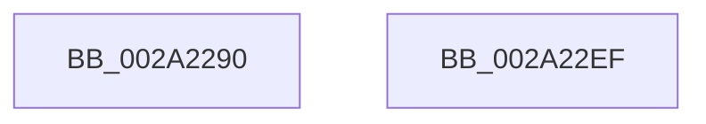

# MiMarkKernelStack

- RVA: `0x002A2290`–`0x002A22F0` (길이 `96` bytes)
- VA: `0x00000001402A2290`
- 실행 섹션: `.text`
- PDB 이름 있음: `예`; PDB Function 태그: `아니요`
- unwind 정보 RVA: `0x00068580`
- 디코드: `28`개 명령, `96/96` bytes 표시
- 미해석 바이트: `0` (있으면 어셈블리에 `.byte`로 보존)

> 이 문서는 커널 이미지의 기계어와 PDB 기호를 분석해 생성했습니다. 4번과 5번은 함수 원형과 자료형을 바이너리 사용 방식에서 추정한 C 해석이며 원본 소스 복구 결과는 아닙니다.

## 1. Dependencies

- 직접 호출 지점: **2**; 고유 호출 대상: **2**
- 직접 호출자로 확인된 함수: **3**
- RIP 상대 이미지 참조: **0**

### Outgoing calls
- `0x002A22AD` → [MiSetPfnIdentity](MiSetPfnIdentity_function_002A2350.md) (function, `0x002A2350`)
- `0x002A22B8` → [MiSetPfnKernelStack](MiSetPfnKernelStack_function_002A2300.md) (function, `0x002A2300`)

### Direct callers
- [MiAllocateKernelStackPages](MiAllocateKernelStackPages_function_002A1BEC.md) at `0x002A1EE1`
- [MiSetPageProtection](../67/MiSetPageProtection_function_00674BDC.md) at `0x00674D9A`
- [MiMarkBootKernelStack](../../init/C6/MiMarkBootKernelStack_function_00C68244.md) at `0x00C6833C`

### Static image references
- 디코드된 RIP-relative 메모리 참조가 없습니다.

## 2. Other-region calls and transfers

- 다른 실행 섹션으로 향하는 call: **0**
- 별도 외부 분기/꼬리 이동을 확인하지 못했습니다.

## 3. Assembly (complete function range)

```asm
002A2290  48 89 5C 24 10                  mov qword ptr [rsp + 0x10], rbx
002A2295  48 89 4C 24 08                  mov qword ptr [rsp + 8], rcx
002A229A  57                              push rdi
002A229B  48 83 EC 20                     sub rsp, 0x20
002A229F  48 8B FA                        mov rdi, rdx
002A22A2  49 8B D8                        mov rbx, r8
002A22A5  48 8B CF                        mov rcx, rdi
002A22A8  BA 02 00 00 00                  mov edx, 2
002A22AD  E8 9E 00 00 00                  call 0x1402a2350
002A22B2  48 8B D3                        mov rdx, rbx
002A22B5  48 8B CF                        mov rcx, rdi
002A22B8  E8 43 00 00 00                  call 0x1402a2300
002A22BD  48 8B 47 10                     mov rax, qword ptr [rdi + 0x10]
002A22C1  48 8B 5C 24 38                  mov rbx, qword ptr [rsp + 0x38]
002A22C6  48 0D E0 03 00 00               or rax, 0x3e0
002A22CC  48 89 47 10                     mov qword ptr [rdi + 0x10], rax
002A22D0  8B 47 20                        mov eax, dword ptr [rdi + 0x20]
002A22D3  89 44 24 30                     mov dword ptr [rsp + 0x30], eax
002A22D7  C1 E8 18                        shr eax, 0x18
002A22DA  24 FD                           and al, 0xfd
002A22DC  0C 05                           or al, 5
002A22DE  88 44 24 33                     mov byte ptr [rsp + 0x33], al
002A22E2  8B 44 24 30                     mov eax, dword ptr [rsp + 0x30]
002A22E6  89 47 20                        mov dword ptr [rdi + 0x20], eax
002A22E9  48 83 C4 20                     add rsp, 0x20
002A22ED  5F                              pop rdi
002A22EE  C3                              ret
002A22EF  CC                              int3
```

## 4. C-style interpretation (structured pseudocode)

```c
__int64 __fastcall MiMarkKernelStack(__int64 a1, __int64 a2, __int64 a3)
{
    __int64 result;
    __int64 v_rsp;
    unsigned __int64 v_stack_p10;
    unsigned __int64 v_stack_p8;
    unsigned __int8 v_stack_pB;

    v_stack_p10 = v_rbx;
    v_stack_p8 = a1;
    v_rsp = (v_rsp) - (32);
    result = MiSetPfnIdentity(a2, 2, a3, a4);
    result = MiSetPfnKernelStack(a2, a3, a3, a4);
    result = (*(unsigned __int64 *)(a2 + 16)) | (992);
    *(unsigned __int64 *)(a2 + 16) = result;
    v_stack_p8 = (unsigned int)((unsigned int)(*(unsigned int *)(a2 + 32)));
    result = (unsigned int)(((unsigned int)(*(unsigned int *)(a2 + 32))) >> (24));
    result = (unsigned __int8)((result) & (253));
    result = (unsigned __int8)((result) | (5));
    v_stack_pB = (unsigned __int8)(result);
    *(unsigned int *)(a2 + 32) = (unsigned int)((unsigned int)(v_stack_p8));
    v_rsp = (v_rsp) + (32);
    return (unsigned int)(v_stack_p8);
}
```

## 5. (Beta) C Style

```c
int64_t MiMarkKernelStack(int64_t Arg1, void *Arg2, int64_t Arg3)
{
    uint8_t *arg2 = (uint8_t *)Arg2;

    int64_t result;
    int64_t local_rsp;
    uint64_t v_stack_p10;
    uint64_t v_stack_p8;
    uint8_t v_stack_pB;

    v_stack_p10 = local_rbx;
    v_stack_p8 = Arg1;
    local_rsp = (local_rsp) - (32);
    result = MiSetPfnIdentity(Arg2, 2, Arg3, a4);
    result = MiSetPfnKernelStack(Arg2, Arg3, Arg3, a4);
    result = (*(uint64_t *)(arg2 + 0x10)) | (992);
    *(uint64_t *)(arg2 + 0x10) = result;
    v_stack_p8 = (uint32_t)((uint32_t)(*(uint32_t *)(arg2 + 0x20)));
    result = (uint32_t)(((uint32_t)(*(uint32_t *)(arg2 + 0x20))) >> (24));
    result = (uint8_t)((result) & (253));
    result = (uint8_t)((result) | (5));
    v_stack_pB = (uint8_t)(result);
    *(uint32_t *)(arg2 + 0x20) = (uint32_t)((uint32_t)(v_stack_p8));
    local_rsp = (local_rsp) + (32);
    return (uint32_t)(v_stack_p8);
}
```

### 관측된 메모리 오프셋

구조체 형식이 확인되지 않은 접근은 인자 기준의 오프셋으로만 기록했습니다.

| 기준 인자 | 오프셋 표현 | 폭 (bit) | 접근 |
|---|---:|---:|---|
| `Arg2` | `+ 0x10` | `64` | `R` |
| `Arg2` | `+ 0x10` | `64` | `W` |
| `Arg2` | `+ 0x20` | `32` | `R` |
| `Arg2` | `+ 0x20` | `32` | `W` |

## 6. Execution-region graph

[열기: 2D/3D 그래프와 함수 탐색 컨트롤 패널](../../../control-panel.html?section=text&rva=0x002A2290&view=graph)

- 2D 그래프는 위에서 아래로 흐르고, 3D 그래프는 빈 공간을 드래그해 회전합니다. Shift+드래그는 이동, 휠은 확대·축소, 함수 노드 선택은 대상 보고서 이동입니다.

### Static fallback


