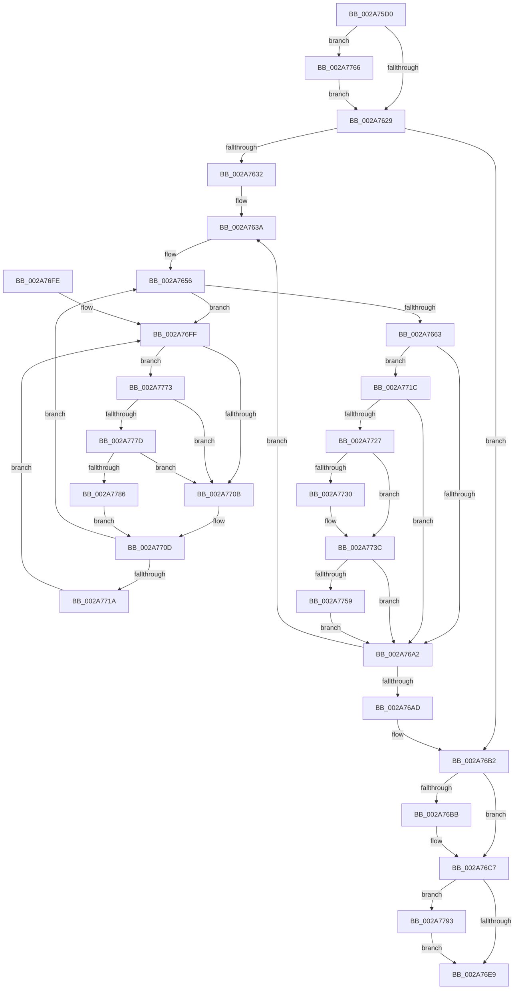

# MiMarkMdlComplete

- RVA: `0x002A75D0`–`0x002A77A6` (길이 `470` bytes)
- VA: `0x00000001402A75D0`
- 실행 섹션: `.text`
- PDB 이름 있음: `예`; PDB Function 태그: `아니요`
- unwind 정보 RVA: `0x00068C0C`
- 디코드: `123`개 명령, `470/470` bytes 표시
- 미해석 바이트: `0` (있으면 어셈블리에 `.byte`로 보존)

> 이 문서는 커널 이미지의 기계어와 PDB 기호를 분석해 생성했습니다. 4번과 5번은 함수 원형과 자료형을 바이너리 사용 방식에서 추정한 C 해석이며 원본 소스 복구 결과는 아닙니다.

## 1. Dependencies

- 직접 호출 지점: **9**; 고유 호출 대상: **7**
- 직접 호출자로 확인된 함수: **1**
- RIP 상대 이미지 참조: **3**

### Outgoing calls
- `0x002A75F2` → [MiLocateLockedVadEvent](MiLocateLockedVadEvent_function_002A7A0C.md) (function, `0x002A7A0C`)
- `0x002A766B` → [MiSetPfnModified](../36/MiSetPfnModified_function_00362960.md) (function, `0x00362960`)
- `0x002A76C2` → [KiLowerIrqlProcessIrqlFlags](../4F/KiLowerIrqlProcessIrqlFlags_function_004F5698.md) (function, `0x004F5698`)
- `0x002A7737` → [KiLowerIrqlProcessIrqlFlags](../4F/KiLowerIrqlProcessIrqlFlags_function_004F5698.md) (function, `0x004F5698`)
- `0x002A775C` → [KiRaiseIrqlProcessIrqlFlags](../4F/KiRaiseIrqlProcessIrqlFlags_function_004F56FC.md) (function, `0x004F56FC`)
- `0x002A7769` → [KiRaiseIrqlProcessIrqlFlags](../4F/KiRaiseIrqlProcessIrqlFlags_function_004F56FC.md) (function, `0x004F56FC`)
- `0x002A777D` → [KiCheckVpBackingLongSpinWaitHypercall](../30/KiCheckVpBackingLongSpinWaitHypercall_function_0030F490.md) (function, `0x0030F490`)
- `0x002A7789` → [HvlNotifyLongSpinWait](../30/HvlNotifyLongSpinWait_function_0030F460.md) (function, `0x0030F460`)
- `0x002A779C` → [KeSetEvent](../33/KeSetEvent_function_0033F310.md) (function, `0x0033F310`)

### Direct callers
- [MiReplaceRotateWithDemandZero](../../page/A7/MiReplaceRotateWithDemandZero_function_00A7C010.md) at `0x00A7C1BD`

### Static image references
- `0x002A761C` → RVA `0x00FC6D20` (`ALMOSTRO`; read)
- `0x002A7702` → RVA `0x00FC52AC` (`ALMOSTRO`; reference)
- `0x002A7773` → RVA `0x00FC6AB8` (`ALMOSTRO`; read)

## 2. Other-region calls and transfers

- 다른 실행 섹션으로 향하는 call: **0**
- 별도 외부 분기/꼬리 이동을 확인하지 못했습니다.

## 3. Assembly (complete function range)

```asm
002A75D0  48 89 5C 24 10                  mov qword ptr [rsp + 0x10], rbx
002A75D5  55                              push rbp
002A75D6  56                              push rsi
002A75D7  57                              push rdi
002A75D8  41 54                           push r12
002A75DA  41 55                           push r13
002A75DC  41 56                           push r14
002A75DE  41 57                           push r15
002A75E0  48 83 EC 20                     sub rsp, 0x20
002A75E4  48 8B C2                        mov rax, rdx
002A75E7  4C 8B C1                        mov r8, rcx
002A75EA  48 8B C8                        mov rcx, rax
002A75ED  BA 08 00 00 00                  mov edx, 8
002A75F2  E8 15 04 00 00                  call 0x1402a7a0c
002A75F7  45 8B 70 28                     mov r14d, dword ptr [r8 + 0x28]
002A75FB  4D 8D 60 30                     lea r12, [r8 + 0x30]
002A75FF  49 C1 EE 0C                     shr r14, 0xc
002A7603  48 8B 68 08                     mov rbp, qword ptr [rax + 8]
002A7607  48 89 6C 24 70                  mov qword ptr [rsp + 0x70], rbp
002A760C  44 0F 20 C7                     mov rdi, cr8
002A7610  BA 02 00 00 00                  mov edx, 2
002A7615  44 0F 22 C2                     mov cr8, rdx
002A7619  45 33 FF                        xor r15d, r15d
002A761C  44 39 3D FD F6 D1 00            cmp dword ptr [rip + 0xd1f6fd], r15d
002A7623  0F 85 3D 01 00 00               jne 0x1402a7766
002A7629  4D 85 F6                        test r14, r14
002A762C  0F 84 80 00 00 00               je 0x1402a76b2
002A7632  BE 01 00 00 00                  mov esi, 1
002A7637  8D 6E 01                        lea ebp, [rsi + 1]
002A763A  49 8B 04 24                     mov rax, qword ptr [r12]
002A763E  44 8B EE                        mov r13d, esi
002A7641  48 8D 1C 40                     lea rbx, [rax + rax*2]
002A7645  48 C1 E3 04                     shl rbx, 4
002A7649  48 B8 00 00 00 00 00 DE FF FF   movabs rax, 0xffffde0000000000
002A7653  48 03 D8                        add rbx, rax
002A7656  F0 48 0F BA 6B 18 3F            lock bts qword ptr [rbx + 0x18], 0x3f
002A765D  0F 82 9C 00 00 00               jb 0x1402a76ff
002A7663  BA 01 00 00 00                  mov edx, 1
002A7668  48 8B CB                        mov rcx, rbx
002A766B  E8 F0 B2 0B 00                  call 0x140362960
002A7670  8B 43 20                        mov eax, dword ptr [rbx + 0x20]
002A7673  89 44 24 60                     mov dword ptr [rsp + 0x60], eax
002A7677  C1 E8 10                        shr eax, 0x10
002A767A  24 DF                           and al, 0xdf
002A767C  88 44 24 62                     mov byte ptr [rsp + 0x62], al
002A7680  45 33 FF                        xor r15d, r15d
002A7683  8B 44 24 60                     mov eax, dword ptr [rsp + 0x60]
002A7687  89 43 20                        mov dword ptr [rbx + 0x20], eax
002A768A  48 B8 FF FF FF FF FF FF FF 7F   movabs rax, 0x7fffffffffffffff
002A7694  4C 89 3B                        mov qword ptr [rbx], r15
002A7697  F0 48 21 43 18                  lock and qword ptr [rbx + 0x18], rax
002A769C  40 F6 C6 3F                     test sil, 0x3f
002A76A0  74 7A                           je 0x1402a771c
002A76A2  49 83 C4 08                     add r12, 8
002A76A6  FF C6                           inc esi
002A76A8  4D 3B EE                        cmp r13, r14
002A76AB  72 8D                           jb 0x1402a763a
002A76AD  48 8B 6C 24 70                  mov rbp, qword ptr [rsp + 0x70]
002A76B2  44 39 3D 67 F6 D1 00            cmp dword ptr [rip + 0xd1f667], r15d
002A76B9  74 0C                           je 0x1402a76c7
002A76BB  44 0F 20 C1                     mov rcx, cr8
002A76BF  40 8A D7                        mov dl, dil
002A76C2  E8 D1 DF 24 00                  call 0x1404f5698
002A76C7  40 0F B6 C7                     movzx eax, dil
002A76CB  44 0F 22 C0                     mov cr8, rax
002A76CF  C7 45 50 9A 00 00 C0            mov dword ptr [rbp + 0x50], 0xc000009a
002A76D6  4C 89 7D 58                     mov qword ptr [rbp + 0x58], r15
002A76DA  8B 85 B0 00 00 00               mov eax, dword ptr [rbp + 0xb0]
002A76E0  83 F8 01                        cmp eax, 1
002A76E3  0F 8F AA 00 00 00               jg 0x1402a7793
002A76E9  48 8B 5C 24 68                  mov rbx, qword ptr [rsp + 0x68]
002A76EE  48 83 C4 20                     add rsp, 0x20
002A76F2  41 5F                           pop r15
002A76F4  41 5E                           pop r14
002A76F6  41 5D                           pop r13
002A76F8  41 5C                           pop r12
002A76FA  5F                              pop rdi
002A76FB  5E                              pop rsi
002A76FC  5D                              pop rbp
002A76FD  C3                              ret
002A76FE  CC                              int3
002A76FF  41 FF C7                        inc r15d
002A7702  44 85 3D A3 DB D1 00            test dword ptr [rip + 0xd1dba3], r15d
002A7709  74 68                           je 0x1402a7773
002A770B  F3 90                           pause
002A770D  48 8B 43 18                     mov rax, qword ptr [rbx + 0x18]
002A7711  48 85 C0                        test rax, rax
002A7714  0F 89 3C FF FF FF               jns 0x1402a7656
002A771A  EB E3                           jmp 0x1402a76ff
002A771C  8B C6                           mov eax, esi
002A771E  49 3B C6                        cmp rax, r14
002A7721  0F 84 7B FF FF FF               je 0x1402a76a2
002A7727  44 39 3D F2 F5 D1 00            cmp dword ptr [rip + 0xd1f5f2], r15d
002A772E  74 0C                           je 0x1402a773c
002A7730  44 0F 20 C1                     mov rcx, cr8
002A7734  40 8A D7                        mov dl, dil
002A7737  E8 5C DF 24 00                  call 0x1404f5698
002A773C  40 0F B6 C7                     movzx eax, dil
002A7740  44 0F 22 C0                     mov cr8, rax
002A7744  44 0F 20 C1                     mov rcx, cr8
002A7748  44 0F 22 C5                     mov cr8, rbp
002A774C  44 39 3D CD F5 D1 00            cmp dword ptr [rip + 0xd1f5cd], r15d
002A7753  0F 84 49 FF FF FF               je 0x1402a76a2
002A7759  40 8A D5                        mov dl, bpl
002A775C  E8 9B DF 24 00                  call 0x1404f56fc
002A7761  E9 3C FF FF FF                  jmp 0x1402a76a2
002A7766  40 8A CF                        mov cl, dil
002A7769  E8 8E DF 24 00                  call 0x1404f56fc
002A776E  E9 B6 FE FF FF                  jmp 0x1402a7629
002A7773  8B 05 3F F3 D1 00               mov eax, dword ptr [rip + 0xd1f33f]
002A7779  A8 40                           test al, 0x40
002A777B  74 8E                           je 0x1402a770b
002A777D  E8 0E 7D 06 00                  call 0x14030f490
002A7782  84 C0                           test al, al
002A7784  74 85                           je 0x1402a770b
002A7786  41 8B CF                        mov ecx, r15d
002A7789  E8 D2 7C 06 00                  call 0x14030f460
002A778E  E9 7A FF FF FF                  jmp 0x1402a770d
002A7793  48 8D 4D 38                     lea rcx, [rbp + 0x38]
002A7797  45 33 C0                        xor r8d, r8d
002A779A  33 D2                           xor edx, edx
002A779C  E8 6F 7B 09 00                  call 0x14033f310
002A77A1  E9 43 FF FF FF                  jmp 0x1402a76e9
```

## 4. C-style interpretation (structured pseudocode)

```c
__int64 __fastcall MiMarkMdlComplete(__int64 a1, __int64 a2)
{
    __int64 result;
    __int64 v_r12;
    __int64 v_r14;
    __int64 v_r15;
    __int64 v_rbx;
    __int64 v_rsi;
    __int64 v_rsp;
    unsigned __int64 v_stack_p10;
    unsigned __int64 v_stack_p18;
    unsigned int v_stack_p8;
    unsigned __int8 v_stack_pA;

    v_stack_p10 = v_rbx;
    v_rsp = (v_rsp) - (32);
    result = MiLocateLockedVadEvent(a2, 8, a1, a4);
    v_r14 = ((unsigned int)(*(unsigned int *)(a1 + 40))) >> (12);
    v_stack_p18 = *(unsigned __int64 *)(result + 8);
    v_r15 = 0;
    if ((*(unsigned int *)(v_rip + 13760253)) != 0) goto loc_002A7766;
loc_002A7629:
    if (v_r14 == 0) goto loc_002A76B2;
loc_002A763A:
    v_rbx = (*(unsigned __int64 *)(a1 + 48) + *(unsigned __int64 *)(a1 + 48) * 2) << (4);
    v_rbx = (v_rbx) + (*(unsigned __int64 *)(a1 + 48));
loc_002A7656:
    if (condition_is_below) goto loc_002A76FF;
    result = MiSetPfnModified(v_rbx, 1, a1, a4);
    v_stack_p8 = (unsigned int)((unsigned int)(*(unsigned int *)(v_rbx + 32)));
    result = (unsigned int)(((unsigned int)(*(unsigned int *)(v_rbx + 32))) >> (16));
    result = (unsigned __int8)((result) & (223));
    v_stack_pA = (unsigned __int8)(result);
    v_r15 = 0;
    *(unsigned int *)(v_rbx + 32) = (unsigned int)((unsigned int)(v_stack_p8));
    *(unsigned __int64 *)(v_rbx) = 0;
    if (((1) & (63)) == 0) goto loc_002A771C;
loc_002A76A2:
    v_r12 = (a1 + 48) + (8);
    v_rsi = (unsigned int)((1) + 1);
    if (1 < v_r14) goto loc_002A763A;
loc_002A76B2:
    result = (unsigned int)(v_stack_p8);
    if ((*(unsigned int *)(v_rip + 13760103)) != 0) {
        a1 = 2;
        a2 = (unsigned __int8)(v_cr8);
        result = KiLowerIrqlProcessIrqlFlags(a1, a2, a1, a4);
    }
    *(unsigned int *)(v_stack_p18 + 80) = 0xC000009AULL;
    *(unsigned __int64 *)(v_stack_p18 + 88) = 0;
    if (((unsigned int)((unsigned int)(*(unsigned int *)(v_stack_p18 + 176)))) > 1) goto loc_002A7793;
loc_002A76E9:
    v_rsp = (v_rsp) + (32);
    return (unsigned int)(*(unsigned int *)(v_stack_p18 + 176));
loc_002A76FF:
    v_r15 = (unsigned int)((v_r15) + 1);
    if (((*(unsigned int *)(v_rip + 13753251)) & ((unsigned int)(v_r15))) == 0) goto loc_002A7773;
loc_002A770B:
loc_002A770D:
    if (!sign_flag) goto loc_002A7656;
    goto loc_002A76FF;
loc_002A771C:
    if (((unsigned int)((unsigned int)(v_rsi))) == v_r14) goto loc_002A76A2;
    result = (unsigned int)((unsigned int)(v_rsi));
    if ((*(unsigned int *)(v_rip + 13759986)) != ((unsigned int)(v_r15))) {
        a1 = (unsigned __int8)(v_cr8);
        a2 = (unsigned __int8)(v_cr8);
        result = KiLowerIrqlProcessIrqlFlags(a1, a2, a1, a4);
    }
    if ((*(unsigned int *)(v_rip + 13759949)) == ((unsigned int)(v_r15))) goto loc_002A76A2;
    result = KiRaiseIrqlProcessIrqlFlags((unsigned __int8)(v_cr8), (unsigned __int8)(v_stack_p18), a1, a4);
    goto loc_002A76A2;
loc_002A7766:
    result = KiRaiseIrqlProcessIrqlFlags((unsigned __int8)(v_cr8), (unsigned __int8)(v_stack_p18), a1, a4);
    goto loc_002A7629;
loc_002A7773:
    if ((((unsigned __int8)((unsigned int)(*(unsigned int *)(v_rip + 13759295)))) & (64)) == 0) goto loc_002A770B;
    result = KiCheckVpBackingLongSpinWaitHypercall((unsigned __int8)(v_cr8), (unsigned __int8)(v_stack_p18), a1, a4);
    if ((unsigned __int8)(result) == 0) goto loc_002A770B;
    result = HvlNotifyLongSpinWait((unsigned int)((unsigned int)(v_r15)), (unsigned __int8)(v_stack_p18), a1, a4);
    goto loc_002A770D;
loc_002A7793:
    a3 = 0;
    a2 = 0;
    result = KeSetEvent(v_stack_p18 + 56, a2, a3, a4);
    goto loc_002A76E9;
}
```

## 5. (Beta) C Style

```c
int64_t MiMarkMdlComplete(int64_t Arg1, int64_t Arg2)
{
    int64_t result;
    int64_t local_r12;
    int64_t local_r14;
    int64_t local_r15;
    int64_t local_rbx;
    int64_t local_rsi;
    int64_t local_rsp;
    uint64_t v_stack_p10;
    uint64_t v_stack_p18;
    uint32_t v_stack_p8;
    uint8_t v_stack_pA;

    v_stack_p10 = local_rbx;
    local_rsp = (local_rsp) - (32);
    result = MiLocateLockedVadEvent(Arg2, 8, Arg1, a4);
    local_r14 = ((uint32_t)(*(uint32_t *)(Arg1 + 0x28))) >> (12);
    v_stack_p18 = *(uint64_t *)(result + 0x8);
    local_r15 = 0;
    if ((*(uint32_t *)(v_rip + 0xD1F6FD)) != 0) goto loc_002A7766;
loc_002A7629:
    if (local_r14 == 0) goto loc_002A76B2;
loc_002A763A:
    local_rbx = (*(uint64_t *)(Arg1 + 0x30) + *(uint64_t *)(Arg1 + 0x30) * 2) << (4);
    local_rbx = (local_rbx) + (*(uint64_t *)(Arg1 + 0x30));
loc_002A7656:
    if (condition_is_below) goto loc_002A76FF;
    result = MiSetPfnModified(local_rbx, 1, Arg1, a4);
    v_stack_p8 = (uint32_t)((uint32_t)(*(uint32_t *)(local_rbx + 0x20)));
    result = (uint32_t)(((uint32_t)(*(uint32_t *)(local_rbx + 0x20))) >> (16));
    result = (uint8_t)((result) & (223));
    v_stack_pA = (uint8_t)(result);
    local_r15 = 0;
    *(uint32_t *)(local_rbx + 0x20) = (uint32_t)((uint32_t)(v_stack_p8));
    *(uint64_t *)(local_rbx) = 0;
    if (((1) & (63)) == 0) goto loc_002A771C;
loc_002A76A2:
    local_r12 = (Arg1 + 48) + (8);
    local_rsi = (uint32_t)((1) + 1);
    if (1 < local_r14) goto loc_002A763A;
loc_002A76B2:
    result = (uint32_t)(v_stack_p8);
    if ((*(uint32_t *)(v_rip + 0xD1F667)) != 0) {
        Arg1 = 2;
        Arg2 = (uint8_t)(v_cr8);
        result = KiLowerIrqlProcessIrqlFlags(Arg1, Arg2, Arg1, a4);
    }
    *(uint32_t *)(v_stack_p18 + 0x50) = 0xC000009AULL;
    *(uint64_t *)(v_stack_p18 + 0x58) = 0;
    if (((uint32_t)((uint32_t)(*(uint32_t *)(v_stack_p18 + 0xB0)))) > 1) goto loc_002A7793;
loc_002A76E9:
    local_rsp = (local_rsp) + (32);
    return (uint32_t)(*(uint32_t *)(v_stack_p18 + 0xB0));
loc_002A76FF:
    local_r15 = (uint32_t)((local_r15) + 1);
    if (((*(uint32_t *)(v_rip + 0xD1DBA3)) & ((uint32_t)(local_r15))) == 0) goto loc_002A7773;
loc_002A770B:
loc_002A770D:
    if (!sign_flag) goto loc_002A7656;
    goto loc_002A76FF;
loc_002A771C:
    if (((uint32_t)((uint32_t)(local_rsi))) == local_r14) goto loc_002A76A2;
    result = (uint32_t)((uint32_t)(local_rsi));
    if ((*(uint32_t *)(v_rip + 0xD1F5F2)) != ((uint32_t)(local_r15))) {
        Arg1 = (uint8_t)(v_cr8);
        Arg2 = (uint8_t)(v_cr8);
        result = KiLowerIrqlProcessIrqlFlags(Arg1, Arg2, Arg1, a4);
    }
    if ((*(uint32_t *)(v_rip + 0xD1F5CD)) == ((uint32_t)(local_r15))) goto loc_002A76A2;
    result = KiRaiseIrqlProcessIrqlFlags((uint8_t)(v_cr8), (uint8_t)(v_stack_p18), Arg1, a4);
    goto loc_002A76A2;
loc_002A7766:
    result = KiRaiseIrqlProcessIrqlFlags((uint8_t)(v_cr8), (uint8_t)(v_stack_p18), Arg1, a4);
    goto loc_002A7629;
loc_002A7773:
    if ((((uint8_t)((uint32_t)(*(uint32_t *)(v_rip + 0xD1F33F)))) & (64)) == 0) goto loc_002A770B;
    result = KiCheckVpBackingLongSpinWaitHypercall((uint8_t)(v_cr8), (uint8_t)(v_stack_p18), Arg1, a4);
    if ((uint8_t)(result) == 0) goto loc_002A770B;
    result = HvlNotifyLongSpinWait((uint32_t)((uint32_t)(local_r15)), (uint8_t)(v_stack_p18), Arg1, a4);
    goto loc_002A770D;
loc_002A7793:
    a3 = 0;
    Arg2 = 0;
    result = KeSetEvent(v_stack_p18 + 56, Arg2, a3, a4);
    goto loc_002A76E9;
}
```

## 6. Execution-region graph

[열기: 2D/3D 그래프와 함수 탐색 컨트롤 패널](../../../control-panel.html?section=text&rva=0x002A75D0&view=graph)

- 2D 그래프는 위에서 아래로 흐르고, 3D 그래프는 빈 공간을 드래그해 회전합니다. Shift+드래그는 이동, 휠은 확대·축소, 함수 노드 선택은 대상 보고서 이동입니다.

### Static fallback


