# MiMoveDirtyBitsToPfns

- RVA: `0x002A8624`–`0x002A8A67` (길이 `1,091` bytes)
- VA: `0x00000001402A8624`
- 실행 섹션: `.text`
- PDB 이름 있음: `예`; PDB Function 태그: `예`
- unwind 정보 RVA: `0x00068D30`
- 디코드: `265`개 명령, `1,091/1,091` bytes 표시
- 미해석 바이트: `0` (있으면 어셈블리에 `.byte`로 보존)

> 이 문서는 커널 이미지의 기계어와 PDB 기호를 분석해 생성했습니다. 4번과 5번은 함수 원형과 자료형을 바이너리 사용 방식에서 추정한 C 해석이며 원본 소스 복구 결과는 아닙니다.

## 1. Dependencies

- 직접 호출 지점: **25**; 고유 호출 대상: **17**
- 직접 호출자로 확인된 함수: **3**
- RIP 상대 이미지 참조: **0**

### Outgoing calls
- `0x002A86CF` → [MiLockWorkingSetShared](../27/MiLockWorkingSetShared_function_0027CBF0.md) (function, `0x0027CBF0`)
- `0x002A871B` → [MiGetNextPageTable](../2C/MiGetNextPageTable_function_002C2EE0.md) (function, `0x002C2EE0`)
- `0x002A8776` → [MiGetProcessorFlushList](../24/MiGetProcessorFlushList_function_00242C90.md) (function, `0x00242C90`)
- `0x002A8793` → [MiInitializeTbFlushList](../29/MiInitializeTbFlushList_function_00294F00.md) (function, `0x00294F00`)
- `0x002A879E` → [MiMakePteClean](MiMakePteClean_function_002A901C.md) (function, `0x002A901C`)
- `0x002A87C2` → [MiGetLeafVa](../27/MiGetLeafVa_function_0027C0A0.md) (function, `0x0027C0A0`)
- `0x002A8833` → [MiUnlockWorkingSetShared](../27/MiUnlockWorkingSetShared_function_0027D690.md) (function, `0x0027D690`)
- `0x002A8861` → [MiGetVadMandatoryPageSize](MiGetVadMandatoryPageSize_function_002A85F0.md) (function, `0x002A85F0`)
- `0x002A886C` → [MiGetLeafVa](../27/MiGetLeafVa_function_0027C0A0.md) (function, `0x0027C0A0`)
- `0x002A8889` → [MiGetLeafVa](../27/MiGetLeafVa_function_0027C0A0.md) (function, `0x0027C0A0`)
- `0x002A88D3` → [ExAcquireSpinLockExclusiveAtDpcLevel](../24/ExAcquireSpinLockExclusiveAtDpcLevel_function_00248E80.md) (function, `0x00248E80`)
- `0x002A88E5` → [RtlClearBitsEx](../29/RtlClearBitsEx_function_00297740.md) (function, `0x00297740`)
- `0x002A890F` → [MiUnlockPageTable](../21/MiUnlockPageTable_function_00216EC0.md) (function, `0x00216EC0`)
- `0x002A891B` → [MiWorkingSetIsContended](MiWorkingSetIsContended_function_002AE520.md) (function, `0x002AE520`)
- `0x002A8924` → [KeShouldYieldProcessor](../27/KeShouldYieldProcessor_function_002773E0.md) (function, `0x002773E0`)
- `0x002A8937` → [MiUnlockWorkingSetShared](../27/MiUnlockWorkingSetShared_function_0027D690.md) (function, `0x0027D690`)
- `0x002A893F` → [MiLockWorkingSetShared](../27/MiLockWorkingSetShared_function_0027CBF0.md) (function, `0x0027CBF0`)
- `0x002A8952` → [ExReleaseSpinLockExclusiveFromDpcLevel](../24/ExReleaseSpinLockExclusiveFromDpcLevel_function_002497E0.md) (function, `0x002497E0`)
- `0x002A8969` → [MiLocateLockedVadEvent](MiLocateLockedVadEvent_function_002A7A0C.md) (function, `0x002A7A0C`)
- `0x002A89DA` → [MiFlushTbList](../31/MiFlushTbList_function_00311FC0.md) (function, `0x00311FC0`)
- `0x002A89DF` → [MiReleaseProcessorFlushList](../31/MiReleaseProcessorFlushList_function_00313C70.md) (function, `0x00313C70`)
- `0x002A8A35` → [MiFlushTbList](../31/MiFlushTbList_function_00311FC0.md) (function, `0x00311FC0`)
- `0x002A8A3A` → [MiReleaseProcessorFlushList](../31/MiReleaseProcessorFlushList_function_00313C70.md) (function, `0x00313C70`)
- `0x002A8A4D` → [ExReleaseSpinLockExclusiveFromDpcLevel](../24/ExReleaseSpinLockExclusiveFromDpcLevel_function_002497E0.md) (function, `0x002497E0`)
- `0x002A8A5D` → [MiUnlockPageTable](../21/MiUnlockPageTable_function_00216EC0.md) (function, `0x00216EC0`)

### Direct callers
- [MiBeginHoldingDirtyFaults](../68/MiBeginHoldingDirtyFaults_function_00682F90.md) at `0x00683007`
- [MiProcessVaRangesInfoClass](../../page/9F/MiProcessVaRangesInfoClass_function_009F4E50.md) at `0x009F4FC0`
- [NtResetWriteWatch](../../page/A4/NtResetWriteWatch_function_00A48F60.md) at `0x00A49065`

### Static image references
- 디코드된 RIP-relative 메모리 참조가 없습니다.

## 2. Other-region calls and transfers

- 다른 실행 섹션으로 향하는 call: **0**
- call이 아닌 외부 분기/꼬리 이동: **2**
  - `0x002A8A0F` → [sub_006DB144 + 0x20](../6D/Unknown_function_006DB144.md) (`tail-transfer`)
  - `0x002A8A17` → [sub_006DB144](../6D/Unknown_function_006DB144.md) (`tail-transfer`)

## 3. Assembly (complete function range)

```asm
002A8624  44 89 4C 24 20                  mov dword ptr [rsp + 0x20], r9d
002A8629  4C 89 44 24 18                  mov qword ptr [rsp + 0x18], r8
002A862E  53                              push rbx
002A862F  55                              push rbp
002A8630  56                              push rsi
002A8631  57                              push rdi
002A8632  41 54                           push r12
002A8634  41 55                           push r13
002A8636  41 56                           push r14
002A8638  41 57                           push r15
002A863A  48 83 EC 68                     sub rsp, 0x68
002A863E  48 8B E9                        mov rbp, rcx
002A8641  41 8B F9                        mov edi, r9d
002A8644  45 33 C9                        xor r9d, r9d
002A8647  48 C1 ED 09                     shr rbp, 9
002A864B  4C 8B FA                        mov r15, rdx
002A864E  44 89 4C 24 34                  mov dword ptr [rsp + 0x34], r9d
002A8653  48 BA F8 FF FF FF 7F 00 00 00   movabs rdx, 0x7ffffffff8
002A865D  44 89 4C 24 30                  mov dword ptr [rsp + 0x30], r9d
002A8662  48 23 EA                        and rbp, rdx
002A8665  48 B9 00 00 00 00 80 F6 FF FF   movabs rcx, 0xfffff68000000000
002A866F  41 8B D9                        mov ebx, r9d
002A8672  48 8B C1                        mov rax, rcx
002A8675  49 C1 EF 09                     shr r15, 9
002A8679  48 03 E8                        add rbp, rax
002A867C  4C 23 FA                        and r15, rdx
002A867F  48 8B C1                        mov rax, rcx
002A8682  4C 03 F8                        add r15, rax
002A8685  65 48 8B 04 25 88 01 00 00      mov rax, qword ptr gs:[0x188]
002A868E  4C 89 BC 24 B8 00 00 00         mov qword ptr [rsp + 0xb8], r15
002A8696  48 8B 88 B8 00 00 00            mov rcx, qword ptr [rax + 0xb8]
002A869D  8B C7                           mov eax, edi
002A869F  83 E0 01                        and eax, 1
002A86A2  89 44 24 38                     mov dword ptr [rsp + 0x38], eax
002A86A6  4C 8B A9 10 04 00 00            mov r13, qword ptr [rcx + 0x410]
002A86AD  4C 8D A1 00 04 00 00            lea r12, [rcx + 0x400]
002A86B4  4C 89 6C 24 50                  mov qword ptr [rsp + 0x50], r13
002A86B9  0F 85 A2 02 00 00               jne 0x1402a8961
002A86BF  4C 89 4C 24 48                  mov qword ptr [rsp + 0x48], r9
002A86C4  4C 89 4C 24 40                  mov qword ptr [rsp + 0x40], r9
002A86C9  49 8B CC                        mov rcx, r12
002A86CC  4D 8B F1                        mov r14, r9
002A86CF  E8 1C 45 FD FF                  call 0x14027cbf0
002A86D4  88 84 24 B0 00 00 00            mov byte ptr [rsp + 0xb0], al
002A86DB  40 8A F0                        mov sil, al
002A86DE  49 3B EF                        cmp rbp, r15
002A86E1  0F 87 46 01 00 00               ja 0x1402a882d
002A86E7  83 E7 02                        and edi, 2
002A86EA  89 BC 24 C8 00 00 00            mov dword ptr [rsp + 0xc8], edi
002A86F1  48 85 DB                        test rbx, rbx
002A86F4  0F 85 06 02 00 00               jne 0x1402a8900
002A86FA  85 FF                           test edi, edi
002A86FC  0F 85 EA 02 00 00               jne 0x1402a89ec
002A8702  48 8D 44 24 34                  lea rax, [rsp + 0x34]
002A8707  41 B9 01 00 00 00               mov r9d, 1
002A870D  44 8A C6                        mov r8b, sil
002A8710  48 89 44 24 20                  mov qword ptr [rsp + 0x20], rax
002A8715  49 8B D7                        mov rdx, r15
002A8718  48 8B CD                        mov rcx, rbp
002A871B  E8 C0 A7 01 00                  call 0x1402c2ee0
002A8720  4C 8B E8                        mov r13, rax
002A8723  48 8B F0                        mov rsi, rax
002A8726  48 85 C0                        test rax, rax
002A8729  0F 85 5E 02 00 00               jne 0x1402a898d
002A872F  49 8B FF                        mov rdi, r15
002A8732  83 7C 24 38 00                  cmp dword ptr [rsp + 0x38], 0
002A8737  0F 85 0D 01 00 00               jne 0x1402a884a
002A873D  4D 85 ED                        test r13, r13
002A8740  0F 84 C2 00 00 00               je 0x1402a8808
002A8746  48 3B F7                        cmp rsi, rdi
002A8749  77 69                           ja 0x1402a87b4
002A874B  8B AC 24 C8 00 00 00            mov ebp, dword ptr [rsp + 0xc8]
002A8752  44 8B 7C 24 38                  mov r15d, dword ptr [rsp + 0x38]
002A8757  48 8B 06                        mov rax, qword ptr [rsi]
002A875A  A8 42                           test al, 0x42
002A875C  0F 95 C2                        setne dl
002A875F  A8 01                           test al, 1
002A8761  0F 95 C1                        setne cl
002A8764  84 D1                           test cl, dl
002A8766  74 3B                           je 0x1402a87a3
002A8768  45 85 FF                        test r15d, r15d
002A876B  0F 84 AB 02 00 00               je 0x1402a8a1c
002A8771  4D 85 F6                        test r14, r14
002A8774  75 22                           jne 0x1402a8798
002A8776  E8 15 A5 F9 FF                  call 0x140242c90
002A877B  45 33 C9                        xor r9d, r9d
002A877E  C7 44 24 20 0A 00 00 00         mov dword ptr [rsp + 0x20], 0xa
002A8786  49 8B D4                        mov rdx, r12
002A8789  48 8B C8                        mov rcx, rax
002A878C  4C 8B F0                        mov r14, rax
002A878F  44 8B 40 0C                     mov r8d, dword ptr [rax + 0xc]
002A8793  E8 68 C7 FE FF                  call 0x140294f00
002A8798  4D 8B C6                        mov r8, r14
002A879B  48 8B D6                        mov rdx, rsi
002A879E  E8 79 08 00 00                  call 0x1402a901c
002A87A3  48 83 C6 08                     add rsi, 8
002A87A7  48 3B F7                        cmp rsi, rdi
002A87AA  76 AB                           jbe 0x1402a8757
002A87AC  4C 8B BC 24 B8 00 00 00         mov r15, qword ptr [rsp + 0xb8]
002A87B4  83 7C 24 30 00                  cmp dword ptr [rsp + 0x30], 0
002A87B9  0F 85 8A 01 00 00               jne 0x1402a8949
002A87BF  48 8B CE                        mov rcx, rsi
002A87C2  E8 D9 38 FD FF                  call 0x14027c0a0
002A87C7  48 8B E8                        mov rbp, rax
002A87CA  48 B8 F8 FF FF FF 7F 00 00 00   movabs rax, 0x7ffffffff8
002A87D4  48 C1 ED 09                     shr rbp, 9
002A87D8  48 23 E8                        and rbp, rax
002A87DB  48 B8 00 00 00 00 80 F6 FF FF   movabs rax, 0xfffff68000000000
002A87E5  48 8B C0                        mov rax, rax
002A87E8  8B BC 24 C8 00 00 00            mov edi, dword ptr [rsp + 0xc8]
002A87EF  48 03 E8                        add rbp, rax
002A87F2  40 8A B4 24 B0 00 00 00         mov sil, byte ptr [rsp + 0xb0]
002A87FA  4C 8B 6C 24 50                  mov r13, qword ptr [rsp + 0x50]
002A87FF  49 3B EF                        cmp rbp, r15
002A8802  0F 86 E9 FE FF FF               jbe 0x1402a86f1
002A8808  4D 85 F6                        test r14, r14
002A880B  0F 85 21 02 00 00               jne 0x1402a8a32
002A8811  83 7C 24 30 00                  cmp dword ptr [rsp + 0x30], 0
002A8816  0F 85 28 02 00 00               jne 0x1402a8a44
002A881C  48 85 DB                        test rbx, rbx
002A881F  0F 85 32 02 00 00               jne 0x1402a8a57
002A8825  40 8A B4 24 B0 00 00 00         mov sil, byte ptr [rsp + 0xb0]
002A882D  40 8A D6                        mov dl, sil
002A8830  49 8B CC                        mov rcx, r12
002A8833  E8 58 4E FD FF                  call 0x14027d690
002A8838  48 83 C4 68                     add rsp, 0x68
002A883C  41 5F                           pop r15
002A883E  41 5E                           pop r14
002A8840  41 5D                           pop r13
002A8842  41 5C                           pop r12
002A8844  5F                              pop rdi
002A8845  5E                              pop rsi
002A8846  5D                              pop rbp
002A8847  5B                              pop rbx
002A8848  C3                              ret
002A8849  CC                              int3
002A884A  48 8B 8C 24 C0 00 00 00         mov rcx, qword ptr [rsp + 0xc0]
002A8852  44 0F B6 51 20                  movzx r10d, byte ptr [rcx + 0x20]
002A8857  8B 41 18                        mov eax, dword ptr [rcx + 0x18]
002A885A  49 C1 E2 20                     shl r10, 0x20
002A885E  4C 0B D0                        or r10, rax
002A8861  E8 8A FD FF FF                  call 0x1402a85f0
002A8866  48 8B CD                        mov rcx, rbp
002A8869  4C 8B D8                        mov r11, rax
002A886C  E8 2F 38 FD FF                  call 0x14027c0a0
002A8871  48 C1 E8 0C                     shr rax, 0xc
002A8875  48 8D 4F 08                     lea rcx, [rdi + 8]
002A8879  49 2B C2                        sub rax, r10
002A887C  33 D2                           xor edx, edx
002A887E  49 F7 F3                        div r11
002A8881  4C 8B C8                        mov r9, rax
002A8884  48 89 44 24 58                  mov qword ptr [rsp + 0x58], rax
002A8889  E8 12 38 FD FF                  call 0x14027c0a0
002A888E  4C 8B 84 24 C0 00 00 00         mov r8, qword ptr [rsp + 0xc0]
002A8896  41 0F B6 50 21                  movzx edx, byte ptr [r8 + 0x21]
002A889B  41 8B 48 1C                     mov ecx, dword ptr [r8 + 0x1c]
002A889F  48 C1 E2 20                     shl rdx, 0x20
002A88A3  48 0B D1                        or rdx, rcx
002A88A6  48 C1 E2 0C                     shl rdx, 0xc
002A88AA  48 81 CA FF 0F 00 00            or rdx, 0xfff
002A88B1  48 3B C2                        cmp rax, rdx
002A88B4  76 39                           jbe 0x1402a88ef
002A88B6  48 8B 6C 24 48                  mov rbp, qword ptr [rsp + 0x48]
002A88BB  48 8B 6D 00                     mov rbp, qword ptr [rbp]
002A88BF  48 8B 4C 24 40                  mov rcx, qword ptr [rsp + 0x40]
002A88C4  49 2B E9                        sub rbp, r9
002A88C7  48 83 C1 08                     add rcx, 8
002A88CB  C7 44 24 30 01 00 00 00         mov dword ptr [rsp + 0x30], 1
002A88D3  E8 A8 05 FA FF                  call 0x140248e80
002A88D8  48 8B 54 24 58                  mov rdx, qword ptr [rsp + 0x58]
002A88DD  4C 8B C5                        mov r8, rbp
002A88E0  48 8B 4C 24 48                  mov rcx, qword ptr [rsp + 0x48]
002A88E5  E8 56 EE FE FF                  call 0x140297740
002A88EA  E9 4E FE FF FF                  jmp 0x1402a873d
002A88EF  48 C1 E8 0C                     shr rax, 0xc
002A88F3  33 D2                           xor edx, edx
002A88F5  49 2B C2                        sub rax, r10
002A88F8  49 F7 F3                        div r11
002A88FB  48 8B E8                        mov rbp, rax
002A88FE  EB BF                           jmp 0x1402a88bf
002A8900  4D 85 F6                        test r14, r14
002A8903  0F 85 CE 00 00 00               jne 0x1402a89d7
002A8909  48 8B D3                        mov rdx, rbx
002A890C  49 8B CC                        mov rcx, r12
002A890F  E8 AC E5 F6 FF                  call 0x140216ec0
002A8914  33 D2                           xor edx, edx
002A8916  49 8B CC                        mov rcx, r12
002A8919  33 DB                           xor ebx, ebx
002A891B  E8 00 5C 00 00                  call 0x1402ae520
002A8920  85 C0                           test eax, eax
002A8922  75 0D                           jne 0x1402a8931
002A8924  E8 B7 EA FC FF                  call 0x1402773e0
002A8929  85 C0                           test eax, eax
002A892B  0F 84 C9 FD FF FF               je 0x1402a86fa
002A8931  40 8A D6                        mov dl, sil
002A8934  49 8B CC                        mov rcx, r12
002A8937  E8 54 4D FD FF                  call 0x14027d690
002A893C  49 8B CC                        mov rcx, r12
002A893F  E8 AC 42 FD FF                  call 0x14027cbf0
002A8944  E9 B1 FD FF FF                  jmp 0x1402a86fa
002A8949  48 8B 4C 24 40                  mov rcx, qword ptr [rsp + 0x40]
002A894E  48 83 C1 08                     add rcx, 8
002A8952  E8 89 0E FA FF                  call 0x1402497e0
002A8957  83 64 24 30 00                  and dword ptr [rsp + 0x30], 0
002A895C  E9 5E FE FF FF                  jmp 0x1402a87bf
002A8961  BA 04 00 00 00                  mov edx, 4
002A8966  49 8B C8                        mov rcx, r8
002A8969  E8 9E F0 FF FF                  call 0x1402a7a0c
002A896E  8B BC 24 C8 00 00 00            mov edi, dword ptr [rsp + 0xc8]
002A8975  48 89 44 24 40                  mov qword ptr [rsp + 0x40], rax
002A897A  4C 8D 68 10                     lea r13, [rax + 0x10]
002A897E  4C 89 6C 24 48                  mov qword ptr [rsp + 0x48], r13
002A8983  4C 8B 6C 24 50                  mov r13, qword ptr [rsp + 0x50]
002A8988  E9 3C FD FF FF                  jmp 0x1402a86c9
002A898D  49 8B DD                        mov rbx, r13
002A8990  49 B8 00 00 00 00 80 F6 FF FF   movabs r8, 0xfffff68000000000
002A899A  48 C1 EB 09                     shr rbx, 9
002A899E  49 B9 F8 FF FF FF 7F 00 00 00   movabs r9, 0x7ffffffff8
002A89A8  49 23 D9                        and rbx, r9
002A89AB  49 8B C0                        mov rax, r8
002A89AE  8B 54 24 34                     mov edx, dword ptr [rsp + 0x34]
002A89B2  48 03 D8                        add rbx, rax
002A89B5  85 D2                           test edx, edx
002A89B7  75 40                           jne 0x1402a89f9
002A89B9  49 8B C5                        mov rax, r13
002A89BC  49 8B FF                        mov rdi, r15
002A89BF  48 25 00 F0 FF FF               and rax, 0xfffffffffffff000
002A89C5  48 05 F8 0F 00 00               add rax, 0xff8
002A89CB  49 3B C7                        cmp rax, r15
002A89CE  48 0F 46 F8                     cmovbe rdi, rax
002A89D2  E9 5B FD FF FF                  jmp 0x1402a8732
002A89D7  49 8B CE                        mov rcx, r14
002A89DA  E8 E1 95 06 00                  call 0x140311fc0
002A89DF  E8 8C B2 06 00                  call 0x140313c70
002A89E4  45 33 F6                        xor r14d, r14d
002A89E7  E9 1D FF FF FF                  jmp 0x1402a8909
002A89EC  F0 49 FF 85 70 05 00 00         lock inc qword ptr [r13 + 0x570]
002A89F4  E9 09 FD FF FF                  jmp 0x1402a8702
002A89F9  49 8B CF                        mov rcx, r15
002A89FC  48 8B F3                        mov rsi, rbx
002A89FF  48 C1 E9 09                     shr rcx, 9
002A8A03  49 23 C9                        and rcx, r9
002A8A06  49 8B C0                        mov rax, r8
002A8A09  48 03 C8                        add rcx, rax
002A8A0C  83 FA 01                        cmp edx, 1
002A8A0F  0F 86 4F 27 43 00               jbe 0x1406db164
002A8A15  FF CA                           dec edx
002A8A17  E9 28 27 43 00                  jmp 0x1406db144
002A8A1C  85 ED                           test ebp, ebp
002A8A1E  0F 84 4D FD FF FF               je 0x1402a8771
002A8A24  48 85 C0                        test rax, rax
002A8A27  0F 88 76 FD FF FF               js 0x1402a87a3
002A8A2D  E9 3F FD FF FF                  jmp 0x1402a8771
002A8A32  49 8B CE                        mov rcx, r14
002A8A35  E8 86 95 06 00                  call 0x140311fc0
002A8A3A  E8 31 B2 06 00                  call 0x140313c70
002A8A3F  E9 CD FD FF FF                  jmp 0x1402a8811
002A8A44  48 8B 4C 24 40                  mov rcx, qword ptr [rsp + 0x40]
002A8A49  48 83 C1 08                     add rcx, 8
002A8A4D  E8 8E 0D FA FF                  call 0x1402497e0
002A8A52  E9 C5 FD FF FF                  jmp 0x1402a881c
002A8A57  48 8B D3                        mov rdx, rbx
002A8A5A  49 8B CC                        mov rcx, r12
002A8A5D  E8 5E E4 F6 FF                  call 0x140216ec0
002A8A62  E9 BE FD FF FF                  jmp 0x1402a8825
```

## 4. C-style interpretation (structured pseudocode)

```c
__int64 __fastcall MiMoveDirtyBitsToPfns(__int64 a1, __int64 a2, __int64 a3, int a4)
{
    __int64 result;
    __int64 v_r10;
    __int64 v_r14;
    __int64 v_r15;
    __int64 v_rbp;
    __int64 v_rbx;
    __int64 v_rdi;
    __int64 v_rsi;
    __int64 v_rsp;
    unsigned __int64 v_stack_m58;
    unsigned __int64 v_stack_m60;
    unsigned __int64 v_stack_m68;
    unsigned int v_stack_m70;
    unsigned int v_stack_m74;
    unsigned int v_stack_m78;
    unsigned __int64 v_stack_m88;
    unsigned __int64 v_stack_p10;
    unsigned __int64 v_stack_p18;
    unsigned int v_stack_p20;
    unsigned int v_stack_p30;
    unsigned int v_stack_p34;
    unsigned __int64 v_stack_p40;
    unsigned __int64 v_stack_p48;
    unsigned __int64 v_stack_p50;
    unsigned __int64 v_stack_p58;
    unsigned __int8 v_stack_p8;
    unsigned __int64 v_stack_pC0;
    unsigned int v_stack_pC8;

    v_stack_p20 = a4;
    v_stack_p18 = a3;
    v_rsp = (v_rsp) - (104);
    a4 = 0;
    v_rbp = (a1) >> (9);
    v_stack_m74 = 0;
    v_stack_m78 = 0;
    v_rbp = (v_rbp) & (a2);
    v_r15 = (a2) >> (9);
    v_rbp = (v_rbp) + (a1);
    v_r15 = (v_r15) & (a2);
    v_r15 = (v_r15) + (a1);
    v_stack_p10 = v_r15;
    result = (unsigned int)(((unsigned int)((unsigned int)((unsigned int)(a4)))) & (1));
    v_stack_m70 = (unsigned int)(result);
    v_stack_m58 = *(unsigned __int64 *)(*(unsigned __int64 *)(*(unsigned __int64 *)(gs_base + (0 + 392)) + 184) + 1040);
    if (condition_is_not_equal) goto loc_002A8961;
    v_stack_m60 = 0;
    v_stack_m68 = 0;
loc_002A86C9:
    result = MiLockWorkingSetShared(*(unsigned __int64 *)(*(unsigned __int64 *)(gs_base + (0 + 392)) + 184) + 1024, a2, a3, a4);
    v_stack_p8 = (unsigned __int8)(result);
    if (v_rbp > v_r15) goto loc_002A882D;
    v_rdi = (unsigned int)(((unsigned int)(a4)) & (2));
    v_stack_p20 = (unsigned int)(v_rdi);
loc_002A86F1:
    if (0 != 0) goto loc_002A8900;
loc_002A86FA:
    if ((unsigned int)(v_rdi) != 0) goto loc_002A89EC;
loc_002A8702:
    v_stack_m88 = v_stack_m74;
    result = MiGetNextPageTable(v_rbp, v_r15, (unsigned __int8)((unsigned __int8)(result)), 1);
    if (result != 0) goto loc_002A898D;
loc_002A8732:
    if (v_stack_m70 != 0) goto loc_002A884A;
loc_002A873D:
    if (result == 0) goto loc_002A8808;
    if (result > v_r15) goto loc_002A87B4;
loc_002A8757:
    a2 = ((((unsigned __int8)(*(unsigned __int64 *)(result))) & (66)) != 0) ? 1 : 0;
    a1 = ((((unsigned __int8)(*(unsigned __int64 *)(result))) & (1)) != 0) ? 1 : 0;
    if ((((unsigned __int8)(a1)) & ((unsigned __int8)(a2))) == 0) goto loc_002A87A3;
    if ((unsigned int)((unsigned int)(v_stack_m70)) == 0) goto loc_002A8A1C;
loc_002A8771:
    result = *(unsigned __int64 *)(result);
    v_r14 = 0;
    if (0 == 0) {
        result = MiGetProcessorFlushList(a1, a2, (unsigned __int8)((unsigned __int8)(result)), 1);
        a4 = 0;
        v_stack_m88 = 10;
        a2 = *(unsigned __int64 *)(*(unsigned __int64 *)(gs_base + (0 + 392)) + 184) + 1024;
        a1 = result;
        v_r14 = result;
        a3 = *(unsigned int *)(result + 12);
        result = MiInitializeTbFlushList(a1, a2, a3, a4);
    }
    result = MiMakePteClean(a1, result, v_r14, a4);
loc_002A87A3:
    v_rsi = (result) + (8);
    if (v_rsi <= v_r15) goto loc_002A8757;
loc_002A87B4:
    if (v_stack_m78 != 0) goto loc_002A8949;
loc_002A87BF:
    result = MiGetLeafVa(v_rsi, result, v_r14, a4);
    v_rbp = (result) >> (9);
    v_rbp = (v_rbp) & (result);
    v_rbp = (v_rbp) + (result);
    if (v_rbp <= v_stack_p10) goto loc_002A86F1;
loc_002A8808:
    if (v_r14 != 0) goto loc_002A8A32;
loc_002A8811:
    if (v_stack_m78 != 0) goto loc_002A8A44;
loc_002A881C:
    if (0 != 0) goto loc_002A8A57;
loc_002A8825:
loc_002A882D:
    result = MiUnlockWorkingSetShared(*(unsigned __int64 *)(*(unsigned __int64 *)(gs_base + (0 + 392)) + 184) + 1024, (unsigned __int8)(v_stack_p8), v_r14, a4);
    v_rsp = (v_rsp) + (104);
    return result;
loc_002A884A:
    v_r10 = (*(unsigned __int8 *)(v_stack_pC0 + 32)) << (32);
    v_r10 = (v_r10) | ((unsigned int)(*(unsigned int *)(v_stack_pC0 + 24)));
    result = MiGetVadMandatoryPageSize(v_stack_pC0, (unsigned __int8)(v_stack_p8), v_r14, a4);
    result = MiGetLeafVa(v_rbp, (unsigned __int8)(v_stack_p8), v_r14, a4);
    result = (result) >> (12);
    result = (result) - (v_r10);
    a2 = 0;
    v_stack_p58 = result;
    result = MiGetLeafVa((unsigned int)(v_stack_p20) + 8, a2, v_r14, result);
    a2 = (*(unsigned __int8 *)(v_stack_pC0 + 33)) << (32);
    a2 = (a2) | ((unsigned int)(*(unsigned int *)(v_stack_pC0 + 28)));
    a2 = (a2) << (12);
    a2 = (a2) | (0xFFFULL);
    if (result <= a2) goto loc_002A88EF;
loc_002A88BF:
    v_rbp = (*(unsigned __int64 *)(v_stack_p48)) - (result);
    a1 = (v_stack_p40) + (8);
    v_stack_p30 = 1;
    result = ExAcquireSpinLockExclusiveAtDpcLevel(a1, a2, v_stack_pC0, result);
    result = RtlClearBitsEx(v_stack_p48, v_stack_p58, v_rbp, result);
    goto loc_002A873D;
loc_002A88EF:
    result = (result) >> (12);
    a2 = 0;
    result = (result) - (v_r10);
    goto loc_002A88BF;
loc_002A8900:
    if (v_r14 != 0) goto loc_002A89D7;
loc_002A8909:
    result = MiUnlockPageTable(*(unsigned __int64 *)(*(unsigned __int64 *)(gs_base + (0 + 392)) + 184) + 1024, 0, v_rbp, result);
    a2 = 0;
    v_rbx = 0;
    result = MiWorkingSetIsContended(*(unsigned __int64 *)(*(unsigned __int64 *)(gs_base + (0 + 392)) + 184) + 1024, a2, v_rbp, result);
    if ((unsigned int)(result) != 0) goto loc_002A8931;
    result = KeShouldYieldProcessor(*(unsigned __int64 *)(*(unsigned __int64 *)(gs_base + (0 + 392)) + 184) + 1024, a2, v_rbp, result);
    if ((unsigned int)(result) == 0) goto loc_002A86FA;
loc_002A8931:
    result = MiUnlockWorkingSetShared(*(unsigned __int64 *)(*(unsigned __int64 *)(gs_base + (0 + 392)) + 184) + 1024, (unsigned __int8)(v_stack_p8), v_rbp, result);
    result = MiLockWorkingSetShared(*(unsigned __int64 *)(*(unsigned __int64 *)(gs_base + (0 + 392)) + 184) + 1024, (unsigned __int8)(v_stack_p8), v_rbp, result);
    goto loc_002A86FA;
loc_002A8949:
    a1 = (v_stack_p40) + (8);
    result = ExReleaseSpinLockExclusiveFromDpcLevel(a1, (unsigned __int8)(v_stack_p8), v_rbp, result);
    goto loc_002A87BF;
loc_002A8961:
    result = MiLocateLockedVadEvent(v_rbp, 4, v_rbp, result);
    v_stack_p40 = result;
    v_stack_p48 = result + 16;
    goto loc_002A86C9;
loc_002A898D:
    v_rbx = (v_stack_p50) >> (9);
    v_rbx = (v_rbx) & (result);
    v_rbx = (v_rbx) + (v_rbp);
    if ((unsigned int)((unsigned int)(v_stack_p34)) != 0) goto loc_002A89F9;
    result = (v_stack_p50) & (0xFFFFFFFFFFFFF000ULL);
    result = (result) + (0xFF8ULL);
    v_rdi = v_stack_p10;
    if (result <= v_stack_p10) { v_rdi = result; }
    goto loc_002A8732;
loc_002A89D7:
    result = MiFlushTbList(v_r14, (unsigned int)(v_stack_p34), v_rbp, result);
    result = MiReleaseProcessorFlushList(v_r14, (unsigned int)(v_stack_p34), v_rbp, result);
    v_r14 = 0;
    goto loc_002A8909;
loc_002A89EC:
    goto loc_002A8702;
loc_002A89F9:
    a1 = (v_stack_p10) >> (9);
    a1 = (a1) & (result);
    a1 = (a1) + (v_rbp);
    a2 = (unsigned int)(((unsigned int)(v_stack_p34)) - 1);
loc_002A8A1C:
    if ((unsigned int)(result) == 0) goto loc_002A8771;
    if (sign_flag) goto loc_002A87A3;
    goto loc_002A8771;
loc_002A8A32:
    result = MiFlushTbList(0, a2, v_rbp, result);
    result = MiReleaseProcessorFlushList(0, a2, v_rbp, result);
    goto loc_002A8811;
loc_002A8A44:
    a1 = (v_stack_p40) + (8);
    result = ExReleaseSpinLockExclusiveFromDpcLevel(a1, a2, v_rbp, result);
    goto loc_002A881C;
loc_002A8A57:
    result = MiUnlockPageTable(*(unsigned __int64 *)(*(unsigned __int64 *)(gs_base + (0 + 392)) + 184) + 1024, v_rbx, v_rbp, result);
    goto loc_002A8825;
}
```

## 5. (Beta) C Style

```c
int64_t MiMoveDirtyBitsToPfns(int64_t Arg1, int64_t Arg2, int64_t Arg3, int32_t Arg4)
{
    int64_t result;
    int64_t local_r10;
    int64_t local_r14;
    int64_t local_r15;
    int64_t local_rbp;
    int64_t local_rbx;
    int64_t local_rdi;
    int64_t local_rsi;
    int64_t local_rsp;
    uint64_t v_stack_m58;
    uint64_t v_stack_m60;
    uint64_t v_stack_m68;
    uint32_t v_stack_m70;
    uint32_t v_stack_m74;
    uint32_t v_stack_m78;
    uint64_t v_stack_m88;
    uint64_t v_stack_p10;
    uint64_t v_stack_p18;
    uint32_t v_stack_p20;
    uint32_t v_stack_p30;
    uint32_t v_stack_p34;
    uint64_t v_stack_p40;
    uint64_t v_stack_p48;
    uint64_t v_stack_p50;
    uint64_t v_stack_p58;
    uint8_t v_stack_p8;
    uint64_t v_stack_pC0;
    uint32_t v_stack_pC8;

    v_stack_p20 = Arg4;
    v_stack_p18 = Arg3;
    local_rsp = (local_rsp) - (104);
    Arg4 = 0;
    local_rbp = (Arg1) >> (9);
    v_stack_m74 = 0;
    v_stack_m78 = 0;
    local_rbp = (local_rbp) & (Arg2);
    local_r15 = (Arg2) >> (9);
    local_rbp = (local_rbp) + (Arg1);
    local_r15 = (local_r15) & (Arg2);
    local_r15 = (local_r15) + (Arg1);
    v_stack_p10 = local_r15;
    result = (uint32_t)(((uint32_t)((uint32_t)((uint32_t)(Arg4)))) & (1));
    v_stack_m70 = (uint32_t)(result);
    v_stack_m58 = *(uint64_t *)(*(uint64_t *)(*(uint64_t *)(gs_base + (0 + 0x188)) + 0xB8) + 0x410);
    if (condition_is_not_equal) goto loc_002A8961;
    v_stack_m60 = 0;
    v_stack_m68 = 0;
loc_002A86C9:
    result = MiLockWorkingSetShared(*(uint64_t *)(*(uint64_t *)(gs_base + (0 + 0x188)) + 0xB8) + 1024, Arg2, Arg3, Arg4);
    v_stack_p8 = (uint8_t)(result);
    if (local_rbp > local_r15) goto loc_002A882D;
    local_rdi = (uint32_t)(((uint32_t)(Arg4)) & (2));
    v_stack_p20 = (uint32_t)(local_rdi);
loc_002A86F1:
    if (0 != 0) goto loc_002A8900;
loc_002A86FA:
    if ((uint32_t)(local_rdi) != 0) goto loc_002A89EC;
loc_002A8702:
    v_stack_m88 = v_stack_m74;
    result = MiGetNextPageTable(local_rbp, local_r15, (uint8_t)((uint8_t)(result)), 1);
    if (result != 0) goto loc_002A898D;
loc_002A8732:
    if (v_stack_m70 != 0) goto loc_002A884A;
loc_002A873D:
    if (result == 0) goto loc_002A8808;
    if (result > local_r15) goto loc_002A87B4;
loc_002A8757:
    Arg2 = ((((uint8_t)(*(uint64_t *)(result))) & (66)) != 0) ? 1 : 0;
    Arg1 = ((((uint8_t)(*(uint64_t *)(result))) & (1)) != 0) ? 1 : 0;
    if ((((uint8_t)(Arg1)) & ((uint8_t)(Arg2))) == 0) goto loc_002A87A3;
    if ((uint32_t)((uint32_t)(v_stack_m70)) == 0) goto loc_002A8A1C;
loc_002A8771:
    result = *(uint64_t *)(result);
    local_r14 = 0;
    if (0 == 0) {
        result = MiGetProcessorFlushList(Arg1, Arg2, (uint8_t)((uint8_t)(result)), 1);
        Arg4 = 0;
        v_stack_m88 = 10;
        Arg2 = *(uint64_t *)(*(uint64_t *)(gs_base + (0 + 0x188)) + 0xB8) + 1024;
        Arg1 = result;
        local_r14 = result;
        Arg3 = *(uint32_t *)(result + 0xC);
        result = MiInitializeTbFlushList(Arg1, Arg2, Arg3, Arg4);
    }
    result = MiMakePteClean(Arg1, result, local_r14, Arg4);
loc_002A87A3:
    local_rsi = (result) + (8);
    if (local_rsi <= local_r15) goto loc_002A8757;
loc_002A87B4:
    if (v_stack_m78 != 0) goto loc_002A8949;
loc_002A87BF:
    result = MiGetLeafVa(local_rsi, result, local_r14, Arg4);
    local_rbp = (result) >> (9);
    local_rbp = (local_rbp) & (result);
    local_rbp = (local_rbp) + (result);
    if (local_rbp <= v_stack_p10) goto loc_002A86F1;
loc_002A8808:
    if (local_r14 != 0) goto loc_002A8A32;
loc_002A8811:
    if (v_stack_m78 != 0) goto loc_002A8A44;
loc_002A881C:
    if (0 != 0) goto loc_002A8A57;
loc_002A8825:
loc_002A882D:
    result = MiUnlockWorkingSetShared(*(uint64_t *)(*(uint64_t *)(gs_base + (0 + 0x188)) + 0xB8) + 1024, (uint8_t)(v_stack_p8), local_r14, Arg4);
    local_rsp = (local_rsp) + (104);
    return result;
loc_002A884A:
    local_r10 = (*(uint8_t *)(v_stack_pC0 + 0x20)) << (32);
    local_r10 = (local_r10) | ((uint32_t)(*(uint32_t *)(v_stack_pC0 + 0x18)));
    result = MiGetVadMandatoryPageSize(v_stack_pC0, (uint8_t)(v_stack_p8), local_r14, Arg4);
    result = MiGetLeafVa(local_rbp, (uint8_t)(v_stack_p8), local_r14, Arg4);
    result = (result) >> (12);
    result = (result) - (local_r10);
    Arg2 = 0;
    v_stack_p58 = result;
    result = MiGetLeafVa((uint32_t)(v_stack_p20) + 8, Arg2, local_r14, result);
    Arg2 = (*(uint8_t *)(v_stack_pC0 + 0x21)) << (32);
    Arg2 = (Arg2) | ((uint32_t)(*(uint32_t *)(v_stack_pC0 + 0x1C)));
    Arg2 = (Arg2) << (12);
    Arg2 = (Arg2) | (0xFFFULL);
    if (result <= Arg2) goto loc_002A88EF;
loc_002A88BF:
    local_rbp = (*(uint64_t *)(v_stack_p48)) - (result);
    Arg1 = (v_stack_p40) + (8);
    v_stack_p30 = 1;
    result = ExAcquireSpinLockExclusiveAtDpcLevel(Arg1, Arg2, v_stack_pC0, result);
    result = RtlClearBitsEx(v_stack_p48, v_stack_p58, local_rbp, result);
    goto loc_002A873D;
loc_002A88EF:
    result = (result) >> (12);
    Arg2 = 0;
    result = (result) - (local_r10);
    goto loc_002A88BF;
loc_002A8900:
    if (local_r14 != 0) goto loc_002A89D7;
loc_002A8909:
    result = MiUnlockPageTable(*(uint64_t *)(*(uint64_t *)(gs_base + (0 + 0x188)) + 0xB8) + 1024, 0, local_rbp, result);
    Arg2 = 0;
    local_rbx = 0;
    result = MiWorkingSetIsContended(*(uint64_t *)(*(uint64_t *)(gs_base + (0 + 0x188)) + 0xB8) + 1024, Arg2, local_rbp, result);
    if ((uint32_t)(result) != 0) goto loc_002A8931;
    result = KeShouldYieldProcessor(*(uint64_t *)(*(uint64_t *)(gs_base + (0 + 0x188)) + 0xB8) + 1024, Arg2, local_rbp, result);
    if ((uint32_t)(result) == 0) goto loc_002A86FA;
loc_002A8931:
    result = MiUnlockWorkingSetShared(*(uint64_t *)(*(uint64_t *)(gs_base + (0 + 0x188)) + 0xB8) + 1024, (uint8_t)(v_stack_p8), local_rbp, result);
    result = MiLockWorkingSetShared(*(uint64_t *)(*(uint64_t *)(gs_base + (0 + 0x188)) + 0xB8) + 1024, (uint8_t)(v_stack_p8), local_rbp, result);
    goto loc_002A86FA;
loc_002A8949:
    Arg1 = (v_stack_p40) + (8);
    result = ExReleaseSpinLockExclusiveFromDpcLevel(Arg1, (uint8_t)(v_stack_p8), local_rbp, result);
    goto loc_002A87BF;
loc_002A8961:
    result = MiLocateLockedVadEvent(local_rbp, 4, local_rbp, result);
    v_stack_p40 = result;
    v_stack_p48 = result + 16;
    goto loc_002A86C9;
loc_002A898D:
    local_rbx = (v_stack_p50) >> (9);
    local_rbx = (local_rbx) & (result);
    local_rbx = (local_rbx) + (local_rbp);
    if ((uint32_t)((uint32_t)(v_stack_p34)) != 0) goto loc_002A89F9;
    result = (v_stack_p50) & (0xFFFFFFFFFFFFF000ULL);
    result = (result) + (0xFF8ULL);
    local_rdi = v_stack_p10;
    if (result <= v_stack_p10) { local_rdi = result; }
    goto loc_002A8732;
loc_002A89D7:
    result = MiFlushTbList(local_r14, (uint32_t)(v_stack_p34), local_rbp, result);
    result = MiReleaseProcessorFlushList(local_r14, (uint32_t)(v_stack_p34), local_rbp, result);
    local_r14 = 0;
    goto loc_002A8909;
loc_002A89EC:
    goto loc_002A8702;
loc_002A89F9:
    Arg1 = (v_stack_p10) >> (9);
    Arg1 = (Arg1) & (result);
    Arg1 = (Arg1) + (local_rbp);
    Arg2 = (uint32_t)(((uint32_t)(v_stack_p34)) - 1);
loc_002A8A1C:
    if ((uint32_t)(result) == 0) goto loc_002A8771;
    if (sign_flag) goto loc_002A87A3;
    goto loc_002A8771;
loc_002A8A32:
    result = MiFlushTbList(0, Arg2, local_rbp, result);
    result = MiReleaseProcessorFlushList(0, Arg2, local_rbp, result);
    goto loc_002A8811;
loc_002A8A44:
    Arg1 = (v_stack_p40) + (8);
    result = ExReleaseSpinLockExclusiveFromDpcLevel(Arg1, Arg2, local_rbp, result);
    goto loc_002A881C;
loc_002A8A57:
    result = MiUnlockPageTable(*(uint64_t *)(*(uint64_t *)(gs_base + (0 + 0x188)) + 0xB8) + 1024, local_rbx, local_rbp, result);
    goto loc_002A8825;
}
```

## 6. Execution-region graph

[열기: 2D/3D 그래프와 함수 탐색 컨트롤 패널](../../../control-panel.html?section=text&rva=0x002A8624&view=graph)

- 2D 그래프는 위에서 아래로 흐르고, 3D 그래프는 빈 공간을 드래그해 회전합니다. Shift+드래그는 이동, 휠은 확대·축소, 함수 노드 선택은 대상 보고서 이동입니다.

### Static fallback

```mermaid
flowchart TD
  bb_002A8624[BB_002A8624]
  bb_002A86BF[BB_002A86BF]
  bb_002A86C9[BB_002A86C9]
  bb_002A86E7[BB_002A86E7]
  bb_002A86F1[BB_002A86F1]
  bb_002A86FA[BB_002A86FA]
  bb_002A8702[BB_002A8702]
  bb_002A872F[BB_002A872F]
  bb_002A8732[BB_002A8732]
  bb_002A873D[BB_002A873D]
  bb_002A8746[BB_002A8746]
  bb_002A874B[BB_002A874B]
  bb_002A8757[BB_002A8757]
  bb_002A8768[BB_002A8768]
  bb_002A8771[BB_002A8771]
  bb_002A8776[BB_002A8776]
  bb_002A8798[BB_002A8798]
  bb_002A87A3[BB_002A87A3]
  bb_002A87AC[BB_002A87AC]
  bb_002A87B4[BB_002A87B4]
  bb_002A87BF[BB_002A87BF]
  bb_002A8808[BB_002A8808]
  bb_002A8811[BB_002A8811]
  bb_002A881C[BB_002A881C]
  bb_002A8825[BB_002A8825]
  bb_002A882D[BB_002A882D]
  bb_002A8849[BB_002A8849]
  bb_002A884A[BB_002A884A]
  bb_002A88B6[BB_002A88B6]
  bb_002A88BF[BB_002A88BF]
  bb_002A88EF[BB_002A88EF]
  bb_002A8900[BB_002A8900]
  bb_002A8909[BB_002A8909]
  bb_002A8924[BB_002A8924]
  bb_002A8931[BB_002A8931]
  bb_002A8949[BB_002A8949]
  bb_002A8961[BB_002A8961]
  bb_002A898D[BB_002A898D]
  bb_002A89B9[BB_002A89B9]
  bb_002A89D7[BB_002A89D7]
  bb_002A89EC[BB_002A89EC]
  bb_002A89F9[BB_002A89F9]
  bb_002A8A15[BB_002A8A15]
  bb_002A8A1C[BB_002A8A1C]
  bb_002A8A24[BB_002A8A24]
  bb_002A8A2D[BB_002A8A2D]
  bb_002A8A32[BB_002A8A32]
  bb_002A8A44[BB_002A8A44]
  bb_002A8A57[BB_002A8A57]
  bb_002A8624 -->|branch| bb_002A8961
  bb_002A8624 -->|fallthrough| bb_002A86BF
  bb_002A86BF -->|flow| bb_002A86C9
  bb_002A86C9 -->|branch| bb_002A882D
  bb_002A86C9 -->|fallthrough| bb_002A86E7
  bb_002A86E7 -->|flow| bb_002A86F1
  bb_002A86F1 -->|branch| bb_002A8900
  bb_002A86F1 -->|fallthrough| bb_002A86FA
  bb_002A86FA -->|branch| bb_002A89EC
  bb_002A86FA -->|fallthrough| bb_002A8702
  bb_002A8702 -->|branch| bb_002A898D
  bb_002A8702 -->|fallthrough| bb_002A872F
  bb_002A872F -->|flow| bb_002A8732
  bb_002A8732 -->|branch| bb_002A884A
  bb_002A8732 -->|fallthrough| bb_002A873D
  bb_002A873D -->|branch| bb_002A8808
  bb_002A873D -->|fallthrough| bb_002A8746
  bb_002A8746 -->|branch| bb_002A87B4
  bb_002A8746 -->|fallthrough| bb_002A874B
  bb_002A874B -->|flow| bb_002A8757
  bb_002A8757 -->|branch| bb_002A87A3
  bb_002A8757 -->|fallthrough| bb_002A8768
  bb_002A8768 -->|branch| bb_002A8A1C
  bb_002A8768 -->|fallthrough| bb_002A8771
  bb_002A8771 -->|branch| bb_002A8798
  bb_002A8771 -->|fallthrough| bb_002A8776
  bb_002A8776 -->|flow| bb_002A8798
  bb_002A8798 -->|flow| bb_002A87A3
  bb_002A87A3 -->|branch| bb_002A8757
  bb_002A87A3 -->|fallthrough| bb_002A87AC
  bb_002A87AC -->|flow| bb_002A87B4
  bb_002A87B4 -->|branch| bb_002A8949
  bb_002A87B4 -->|fallthrough| bb_002A87BF
  bb_002A87BF -->|branch| bb_002A86F1
  bb_002A87BF -->|fallthrough| bb_002A8808
  bb_002A8808 -->|branch| bb_002A8A32
  bb_002A8808 -->|fallthrough| bb_002A8811
  bb_002A8811 -->|branch| bb_002A8A44
  bb_002A8811 -->|fallthrough| bb_002A881C
  bb_002A881C -->|branch| bb_002A8A57
  bb_002A881C -->|fallthrough| bb_002A8825
  bb_002A8825 -->|flow| bb_002A882D
  bb_002A8849 -->|flow| bb_002A884A
  bb_002A884A -->|branch| bb_002A88EF
  bb_002A884A -->|fallthrough| bb_002A88B6
  bb_002A88B6 -->|flow| bb_002A88BF
  bb_002A88BF -->|branch| bb_002A873D
  bb_002A88EF -->|branch| bb_002A88BF
  bb_002A8900 -->|branch| bb_002A89D7
  bb_002A8900 -->|fallthrough| bb_002A8909
  bb_002A8909 -->|branch| bb_002A8931
  bb_002A8909 -->|fallthrough| bb_002A8924
  bb_002A8924 -->|branch| bb_002A86FA
  bb_002A8924 -->|fallthrough| bb_002A8931
  bb_002A8931 -->|branch| bb_002A86FA
  bb_002A8949 -->|branch| bb_002A87BF
  bb_002A8961 -->|branch| bb_002A86C9
  bb_002A898D -->|branch| bb_002A89F9
  bb_002A898D -->|fallthrough| bb_002A89B9
  bb_002A89B9 -->|branch| bb_002A8732
  bb_002A89D7 -->|branch| bb_002A8909
  bb_002A89EC -->|branch| bb_002A8702
  bb_002A89F9 -->|fallthrough| bb_002A8A15
  bb_002A8A1C -->|branch| bb_002A8771
  bb_002A8A1C -->|fallthrough| bb_002A8A24
  bb_002A8A24 -->|branch| bb_002A87A3
  bb_002A8A24 -->|fallthrough| bb_002A8A2D
  bb_002A8A2D -->|branch| bb_002A8771
  bb_002A8A32 -->|branch| bb_002A8811
  bb_002A8A44 -->|branch| bb_002A881C
  bb_002A8A57 -->|branch| bb_002A8825
```


