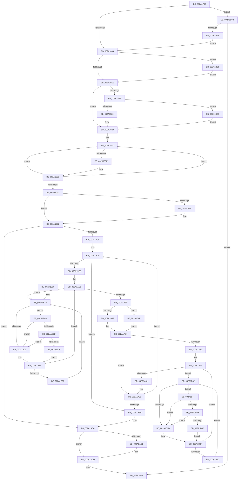

# MiOutPageSingleKernelStack

- RVA: `0x002A1790`–`0x002A1BE6` (길이 `1,110` bytes)
- VA: `0x00000001402A1790`
- 실행 섹션: `.text`
- PDB 이름 있음: `예`; PDB Function 태그: `아니요`
- unwind 정보 RVA: `0x00068538`
- 디코드: `270`개 명령, `1,110/1,110` bytes 표시
- 미해석 바이트: `0` (있으면 어셈블리에 `.byte`로 보존)

> 이 문서는 커널 이미지의 기계어와 PDB 기호를 분석해 생성했습니다. 4번과 5번은 함수 원형과 자료형을 바이너리 사용 방식에서 추정한 C 해석이며 원본 소스 복구 결과는 아닙니다.

## 1. Dependencies

- 직접 호출 지점: **27**; 고유 호출 대상: **18**
- 직접 호출자로 확인된 함수: **1**
- RIP 상대 이미지 참조: **4**

### Outgoing calls
- `0x002A1846` → [MiMakeDemandZeroPte](../33/MiMakeDemandZeroPte_function_00337A00.md) (function, `0x00337A00`)
- `0x002A18AF` → [MiVaToFlushVm](../31/MiVaToFlushVm_function_0031AD84.md) (function, `0x0031AD84`)
- `0x002A18BF` → [MiLockWorkingSetShared](../27/MiLockWorkingSetShared_function_0027CBF0.md) (function, `0x0027CBF0`)
- `0x002A18D1` → [MiLockNestedPageTable](../23/MiLockNestedPageTable_function_0023E890.md) (function, `0x0023E890`)
- `0x002A18F4` → [MiGetWorkingSetSwapSupport](MiGetWorkingSetSwapSupport_function_002A35A0.md) (function, `0x002A35A0`)
- `0x002A1909` → [ExAcquireSpinLockExclusiveAtDpcLevel](../24/ExAcquireSpinLockExclusiveAtDpcLevel_function_00248E80.md) (function, `0x00248E80`)
- `0x002A1911` → [MiGetWorkingSetSwapSupport](MiGetWorkingSetSwapSupport_function_002A35A0.md) (function, `0x002A35A0`)
- `0x002A1920` → [MiGetWorkingSetSwapSupport](MiGetWorkingSetSwapSupport_function_002A35A0.md) (function, `0x002A35A0`)
- `0x002A1967` → [MiOutSwapKernelStackPage](MiOutSwapKernelStackPage_function_002A29BC.md) (function, `0x002A29BC`)
- `0x002A1974` → [MiMakeTransitionPte](../36/MiMakeTransitionPte_function_00363F70.md) (function, `0x00363F70`)
- `0x002A1984` → [MiLockAndDecrementShareCount](MiLockAndDecrementShareCount_function_002A2854.md) (function, `0x002A2854`)
- `0x002A19AD` → [ExReleaseSpinLockExclusiveFromDpcLevel](../24/ExReleaseSpinLockExclusiveFromDpcLevel_function_002497E0.md) (function, `0x002497E0`)
- `0x002A1A4F` → [MiSetPfnIdentity](MiSetPfnIdentity_function_002A2350.md) (function, `0x002A2350`)
- `0x002A1A59` → [MiDecrementShareCountEx](../33/MiDecrementShareCountEx_function_00333F70.md) (function, `0x00333F70`)
- `0x002A1A86` → [MiDecrementShareCountEx](../33/MiDecrementShareCountEx_function_00333F70.md) (function, `0x00333F70`)
- `0x002A1AC8` → [MiUnlockPageTable](../21/MiUnlockPageTable_function_00216EC0.md) (function, `0x00216EC0`)
- `0x002A1AD3` → [MiUnlockPageTable](../21/MiUnlockPageTable_function_00216EC0.md) (function, `0x00216EC0`)
- `0x002A1AE2` → [MiUnlockWorkingSetShared](../27/MiUnlockWorkingSetShared_function_0027D690.md) (function, `0x0027D690`)
- `0x002A1AFF` → [MiInsertTbFlushEntry](../29/MiInsertTbFlushEntry_function_00293670.md) (function, `0x00293670`)
- `0x002A1B56` → [MiMakeTransitionPte](../36/MiMakeTransitionPte_function_00363F70.md) (function, `0x00363F70`)
- `0x002A1B6D` → [KiCheckVpBackingLongSpinWaitHypercall](../30/KiCheckVpBackingLongSpinWaitHypercall_function_0030F490.md) (function, `0x0030F490`)
- `0x002A1B78` → [HvlNotifyLongSpinWait](../30/HvlNotifyLongSpinWait_function_0030F460.md) (function, `0x0030F460`)
- `0x002A1B89` → [KiCheckVpBackingLongSpinWaitHypercall](../30/KiCheckVpBackingLongSpinWaitHypercall_function_0030F490.md) (function, `0x0030F490`)
- `0x002A1B94` → [HvlNotifyLongSpinWait](../30/HvlNotifyLongSpinWait_function_0030F460.md) (function, `0x0030F460`)
- `0x002A1BA1` → [MiCreateKernelStackNode](../4F/MiCreateKernelStackNode_function_004FB0B8.md) (function, `0x004FB0B8`)
- `0x002A1BCF` → [MiLockNestedPageTable](../23/MiLockNestedPageTable_function_0023E890.md) (function, `0x0023E890`)
- `0x002A1BDC` → [ExReleaseSpinLockExclusiveFromDpcLevel](../24/ExReleaseSpinLockExclusiveFromDpcLevel_function_002497E0.md) (function, `0x002497E0`)

### Direct callers
- [KeEnumerateKernelStackSegments](KeEnumerateKernelStackSegments_function_002A13B8.md) at `0x002A14AB`

### Static image references
- `0x002A1868` → RVA `0x00E30088` (`.data`; read)
- `0x002A1873` → RVA `0x00E38D00` (`.data`; read)
- `0x002A1B19` → RVA `0x00FC52AC` (`ALMOSTRO`; reference)
- `0x002A1B63` → RVA `0x00FC6AB8` (`ALMOSTRO`; read)

## 2. Other-region calls and transfers

- 다른 실행 섹션으로 향하는 call: **0**
- 별도 외부 분기/꼬리 이동을 확인하지 못했습니다.

## 3. Assembly (complete function range)

```asm
002A1790  4C 89 44 24 18                  mov qword ptr [rsp + 0x18], r8
002A1795  48 89 4C 24 08                  mov qword ptr [rsp + 8], rcx
002A179A  53                              push rbx
002A179B  55                              push rbp
002A179C  56                              push rsi
002A179D  57                              push rdi
002A179E  41 54                           push r12
002A17A0  41 55                           push r13
002A17A2  41 56                           push r14
002A17A4  41 57                           push r15
002A17A6  48 83 EC 68                     sub rsp, 0x68
002A17AA  48 8B FA                        mov rdi, rdx
002A17AD  49 B9 00 00 00 00 80 F6 FF FF   movabs r9, 0xfffff68000000000
002A17B7  48 8B D1                        mov rdx, rcx
002A17BA  49 BA F8 FF FF FF 7F 00 00 00   movabs r10, 0x7ffffffff8
002A17C4  48 8B 0F                        mov rcx, qword ptr [rdi]
002A17C7  48 81 E9 00 10 00 00            sub rcx, 0x1000
002A17CE  48 C1 E9 09                     shr rcx, 9
002A17D2  49 23 CA                        and rcx, r10
002A17D5  49 8B C1                        mov rax, r9
002A17D8  4C 8B 67 10                     mov r12, qword ptr [rdi + 0x10]
002A17DC  48 03 C8                        add rcx, rax
002A17DF  49 83 EC 08                     sub r12, 8
002A17E3  48 89 4C 24 28                  mov qword ptr [rsp + 0x28], rcx
002A17E8  49 C1 EC 09                     shr r12, 9
002A17EC  4D 23 E2                        and r12, r10
002A17EF  49 8B C1                        mov rax, r9
002A17F2  4C 03 E0                        add r12, rax
002A17F5  4D 8B C4                        mov r8, r12
002A17F8  4C 89 64 24 58                  mov qword ptr [rsp + 0x58], r12
002A17FD  49 C1 E0 19                     shl r8, 0x19
002A1801  49 8B C1                        mov rax, r9
002A1804  4C 8B 6F 08                     mov r13, qword ptr [rdi + 8]
002A1808  48 C1 E0 19                     shl rax, 0x19
002A180C  4C 2B C0                        sub r8, rax
002A180F  49 C1 ED 09                     shr r13, 9
002A1813  49 C1 F8 10                     sar r8, 0x10
002A1817  4D 23 EA                        and r13, r10
002A181A  4C 89 44 24 20                  mov qword ptr [rsp + 0x20], r8
002A181F  49 8B C1                        mov rax, r9
002A1822  4C 03 E8                        add r13, rax
002A1825  4D 8B F4                        mov r14, r12
002A1828  48 8B C1                        mov rax, rcx
002A182B  4C 89 6C 24 30                  mov qword ptr [rsp + 0x30], r13
002A1830  49 2B C4                        sub rax, r12
002A1833  B9 1F 00 00 00                  mov ecx, 0x1f
002A1838  48 C1 F8 03                     sar rax, 3
002A183C  FF C0                           inc eax
002A183E  48 89 84 24 C8 00 00 00         mov qword ptr [rsp + 0xc8], rax
002A1846  E8 B5 61 09 00                  call 0x140337a00
002A184B  48 89 44 24 50                  mov qword ptr [rsp + 0x50], rax
002A1850  45 33 FF                        xor r15d, r15d
002A1853  48 8B 82 20 02 00 00            mov rax, qword ptr [rdx + 0x220]
002A185A  0F B7 88 AE 04 00 00            movzx ecx, word ptr [rax + 0x4ae]
002A1861  48 8D B0 00 04 00 00            lea rsi, [rax + 0x400]
002A1868  48 8B 05 19 E8 B8 00            mov rax, qword ptr [rip + 0xb8e819]
002A186F  48 8B 2C C8                     mov rbp, qword ptr [rax + rcx*8]
002A1873  48 8D 05 86 74 B9 00            lea rax, [rip + 0xb97486]
002A187A  48 3B E8                        cmp rbp, rax
002A187D  0F 85 18 03 00 00               jne 0x1402a1b9b
002A1883  49 C1 ED 09                     shr r13, 9
002A1887  4D 23 EA                        and r13, r10
002A188A  49 8B C1                        mov rax, r9
002A188D  48 8B 4C 24 28                  mov rcx, qword ptr [rsp + 0x28]
002A1892  4C 03 E8                        add r13, rax
002A1895  48 C1 E9 09                     shr rcx, 9
002A1899  49 23 CA                        and rcx, r10
002A189C  4C 89 6C 24 38                  mov qword ptr [rsp + 0x38], r13
002A18A1  49 8B C1                        mov rax, r9
002A18A4  48 03 C1                        add rax, rcx
002A18A7  49 8B CC                        mov rcx, r12
002A18AA  48 89 44 24 48                  mov qword ptr [rsp + 0x48], rax
002A18AF  E8 D0 94 07 00                  call 0x14031ad84
002A18B4  48 8B C8                        mov rcx, rax
002A18B7  48 89 44 24 40                  mov qword ptr [rsp + 0x40], rax
002A18BC  4C 8B E0                        mov r12, rax
002A18BF  E8 2C B3 FD FF                  call 0x14027cbf0
002A18C4  49 8B D5                        mov rdx, r13
002A18C7  88 84 24 B8 00 00 00            mov byte ptr [rsp + 0xb8], al
002A18CE  49 8B CC                        mov rcx, r12
002A18D1  E8 BA CF F9 FF                  call 0x14023e890
002A18D6  4C 3B 6C 24 48                  cmp r13, qword ptr [rsp + 0x48]
002A18DB  0F 85 E7 02 00 00               jne 0x1402a1bc8
002A18E1  48 8B 4F 10                     mov rcx, qword ptr [rdi + 0x10]
002A18E5  48 8B 94 24 B0 00 00 00         mov rdx, qword ptr [rsp + 0xb0]
002A18ED  48 89 51 F8                     mov qword ptr [rcx - 8], rdx
002A18F1  48 8B CE                        mov rcx, rsi
002A18F4  E8 A7 1C 00 00                  call 0x1402a35a0
002A18F9  48 83 F8 02                     cmp rax, 2
002A18FD  76 29                           jbe 0x1402a1928
002A18FF  48 8D BD A0 04 00 00            lea rdi, [rbp + 0x4a0]
002A1906  48 8B CF                        mov rcx, rdi
002A1909  E8 72 75 FA FF                  call 0x140248e80
002A190E  48 8B CE                        mov rcx, rsi
002A1911  E8 8A 1C 00 00                  call 0x1402a35a0
002A1916  48 83 F8 02                     cmp rax, 2
002A191A  0F 86 B9 02 00 00               jbe 0x1402a1bd9
002A1920  E8 7B 1C 00 00                  call 0x1402a35a0
002A1925  4C 8B F8                        mov r15, rax
002A1928  4C 8B 64 24 28                  mov r12, qword ptr [rsp + 0x28]
002A192D  48 BB FF FF FF FF FF 00 00 00   movabs rbx, 0xffffffffff
002A1937  49 BD 00 00 00 00 00 DE FF FF   movabs r13, 0xffffde0000000000
002A1941  49 8B 3E                        mov rdi, qword ptr [r14]
002A1944  48 C1 EF 0C                     shr rdi, 0xc
002A1948  48 23 FB                        and rdi, rbx
002A194B  48 8D 34 7F                     lea rsi, [rdi + rdi*2]
002A194F  48 C1 E6 04                     shl rsi, 4
002A1953  49 8B C5                        mov rax, r13
002A1956  48 03 F0                        add rsi, rax
002A1959  4D 85 FF                        test r15, r15
002A195C  74 0E                           je 0x1402a196c
002A195E  4D 8B C6                        mov r8, r14
002A1961  48 8B D5                        mov rdx, rbp
002A1964  49 8B CF                        mov rcx, r15
002A1967  E8 50 10 00 00                  call 0x1402a29bc
002A196C  BA 1F 00 00 00                  mov edx, 0x1f
002A1971  48 8B CF                        mov rcx, rdi
002A1974  E8 F7 25 0C 00                  call 0x140363f70
002A1979  BA 02 00 00 00                  mov edx, 2
002A197E  49 89 06                        mov qword ptr [r14], rax
002A1981  48 8B CE                        mov rcx, rsi
002A1984  E8 CB 0E 00 00                  call 0x1402a2854
002A1989  49 83 C6 08                     add r14, 8
002A198D  4D 3B F4                        cmp r14, r12
002A1990  76 AF                           jbe 0x1402a1941
002A1992  48 8B 5C 24 50                  mov rbx, qword ptr [rsp + 0x50]
002A1997  4C 8B 6C 24 38                  mov r13, qword ptr [rsp + 0x38]
002A199C  4C 8B 64 24 40                  mov r12, qword ptr [rsp + 0x40]
002A19A1  4D 85 FF                        test r15, r15
002A19A4  74 0C                           je 0x1402a19b2
002A19A6  48 8D 8D A0 04 00 00            lea rcx, [rbp + 0x4a0]
002A19AD  E8 2E 7E FA FF                  call 0x1402497e0
002A19B2  4C 8B 74 24 58                  mov r14, qword ptr [rsp + 0x58]
002A19B7  49 83 C6 F8                     add r14, -8
002A19BB  4C 3B 74 24 30                  cmp r14, qword ptr [rsp + 0x30]
002A19C0  0F 82 F4 00 00 00               jb 0x1402a1aba
002A19C6  41 BC 01 00 00 00               mov r12d, 1
002A19CC  49 BD 00 00 00 00 00 DE FF FF   movabs r13, 0xffffde0000000000
002A19D6  4D 8B 3E                        mov r15, qword ptr [r14]
002A19D9  45 84 FC                        test r12b, r15b
002A19DC  0F 84 CE 00 00 00               je 0x1402a1ab0
002A19E2  49 C1 EF 0C                     shr r15, 0xc
002A19E6  48 B9 FF FF FF FF FF 00 00 00   movabs rcx, 0xffffffffff
002A19F0  4C 23 F9                        and r15, rcx
002A19F3  4B 8D 3C 7F                     lea rdi, [r15 + r15*2]
002A19F7  48 C1 E7 04                     shl rdi, 4
002A19FB  49 8B C5                        mov rax, r13
002A19FE  48 03 F8                        add rdi, rax
002A1A01  48 8B 47 28                     mov rax, qword ptr [rdi + 0x28]
002A1A05  48 23 C1                        and rax, rcx
002A1A08  48 8D 34 40                     lea rsi, [rax + rax*2]
002A1A0C  48 C1 E6 04                     shl rsi, 4
002A1A10  49 8B C5                        mov rax, r13
002A1A13  48 03 F0                        add rsi, rax
002A1A16  33 ED                           xor ebp, ebp
002A1A18  F0 48 0F BA 6F 18 3F            lock bts qword ptr [rdi + 0x18], 0x3f
002A1A1F  0F 82 F1 00 00 00               jb 0x1402a1b16
002A1A25  8B 47 20                        mov eax, dword ptr [rdi + 0x20]
002A1A28  66 41 3B C4                     cmp ax, r12w
002A1A2C  0F 85 1C 01 00 00               jne 0x1402a1b4e
002A1A32  49 89 1E                        mov qword ptr [r14], rbx
002A1A35  48 B9 00 00 00 00 00 00 00 40   movabs rcx, 0x4000000000000000
002A1A3F  48 8B 47 18                     mov rax, qword ptr [rdi + 0x18]
002A1A43  33 D2                           xor edx, edx
002A1A45  48 0B C1                        or rax, rcx
002A1A48  48 8B CF                        mov rcx, rdi
002A1A4B  48 89 47 18                     mov qword ptr [rdi + 0x18], rax
002A1A4F  E8 FC 08 00 00                  call 0x1402a2350
002A1A54  33 D2                           xor edx, edx
002A1A56  48 8B CF                        mov rcx, rdi
002A1A59  E8 12 25 09 00                  call 0x140333f70
002A1A5E  48 BD FF FF FF FF FF FF FF 7F   movabs rbp, 0x7fffffffffffffff
002A1A68  F0 48 21 6F 18                  lock and qword ptr [rdi + 0x18], rbp
002A1A6D  83 F8 03                        cmp eax, 3
002A1A70  74 1E                           je 0x1402a1a90
002A1A72  33 FF                           xor edi, edi
002A1A74  F0 48 0F BA 6E 18 3F            lock bts qword ptr [rsi + 0x18], 0x3f
002A1A7B  0F 82 B1 00 00 00               jb 0x1402a1b32
002A1A81  33 D2                           xor edx, edx
002A1A83  48 8B CE                        mov rcx, rsi
002A1A86  E8 E5 24 09 00                  call 0x140333f70
002A1A8B  F0 48 21 6E 18                  lock and qword ptr [rsi + 0x18], rbp
002A1A90  44 01 A4 24 C8 00 00 00         add dword ptr [rsp + 0xc8], r12d
002A1A98  49 83 EE 08                     sub r14, 8
002A1A9C  48 81 6C 24 20 00 10 00 00      sub qword ptr [rsp + 0x20], 0x1000
002A1AA5  4C 3B 74 24 30                  cmp r14, qword ptr [rsp + 0x30]
002A1AAA  0F 83 26 FF FF FF               jae 0x1402a19d6
002A1AB0  4C 8B 6C 24 38                  mov r13, qword ptr [rsp + 0x38]
002A1AB5  4C 8B 64 24 40                  mov r12, qword ptr [rsp + 0x40]
002A1ABA  4C 3B 6C 24 48                  cmp r13, qword ptr [rsp + 0x48]
002A1ABF  74 0C                           je 0x1402a1acd
002A1AC1  49 8D 55 08                     lea rdx, [r13 + 8]
002A1AC5  49 8B CC                        mov rcx, r12
002A1AC8  E8 F3 53 F7 FF                  call 0x140216ec0
002A1ACD  49 8B D5                        mov rdx, r13
002A1AD0  49 8B CC                        mov rcx, r12
002A1AD3  E8 E8 53 F7 FF                  call 0x140216ec0
002A1AD8  8A 94 24 B8 00 00 00            mov dl, byte ptr [rsp + 0xb8]
002A1ADF  49 8B CC                        mov rcx, r12
002A1AE2  E8 A9 BB FD FF                  call 0x14027d690
002A1AE7  44 8B 84 24 C8 00 00 00         mov r8d, dword ptr [rsp + 0xc8]
002A1AEF  45 33 C9                        xor r9d, r9d
002A1AF2  48 8B 54 24 20                  mov rdx, qword ptr [rsp + 0x20]
002A1AF7  48 8B 8C 24 C0 00 00 00         mov rcx, qword ptr [rsp + 0xc0]
002A1AFF  E8 6C 1B FF FF                  call 0x140293670
002A1B04  48 83 C4 68                     add rsp, 0x68
002A1B08  41 5F                           pop r15
002A1B0A  41 5E                           pop r14
002A1B0C  41 5D                           pop r13
002A1B0E  41 5C                           pop r12
002A1B10  5F                              pop rdi
002A1B11  5E                              pop rsi
002A1B12  5D                              pop rbp
002A1B13  5B                              pop rbx
002A1B14  C3                              ret
002A1B15  CC                              int3
002A1B16  41 03 EC                        add ebp, r12d
002A1B19  85 2D 8D 37 D2 00               test dword ptr [rip + 0xd2378d], ebp
002A1B1F  74 42                           je 0x1402a1b63
002A1B21  F3 90                           pause
002A1B23  48 8B 47 18                     mov rax, qword ptr [rdi + 0x18]
002A1B27  48 85 C0                        test rax, rax
002A1B2A  0F 89 E8 FE FF FF               jns 0x1402a1a18
002A1B30  EB E4                           jmp 0x1402a1b16
002A1B32  41 03 FC                        add edi, r12d
002A1B35  85 3D 71 37 D2 00               test dword ptr [rip + 0xd23771], edi
002A1B3B  74 42                           je 0x1402a1b7f
002A1B3D  F3 90                           pause
002A1B3F  48 8B 46 18                     mov rax, qword ptr [rsi + 0x18]
002A1B43  48 85 C0                        test rax, rax
002A1B46  0F 89 28 FF FF FF               jns 0x1402a1a74
002A1B4C  EB E4                           jmp 0x1402a1b32
002A1B4E  BA 1F 00 00 00                  mov edx, 0x1f
002A1B53  49 8B CF                        mov rcx, r15
002A1B56  E8 15 24 0C 00                  call 0x140363f70
002A1B5B  49 89 06                        mov qword ptr [r14], rax
002A1B5E  E9 F1 FE FF FF                  jmp 0x1402a1a54
002A1B63  8B 05 4F 4F D2 00               mov eax, dword ptr [rip + 0xd24f4f]
002A1B69  A8 40                           test al, 0x40
002A1B6B  74 B4                           je 0x1402a1b21
002A1B6D  E8 1E D9 06 00                  call 0x14030f490
002A1B72  84 C0                           test al, al
002A1B74  74 AB                           je 0x1402a1b21
002A1B76  8B CD                           mov ecx, ebp
002A1B78  E8 E3 D8 06 00                  call 0x14030f460
002A1B7D  EB A4                           jmp 0x1402a1b23
002A1B7F  8B 05 33 4F D2 00               mov eax, dword ptr [rip + 0xd24f33]
002A1B85  A8 40                           test al, 0x40
002A1B87  74 B4                           je 0x1402a1b3d
002A1B89  E8 02 D9 06 00                  call 0x14030f490
002A1B8E  84 C0                           test al, al
002A1B90  74 AB                           je 0x1402a1b3d
002A1B92  8B CF                           mov ecx, edi
002A1B94  E8 C7 D8 06 00                  call 0x14030f460
002A1B99  EB A4                           jmp 0x1402a1b3f
002A1B9B  48 8B D7                        mov rdx, rdi
002A1B9E  48 8B CD                        mov rcx, rbp
002A1BA1  E8 12 95 25 00                  call 0x1404fb0b8
002A1BA6  48 85 C0                        test rax, rax
002A1BA9  0F 84 55 FF FF FF               je 0x1402a1b04
002A1BAF  49 B9 00 00 00 00 80 F6 FF FF   movabs r9, 0xfffff68000000000
002A1BB9  49 BA F8 FF FF FF 7F 00 00 00   movabs r10, 0x7ffffffff8
002A1BC3  E9 BB FC FF FF                  jmp 0x1402a1883
002A1BC8  49 8D 55 08                     lea rdx, [r13 + 8]
002A1BCC  49 8B CC                        mov rcx, r12
002A1BCF  E8 BC CC F9 FF                  call 0x14023e890
002A1BD4  E9 08 FD FF FF                  jmp 0x1402a18e1
002A1BD9  48 8B CF                        mov rcx, rdi
002A1BDC  E8 FF 7B FA FF                  call 0x1402497e0
002A1BE1  E9 42 FD FF FF                  jmp 0x1402a1928
```

## 4. C-style interpretation (structured pseudocode)

```c
__int64 __fastcall MiOutPageSingleKernelStack(__int64 a1, __int64 a2, __int64 a3)
{
    __int64 result;
    __int64 v_r12;
    __int64 v_r13;
    __int64 v_r14;
    __int64 v_r15;
    __int64 v_rbp;
    __int64 v_rdi;
    __int64 v_rsi;
    __int64 v_rsp;
    unsigned __int64 v_stack_m50;
    unsigned __int64 v_stack_m58;
    unsigned __int64 v_stack_m60;
    unsigned __int64 v_stack_m68;
    unsigned __int64 v_stack_m70;
    unsigned __int64 v_stack_m78;
    unsigned __int64 v_stack_m80;
    unsigned __int64 v_stack_m88;
    unsigned __int8 v_stack_p10;
    unsigned __int64 v_stack_p18;
    unsigned __int64 v_stack_p20;
    unsigned __int64 v_stack_p8;

    v_stack_p18 = a3;
    v_stack_p8 = a1;
    v_rsp = (v_rsp) - (104);
    a1 = (*(unsigned __int64 *)(a2)) - (0x1000ULL);
    a1 = (a1) >> (9);
    a1 = (a1) & (v_r10);
    a1 = (a1) + (a4);
    v_r12 = (*(unsigned __int64 *)(a2 + 16)) - (8);
    v_stack_m80 = a1;
    v_r12 = (v_r12) >> (9);
    v_r12 = (v_r12) & (v_r10);
    v_r12 = (v_r12) + (a4);
    v_stack_m50 = v_r12;
    a3 = (v_r12) << (25);
    result = (a4) << (25);
    a3 = (a3) - (result);
    v_r13 = (*(unsigned __int64 *)(a2 + 8)) >> (9);
    a3 = (a3) >> (16);
    v_r13 = (v_r13) & (v_r10);
    v_stack_m88 = a3;
    v_r13 = (v_r13) + (a4);
    v_stack_m78 = v_r13;
    result = (a1) - (v_r12);
    result = (result) >> (3);
    result = (unsigned int)((result) + 1);
    v_stack_p20 = result;
    result = MiMakeDemandZeroPte(31, a1, a3, a4);
    v_stack_m58 = result;
    v_r15 = 0;
    if ((*(unsigned __int64 *)(*(unsigned __int64 *)(v_rip + 12118041) + *(unsigned __int16 *)(*(unsigned __int64 *)(a1 + 544) + 1198) * 8)) != (v_rip + 12153990)) goto loc_002A1B9B;
loc_002A1883:
    v_r13 = (v_r13) >> (9);
    v_r13 = (v_r13) & (v_r10);
    v_r13 = (v_r13) + (a4);
    a1 = (v_stack_m80) >> (9);
    a1 = (a1) & (v_r10);
    v_stack_m70 = v_r13;
    result = (a4) + (a1);
    v_stack_m60 = result;
    result = MiVaToFlushVm(v_r12, a1, a3, a4);
    v_stack_m68 = result;
    result = MiLockWorkingSetShared(result, a1, a3, a4);
    v_stack_p10 = (unsigned __int8)(result);
    result = MiLockNestedPageTable(result, v_r13, a3, a4);
    if (v_r13 != v_stack_m60) goto loc_002A1BC8;
loc_002A18E1:
    *(unsigned __int64 *)(*(unsigned __int64 *)(a2 + 16) - 8) = v_stack_p8;
    result = MiGetWorkingSetSwapSupport(*(unsigned __int64 *)(a1 + 544) + 1024, v_stack_p8, a3, a4);
    if (result <= 2) goto loc_002A1928;
    result = ExAcquireSpinLockExclusiveAtDpcLevel(*(unsigned __int64 *)(*(unsigned __int64 *)(v_rip + 12118041) + *(unsigned __int16 *)(*(unsigned __int64 *)(a1 + 544) + 1198) * 8) + 1184, v_stack_p8, a3, a4);
    result = MiGetWorkingSetSwapSupport(*(unsigned __int64 *)(a1 + 544) + 1024, v_stack_p8, a3, a4);
    if (result <= 2) goto loc_002A1BD9;
    result = MiGetWorkingSetSwapSupport(*(unsigned __int64 *)(a1 + 544) + 1024, v_stack_p8, a3, a4);
loc_002A1928:
loc_002A1941:
    v_rdi = (*(unsigned __int64 *)(v_r12)) >> (12);
    v_rdi = (v_rdi) & (v_rbx);
    v_rsi = (v_rdi + v_rdi * 2) << (4);
    v_rsi = (v_rsi) + (v_r13);
    result = v_r13;
    if (result != 0) {
        a3 = v_r12;
        a2 = *(unsigned __int64 *)(*(unsigned __int64 *)(v_rip + 12118041) + *(unsigned __int16 *)(*(unsigned __int64 *)(a1 + 544) + 1198) * 8);
        a1 = result;
        result = MiOutSwapKernelStackPage(a1, a2, a3, a4);
    }
    result = MiMakeTransitionPte(v_rdi, 31, a3, a4);
    *(unsigned __int64 *)(v_r12) = result;
    result = MiLockAndDecrementShareCount(v_rsi, 2, a3, a4);
    v_r14 = (v_r12) + (8);
    if (v_r14 <= v_stack_m80) goto loc_002A1941;
    if (result != 0) {
        a1 = *(unsigned __int64 *)(*(unsigned __int64 *)(v_rip + 12118041) + *(unsigned __int16 *)(*(unsigned __int64 *)(a1 + 544) + 1198) * 8) + 1184;
        result = ExReleaseSpinLockExclusiveFromDpcLevel(a1, 2, a3, a4);
    }
    v_r14 = (v_stack_m50) + (-8);
    if (v_r14 < v_stack_m78) goto loc_002A1ABA;
loc_002A19D6:
    if (((1) & ((unsigned __int8)(*(unsigned __int64 *)(v_r14)))) == 0) goto loc_002A1AB0;
    v_r15 = (*(unsigned __int64 *)(v_r14)) >> (12);
    v_r15 = (v_r15) & (a1);
    v_rdi = (v_r15 + v_r15 * 2) << (4);
    v_rdi = (v_rdi) + (v_stack_m70);
    result = (*(unsigned __int64 *)(v_rdi + 40)) & (a1);
    v_rsi = (result + result * 2) << (4);
    v_rsi = (v_rsi) + (v_stack_m70);
    v_rbp = 0;
loc_002A1A18:
    if (condition_is_below) goto loc_002A1B16;
    if (((unsigned __int16)((unsigned int)(*(unsigned int *)(v_rdi + 32)))) != 1) goto loc_002A1B4E;
    *(unsigned __int64 *)(v_r14) = v_stack_m58;
    a2 = 0;
    result = (*(unsigned __int64 *)(v_rdi + 24)) | (a1);
    *(unsigned __int64 *)(v_rdi + 24) = result;
    result = MiSetPfnIdentity(v_rdi, a2, a3, a4);
loc_002A1A54:
    a2 = 0;
    result = MiDecrementShareCountEx(v_rdi, a2, a3, a4);
    if (((unsigned int)(result)) == 3) goto loc_002A1A90;
    v_rdi = 0;
loc_002A1A74:
    if (condition_is_below) goto loc_002A1B32;
    a2 = 0;
    result = MiDecrementShareCountEx(v_rsi, a2, a3, a4);
loc_002A1A90:
    v_r14 = (v_r14) - (8);
    if (v_r14 >= v_stack_m78) goto loc_002A19D6;
loc_002A1AB0:
loc_002A1ABA:
    if (v_stack_m70 != v_stack_m60) {
        a2 = v_stack_m70 + 8;
        a1 = v_stack_m68;
        result = MiUnlockPageTable(a1, a2, a3, a4);
    }
    result = MiUnlockPageTable(v_stack_m68, v_stack_m70, a3, a4);
    result = MiUnlockWorkingSetShared(v_stack_m68, v_stack_p10, a3, a4);
    a4 = 0;
    result = MiInsertTbFlushEntry(v_stack_p18, v_stack_m88, (unsigned int)(v_stack_p20), a4);
loc_002A1B04:
    v_rsp = (v_rsp) + (104);
    return result;
loc_002A1B16:
    v_rbp = (unsigned int)((v_rbp) + ((unsigned int)(v_stack_m68)));
    if (((*(unsigned int *)(v_rip + 13776781)) & ((unsigned int)(v_rbp))) == 0) goto loc_002A1B63;
loc_002A1B21:
loc_002A1B23:
    if (!sign_flag) goto loc_002A1A18;
    goto loc_002A1B16;
loc_002A1B32:
    v_rdi = (unsigned int)((v_rdi) + ((unsigned int)(v_stack_m68)));
    if (((*(unsigned int *)(v_rip + 13776753)) & ((unsigned int)(v_rdi))) == 0) goto loc_002A1B7F;
loc_002A1B3D:
loc_002A1B3F:
    if (!sign_flag) goto loc_002A1A74;
    goto loc_002A1B32;
loc_002A1B4E:
    result = MiMakeTransitionPte(v_r15, 31, (unsigned int)(v_stack_p20), a4);
    *(unsigned __int64 *)(v_r14) = result;
    goto loc_002A1A54;
loc_002A1B63:
    if ((((unsigned __int8)((unsigned int)(*(unsigned int *)(v_rip + 13782863)))) & (64)) == 0) goto loc_002A1B21;
    result = KiCheckVpBackingLongSpinWaitHypercall(v_r15, 31, (unsigned int)(v_stack_p20), a4);
    if ((unsigned __int8)(result) == 0) goto loc_002A1B21;
    result = HvlNotifyLongSpinWait((unsigned int)((unsigned int)(v_rbp)), 31, (unsigned int)(v_stack_p20), a4);
    goto loc_002A1B23;
loc_002A1B7F:
    if ((((unsigned __int8)((unsigned int)(*(unsigned int *)(v_rip + 13782835)))) & (64)) == 0) goto loc_002A1B3D;
    result = KiCheckVpBackingLongSpinWaitHypercall((unsigned int)((unsigned int)(v_rbp)), 31, (unsigned int)(v_stack_p20), a4);
    if ((unsigned __int8)(result) == 0) goto loc_002A1B3D;
    result = HvlNotifyLongSpinWait((unsigned int)((unsigned int)(v_rdi)), 31, (unsigned int)(v_stack_p20), a4);
    goto loc_002A1B3F;
loc_002A1B9B:
    result = MiCreateKernelStackNode(v_rbp, v_rdi, (unsigned int)(v_stack_p20), a4);
    if (result == 0) goto loc_002A1B04;
    goto loc_002A1883;
loc_002A1BC8:
    result = MiLockNestedPageTable(v_stack_m68, v_stack_m70 + 8, (unsigned int)(v_stack_p20), a4);
    goto loc_002A18E1;
loc_002A1BD9:
    result = ExReleaseSpinLockExclusiveFromDpcLevel(v_rdi, v_stack_m70 + 8, (unsigned int)(v_stack_p20), a4);
    goto loc_002A1928;
}
```

## 5. (Beta) C Style

```c
int64_t MiOutPageSingleKernelStack(int64_t Arg1, void *Arg2, int64_t Arg3)
{
    uint8_t *arg2 = (uint8_t *)Arg2;

    int64_t result;
    int64_t local_r12;
    int64_t local_r13;
    int64_t local_r14;
    int64_t local_r15;
    int64_t local_rbp;
    int64_t local_rdi;
    int64_t local_rsi;
    int64_t local_rsp;
    uint64_t v_stack_m50;
    uint64_t v_stack_m58;
    uint64_t v_stack_m60;
    uint64_t v_stack_m68;
    uint64_t v_stack_m70;
    uint64_t v_stack_m78;
    uint64_t v_stack_m80;
    uint64_t v_stack_m88;
    uint8_t v_stack_p10;
    uint64_t v_stack_p18;
    uint64_t v_stack_p20;
    uint64_t v_stack_p8;

    v_stack_p18 = Arg3;
    v_stack_p8 = Arg1;
    local_rsp = (local_rsp) - (104);
    Arg1 = (*(uint64_t *)(arg2)) - (0x1000ULL);
    Arg1 = (Arg1) >> (9);
    Arg1 = (Arg1) & (local_r10);
    Arg1 = (Arg1) + (a4);
    local_r12 = (*(uint64_t *)(arg2 + 0x10)) - (8);
    v_stack_m80 = Arg1;
    local_r12 = (local_r12) >> (9);
    local_r12 = (local_r12) & (local_r10);
    local_r12 = (local_r12) + (a4);
    v_stack_m50 = local_r12;
    Arg3 = (local_r12) << (25);
    result = (a4) << (25);
    Arg3 = (Arg3) - (result);
    local_r13 = (*(uint64_t *)(arg2 + 0x8)) >> (9);
    Arg3 = (Arg3) >> (16);
    local_r13 = (local_r13) & (local_r10);
    v_stack_m88 = Arg3;
    local_r13 = (local_r13) + (a4);
    v_stack_m78 = local_r13;
    result = (Arg1) - (local_r12);
    result = (result) >> (3);
    result = (uint32_t)((result) + 1);
    v_stack_p20 = result;
    result = MiMakeDemandZeroPte(31, Arg1, Arg3, a4);
    v_stack_m58 = result;
    local_r15 = 0;
    if ((*(uint64_t *)(*(uint64_t *)(v_rip + 0xB8E819) + *(uint16_t *)(*(uint64_t *)(Arg1 + 0x220) + 0x4AE) * 8)) != (v_rip + 12153990)) goto loc_002A1B9B;
loc_002A1883:
    local_r13 = (local_r13) >> (9);
    local_r13 = (local_r13) & (local_r10);
    local_r13 = (local_r13) + (a4);
    Arg1 = (v_stack_m80) >> (9);
    Arg1 = (Arg1) & (local_r10);
    v_stack_m70 = local_r13;
    result = (a4) + (Arg1);
    v_stack_m60 = result;
    result = MiVaToFlushVm(local_r12, Arg1, Arg3, a4);
    v_stack_m68 = result;
    result = MiLockWorkingSetShared(result, Arg1, Arg3, a4);
    v_stack_p10 = (uint8_t)(result);
    result = MiLockNestedPageTable(result, local_r13, Arg3, a4);
    if (local_r13 != v_stack_m60) goto loc_002A1BC8;
loc_002A18E1:
    *(uint64_t *)(*(uint64_t *)(arg2 + 0x10) - 0x8) = v_stack_p8;
    result = MiGetWorkingSetSwapSupport(*(uint64_t *)(Arg1 + 0x220) + 1024, v_stack_p8, Arg3, a4);
    if (result <= 2) goto loc_002A1928;
    result = ExAcquireSpinLockExclusiveAtDpcLevel(*(uint64_t *)(*(uint64_t *)(v_rip + 0xB8E819) + *(uint16_t *)(*(uint64_t *)(Arg1 + 0x220) + 0x4AE) * 8) + 1184, v_stack_p8, Arg3, a4);
    result = MiGetWorkingSetSwapSupport(*(uint64_t *)(Arg1 + 0x220) + 1024, v_stack_p8, Arg3, a4);
    if (result <= 2) goto loc_002A1BD9;
    result = MiGetWorkingSetSwapSupport(*(uint64_t *)(Arg1 + 0x220) + 1024, v_stack_p8, Arg3, a4);
loc_002A1928:
loc_002A1941:
    local_rdi = (*(uint64_t *)(local_r12)) >> (12);
    local_rdi = (local_rdi) & (local_rbx);
    local_rsi = (local_rdi + local_rdi * 2) << (4);
    local_rsi = (local_rsi) + (local_r13);
    result = local_r13;
    if (result != 0) {
        Arg3 = local_r12;
        Arg2 = *(uint64_t *)(*(uint64_t *)(v_rip + 0xB8E819) + *(uint16_t *)(*(uint64_t *)(Arg1 + 0x220) + 0x4AE) * 8);
        Arg1 = result;
        result = MiOutSwapKernelStackPage(Arg1, Arg2, Arg3, a4);
    }
    result = MiMakeTransitionPte(local_rdi, 31, Arg3, a4);
    *(uint64_t *)(local_r12) = result;
    result = MiLockAndDecrementShareCount(local_rsi, 2, Arg3, a4);
    local_r14 = (local_r12) + (8);
    if (local_r14 <= v_stack_m80) goto loc_002A1941;
    if (result != 0) {
        Arg1 = *(uint64_t *)(*(uint64_t *)(v_rip + 0xB8E819) + *(uint16_t *)(*(uint64_t *)(Arg1 + 0x220) + 0x4AE) * 8) + 1184;
        result = ExReleaseSpinLockExclusiveFromDpcLevel(Arg1, 2, Arg3, a4);
    }
    local_r14 = (v_stack_m50) + (-8);
    if (local_r14 < v_stack_m78) goto loc_002A1ABA;
loc_002A19D6:
    if (((1) & ((uint8_t)(*(uint64_t *)(local_r14)))) == 0) goto loc_002A1AB0;
    local_r15 = (*(uint64_t *)(local_r14)) >> (12);
    local_r15 = (local_r15) & (Arg1);
    local_rdi = (local_r15 + local_r15 * 2) << (4);
    local_rdi = (local_rdi) + (v_stack_m70);
    result = (*(uint64_t *)(local_rdi + 0x28)) & (Arg1);
    local_rsi = (result + result * 2) << (4);
    local_rsi = (local_rsi) + (v_stack_m70);
    local_rbp = 0;
loc_002A1A18:
    if (condition_is_below) goto loc_002A1B16;
    if (((uint16_t)((uint32_t)(*(uint32_t *)(local_rdi + 0x20)))) != 1) goto loc_002A1B4E;
    *(uint64_t *)(local_r14) = v_stack_m58;
    Arg2 = 0;
    result = (*(uint64_t *)(local_rdi + 0x18)) | (Arg1);
    *(uint64_t *)(local_rdi + 0x18) = result;
    result = MiSetPfnIdentity(local_rdi, Arg2, Arg3, a4);
loc_002A1A54:
    Arg2 = 0;
    result = MiDecrementShareCountEx(local_rdi, Arg2, Arg3, a4);
    if (((uint32_t)(result)) == 3) goto loc_002A1A90;
    local_rdi = 0;
loc_002A1A74:
    if (condition_is_below) goto loc_002A1B32;
    Arg2 = 0;
    result = MiDecrementShareCountEx(local_rsi, Arg2, Arg3, a4);
loc_002A1A90:
    local_r14 = (local_r14) - (8);
    if (local_r14 >= v_stack_m78) goto loc_002A19D6;
loc_002A1AB0:
loc_002A1ABA:
    if (v_stack_m70 != v_stack_m60) {
        Arg2 = v_stack_m70 + 8;
        Arg1 = v_stack_m68;
        result = MiUnlockPageTable(Arg1, Arg2, Arg3, a4);
    }
    result = MiUnlockPageTable(v_stack_m68, v_stack_m70, Arg3, a4);
    result = MiUnlockWorkingSetShared(v_stack_m68, v_stack_p10, Arg3, a4);
    a4 = 0;
    result = MiInsertTbFlushEntry(v_stack_p18, v_stack_m88, (uint32_t)(v_stack_p20), a4);
loc_002A1B04:
    local_rsp = (local_rsp) + (104);
    return result;
loc_002A1B16:
    local_rbp = (uint32_t)((local_rbp) + ((uint32_t)(v_stack_m68)));
    if (((*(uint32_t *)(v_rip + 0xD2378D)) & ((uint32_t)(local_rbp))) == 0) goto loc_002A1B63;
loc_002A1B21:
loc_002A1B23:
    if (!sign_flag) goto loc_002A1A18;
    goto loc_002A1B16;
loc_002A1B32:
    local_rdi = (uint32_t)((local_rdi) + ((uint32_t)(v_stack_m68)));
    if (((*(uint32_t *)(v_rip + 0xD23771)) & ((uint32_t)(local_rdi))) == 0) goto loc_002A1B7F;
loc_002A1B3D:
loc_002A1B3F:
    if (!sign_flag) goto loc_002A1A74;
    goto loc_002A1B32;
loc_002A1B4E:
    result = MiMakeTransitionPte(local_r15, 31, (uint32_t)(v_stack_p20), a4);
    *(uint64_t *)(local_r14) = result;
    goto loc_002A1A54;
loc_002A1B63:
    if ((((uint8_t)((uint32_t)(*(uint32_t *)(v_rip + 0xD24F4F)))) & (64)) == 0) goto loc_002A1B21;
    result = KiCheckVpBackingLongSpinWaitHypercall(local_r15, 31, (uint32_t)(v_stack_p20), a4);
    if ((uint8_t)(result) == 0) goto loc_002A1B21;
    result = HvlNotifyLongSpinWait((uint32_t)((uint32_t)(local_rbp)), 31, (uint32_t)(v_stack_p20), a4);
    goto loc_002A1B23;
loc_002A1B7F:
    if ((((uint8_t)((uint32_t)(*(uint32_t *)(v_rip + 0xD24F33)))) & (64)) == 0) goto loc_002A1B3D;
    result = KiCheckVpBackingLongSpinWaitHypercall((uint32_t)((uint32_t)(local_rbp)), 31, (uint32_t)(v_stack_p20), a4);
    if ((uint8_t)(result) == 0) goto loc_002A1B3D;
    result = HvlNotifyLongSpinWait((uint32_t)((uint32_t)(local_rdi)), 31, (uint32_t)(v_stack_p20), a4);
    goto loc_002A1B3F;
loc_002A1B9B:
    result = MiCreateKernelStackNode(local_rbp, local_rdi, (uint32_t)(v_stack_p20), a4);
    if (result == 0) goto loc_002A1B04;
    goto loc_002A1883;
loc_002A1BC8:
    result = MiLockNestedPageTable(v_stack_m68, v_stack_m70 + 8, (uint32_t)(v_stack_p20), a4);
    goto loc_002A18E1;
loc_002A1BD9:
    result = ExReleaseSpinLockExclusiveFromDpcLevel(local_rdi, v_stack_m70 + 8, (uint32_t)(v_stack_p20), a4);
    goto loc_002A1928;
}
```

### 관측된 메모리 오프셋

구조체 형식이 확인되지 않은 접근은 인자 기준의 오프셋으로만 기록했습니다.

| 기준 인자 | 오프셋 표현 | 폭 (bit) | 접근 |
|---|---:|---:|---|
| `Arg2` | `+ 0x0` | `64` | `R` |
| `Arg2` | `+ 0x8` | `64` | `R` |
| `Arg2` | `+ 0x10` | `64` | `R` |

## 6. Execution-region graph

[열기: 2D/3D 그래프와 함수 탐색 컨트롤 패널](../../../control-panel.html?section=text&rva=0x002A1790&view=graph)

- 2D 그래프는 위에서 아래로 흐르고, 3D 그래프는 빈 공간을 드래그해 회전합니다. Shift+드래그는 이동, 휠은 확대·축소, 함수 노드 선택은 대상 보고서 이동입니다.

### Static fallback


