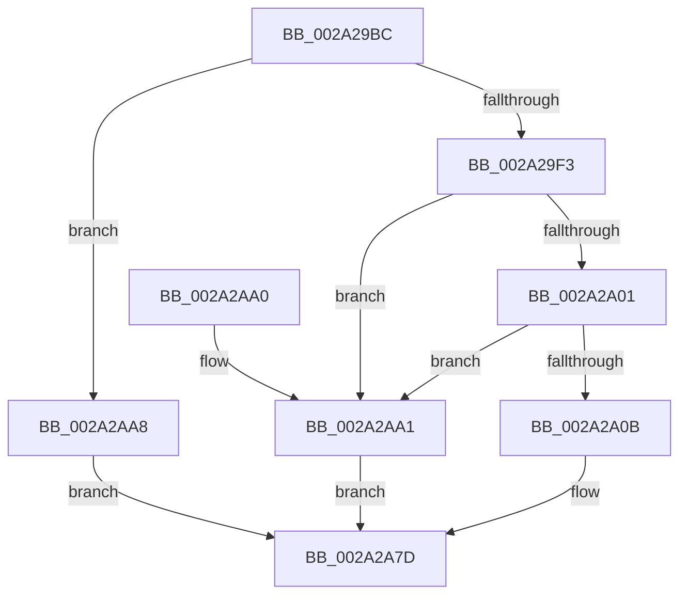

# MiOutSwapKernelStackPage

- RVA: `0x002A29BC`–`0x002A2AAF` (길이 `243` bytes)
- VA: `0x00000001402A29BC`
- 실행 섹션: `.text`
- PDB 이름 있음: `예`; PDB Function 태그: `아니요`
- unwind 정보 RVA: `0x000685F8`
- 디코드: `59`개 명령, `243/243` bytes 표시
- 미해석 바이트: `0` (있으면 어셈블리에 `.byte`로 보존)

> 이 문서는 커널 이미지의 기계어와 PDB 기호를 분석해 생성했습니다. 4번과 5번은 함수 원형과 자료형을 바이너리 사용 방식에서 추정한 C 해석이며 원본 소스 복구 결과는 아닙니다.

## 1. Dependencies

- 직접 호출 지점: **4**; 고유 호출 대상: **4**
- 직접 호출자로 확인된 함수: **1**
- RIP 상대 이미지 참조: **1**

### Outgoing calls
- `0x002A2A31` → [memset](../6C/memset_function_006C6C40.md) (function, `0x006C6C40`)
- `0x002A2A3E` → [MiVaToFlushVm](../31/MiVaToFlushVm_function_0031AD84.md) (function, `0x0031AD84`)
- `0x002A2A6C` → [MiOutSwapWorkingSet](../2C/MiOutSwapWorkingSet_function_002C1464.md) (function, `0x002C1464`)
- `0x002A2A88` → [_security_check_cookie](../6A/_security_check_cookie_function_006AC640.md) (function, `0x006AC640`)

### Direct callers
- [MiOutPageSingleKernelStack](MiOutPageSingleKernelStack_function_002A1790.md) at `0x002A1967`

### Static image references
- `0x002A29CB` → RVA `0x00E0A740` (`.data`; read)

## 2. Other-region calls and transfers

- 다른 실행 섹션으로 향하는 call: **0**
- 별도 외부 분기/꼬리 이동을 확인하지 못했습니다.

## 3. Assembly (complete function range)

```asm
002A29BC  48 89 5C 24 20                  mov qword ptr [rsp + 0x20], rbx
002A29C1  55                              push rbp
002A29C2  56                              push rsi
002A29C3  57                              push rdi
002A29C4  48 81 EC E0 00 00 00            sub rsp, 0xe0
002A29CB  48 8B 05 6E 7D B6 00            mov rax, qword ptr [rip + 0xb67d6e]
002A29D2  48 33 C4                        xor rax, rsp
002A29D5  48 89 84 24 D0 00 00 00         mov qword ptr [rsp + 0xd0], rax
002A29DD  48 8B 59 38                     mov rbx, qword ptr [rcx + 0x38]
002A29E1  49 8B F0                        mov rsi, r8
002A29E4  48 8B EA                        mov rbp, rdx
002A29E7  48 8B F9                        mov rdi, rcx
002A29EA  48 85 DB                        test rbx, rbx
002A29ED  0F 84 B5 00 00 00               je 0x1402a2aa8
002A29F3  48 8B 43 10                     mov rax, qword ptr [rbx + 0x10]
002A29F7  48 39 43 08                     cmp qword ptr [rbx + 8], rax
002A29FB  0F 86 A0 00 00 00               jbe 0x1402a2aa1
002A2A01  83 79 48 00                     cmp dword ptr [rcx + 0x48], 0
002A2A05  0F 84 96 00 00 00               je 0x1402a2aa1
002A2A0B  48 C1 E6 19                     shl rsi, 0x19
002A2A0F  48 B8 00 00 00 00 80 F6 FF FF   movabs rax, 0xfffff68000000000
002A2A19  48 C1 E0 19                     shl rax, 0x19
002A2A1D  48 8D 4C 24 30                  lea rcx, [rsp + 0x30]
002A2A22  48 2B F0                        sub rsi, rax
002A2A25  33 D2                           xor edx, edx
002A2A27  41 B8 98 00 00 00               mov r8d, 0x98
002A2A2D  48 C1 FE 10                     sar rsi, 0x10
002A2A31  E8 0A 42 42 00                  call 0x1406c6c40
002A2A36  48 8B CE                        mov rcx, rsi
002A2A39  48 89 5C 24 30                  mov qword ptr [rsp + 0x30], rbx
002A2A3E  E8 41 83 07 00                  call 0x14031ad84
002A2A43  0F 10 47 40                     movups xmm0, xmmword ptr [rdi + 0x40]
002A2A47  48 8D 4C 24 30                  lea rcx, [rsp + 0x30]
002A2A4C  48 89 44 24 40                  mov qword ptr [rsp + 0x40], rax
002A2A51  48 89 4C 24 20                  mov qword ptr [rsp + 0x20], rcx
002A2A56  4C 8B CE                        mov r9, rsi
002A2A59  48 8B C8                        mov rcx, rax
002A2A5C  48 89 6C 24 48                  mov qword ptr [rsp + 0x48], rbp
002A2A61  4C 8B C6                        mov r8, rsi
002A2A64  33 D2                           xor edx, edx
002A2A66  F3 0F 7F 44 24 58               movdqu xmmword ptr [rsp + 0x58], xmm0
002A2A6C  E8 F3 E9 01 00                  call 0x1402c1464
002A2A71  0F 10 44 24 58                  movups xmm0, xmmword ptr [rsp + 0x58]
002A2A76  33 C0                           xor eax, eax
002A2A78  F3 0F 7F 47 40                  movdqu xmmword ptr [rdi + 0x40], xmm0
002A2A7D  48 8B 8C 24 D0 00 00 00         mov rcx, qword ptr [rsp + 0xd0]
002A2A85  48 33 CC                        xor rcx, rsp
002A2A88  E8 B3 9B 40 00                  call 0x1406ac640
002A2A8D  48 8B 9C 24 18 01 00 00         mov rbx, qword ptr [rsp + 0x118]
002A2A95  48 81 C4 E0 00 00 00            add rsp, 0xe0
002A2A9C  5F                              pop rdi
002A2A9D  5E                              pop rsi
002A2A9E  5D                              pop rbp
002A2A9F  C3                              ret
002A2AA0  CC                              int3
002A2AA1  B8 09 02 00 C0                  mov eax, 0xc0000209
002A2AA6  EB D5                           jmp 0x1402a2a7d
002A2AA8  B8 AB 00 00 C0                  mov eax, 0xc00000ab
002A2AAD  EB CE                           jmp 0x1402a2a7d
```

## 4. C-style interpretation (structured pseudocode)

```c
__int64 __fastcall MiOutSwapKernelStackPage(__int64 a1, __int64 a2, __int64 a3)
{
    __int64 result;
    __int64 v_rsi;
    __int64 v_rsp;
    unsigned __int64 v_stack_m28;
    unsigned __int64 v_stack_mA0;
    unsigned __int64 v_stack_mB0;
    unsigned __int64 v_stack_mB8;
    unsigned __int64 v_stack_mC8;
    unsigned __int64 v_stack_mD8;
    unsigned __int64 v_stack_p20;

    v_stack_p20 = v_rbx;
    v_rsp = (v_rsp) - (224);
    result = (*(unsigned __int64 *)(v_rip + 11959662)) ^ (v_rsp);
    v_stack_m28 = result;
    if (*(unsigned __int64 *)(a1 + 56) == 0) goto loc_002A2AA8;
    if ((*(unsigned __int64 *)(*(unsigned __int64 *)(a1 + 56) + 8)) <= (*(unsigned __int64 *)(*(unsigned __int64 *)(a1 + 56) + 16))) goto loc_002A2AA1;
    if ((*(unsigned int *)(a1 + 72)) == 0) goto loc_002A2AA1;
    v_rsi = (a3) << (25);
    result = (*(unsigned __int64 *)(*(unsigned __int64 *)(a1 + 56) + 16)) << (25);
    v_rsi = (v_rsi) - (result);
    a2 = 0;
    v_rsi = (v_rsi) >> (16);
    result = memset(v_stack_mC8, a2, 152, a4);
    v_stack_mC8 = *(unsigned __int64 *)(a1 + 56);
    result = MiVaToFlushVm(v_rsi, a2, 152, a4);
    v_stack_mB8 = result;
    v_stack_mD8 = v_stack_mC8;
    v_stack_mB0 = 0;
    a2 = 0;
    v_stack_mA0 = v_xmm0;
    result = MiOutSwapWorkingSet(result, a2, v_rsi, v_rsi);
    result = 0;
    *(unsigned __int64 *)(a1 + 64) = v_xmm0;
loc_002A2A7D:
    a1 = (v_stack_m28) ^ (v_rsp);
    result = _security_check_cookie(a1, a2, v_rsi, v_rsi);
    v_rsp = (v_rsp) + (224);
    return result;
loc_002A2AA1:
    goto loc_002A2A7D;
loc_002A2AA8:
    goto loc_002A2A7D;
}
```

## 5. (Beta) C Style

```c
int64_t MiOutSwapKernelStackPage(void *Arg1, int64_t Arg2, int64_t Arg3)
{
    uint8_t *arg1 = (uint8_t *)Arg1;

    int64_t result;
    int64_t local_rsi;
    int64_t local_rsp;
    uint64_t v_stack_m28;
    uint64_t v_stack_mA0;
    uint64_t v_stack_mB0;
    uint64_t v_stack_mB8;
    uint64_t v_stack_mC8;
    uint64_t v_stack_mD8;
    uint64_t v_stack_p20;

    v_stack_p20 = local_rbx;
    local_rsp = (local_rsp) - (224);
    result = (*(uint64_t *)(v_rip + 0xB67D6E)) ^ (local_rsp);
    v_stack_m28 = result;
    if (*(uint64_t *)(arg1 + 0x38) == 0) goto loc_002A2AA8;
    if ((*(uint64_t *)(*(uint64_t *)(arg1 + 0x38) + 0x8)) <= (*(uint64_t *)(*(uint64_t *)(arg1 + 0x38) + 0x10))) goto loc_002A2AA1;
    if ((*(uint32_t *)(arg1 + 0x48)) == 0) goto loc_002A2AA1;
    local_rsi = (Arg3) << (25);
    result = (*(uint64_t *)(*(uint64_t *)(arg1 + 0x38) + 0x10)) << (25);
    local_rsi = (local_rsi) - (result);
    Arg2 = 0;
    local_rsi = (local_rsi) >> (16);
    result = memset(v_stack_mC8, Arg2, 152, a4);
    v_stack_mC8 = *(uint64_t *)(arg1 + 0x38);
    result = MiVaToFlushVm(local_rsi, Arg2, 152, a4);
    v_stack_mB8 = result;
    v_stack_mD8 = v_stack_mC8;
    v_stack_mB0 = 0;
    Arg2 = 0;
    v_stack_mA0 = v_xmm0;
    result = MiOutSwapWorkingSet(result, Arg2, local_rsi, local_rsi);
    result = 0;
    *(uint64_t *)(arg1 + 0x40) = v_xmm0;
loc_002A2A7D:
    Arg1 = (v_stack_m28) ^ (local_rsp);
    result = _security_check_cookie(Arg1, Arg2, local_rsi, local_rsi);
    local_rsp = (local_rsp) + (224);
    return result;
loc_002A2AA1:
    goto loc_002A2A7D;
loc_002A2AA8:
    goto loc_002A2A7D;
}
```

### 관측된 메모리 오프셋

구조체 형식이 확인되지 않은 접근은 인자 기준의 오프셋으로만 기록했습니다.

| 기준 인자 | 오프셋 표현 | 폭 (bit) | 접근 |
|---|---:|---:|---|
| `Arg1` | `+ 0x38` | `64` | `R` |
| `Arg1` | `+ 0x40` | `128` | `R` |
| `Arg1` | `+ 0x40` | `128` | `W` |
| `Arg1` | `+ 0x48` | `32` | `R` |

## 6. Execution-region graph

[열기: 2D/3D 그래프와 함수 탐색 컨트롤 패널](../../../control-panel.html?section=text&rva=0x002A29BC&view=graph)

- 2D 그래프는 위에서 아래로 흐르고, 3D 그래프는 빈 공간을 드래그해 회전합니다. Shift+드래그는 이동, 휠은 확대·축소, 함수 노드 선택은 대상 보고서 이동입니다.

### Static fallback


