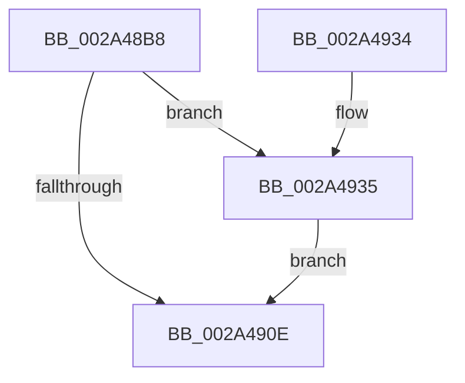

# MiOutlawInswaps

- RVA: `0x002A48B8`–`0x002A493E` (길이 `134` bytes)
- VA: `0x00000001402A48B8`
- 실행 섹션: `.text`
- PDB 이름 있음: `예`; PDB Function 태그: `아니요`
- unwind 정보 RVA: `0x00068908`
- 디코드: `31`개 명령, `134/134` bytes 표시
- 미해석 바이트: `0` (있으면 어셈블리에 `.byte`로 보존)

> 이 문서는 커널 이미지의 기계어와 PDB 기호를 분석해 생성했습니다. 4번과 5번은 함수 원형과 자료형을 바이너리 사용 방식에서 추정한 C 해석이며 원본 소스 복구 결과는 아닙니다.

## 1. Dependencies

- 직접 호출 지점: **3**; 고유 호출 대상: **3**
- 직접 호출자로 확인된 함수: **1**
- RIP 상대 이미지 참조: **2**

### Outgoing calls
- `0x002A48E7` → [ExAcquireSpinLockExclusive](../24/ExAcquireSpinLockExclusive_function_00248690.md) (function, `0x00248690`)
- `0x002A48F1` → [MiGetWorkingSetSwapSupport](MiGetWorkingSetSwapSupport_function_002A35A0.md) (function, `0x002A35A0`)
- `0x002A491C` → [MiReleaseSpinLockExclusive](../24/MiReleaseSpinLockExclusive_function_002482C0.md) (function, `0x002482C0`)

### Direct callers
- [MiBeginProcessClean](MiBeginProcessClean_function_002A473C.md) at `0x002A47EF`

### Static image references
- `0x002A48C7` → RVA `0x00E30088` (`.data`; read)
- `0x002A4905` → RVA `0x00E38858` (`.data`; read)

## 2. Other-region calls and transfers

- 다른 실행 섹션으로 향하는 call: **0**
- 별도 외부 분기/꼬리 이동을 확인하지 못했습니다.

## 3. Assembly (complete function range)

```asm
002A48B8  48 89 5C 24 08                  mov qword ptr [rsp + 8], rbx
002A48BD  48 89 74 24 10                  mov qword ptr [rsp + 0x10], rsi
002A48C2  57                              push rdi
002A48C3  48 83 EC 20                     sub rsp, 0x20
002A48C7  48 8B 05 BA B7 B8 00            mov rax, qword ptr [rip + 0xb8b7ba]
002A48CE  48 8D 99 00 04 00 00            lea rbx, [rcx + 0x400]
002A48D5  0F B7 89 AE 04 00 00            movzx ecx, word ptr [rcx + 0x4ae]
002A48DC  48 8B 3C C8                     mov rdi, qword ptr [rax + rcx*8]
002A48E0  48 8D 8F A0 04 00 00            lea rcx, [rdi + 0x4a0]
002A48E7  E8 A4 3D FA FF                  call 0x140248690
002A48EC  48 8B CB                        mov rcx, rbx
002A48EF  8A D0                           mov dl, al
002A48F1  E8 AA EC FF FF                  call 0x1402a35a0
002A48F6  8B 8B B8 00 00 00               mov ecx, dword ptr [rbx + 0xb8]
002A48FC  48 8B F0                        mov rsi, rax
002A48FF  80 E1 0F                        and cl, 0xf
002A4902  80 F9 01                        cmp cl, 1
002A4905  48 8D 0D 4C 3F B9 00            lea rcx, [rip + 0xb93f4c]
002A490C  75 27                           jne 0x1402a4935
002A490E  48 C7 01 02 00 00 00            mov qword ptr [rcx], 2
002A4915  48 8D 8F A0 04 00 00            lea rcx, [rdi + 0x4a0]
002A491C  E8 9F 39 FA FF                  call 0x1402482c0
002A4921  48 8B 5C 24 30                  mov rbx, qword ptr [rsp + 0x30]
002A4926  48 8B C6                        mov rax, rsi
002A4929  48 8B 74 24 38                  mov rsi, qword ptr [rsp + 0x38]
002A492E  48 83 C4 20                     add rsp, 0x20
002A4932  5F                              pop rdi
002A4933  C3                              ret
002A4934  CC                              int3
002A4935  48 8D 8B D8 00 00 00            lea rcx, [rbx + 0xd8]
002A493C  EB D0                           jmp 0x1402a490e
```

## 4. C-style interpretation (structured pseudocode)

```c
__int64 __fastcall MiOutlawInswaps(__int64 a1)
{
    __int64 result;
    __int64 v_rsp;
    unsigned __int64 v_stack_p10;
    unsigned __int64 v_stack_p8;

    v_stack_p8 = v_rbx;
    v_stack_p10 = v_rsi;
    v_rsp = (v_rsp) - (32);
    result = ExAcquireSpinLockExclusive(*(unsigned __int64 *)(*(unsigned __int64 *)(v_rip + 12105658) + *(unsigned __int16 *)(a1 + 1198) * 8) + 1184, a2, a3, a4);
    result = MiGetWorkingSetSwapSupport(a1 + 1024, (unsigned __int8)(result), a3, a4);
    a1 = (unsigned __int8)(((unsigned int)(*(unsigned int *)(a1 + 1024 + 184))) & (15));
    if (((unsigned __int8)(a1)) != 1) goto loc_002A4935;
loc_002A490E:
    *(unsigned __int64 *)(v_rip + 12140364) = 2;
    result = MiReleaseSpinLockExclusive(*(unsigned __int64 *)(*(unsigned __int64 *)(v_rip + 12105658) + *(unsigned __int16 *)(a1 + 1198) * 8) + 1184, (unsigned __int8)(result), a3, a4);
    v_rsp = (v_rsp) + (32);
    return result;
loc_002A4935:
    goto loc_002A490E;
}
```

## 5. (Beta) C Style

```c
int64_t MiOutlawInswaps(void *Arg1)
{
    uint8_t *arg1 = (uint8_t *)Arg1;

    int64_t result;
    int64_t local_rsp;
    uint64_t v_stack_p10;
    uint64_t v_stack_p8;

    v_stack_p8 = local_rbx;
    v_stack_p10 = local_rsi;
    local_rsp = (local_rsp) - (32);
    result = ExAcquireSpinLockExclusive(*(uint64_t *)(*(uint64_t *)(v_rip + 0xB8B7BA) + *(uint16_t *)(arg1 + 0x4AE) * 8) + 1184, a2, a3, a4);
    result = MiGetWorkingSetSwapSupport(Arg1 + 1024, (uint8_t)(result), a3, a4);
    Arg1 = (uint8_t)(((uint32_t)(*(uint32_t *)(arg1 + 0x400 + 0xB8))) & (15));
    if (((uint8_t)(Arg1)) != 1) goto loc_002A4935;
loc_002A490E:
    *(uint64_t *)(v_rip + 0xB93F4C) = 2;
    result = MiReleaseSpinLockExclusive(*(uint64_t *)(*(uint64_t *)(v_rip + 0xB8B7BA) + *(uint16_t *)(arg1 + 0x4AE) * 8) + 1184, (uint8_t)(result), a3, a4);
    local_rsp = (local_rsp) + (32);
    return result;
loc_002A4935:
    goto loc_002A490E;
}
```

### 관측된 메모리 오프셋

구조체 형식이 확인되지 않은 접근은 인자 기준의 오프셋으로만 기록했습니다.

| 기준 인자 | 오프셋 표현 | 폭 (bit) | 접근 |
|---|---:|---:|---|
| `Arg1` | `+ 0xB8` | `32` | `R` |
| `Arg1` | `+ 0xD8` | `64` | `R` |
| `Arg1` | `+ 0x400` | `64` | `R` |
| `Arg1` | `+ 0x4AE` | `16` | `R` |

## 6. Execution-region graph

[열기: 2D/3D 그래프와 함수 탐색 컨트롤 패널](../../../control-panel.html?section=text&rva=0x002A48B8&view=graph)

- 2D 그래프는 위에서 아래로 흐르고, 3D 그래프는 빈 공간을 드래그해 회전합니다. Shift+드래그는 이동, 휠은 확대·축소, 함수 노드 선택은 대상 보고서 이동입니다.

### Static fallback


