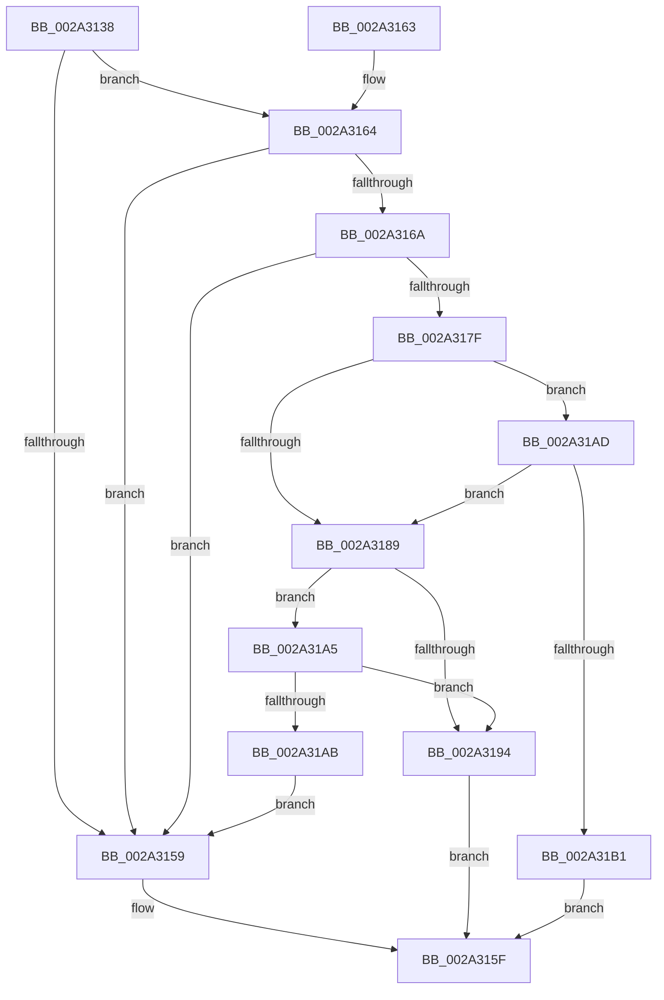

# MiPageAvailable

- RVA: `0x002A3138`–`0x002A31B3` (길이 `123` bytes)
- VA: `0x00000001402A3138`
- 실행 섹션: `.text`
- PDB 이름 있음: `예`; PDB Function 태그: `아니요`
- unwind 정보 RVA: `0x000DB714`
- 디코드: `36`개 명령, `123/123` bytes 표시
- 미해석 바이트: `0` (있으면 어셈블리에 `.byte`로 보존)

> 이 문서는 커널 이미지의 기계어와 PDB 기호를 분석해 생성했습니다. 4번과 5번은 함수 원형과 자료형을 바이너리 사용 방식에서 추정한 C 해석이며 원본 소스 복구 결과는 아닙니다.

## 1. Dependencies

- 직접 호출 지점: **0**; 고유 호출 대상: **0**
- 직접 호출자로 확인된 함수: **4**
- RIP 상대 이미지 참조: **0**

### Outgoing calls
- 직접 디코드된 call 명령이 없습니다.

### Direct callers
- [MiGetPage](../28/MiGetPage_function_002884C0.md) at `0x00288AAF`
- [MiGetPage](../28/MiGetPage_function_002884C0.md) at `0x002890C0`
- [sub_002A2D9F](Unknown_function_002A2D9F.md) at `0x002A2E03`
- [MiGetPageChain](../33/MiGetPageChain_function_00330130.md) at `0x003305D6`
- [MiHandleSpecialPurposeMemoryCachedFault](../44/MiHandleSpecialPurposeMemoryCachedFault_function_0044C740.md) at `0x0044C872`

### Static image references
- 디코드된 RIP-relative 메모리 참조가 없습니다.

## 2. Other-region calls and transfers

- 다른 실행 섹션으로 향하는 call: **0**
- 별도 외부 분기/꼬리 이동을 확인하지 못했습니다.

## 3. Assembly (complete function range)

```asm
002A3138  48 8B 81 00 49 00 00            mov rax, qword ptr [rcx + 0x4900]
002A313F  45 33 C0                        xor r8d, r8d
002A3142  48 85 C0                        test rax, rax
002A3145  4C 8B D1                        mov r10, rcx
002A3148  4C 8D 48 FF                     lea r9, [rax - 1]
002A314C  4C 0F 44 C8                     cmove r9, rax
002A3150  49 81 F9 9F 00 00 00            cmp r9, 0x9f
002A3157  72 0B                           jb 0x1402a3164
002A3159  41 B8 01 00 00 00               mov r8d, 1
002A315F  41 8B C0                        mov eax, r8d
002A3162  C3                              ret
002A3163  CC                              int3
002A3164  0F BA E2 09                     bt edx, 9
002A3168  72 EF                           jb 0x1402a3159
002A316A  65 48 8B 0C 25 88 01 00 00      mov rcx, qword ptr gs:[0x188]
002A3173  8B 81 A4 05 00 00               mov eax, dword ptr [rcx + 0x5a4]
002A3179  24 0C                           and al, 0xc
002A317B  3C 08                           cmp al, 8
002A317D  74 DA                           je 0x1402a3159
002A317F  41 8B 42 04                     mov eax, dword ptr [r10 + 4]
002A3183  49 83 F9 20                     cmp r9, 0x20
002A3187  72 24                           jb 0x1402a31ad
002A3189  8B 89 A4 05 00 00               mov ecx, dword ptr [rcx + 0x5a4]
002A318F  F6 C1 02                        test cl, 2
002A3192  75 11                           jne 0x1402a31a5
002A3194  0F B6 C8                        movzx ecx, al
002A3197  41 B8 01 00 00 00               mov r8d, 1
002A319D  C1 E9 04                        shr ecx, 4
002A31A0  44 23 C1                        and r8d, ecx
002A31A3  EB BA                           jmp 0x1402a315f
002A31A5  49 83 F9 21                     cmp r9, 0x21
002A31A9  72 E9                           jb 0x1402a3194
002A31AB  EB AC                           jmp 0x1402a3159
002A31AD  A8 04                           test al, 4
002A31AF  74 D8                           je 0x1402a3189
002A31B1  EB AC                           jmp 0x1402a315f
```

## 4. C-style interpretation (structured pseudocode)

```c
__int64 __fastcall MiPageAvailable(__int64 a1, int a2, int a3)
{
    __int64 result;

    a3 = 0;
    a4 = *(unsigned __int64 *)(a1 + 18688) - 1;
    if (*(unsigned __int64 *)(a1 + 18688) == 0) { a4 = *(unsigned __int64 *)(a1 + 18688); }
    if (a4 < 159) goto loc_002A3164;
loc_002A3159:
loc_002A315F:
    return 1;
loc_002A3164:
    if (a4 < 159) goto loc_002A3159;
    result = (unsigned __int8)(((unsigned int)(*(unsigned int *)(*(unsigned __int64 *)(gs_base + (0 + 392)) + 1444))) & (12));
    if (((unsigned __int8)(result)) == 8) goto loc_002A3159;
    if (a4 < 32) goto loc_002A31AD;
loc_002A3189:
    if ((((unsigned __int8)((unsigned int)(*(unsigned int *)(*(unsigned __int64 *)(gs_base + (0 + 392)) + 1444)))) & (2)) != 0) goto loc_002A31A5;
loc_002A3194:
    a1 = (unsigned int)(((unsigned __int8)((unsigned int)(*(unsigned int *)(a1 + 4)))) >> (4));
    a3 = (unsigned int)((1) & ((unsigned int)(a1)));
    goto loc_002A315F;
loc_002A31A5:
    if (a4 < 33) goto loc_002A3194;
    goto loc_002A3159;
loc_002A31AD:
    if ((((unsigned __int8)((unsigned int)(*(unsigned int *)(a1 + 4)))) & (4)) == 0) goto loc_002A3189;
    goto loc_002A315F;
}
```

## 5. (Beta) C Style

```c
int64_t MiPageAvailable(void *Arg1, int32_t Arg2, int32_t Arg3)
{
    uint8_t *arg1 = (uint8_t *)Arg1;

    int64_t result;

    Arg3 = 0;
    a4 = *(uint64_t *)(arg1 + 0x4900) - 1;
    if (*(uint64_t *)(arg1 + 0x4900) == 0) { a4 = *(uint64_t *)(arg1 + 0x4900); }
    if (a4 < 159) goto loc_002A3164;
loc_002A3159:
loc_002A315F:
    return 1;
loc_002A3164:
    if (a4 < 159) goto loc_002A3159;
    result = (uint8_t)(((uint32_t)(*(uint32_t *)(*(uint64_t *)(gs_base + (0 + 0x188)) + 0x5A4))) & (12));
    if (((uint8_t)(result)) == 8) goto loc_002A3159;
    if (a4 < 32) goto loc_002A31AD;
loc_002A3189:
    if ((((uint8_t)((uint32_t)(*(uint32_t *)(*(uint64_t *)(gs_base + (0 + 0x188)) + 0x5A4)))) & (2)) != 0) goto loc_002A31A5;
loc_002A3194:
    Arg1 = (uint32_t)(((uint8_t)((uint32_t)(*(uint32_t *)(arg1 + 0x4)))) >> (4));
    Arg3 = (uint32_t)((1) & ((uint32_t)(Arg1)));
    goto loc_002A315F;
loc_002A31A5:
    if (a4 < 33) goto loc_002A3194;
    goto loc_002A3159;
loc_002A31AD:
    if ((((uint8_t)((uint32_t)(*(uint32_t *)(arg1 + 0x4)))) & (4)) == 0) goto loc_002A3189;
    goto loc_002A315F;
}
```

### 관측된 메모리 오프셋

구조체 형식이 확인되지 않은 접근은 인자 기준의 오프셋으로만 기록했습니다.

| 기준 인자 | 오프셋 표현 | 폭 (bit) | 접근 |
|---|---:|---:|---|
| `Arg1` | `+ 0x4` | `32` | `R` |
| `Arg1` | `+ 0x4900` | `64` | `R` |

## 6. Execution-region graph

[열기: 2D/3D 그래프와 함수 탐색 컨트롤 패널](../../../control-panel.html?section=text&rva=0x002A3138&view=graph)

- 2D 그래프는 위에서 아래로 흐르고, 3D 그래프는 빈 공간을 드래그해 회전합니다. Shift+드래그는 이동, 휠은 확대·축소, 함수 노드 선택은 대상 보고서 이동입니다.

### Static fallback


