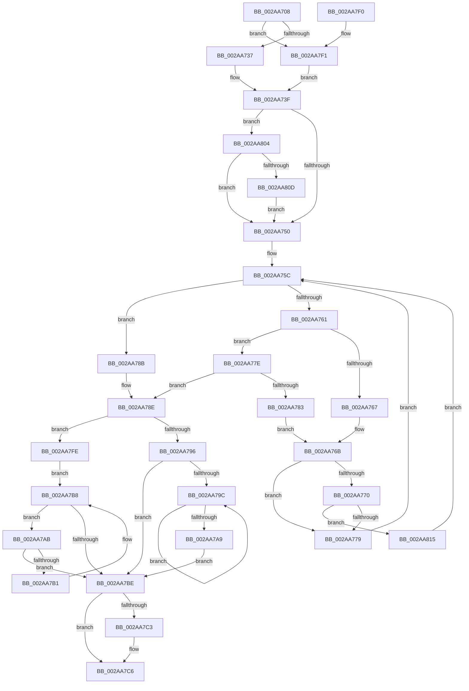

# MiPageFileLargestBitmapsRun

- RVA: `0x002AA708`–`0x002AA81D` (길이 `277` bytes)
- VA: `0x00000001402AA708`
- 실행 섹션: `.text`
- PDB 이름 있음: `예`; PDB Function 태그: `아니요`
- unwind 정보 RVA: `0x00068ED8`
- 디코드: `82`개 명령, `277/277` bytes 표시
- 미해석 바이트: `0` (있으면 어셈블리에 `.byte`로 보존)

> 이 문서는 커널 이미지의 기계어와 PDB 기호를 분석해 생성했습니다. 4번과 5번은 함수 원형과 자료형을 바이너리 사용 방식에서 추정한 C 해석이며 원본 소스 복구 결과는 아닙니다.

## 1. Dependencies

- 직접 호출 지점: **3**; 고유 호출 대상: **3**
- 직접 호출자로 확인된 함수: **6**
- RIP 상대 이미지 참조: **0**

### Outgoing calls
- `0x002AA73A` → [ExAcquireSpinLockSharedAtDpcLevel](../24/ExAcquireSpinLockSharedAtDpcLevel_function_00248E30.md) (function, `0x00248E30`)
- `0x002AA7D4` → [MiReleaseSpinLockShared](../34/MiReleaseSpinLockShared_function_00348BF0.md) (function, `0x00348BF0`)
- `0x002AA7F1` → [ExAcquireSpinLockShared](../24/ExAcquireSpinLockShared_function_0024DCE0.md) (function, `0x0024DCE0`)

### Direct callers
- [MiFindBestOutswapPagefile](MiFindBestOutswapPagefile_function_002A73B4.md) at `0x002A7452`
- [MiFindBestOutswapPagefile](MiFindBestOutswapPagefile_function_002A73B4.md) at `0x002A745C`
- [MiTrimUnusedPageFileRegionsWorker](MiTrimUnusedPageFileRegionsWorker_function_002AA320.md) at `0x002AA4FE`
- [MiGatherPagefilePages](../37/MiGatherPagefilePages_function_00372B08.md) at `0x003732BC`
- [MiGetKernelStackSwapSupport](../3E/MiGetKernelStackSwapSupport_function_003E2900.md) at `0x003E2A2C`
- [MiGetKernelStackSwapSupport](../3E/MiGetKernelStackSwapSupport_function_003E2900.md) at `0x003E2A3D`
- [MiFindFreePageFileSpace](../3E/MiFindFreePageFileSpace_function_003E2CAC.md) at `0x003E2D29`
- [MiFindFreePageFileSpace](../3E/MiFindFreePageFileSpace_function_003E2CAC.md) at `0x003E30B0`
- [MiFindFreePageFileSpace](../3E/MiFindFreePageFileSpace_function_003E2CAC.md) at `0x003E321A`
- [sub_006EA85E](../6E/Unknown_function_006EA85E.md) at `0x006EA864`

### Static image references
- 디코드된 RIP-relative 메모리 참조가 없습니다.

## 2. Other-region calls and transfers

- 다른 실행 섹션으로 향하는 call: **0**
- 별도 외부 분기/꼬리 이동을 확인하지 못했습니다.

## 3. Assembly (complete function range)

```asm
002AA708  48 89 5C 24 08                  mov qword ptr [rsp + 8], rbx
002AA70D  48 89 6C 24 10                  mov qword ptr [rsp + 0x10], rbp
002AA712  48 89 74 24 18                  mov qword ptr [rsp + 0x18], rsi
002AA717  57                              push rdi
002AA718  48 83 EC 20                     sub rsp, 0x20
002AA71C  48 8B D9                        mov rbx, rcx
002AA71F  33 FF                           xor edi, edi
002AA721  44 0F 20 C0                     mov rax, cr8
002AA725  48 8D B1 C8 00 00 00            lea rsi, [rcx + 0xc8]
002AA72C  48 8B CE                        mov rcx, rsi
002AA72F  3C 02                           cmp al, 2
002AA731  0F 85 BA 00 00 00               jne 0x1402aa7f1
002AA737  40 B5 11                        mov bpl, 0x11
002AA73A  E8 F1 E6 F9 FF                  call 0x140248e30
002AA73F  48 8D 53 70                     lea rdx, [rbx + 0x70]
002AA743  F6 42 08 01                     test byte ptr [rdx + 8], 1
002AA747  48 8B 0A                        mov rcx, qword ptr [rdx]
002AA74A  0F 85 B4 00 00 00               jne 0x1402aa804
002AA750  44 0F B6 42 08                  movzx r8d, byte ptr [rdx + 8]
002AA755  48 8B D7                        mov rdx, rdi
002AA758  41 83 E0 01                     and r8d, 1
002AA75C  48 85 C9                        test rcx, rcx
002AA75F  74 2A                           je 0x1402aa78b
002AA761  83 79 34 FF                     cmp dword ptr [rcx + 0x34], -1
002AA765  73 17                           jae 0x1402aa77e
002AA767  48 8B 41 08                     mov rax, qword ptr [rcx + 8]
002AA76B  45 85 C0                        test r8d, r8d
002AA76E  74 09                           je 0x1402aa779
002AA770  48 85 C0                        test rax, rax
002AA773  0F 85 9C 00 00 00               jne 0x1402aa815
002AA779  48 8B C8                        mov rcx, rax
002AA77C  EB DE                           jmp 0x1402aa75c
002AA77E  39 79 30                        cmp dword ptr [rcx + 0x30], edi
002AA781  76 0B                           jbe 0x1402aa78e
002AA783  48 8B 01                        mov rax, qword ptr [rcx]
002AA786  48 8B D1                        mov rdx, rcx
002AA789  EB E0                           jmp 0x1402aa76b
002AA78B  48 8B CA                        mov rcx, rdx
002AA78E  48 8B 11                        mov rdx, qword ptr [rcx]
002AA791  48 85 D2                        test rdx, rdx
002AA794  74 68                           je 0x1402aa7fe
002AA796  48 39 7A 08                     cmp qword ptr [rdx + 8], rdi
002AA79A  74 22                           je 0x1402aa7be
002AA79C  48 8B 42 08                     mov rax, qword ptr [rdx + 8]
002AA7A0  48 8B D0                        mov rdx, rax
002AA7A3  48 39 78 08                     cmp qword ptr [rax + 8], rdi
002AA7A7  75 F3                           jne 0x1402aa79c
002AA7A9  EB 13                           jmp 0x1402aa7be
002AA7AB  48 39 4A 08                     cmp qword ptr [rdx + 8], rcx
002AA7AF  74 0D                           je 0x1402aa7be
002AA7B1  48 8B CA                        mov rcx, rdx
002AA7B4  48 8B 52 10                     mov rdx, qword ptr [rdx + 0x10]
002AA7B8  48 83 E2 FC                     and rdx, 0xfffffffffffffffc
002AA7BC  75 ED                           jne 0x1402aa7ab
002AA7BE  48 85 D2                        test rdx, rdx
002AA7C1  74 03                           je 0x1402aa7c6
002AA7C3  8B 7A 34                        mov edi, dword ptr [rdx + 0x34]
002AA7C6  8B 5B 6C                        mov ebx, dword ptr [rbx + 0x6c]
002AA7C9  40 8A D5                        mov dl, bpl
002AA7CC  3B FB                           cmp edi, ebx
002AA7CE  48 8B CE                        mov rcx, rsi
002AA7D1  0F 47 DF                        cmova ebx, edi
002AA7D4  E8 17 E4 09 00                  call 0x140348bf0
002AA7D9  48 8B 6C 24 38                  mov rbp, qword ptr [rsp + 0x38]
002AA7DE  8B C3                           mov eax, ebx
002AA7E0  48 8B 5C 24 30                  mov rbx, qword ptr [rsp + 0x30]
002AA7E5  48 8B 74 24 40                  mov rsi, qword ptr [rsp + 0x40]
002AA7EA  48 83 C4 20                     add rsp, 0x20
002AA7EE  5F                              pop rdi
002AA7EF  C3                              ret
002AA7F0  CC                              int3
002AA7F1  E8 EA 34 FA FF                  call 0x14024dce0
002AA7F6  40 8A E8                        mov bpl, al
002AA7F9  E9 41 FF FF FF                  jmp 0x1402aa73f
002AA7FE  48 8B 51 10                     mov rdx, qword ptr [rcx + 0x10]
002AA802  EB B4                           jmp 0x1402aa7b8
002AA804  48 85 C9                        test rcx, rcx
002AA807  0F 84 43 FF FF FF               je 0x1402aa750
002AA80D  48 33 CA                        xor rcx, rdx
002AA810  E9 3B FF FF FF                  jmp 0x1402aa750
002AA815  48 33 C8                        xor rcx, rax
002AA818  E9 3F FF FF FF                  jmp 0x1402aa75c
```

## 4. C-style interpretation (structured pseudocode)

```c
__int64 __fastcall MiPageFileLargestBitmapsRun(__int64 a1)
{
    __int64 result;
    __int64 v_rbx;
    __int64 v_rdi;
    __int64 v_rsp;
    unsigned __int64 v_stack_p10;
    unsigned __int64 v_stack_p18;
    unsigned __int64 v_stack_p8;

    v_stack_p8 = v_rbx;
    v_stack_p10 = v_rbp;
    v_stack_p18 = v_rsi;
    v_rsp = (v_rsp) - (32);
    v_rdi = 0;
    if (((unsigned __int8)(v_cr8)) != 2) goto loc_002AA7F1;
    result = ExAcquireSpinLockSharedAtDpcLevel(a1 + 200, a2, a3, a4);
loc_002AA73F:
    if (((*(unsigned __int8 *)(a1 + 112 + 8)) & (1)) != 0) goto loc_002AA804;
loc_002AA750:
    a3 = (unsigned int)((*(unsigned __int8 *)(a1 + 112 + 8)) & (1));
loc_002AA75C:
    if (*(unsigned __int64 *)(a1 + 112) == 0) goto loc_002AA78B;
    if ((*(unsigned int *)(*(unsigned __int64 *)(a1 + 112) + 52)) >= -1) goto loc_002AA77E;
loc_002AA76B:
    if ((unsigned int)(a3) == 0) goto loc_002AA779;
    if (*(unsigned __int64 *)(*(unsigned __int64 *)(a1 + 112) + 8) != 0) goto loc_002AA815;
loc_002AA779:
    goto loc_002AA75C;
loc_002AA77E:
    if ((*(unsigned int *)(*(unsigned __int64 *)(*(unsigned __int64 *)(a1 + 112) + 8) + 48)) <= 0) goto loc_002AA78E;
    goto loc_002AA76B;
loc_002AA78B:
loc_002AA78E:
    if (*(unsigned __int64 *)(*(unsigned __int64 *)(*(unsigned __int64 *)(a1 + 112) + 8)) == 0) goto loc_002AA7FE;
    if ((*(unsigned __int64 *)(*(unsigned __int64 *)(*(unsigned __int64 *)(*(unsigned __int64 *)(a1 + 112) + 8)) + 8)) == 0) goto loc_002AA7BE;
loc_002AA79C:
    if ((*(unsigned __int64 *)(*(unsigned __int64 *)(*(unsigned __int64 *)(*(unsigned __int64 *)(*(unsigned __int64 *)(a1 + 112) + 8)) + 8) + 8)) != 0) goto loc_002AA79C;
    goto loc_002AA7BE;
loc_002AA7AB:
    if ((*(unsigned __int64 *)(*(unsigned __int64 *)(*(unsigned __int64 *)(*(unsigned __int64 *)(*(unsigned __int64 *)(a1 + 112) + 8)) + 8) + 8)) == (*(unsigned __int64 *)(*(unsigned __int64 *)(a1 + 112) + 8))) goto loc_002AA7BE;
loc_002AA7B8:
    a2 = (*(unsigned __int64 *)(*(unsigned __int64 *)(*(unsigned __int64 *)(*(unsigned __int64 *)(*(unsigned __int64 *)(a1 + 112) + 8)) + 8) + 16)) & (-4);
    if (condition_is_not_equal) goto loc_002AA7AB;
loc_002AA7BE:
    if (a2 != 0) {
        v_rdi = *(unsigned int *)(a2 + 52);
    }
    v_rbx = (unsigned int)(*(unsigned int *)(a1 + 108));
    if (((unsigned int)(v_rdi)) > ((unsigned int)((unsigned int)(*(unsigned int *)(a1 + 108))))) { v_rbx = (unsigned int)(v_rdi); }
    result = MiReleaseSpinLockShared(a1 + 200, 17, a3, a4);
    v_rsp = (v_rsp) + (32);
    return (unsigned int)((unsigned int)(v_rbx));
loc_002AA7F1:
    result = ExAcquireSpinLockShared(a1 + 200, 17, a3, a4);
    goto loc_002AA73F;
loc_002AA7FE:
    goto loc_002AA7B8;
loc_002AA804:
    if (a1 + 200 == 0) goto loc_002AA750;
    a1 = (a1 + 200) ^ (*(unsigned __int64 *)(a1 + 200 + 16));
    goto loc_002AA750;
loc_002AA815:
    a1 = (a1) ^ (result);
    goto loc_002AA75C;
}
```

## 5. (Beta) C Style

```c
int64_t MiPageFileLargestBitmapsRun(void *Arg1)
{
    uint8_t *arg1 = (uint8_t *)Arg1;

    int64_t result;
    int64_t local_rbx;
    int64_t local_rdi;
    int64_t local_rsp;
    uint64_t v_stack_p10;
    uint64_t v_stack_p18;
    uint64_t v_stack_p8;

    v_stack_p8 = local_rbx;
    v_stack_p10 = local_rbp;
    v_stack_p18 = local_rsi;
    local_rsp = (local_rsp) - (32);
    local_rdi = 0;
    if (((uint8_t)(v_cr8)) != 2) goto loc_002AA7F1;
    result = ExAcquireSpinLockSharedAtDpcLevel(Arg1 + 200, a2, a3, a4);
loc_002AA73F:
    if (((*(uint8_t *)(arg1 + 0x70 + 0x8)) & (1)) != 0) goto loc_002AA804;
loc_002AA750:
    a3 = (uint32_t)((*(uint8_t *)(arg1 + 0x70 + 0x8)) & (1));
loc_002AA75C:
    if (*(uint64_t *)(arg1 + 0x70) == 0) goto loc_002AA78B;
    if ((*(uint32_t *)(*(uint64_t *)(arg1 + 0x70) + 0x34)) >= -1) goto loc_002AA77E;
loc_002AA76B:
    if ((uint32_t)(a3) == 0) goto loc_002AA779;
    if (*(uint64_t *)(*(uint64_t *)(arg1 + 0x70) + 0x8) != 0) goto loc_002AA815;
loc_002AA779:
    goto loc_002AA75C;
loc_002AA77E:
    if ((*(uint32_t *)(*(uint64_t *)(*(uint64_t *)(arg1 + 0x70) + 0x8) + 0x30)) <= 0) goto loc_002AA78E;
    goto loc_002AA76B;
loc_002AA78B:
loc_002AA78E:
    if (*(uint64_t *)(*(uint64_t *)(*(uint64_t *)(arg1 + 0x70) + 0x8)) == 0) goto loc_002AA7FE;
    if ((*(uint64_t *)(*(uint64_t *)(*(uint64_t *)(*(uint64_t *)(arg1 + 0x70) + 0x8)) + 0x8)) == 0) goto loc_002AA7BE;
loc_002AA79C:
    if ((*(uint64_t *)(*(uint64_t *)(*(uint64_t *)(*(uint64_t *)(*(uint64_t *)(arg1 + 0x70) + 0x8)) + 0x8) + 0x8)) != 0) goto loc_002AA79C;
    goto loc_002AA7BE;
loc_002AA7AB:
    if ((*(uint64_t *)(*(uint64_t *)(*(uint64_t *)(*(uint64_t *)(*(uint64_t *)(arg1 + 0x70) + 0x8)) + 0x8) + 0x8)) == (*(uint64_t *)(*(uint64_t *)(arg1 + 0x70) + 0x8))) goto loc_002AA7BE;
loc_002AA7B8:
    a2 = (*(uint64_t *)(*(uint64_t *)(*(uint64_t *)(*(uint64_t *)(*(uint64_t *)(arg1 + 0x70) + 0x8)) + 0x8) + 0x10)) & (-4);
    if (condition_is_not_equal) goto loc_002AA7AB;
loc_002AA7BE:
    if (a2 != 0) {
        local_rdi = *(uint32_t *)(a2 + 0x34);
    }
    local_rbx = (uint32_t)(*(uint32_t *)(arg1 + 0x6C));
    if (((uint32_t)(local_rdi)) > ((uint32_t)((uint32_t)(*(uint32_t *)(arg1 + 0x6C))))) { local_rbx = (uint32_t)(local_rdi); }
    result = MiReleaseSpinLockShared(Arg1 + 200, 17, a3, a4);
    local_rsp = (local_rsp) + (32);
    return (uint32_t)((uint32_t)(local_rbx));
loc_002AA7F1:
    result = ExAcquireSpinLockShared(Arg1 + 200, 17, a3, a4);
    goto loc_002AA73F;
loc_002AA7FE:
    goto loc_002AA7B8;
loc_002AA804:
    if (Arg1 + 200 == 0) goto loc_002AA750;
    Arg1 = (Arg1 + 200) ^ (*(uint64_t *)(arg1 + 0xC8 + 0x10));
    goto loc_002AA750;
loc_002AA815:
    Arg1 = (Arg1) ^ (result);
    goto loc_002AA75C;
}
```

### 관측된 메모리 오프셋

구조체 형식이 확인되지 않은 접근은 인자 기준의 오프셋으로만 기록했습니다.

| 기준 인자 | 오프셋 표현 | 폭 (bit) | 접근 |
|---|---:|---:|---|
| `Arg1` | `+ 0x0` | `64` | `R` |
| `Arg1` | `+ 0x8` | `8` | `R` |
| `Arg1` | `+ 0x6C` | `32` | `R` |
| `Arg1` | `+ 0x70` | `64` | `R` |
| `Arg1` | `+ 0xC8` | `64` | `R` |

## 6. Execution-region graph

[열기: 2D/3D 그래프와 함수 탐색 컨트롤 패널](../../../control-panel.html?section=text&rva=0x002AA708&view=graph)

- 2D 그래프는 위에서 아래로 흐르고, 3D 그래프는 빈 공간을 드래그해 회전합니다. Shift+드래그는 이동, 휠은 확대·축소, 함수 노드 선택은 대상 보고서 이동입니다.

### Static fallback


