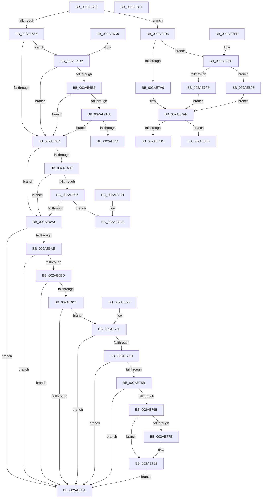

# MiPageTableLockIsContended

- RVA: `0x002AE650`–`0x002AE812` (길이 `450` bytes)
- VA: `0x00000001402AE650`
- 실행 섹션: `.text`
- PDB 이름 있음: `예`; PDB Function 태그: `아니요`
- unwind 정보 RVA: `0x000DB714`
- 디코드: `117`개 명령, `450/450` bytes 표시
- 미해석 바이트: `0` (있으면 어셈블리에 `.byte`로 보존)

> 이 문서는 커널 이미지의 기계어와 PDB 기호를 분석해 생성했습니다. 4번과 5번은 함수 원형과 자료형을 바이너리 사용 방식에서 추정한 C 해석이며 원본 소스 복구 결과는 아닙니다.

## 1. Dependencies

- 직접 호출 지점: **0**; 고유 호출 대상: **0**
- 직접 호출자로 확인된 함수: **13**
- RIP 상대 이미지 참조: **2**

### Outgoing calls
- 직접 디코드된 call 명령이 없습니다.

### Direct callers
- [MiInsertViewOfPhysicalSection](MiInsertViewOfPhysicalSection_function_002A57E0.md) at `0x002A5985`
- [MiReplaceRotateWithDemandZeroNoCopy](MiReplaceRotateWithDemandZeroNoCopy_function_002AAB04.md) at `0x002AAE48`
- [MiMapLockedPagesInUserSpaceHelper](MiMapLockedPagesInUserSpaceHelper_function_002ADFE0.md) at `0x002AE171`
- [MiProbePacketContended](MiProbePacketContended_function_002AE5A8.md) at `0x002AE5C0`
- [MiSharePages](../31/MiSharePages_function_00315110.md) at `0x00316107`
- [MiCommitEnclavePages](../36/MiCommitEnclavePages_function_00367CCC.md) at `0x00367EB2`
- [MiAddPagesToEnclave](../36/MiAddPagesToEnclave_function_00367EEC.md) at `0x00368239`
- [MiDecommitHardwareEnclavePages](../36/MiDecommitHardwareEnclavePages_function_003688D4.md) at `0x00368AA4`
- [NtLockVirtualMemory](../40/NtLockVirtualMemory_function_004088A0.md) at `0x00408F98`
- [NtLockVirtualMemory](../40/NtLockVirtualMemory_function_004088A0.md) at `0x004091CC`
- [MiProtectEnclavePages](../4D/MiProtectEnclavePages_function_004D5528.md) at `0x004D57C0`
- [MiVadRangeIsIoSpace](../4D/MiVadRangeIsIoSpace_function_004D5CD4.md) at `0x004D5E05`
- [NtUnlockVirtualMemory](../4E/NtUnlockVirtualMemory_function_004EE890.md) at `0x004EEA06`
- [NtUnlockVirtualMemory](../4E/NtUnlockVirtualMemory_function_004EE890.md) at `0x004EEE6C`
- [MiScrubLargeMappedPage](../69/MiScrubLargeMappedPage_function_00693E2C.md) at `0x0069419A`

### Static image references
- `0x002AE730` → RVA `0x00FC6A88` (`ALMOSTRO`; read)
- `0x002AE7D9` → RVA `0x00E2F1AC` (`.data`; read)

## 2. Other-region calls and transfers

- 다른 실행 섹션으로 향하는 call: **0**
- 별도 외부 분기/꼬리 이동을 확인하지 못했습니다.

## 3. Assembly (complete function range)

```asm
002AE650  4C 8B C1                        mov r8, rcx
002AE653  48 B8 68 DF BE 7D FB F6 FF FF   movabs rax, 0xfffff6fb7dbedf68
002AE65D  48 3B D0                        cmp rdx, rax
002AE660  0F 84 2F 01 00 00               je 0x1402ae795
002AE666  8B 81 B8 00 00 00               mov eax, dword ptr [rcx + 0xb8]
002AE66C  49 B9 00 D0 BE 7D FB F6 FF FF   movabs r9, 0xfffff6fb7dbed000
002AE676  49 BA FF DF BE 7D FB F6 FF FF   movabs r10, 0xfffff6fb7dbedfff
002AE680  A8 0F                           test al, 0xf
002AE682  74 56                           je 0x1402ae6da
002AE684  41 8B 80 B8 00 00 00            mov eax, dword ptr [r8 + 0xb8]
002AE68B  A8 0F                           test al, 0xf
002AE68D  74 14                           je 0x1402ae6a3
002AE68F  49 8B C1                        mov rax, r9
002AE692  48 3B D0                        cmp rdx, rax
002AE695  72 0C                           jb 0x1402ae6a3
002AE697  49 8B C2                        mov rax, r10
002AE69A  48 3B D0                        cmp rdx, rax
002AE69D  0F 86 1B 01 00 00               jbe 0x1402ae7be
002AE6A3  48 8B 02                        mov rax, qword ptr [rdx]
002AE6A6  49 8B C9                        mov rcx, r9
002AE6A9  48 3B D1                        cmp rdx, rcx
002AE6AC  72 23                           jb 0x1402ae6d1
002AE6AE  48 B9 F8 D7 BE 7D FB F6 FF FF   movabs rcx, 0xfffff6fb7dbed7f8
002AE6B8  48 3B D1                        cmp rdx, rcx
002AE6BB  77 14                           ja 0x1402ae6d1
002AE6BD  A8 01                           test al, 1
002AE6BF  74 10                           je 0x1402ae6d1
002AE6C1  A8 42                           test al, 0x42
002AE6C3  41 0F 95 C0                     setne r8b
002AE6C7  A8 20                           test al, 0x20
002AE6C9  0F 95 C1                        setne cl
002AE6CC  44 84 C1                        test cl, r8b
002AE6CF  74 5F                           je 0x1402ae730
002AE6D1  48 C1 E8 3C                     shr rax, 0x3c
002AE6D5  83 E0 02                        and eax, 2
002AE6D8  C3                              ret
002AE6D9  CC                              int3
002AE6DA  49 8B C1                        mov rax, r9
002AE6DD  48 3B D0                        cmp rdx, rax
002AE6E0  72 A2                           jb 0x1402ae684
002AE6E2  49 8B C2                        mov rax, r10
002AE6E5  48 3B D0                        cmp rdx, rax
002AE6E8  77 9A                           ja 0x1402ae684
002AE6EA  65 48 8B 04 25 88 01 00 00      mov rax, qword ptr gs:[0x188]
002AE6F3  48 8B 88 B8 00 00 00            mov rcx, qword ptr [rax + 0xb8]
002AE6FA  48 8B 81 10 04 00 00            mov rax, qword ptr [rcx + 0x410]
002AE701  48 8B 88 68 05 00 00            mov rcx, qword ptr [rax + 0x568]
002AE708  48 85 C9                        test rcx, rcx
002AE70B  0F 84 73 FF FF FF               je 0x1402ae684
002AE711  48 C1 EA 03                     shr rdx, 3
002AE715  B8 01 00 00 00                  mov eax, 1
002AE71A  81 E2 FF 01 00 00               and edx, 0x1ff
002AE720  8B 0C 91                        mov ecx, dword ptr [rcx + rdx*4]
002AE723  33 D2                           xor edx, edx
002AE725  0F BA E1 1E                     bt ecx, 0x1e
002AE729  0F 42 D0                        cmovb edx, eax
002AE72C  8B C2                           mov eax, edx
002AE72E  C3                              ret
002AE72F  CC                              int3
002AE730  48 F7 05 4D 83 D1 00 00 00 60 00  test qword ptr [rip + 0xd1834d], 0x600000
002AE73B  74 94                           je 0x1402ae6d1
002AE73D  65 48 8B 0C 25 88 01 00 00      mov rcx, qword ptr gs:[0x188]
002AE746  4C 8B 81 B8 00 00 00            mov r8, qword ptr [rcx + 0xb8]
002AE74D  41 80 B8 60 01 00 00 01         cmp byte ptr [r8 + 0x160], 1
002AE755  0F 84 76 FF FF FF               je 0x1402ae6d1
002AE75B  49 8B 88 08 05 00 00            mov rcx, qword ptr [r8 + 0x508]
002AE762  48 85 C9                        test rcx, rcx
002AE765  0F 84 66 FF FF FF               je 0x1402ae6d1
002AE76B  48 C1 EA 03                     shr rdx, 3
002AE76F  81 E2 FF 01 00 00               and edx, 0x1ff
002AE775  48 8B 0C D1                     mov rcx, qword ptr [rcx + rdx*8]
002AE779  F6 C1 20                        test cl, 0x20
002AE77C  74 04                           je 0x1402ae782
002AE77E  48 83 C8 20                     or rax, 0x20
002AE782  48 8B D0                        mov rdx, rax
002AE785  48 83 C8 42                     or rax, 0x42
002AE789  F6 C1 42                        test cl, 0x42
002AE78C  48 0F 44 C2                     cmove rax, rdx
002AE790  E9 3C FF FF FF                  jmp 0x1402ae6d1
002AE795  65 48 8B 0C 25 20 00 00 00      mov rcx, qword ptr gs:[0x20]
002AE79E  41 8B 80 B8 00 00 00            mov eax, dword ptr [r8 + 0xb8]
002AE7A5  24 0F                           and al, 0xf
002AE7A7  75 46                           jne 0x1402ae7ef
002AE7A9  41 B8 30 00 00 00               mov r8d, 0x30
002AE7AF  49 8B 84 08 40 9C 00 00         mov rax, qword ptr [r8 + rcx + 0x9c40]
002AE7B7  48 85 C0                        test rax, rax
002AE7BA  75 4F                           jne 0x1402ae80b
002AE7BC  C3                              ret
002AE7BD  CC                              int3
002AE7BE  49 8B C1                        mov rax, r9
002AE7C1  48 2B D0                        sub rdx, rax
002AE7C4  41 8B 80 B8 00 00 00            mov eax, dword ptr [r8 + 0xb8]
002AE7CB  48 C1 FA 03                     sar rdx, 3
002AE7CF  03 D2                           add edx, edx
002AE7D1  8B C2                           mov eax, edx
002AE7D3  8B CA                           mov ecx, edx
002AE7D5  48 C1 E8 05                     shr rax, 5
002AE7D9  48 8D 15 CC 09 B8 00            lea rdx, [rip + 0xb809cc]
002AE7E0  83 E1 1F                        and ecx, 0x1f
002AE7E3  8B 04 82                        mov eax, dword ptr [rdx + rax*4]
002AE7E6  D3 E8                           shr eax, cl
002AE7E8  D1 E8                           shr eax, 1
002AE7EA  83 E0 01                        and eax, 1
002AE7ED  C3                              ret
002AE7EE  CC                              int3
002AE7EF  3C 07                           cmp al, 7
002AE7F1  74 10                           je 0x1402ae803
002AE7F3  33 D2                           xor edx, edx
002AE7F5  41 B8 48 00 00 00               mov r8d, 0x48
002AE7FB  3C 05                           cmp al, 5
002AE7FD  44 0F 44 C2                     cmove r8d, edx
002AE801  EB AC                           jmp 0x1402ae7af
002AE803  41 B8 18 00 00 00               mov r8d, 0x18
002AE809  EB A4                           jmp 0x1402ae7af
002AE80B  B8 01 00 00 00                  mov eax, 1
002AE810  C3                              ret
002AE811  CC                              int3
```

## 4. C-style interpretation (structured pseudocode)

```c
__int64 __fastcall MiPageTableLockIsContended(__int64 a1, __int64 a2)
{
    __int64 result;

    if (a2 == result) goto loc_002AE795;
    if ((((unsigned __int8)((unsigned int)(*(unsigned int *)(a1 + 184)))) & (15)) == 0) goto loc_002AE6DA;
loc_002AE684:
    if ((((unsigned __int8)((unsigned int)(*(unsigned int *)(a1 + 184)))) & (15)) == 0) goto loc_002AE6A3;
    if (a2 < a4) goto loc_002AE6A3;
    if (a2 <= v_r10) goto loc_002AE7BE;
loc_002AE6A3:
    if (a2 < a4) goto loc_002AE6D1;
    if (a2 > a4) goto loc_002AE6D1;
    if ((((unsigned __int8)(*(unsigned __int64 *)(a2))) & (1)) == 0) goto loc_002AE6D1;
    a3 = ((((unsigned __int8)(*(unsigned __int64 *)(a2))) & (66)) != 0) ? 1 : 0;
    a1 = ((((unsigned __int8)(*(unsigned __int64 *)(a2))) & (32)) != 0) ? 1 : 0;
    if ((((unsigned __int8)(a1)) & ((unsigned __int8)(a3))) == 0) goto loc_002AE730;
loc_002AE6D1:
    result = (*(unsigned __int64 *)(a2)) >> (60);
    result = (unsigned int)((result) & (2));
    return result;
loc_002AE6DA:
    if (a2 < a4) goto loc_002AE684;
    if (a2 > v_r10) goto loc_002AE684;
    if (*(unsigned __int64 *)(*(unsigned __int64 *)(*(unsigned __int64 *)(*(unsigned __int64 *)(gs_base + (0 + 392)) + 184) + 1040) + 1384) == 0) goto loc_002AE684;
    a2 = (a2) >> (3);
    a2 = (unsigned int)((a2) & (511));
    a2 = 0;
    if (condition_is_below) { a2 = 1; }
    return (unsigned int)((unsigned int)(a2));
loc_002AE730:
    if (((*(unsigned __int64 *)(v_rip + 13730637)) & (0x600000ULL)) == 0) goto loc_002AE6D1;
    if ((*(unsigned __int8 *)(*(unsigned __int64 *)(*(unsigned __int64 *)(gs_base + (0 + 392)) + 184) + 352)) == 1) goto loc_002AE6D1;
    if (*(unsigned __int64 *)(*(unsigned __int64 *)(*(unsigned __int64 *)(gs_base + (0 + 392)) + 184) + 1288) == 0) goto loc_002AE6D1;
    a2 = (a2) >> (3);
    a2 = (unsigned int)((a2) & (511));
    result = (unsigned int)((unsigned int)(a2));
    if ((((unsigned __int8)(*(unsigned __int64 *)(*(unsigned __int64 *)(*(unsigned __int64 *)(*(unsigned __int64 *)(gs_base + (0 + 392)) + 184) + 1288) + a2 * 8))) & (32)) != 0) {
        result = ((unsigned int)((unsigned int)(a2))) | (32);
    }
    result = (result) | (66);
    if ((((unsigned __int8)(*(unsigned __int64 *)(*(unsigned __int64 *)(*(unsigned __int64 *)(*(unsigned __int64 *)(gs_base + (0 + 392)) + 184) + 1288) + a2 * 8))) & (66)) == 0) { result = result; }
    goto loc_002AE6D1;
loc_002AE795:
    result = (unsigned __int8)(((unsigned int)(*(unsigned int *)(*(unsigned __int64 *)(*(unsigned __int64 *)(gs_base + (0 + 392)) + 184) + 184))) & (15));
    if (condition_is_not_equal) goto loc_002AE7EF;
loc_002AE7AF:
    if (*(unsigned __int64 *)(48 + *(unsigned __int64 *)(gs_base + (0 + 32)) * 1 + 40000) != 0) goto loc_002AE80B;
    return *(unsigned __int64 *)(48 + *(unsigned __int64 *)(gs_base + (0 + 32)) * 1 + 40000);
loc_002AE7BE:
    a2 = (result) - (a4);
    a2 = (a2) >> (3);
    a2 = (unsigned int)((a2) + ((unsigned int)(a2)));
    result = ((unsigned int)((unsigned int)(a2))) >> (5);
    a1 = (unsigned int)(((unsigned int)((unsigned int)(a2))) & (31));
    result = (unsigned int)(((unsigned int)(*(unsigned int *)(v_rip + 12061132 + result * 4))) >> ((unsigned __int8)(a1)));
    result = (unsigned int)((result) >> (1));
    result = (unsigned int)((result) & (1));
    return result;
loc_002AE7EF:
    if (((unsigned __int8)(result)) == 7) goto loc_002AE803;
    a2 = 0;
    a3 = 72;
    if (((unsigned __int8)(result)) == 5) { a3 = 0; }
    goto loc_002AE7AF;
loc_002AE803:
    goto loc_002AE7AF;
loc_002AE80B:
    return 1;
}
```

## 5. (Beta) C Style

```c
int64_t MiPageTableLockIsContended(void *Arg1, int64_t Arg2)
{
    uint8_t *arg1 = (uint8_t *)Arg1;

    int64_t result;

    if (Arg2 == result) goto loc_002AE795;
    if ((((uint8_t)((uint32_t)(*(uint32_t *)(arg1 + 0xB8)))) & (15)) == 0) goto loc_002AE6DA;
loc_002AE684:
    if ((((uint8_t)((uint32_t)(*(uint32_t *)(arg1 + 0xB8)))) & (15)) == 0) goto loc_002AE6A3;
    if (Arg2 < a4) goto loc_002AE6A3;
    if (Arg2 <= local_r10) goto loc_002AE7BE;
loc_002AE6A3:
    if (Arg2 < a4) goto loc_002AE6D1;
    if (Arg2 > a4) goto loc_002AE6D1;
    if ((((uint8_t)(*(uint64_t *)(Arg2))) & (1)) == 0) goto loc_002AE6D1;
    a3 = ((((uint8_t)(*(uint64_t *)(Arg2))) & (66)) != 0) ? 1 : 0;
    Arg1 = ((((uint8_t)(*(uint64_t *)(Arg2))) & (32)) != 0) ? 1 : 0;
    if ((((uint8_t)(Arg1)) & ((uint8_t)(a3))) == 0) goto loc_002AE730;
loc_002AE6D1:
    result = (*(uint64_t *)(Arg2)) >> (60);
    result = (uint32_t)((result) & (2));
    return result;
loc_002AE6DA:
    if (Arg2 < a4) goto loc_002AE684;
    if (Arg2 > local_r10) goto loc_002AE684;
    if (*(uint64_t *)(*(uint64_t *)(*(uint64_t *)(*(uint64_t *)(gs_base + (0 + 0x188)) + 0xB8) + 0x410) + 0x568) == 0) goto loc_002AE684;
    Arg2 = (Arg2) >> (3);
    Arg2 = (uint32_t)((Arg2) & (511));
    Arg2 = 0;
    if (condition_is_below) { Arg2 = 1; }
    return (uint32_t)((uint32_t)(Arg2));
loc_002AE730:
    if (((*(uint64_t *)(v_rip + 0xD1834D)) & (0x600000ULL)) == 0) goto loc_002AE6D1;
    if ((*(uint8_t *)(*(uint64_t *)(*(uint64_t *)(gs_base + (0 + 0x188)) + 0xB8) + 0x160)) == 1) goto loc_002AE6D1;
    if (*(uint64_t *)(*(uint64_t *)(*(uint64_t *)(gs_base + (0 + 0x188)) + 0xB8) + 0x508) == 0) goto loc_002AE6D1;
    Arg2 = (Arg2) >> (3);
    Arg2 = (uint32_t)((Arg2) & (511));
    result = (uint32_t)((uint32_t)(Arg2));
    if ((((uint8_t)(*(uint64_t *)(*(uint64_t *)(*(uint64_t *)(*(uint64_t *)(gs_base + (0 + 0x188)) + 0xB8) + 0x508) + Arg2 * 8))) & (32)) != 0) {
        result = ((uint32_t)((uint32_t)(Arg2))) | (32);
    }
    result = (result) | (66);
    if ((((uint8_t)(*(uint64_t *)(*(uint64_t *)(*(uint64_t *)(*(uint64_t *)(gs_base + (0 + 0x188)) + 0xB8) + 0x508) + Arg2 * 8))) & (66)) == 0) { result = result; }
    goto loc_002AE6D1;
loc_002AE795:
    result = (uint8_t)(((uint32_t)(*(uint32_t *)(*(uint64_t *)(*(uint64_t *)(gs_base + (0 + 0x188)) + 0xB8) + 0xB8))) & (15));
    if (condition_is_not_equal) goto loc_002AE7EF;
loc_002AE7AF:
    if (*(uint64_t *)(48 + *(uint64_t *)(gs_base + (0 + 0x20)) * 1 + 0x9C40) != 0) goto loc_002AE80B;
    return *(uint64_t *)(48 + *(uint64_t *)(gs_base + (0 + 0x20)) * 1 + 0x9C40);
loc_002AE7BE:
    Arg2 = (result) - (a4);
    Arg2 = (Arg2) >> (3);
    Arg2 = (uint32_t)((Arg2) + ((uint32_t)(Arg2)));
    result = ((uint32_t)((uint32_t)(Arg2))) >> (5);
    Arg1 = (uint32_t)(((uint32_t)((uint32_t)(Arg2))) & (31));
    result = (uint32_t)(((uint32_t)(*(uint32_t *)(v_rip + 0xB809CC + result * 4))) >> ((uint8_t)(Arg1)));
    result = (uint32_t)((result) >> (1));
    result = (uint32_t)((result) & (1));
    return result;
loc_002AE7EF:
    if (((uint8_t)(result)) == 7) goto loc_002AE803;
    Arg2 = 0;
    a3 = 72;
    if (((uint8_t)(result)) == 5) { a3 = 0; }
    goto loc_002AE7AF;
loc_002AE803:
    goto loc_002AE7AF;
loc_002AE80B:
    return 1;
}
```

### 관측된 메모리 오프셋

구조체 형식이 확인되지 않은 접근은 인자 기준의 오프셋으로만 기록했습니다.

| 기준 인자 | 오프셋 표현 | 폭 (bit) | 접근 |
|---|---:|---:|---|
| `Arg1` | `+ 0xB8` | `32` | `R` |

## 6. Execution-region graph

[열기: 2D/3D 그래프와 함수 탐색 컨트롤 패널](../../../control-panel.html?section=text&rva=0x002AE650&view=graph)

- 2D 그래프는 위에서 아래로 흐르고, 3D 그래프는 빈 공간을 드래그해 회전합니다. Shift+드래그는 이동, 휠은 확대·축소, 함수 노드 선택은 대상 보고서 이동입니다.

### Static fallback


