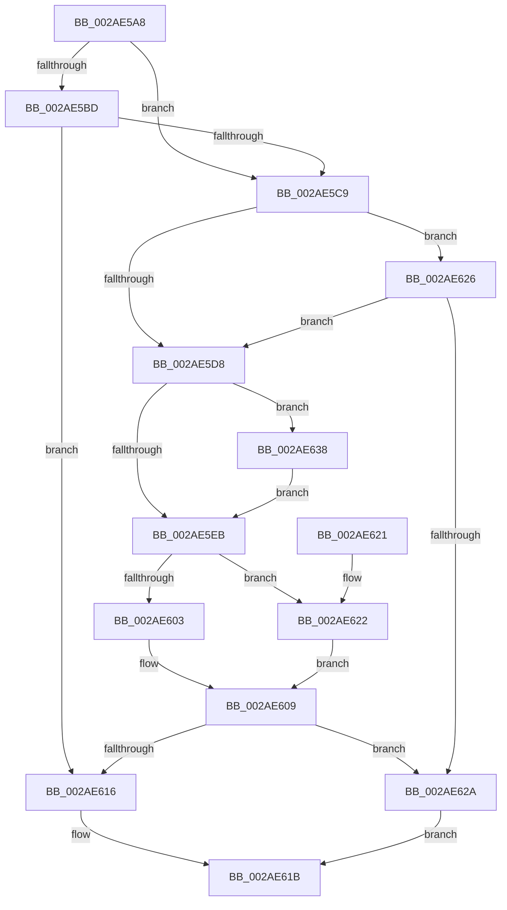

# MiProbePacketContended

- RVA: `0x002AE5A8`–`0x002AE641` (길이 `153` bytes)
- VA: `0x00000001402AE5A8`
- 실행 섹션: `.text`
- PDB 이름 있음: `예`; PDB Function 태그: `아니요`
- unwind 정보 RVA: `0x00065B84`
- 디코드: `47`개 명령, `153/153` bytes 표시
- 미해석 바이트: `0` (있으면 어셈블리에 `.byte`로 보존)

> 이 문서는 커널 이미지의 기계어와 PDB 기호를 분석해 생성했습니다. 4번과 5번은 함수 원형과 자료형을 바이너리 사용 방식에서 추정한 C 해석이며 원본 소스 복구 결과는 아닙니다.

## 1. Dependencies

- 직접 호출 지점: **2**; 고유 호출 대상: **2**
- 직접 호출자로 확인된 함수: **2**
- RIP 상대 이미지 참조: **1**

### Outgoing calls
- `0x002AE5C0` → [MiPageTableLockIsContended](MiPageTableLockIsContended_function_002AE650.md) (function, `0x002AE650`)
- `0x002AE62A` → [KeShouldYieldProcessor](../27/KeShouldYieldProcessor_function_002773E0.md) (function, `0x002773E0`)

### Direct callers
- [MiProbeAndLockPacket](../23/MiProbeAndLockPacket_function_0023BE20.md) at `0x0023C0B0`
- [MiProbeAndLockPacket](../23/MiProbeAndLockPacket_function_0023BE20.md) at `0x0023C0C2`
- [sub_0023F9E7](../23/Unknown_function_0023F9E7.md) at `0x0023FA25`

### Static image references
- `0x002AE5E2` → RVA `0x00E38840` (`.data`; read)

## 2. Other-region calls and transfers

- 다른 실행 섹션으로 향하는 call: **0**
- 별도 외부 분기/꼬리 이동을 확인하지 못했습니다.

## 3. Assembly (complete function range)

```asm
002AE5A8  40 53                           push rbx
002AE5AA  48 83 EC 20                     sub rsp, 0x20
002AE5AE  48 8B 51 28                     mov rdx, qword ptr [rcx + 0x28]
002AE5B2  4C 8D 59 68                     lea r11, [rcx + 0x68]
002AE5B6  33 DB                           xor ebx, ebx
002AE5B8  48 85 D2                        test rdx, rdx
002AE5BB  74 0C                           je 0x1402ae5c9
002AE5BD  49 8B 0B                        mov rcx, qword ptr [r11]
002AE5C0  E8 8B 00 00 00                  call 0x1402ae650
002AE5C5  85 C0                           test eax, eax
002AE5C7  75 4D                           jne 0x1402ae616
002AE5C9  49 8B 0B                        mov rcx, qword ptr [r11]
002AE5CC  8B 81 B8 00 00 00               mov eax, dword ptr [rcx + 0xb8]
002AE5D2  24 0F                           and al, 0xf
002AE5D4  3C 05                           cmp al, 5
002AE5D6  75 4E                           jne 0x1402ae626
002AE5D8  8B 81 B8 00 00 00               mov eax, dword ptr [rcx + 0xb8]
002AE5DE  24 0F                           and al, 0xf
002AE5E0  3C 01                           cmp al, 1
002AE5E2  48 8D 05 57 A2 B8 00            lea rax, [rip + 0xb8a257]
002AE5E9  75 4D                           jne 0x1402ae638
002AE5EB  48 8B 10                        mov rdx, qword ptr [rax]
002AE5EE  65 48 8B 04 25 20 00 00 00      mov rax, qword ptr gs:[0x20]
002AE5F7  48 8B 88 38 88 00 00            mov rcx, qword ptr [rax + 0x8838]
002AE5FE  48 85 C9                        test rcx, rcx
002AE601  74 1F                           je 0x1402ae622
002AE603  8B 81 44 01 00 00               mov eax, dword ptr [rcx + 0x144]
002AE609  48 C1 E0 06                     shl rax, 6
002AE60D  8B 04 10                        mov eax, dword ptr [rax + rdx]
002AE610  0F BA E0 1E                     bt eax, 0x1e
002AE614  73 14                           jae 0x1402ae62a
002AE616  B8 01 00 00 00                  mov eax, 1
002AE61B  48 83 C4 20                     add rsp, 0x20
002AE61F  5B                              pop rbx
002AE620  C3                              ret
002AE621  CC                              int3
002AE622  8B C3                           mov eax, ebx
002AE624  EB E3                           jmp 0x1402ae609
002AE626  3C 04                           cmp al, 4
002AE628  76 AE                           jbe 0x1402ae5d8
002AE62A  E8 B1 8D FC FF                  call 0x1402773e0
002AE62F  85 C0                           test eax, eax
002AE631  0F 95 C3                        setne bl
002AE634  8B C3                           mov eax, ebx
002AE636  EB E3                           jmp 0x1402ae61b
002AE638  48 8D 81 C0 00 00 00            lea rax, [rcx + 0xc0]
002AE63F  EB AA                           jmp 0x1402ae5eb
```

## 4. C-style interpretation (structured pseudocode)

```c
__int64 __fastcall MiProbePacketContended(__int64 a1)
{
    __int64 result;
    __int64 v_rbx;
    __int64 v_rsp;

    v_rsp = (v_rsp) - (32);
    v_rbx = 0;
    if (*(unsigned __int64 *)(a1 + 40) == 0) goto loc_002AE5C9;
    result = MiPageTableLockIsContended(*(unsigned __int64 *)(a1 + 104), *(unsigned __int64 *)(a1 + 40), a3, a4);
    if ((unsigned int)(result) != 0) goto loc_002AE616;
loc_002AE5C9:
    result = (unsigned __int8)(((unsigned int)(*(unsigned int *)(*(unsigned __int64 *)(a1 + 104) + 184))) & (15));
    if (((unsigned __int8)(result)) != 5) goto loc_002AE626;
loc_002AE5D8:
    result = (unsigned __int8)(((unsigned int)(*(unsigned int *)(*(unsigned __int64 *)(a1 + 104) + 184))) & (15));
    if (((unsigned __int8)(result)) != 1) goto loc_002AE638;
loc_002AE5EB:
    if (*(unsigned __int64 *)(*(unsigned __int64 *)(gs_base + (0 + 32)) + 34872) == 0) goto loc_002AE622;
loc_002AE609:
    result = ((unsigned int)(*(unsigned int *)(*(unsigned __int64 *)(*(unsigned __int64 *)(gs_base + (0 + 32)) + 34872) + 324))) << (6);
    if (condition_is_above_or_equal) goto loc_002AE62A;
loc_002AE616:
loc_002AE61B:
    v_rsp = (v_rsp) + (32);
    return 1;
loc_002AE622:
    goto loc_002AE609;
loc_002AE626:
    if (0 <= 4) goto loc_002AE5D8;
loc_002AE62A:
    result = KeShouldYieldProcessor(*(unsigned __int64 *)(*(unsigned __int64 *)(gs_base + (0 + 32)) + 34872), *(unsigned __int64 *)(v_rip + 12100183), a3, a4);
    v_rbx = ((unsigned int)(result) != 0) ? 1 : 0;
    goto loc_002AE61B;
loc_002AE638:
    goto loc_002AE5EB;
}
```

## 5. (Beta) C Style

```c
int64_t MiProbePacketContended(void *Arg1)
{
    uint8_t *arg1 = (uint8_t *)Arg1;

    int64_t result;
    int64_t local_rbx;
    int64_t local_rsp;

    local_rsp = (local_rsp) - (32);
    local_rbx = 0;
    if (*(uint64_t *)(arg1 + 0x28) == 0) goto loc_002AE5C9;
    result = MiPageTableLockIsContended(*(uint64_t *)(arg1 + 0x68), *(uint64_t *)(arg1 + 0x28), a3, a4);
    if ((uint32_t)(result) != 0) goto loc_002AE616;
loc_002AE5C9:
    result = (uint8_t)(((uint32_t)(*(uint32_t *)(*(uint64_t *)(arg1 + 0x68) + 0xB8))) & (15));
    if (((uint8_t)(result)) != 5) goto loc_002AE626;
loc_002AE5D8:
    result = (uint8_t)(((uint32_t)(*(uint32_t *)(*(uint64_t *)(arg1 + 0x68) + 0xB8))) & (15));
    if (((uint8_t)(result)) != 1) goto loc_002AE638;
loc_002AE5EB:
    if (*(uint64_t *)(*(uint64_t *)(gs_base + (0 + 0x20)) + 0x8838) == 0) goto loc_002AE622;
loc_002AE609:
    result = ((uint32_t)(*(uint32_t *)(*(uint64_t *)(*(uint64_t *)(gs_base + (0 + 0x20)) + 0x8838) + 0x144))) << (6);
    if (condition_is_above_or_equal) goto loc_002AE62A;
loc_002AE616:
loc_002AE61B:
    local_rsp = (local_rsp) + (32);
    return 1;
loc_002AE622:
    goto loc_002AE609;
loc_002AE626:
    if (0 <= 4) goto loc_002AE5D8;
loc_002AE62A:
    result = KeShouldYieldProcessor(*(uint64_t *)(*(uint64_t *)(gs_base + (0 + 0x20)) + 0x8838), *(uint64_t *)(v_rip + 0xB8A257), a3, a4);
    local_rbx = ((uint32_t)(result) != 0) ? 1 : 0;
    goto loc_002AE61B;
loc_002AE638:
    goto loc_002AE5EB;
}
```

### 관측된 메모리 오프셋

구조체 형식이 확인되지 않은 접근은 인자 기준의 오프셋으로만 기록했습니다.

| 기준 인자 | 오프셋 표현 | 폭 (bit) | 접근 |
|---|---:|---:|---|
| `Arg1` | `+ 0x0` | `64` | `R` |
| `Arg1` | `+ 0x28` | `64` | `R` |
| `Arg1` | `+ 0x68` | `64` | `R` |

## 6. Execution-region graph

[열기: 2D/3D 그래프와 함수 탐색 컨트롤 패널](../../../control-panel.html?section=text&rva=0x002AE5A8&view=graph)

- 2D 그래프는 위에서 아래로 흐르고, 3D 그래프는 빈 공간을 드래그해 회전합니다. Shift+드래그는 이동, 휠은 확대·축소, 함수 노드 선택은 대상 보고서 이동입니다.

### Static fallback


