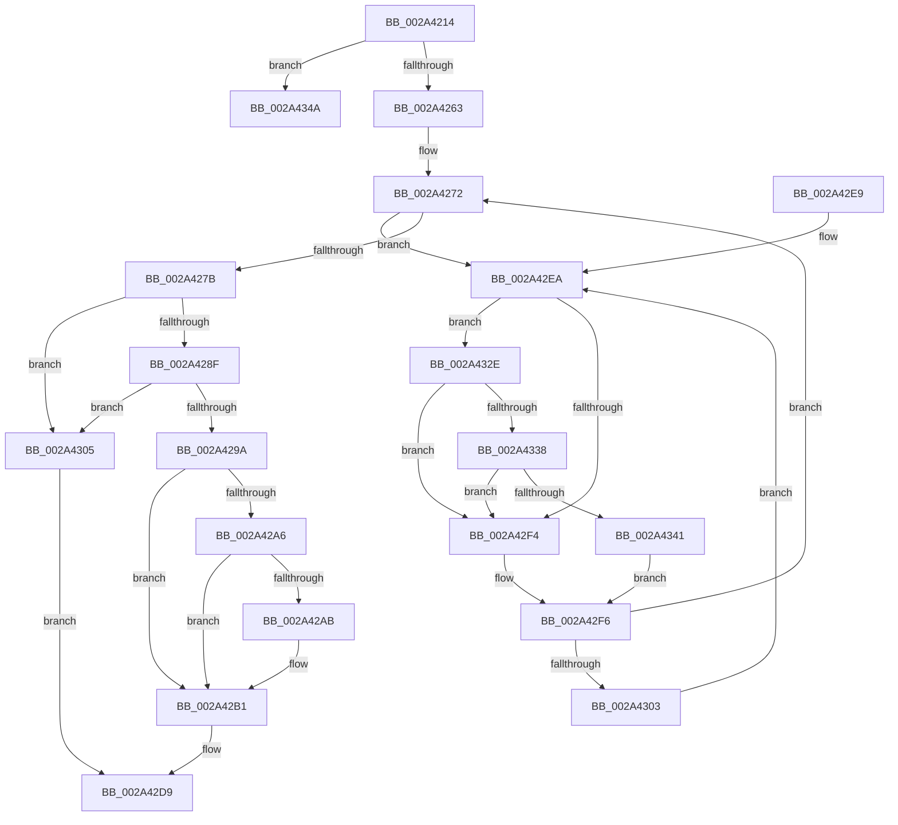

# MiReleaseInPageRefs

- RVA: `0x002A4214`–`0x002A4373` (길이 `351` bytes)
- VA: `0x00000001402A4214`
- 실행 섹션: `.text`
- PDB 이름 있음: `예`; PDB Function 태그: `아니요`
- unwind 정보 RVA: `0x000688A0`
- 디코드: `87`개 명령, `351/351` bytes 표시
- 미해석 바이트: `0` (있으면 어셈블리에 `.byte`로 보존)

> 이 문서는 커널 이미지의 기계어와 PDB 기호를 분석해 생성했습니다. 4번과 5번은 함수 원형과 자료형을 바이너리 사용 방식에서 추정한 C 해석이며 원본 소스 복구 결과는 아닙니다.

## 1. Dependencies

- 직접 호출 지점: **5**; 고유 호출 대상: **5**
- 직접 호출자로 확인된 함수: **1**
- RIP 상대 이미지 참조: **3**

### Outgoing calls
- `0x002A426B` → [MiLockAndDecrementShareCount](MiLockAndDecrementShareCount_function_002A2854.md) (function, `0x002A2854`)
- `0x002A42D4` → [MiDereferenceControlAreaPfnList](MiDereferenceControlAreaPfnList_function_002A45E8.md) (function, `0x002A45E8`)
- `0x002A4338` → [KiCheckVpBackingLongSpinWaitHypercall](../30/KiCheckVpBackingLongSpinWaitHypercall_function_0030F490.md) (function, `0x0030F490`)
- `0x002A4343` → [HvlNotifyLongSpinWait](../30/HvlNotifyLongSpinWait_function_0030F460.md) (function, `0x0030F460`)
- `0x002A436D` → [KeBugCheckEx](../4F/KeBugCheckEx_function_004FD660.md) (function, `0x004FD660`)

### Direct callers
- [MiInvalidateCollidedIos](../38/MiInvalidateCollidedIos_function_00386110.md) at `0x003861C1`
- [MiInvalidateCollidedIos](../38/MiInvalidateCollidedIos_function_00386110.md) at `0x00386313`
- [MiInvalidateCollidedIos](../38/MiInvalidateCollidedIos_function_00386110.md) at `0x0038637D`

### Static image references
- `0x002A429A` → RVA `0x00E2DC80` (`.data`; read)
- `0x002A42EC` → RVA `0x00FC52AC` (`ALMOSTRO`; reference)
- `0x002A432E` → RVA `0x00FC6AB8` (`ALMOSTRO`; read)

## 2. Other-region calls and transfers

- 다른 실행 섹션으로 향하는 call: **0**
- 별도 외부 분기/꼬리 이동을 확인하지 못했습니다.

## 3. Assembly (complete function range)

```asm
002A4214  48 89 5C 24 08                  mov qword ptr [rsp + 8], rbx
002A4219  48 89 74 24 10                  mov qword ptr [rsp + 0x10], rsi
002A421E  57                              push rdi
002A421F  48 83 EC 30                     sub rsp, 0x30
002A4223  48 8B 41 28                     mov rax, qword ptr [rcx + 0x28]
002A4227  48 8B D9                        mov rbx, rcx
002A422A  48 B9 FF FF FF FF FF 00 00 00   movabs rcx, 0xffffffffff
002A4234  48 23 C1                        and rax, rcx
002A4237  4C 8D 0C 40                     lea r9, [rax + rax*2]
002A423B  49 C1 E1 04                     shl r9, 4
002A423F  48 B8 00 00 00 00 00 DE FF FF   movabs rax, 0xffffde0000000000
002A4249  4C 03 C8                        add r9, rax
002A424C  48 BE 00 00 00 00 00 00 00 40   movabs rsi, 0x4000000000000000
002A4256  49 8B 41 18                     mov rax, qword ptr [r9 + 0x18]
002A425A  48 85 C6                        test rsi, rax
002A425D  0F 85 E7 00 00 00               jne 0x1402a434a
002A4263  BA 02 00 00 00                  mov edx, 2
002A4268  49 8B C9                        mov rcx, r9
002A426B  E8 E4 E5 FF FF                  call 0x1402a2854
002A4270  33 FF                           xor edi, edi
002A4272  F0 48 0F BA 6B 18 3F            lock bts qword ptr [rbx + 0x18], 0x3f
002A4279  72 6F                           jb 0x1402a42ea
002A427B  48 8B 43 18                     mov rax, qword ptr [rbx + 0x18]
002A427F  48 0B C6                        or rax, rsi
002A4282  48 89 43 18                     mov qword ptr [rbx + 0x18], rax
002A4286  48 8B 43 28                     mov rax, qword ptr [rbx + 0x28]
002A428A  48 85 C0                        test rax, rax
002A428D  79 76                           jns 0x1402a4305
002A428F  48 8B 4B 10                     mov rcx, qword ptr [rbx + 0x10]
002A4293  48 0F BA E1 0A                  bt rcx, 0xa
002A4298  73 6B                           jae 0x1402a4305
002A429A  48 8B 05 DF 99 B8 00            mov rax, qword ptr [rip + 0xb899df]
002A42A1  48 85 C0                        test rax, rax
002A42A4  74 0B                           je 0x1402a42b1
002A42A6  F6 C1 10                        test cl, 0x10
002A42A9  75 06                           jne 0x1402a42b1
002A42AB  48 F7 D0                        not rax
002A42AE  48 23 C8                        and rcx, rax
002A42B1  48 C1 F9 10                     sar rcx, 0x10
002A42B5  48 B8 FF FF FF FF FF FF FF 7F   movabs rax, 0x7fffffffffffffff
002A42BF  F0 48 21 43 18                  lock and qword ptr [rbx + 0x18], rax
002A42C4  41 B9 03 00 00 00               mov r9d, 3
002A42CA  48 8B D1                        mov rdx, rcx
002A42CD  48 8B 09                        mov rcx, qword ptr [rcx]
002A42D0  45 8D 41 FE                     lea r8d, [r9 - 2]
002A42D4  E8 0F 03 00 00                  call 0x1402a45e8
002A42D9  48 8B 5C 24 40                  mov rbx, qword ptr [rsp + 0x40]
002A42DE  48 8B 74 24 48                  mov rsi, qword ptr [rsp + 0x48]
002A42E3  48 83 C4 30                     add rsp, 0x30
002A42E7  5F                              pop rdi
002A42E8  C3                              ret
002A42E9  CC                              int3
002A42EA  FF C7                           inc edi
002A42EC  85 3D BA 0F D2 00               test dword ptr [rip + 0xd20fba], edi
002A42F2  74 3A                           je 0x1402a432e
002A42F4  F3 90                           pause
002A42F6  48 8B 43 18                     mov rax, qword ptr [rbx + 0x18]
002A42FA  48 85 C0                        test rax, rax
002A42FD  0F 89 6F FF FF FF               jns 0x1402a4272
002A4303  EB E5                           jmp 0x1402a42ea
002A4305  48 8B 43 10                     mov rax, qword ptr [rbx + 0x10]
002A4309  48 83 E0 FB                     and rax, 0xfffffffffffffffb
002A430D  48 89 43 10                     mov qword ptr [rbx + 0x10], rax
002A4311  48 8B 43 10                     mov rax, qword ptr [rbx + 0x10]
002A4315  48 83 E0 FD                     and rax, 0xfffffffffffffffd
002A4319  48 89 43 10                     mov qword ptr [rbx + 0x10], rax
002A431D  48 B8 FF FF FF FF FF FF FF 7F   movabs rax, 0x7fffffffffffffff
002A4327  F0 48 21 43 18                  lock and qword ptr [rbx + 0x18], rax
002A432C  EB AB                           jmp 0x1402a42d9
002A432E  8B 05 84 27 D2 00               mov eax, dword ptr [rip + 0xd22784]
002A4334  A8 40                           test al, 0x40
002A4336  74 BC                           je 0x1402a42f4
002A4338  E8 53 B1 06 00                  call 0x14030f490
002A433D  84 C0                           test al, al
002A433F  74 B3                           je 0x1402a42f4
002A4341  8B CF                           mov ecx, edi
002A4343  E8 18 B1 06 00                  call 0x14030f460
002A4348  EB AC                           jmp 0x1402a42f6
002A434A  49 8B 41 18                     mov rax, qword ptr [r9 + 0x18]
002A434E  48 B9 FF FF FF FF FF FF FF 3F   movabs rcx, 0x3fffffffffffffff
002A4358  48 23 C1                        and rax, rcx
002A435B  4C 8B C3                        mov r8, rbx
002A435E  B9 1A 00 00 00                  mov ecx, 0x1a
002A4363  48 89 44 24 20                  mov qword ptr [rsp + 0x20], rax
002A4368  BA 50 19 06 00                  mov edx, 0x61950
002A436D  E8 EE 92 25 00                  call 0x1404fd660
002A4372  CC                              int3
```

## 4. C-style interpretation (structured pseudocode)

```c
__int64 __fastcall MiReleaseInPageRefs(__int64 a1)
{
    __int64 result;
    __int64 v_rdi;
    __int64 v_rsp;
    unsigned __int64 v_stack_p10;
    unsigned __int64 v_stack_p20;
    unsigned __int64 v_stack_p8;

    v_stack_p8 = v_rbx;
    v_stack_p10 = v_rsi;
    v_rsp = (v_rsp) - (48);
    result = (*(unsigned __int64 *)(a1 + 40)) & (a1);
    a4 = (result + result * 2) << (4);
    a4 = (a4) + (result);
    if (((v_rsi) & (*(unsigned __int64 *)(a4 + 24))) != 0) goto loc_002A434A;
    result = MiLockAndDecrementShareCount(a4, 2, a3, a4);
    v_rdi = 0;
loc_002A4272:
    if (condition_is_below) goto loc_002A42EA;
    result = (*(unsigned __int64 *)(a1 + 24)) | (v_rsi);
    *(unsigned __int64 *)(a1 + 24) = result;
    if (!sign_flag) goto loc_002A4305;
    if (condition_is_above_or_equal) goto loc_002A4305;
    if (*(unsigned __int64 *)(v_rip + 12098015) == 0) goto loc_002A42B1;
    result = *(unsigned __int64 *)(v_rip + 12098015);
    if ((((unsigned __int8)(*(unsigned __int64 *)(a1 + 16))) & (16)) == 0) {
        result = ~(*(unsigned __int64 *)(v_rip + 12098015));
        a1 = (*(unsigned __int64 *)(a1 + 16)) & (result);
    }
    a1 = (a1) >> (16);
    result = MiDereferenceControlAreaPfnList(*(unsigned __int64 *)(a1), a1, 3 - 2, 3);
loc_002A42D9:
    v_rsp = (v_rsp) + (48);
    return result;
loc_002A42EA:
    v_rdi = (unsigned int)((v_rdi) + 1);
    if (((*(unsigned int *)(v_rip + 13766586)) & ((unsigned int)(v_rdi))) == 0) goto loc_002A432E;
loc_002A42F4:
loc_002A42F6:
    if (!sign_flag) goto loc_002A4272;
    goto loc_002A42EA;
loc_002A4305:
    result = (*(unsigned __int64 *)(v_stack_p8 + 16)) & (-5);
    *(unsigned __int64 *)(v_stack_p8 + 16) = result;
    result = (*(unsigned __int64 *)(v_stack_p8 + 16)) & (-3);
    *(unsigned __int64 *)(v_stack_p8 + 16) = result;
    goto loc_002A42D9;
loc_002A432E:
    if ((((unsigned __int8)((unsigned int)(*(unsigned int *)(v_rip + 13772676)))) & (64)) == 0) goto loc_002A42F4;
    result = KiCheckVpBackingLongSpinWaitHypercall(*(unsigned __int64 *)(a1), a1, 3 - 2, 3);
    if ((unsigned __int8)(result) == 0) goto loc_002A42F4;
    result = HvlNotifyLongSpinWait((unsigned int)((unsigned int)(v_rdi)), a1, 3 - 2, 3);
    goto loc_002A42F6;
loc_002A434A:
    result = (*(unsigned __int64 *)(3 + 24)) & ((unsigned int)((unsigned int)(v_rdi)));
    v_stack_p20 = result;
    result = KeBugCheckEx(26, (unsigned int)(0x61950ULL), v_stack_p8, 3);
    return result;
}
```

## 5. (Beta) C Style

```c
int64_t MiReleaseInPageRefs(void *Arg1)
{
    uint8_t *arg1 = (uint8_t *)Arg1;

    int64_t result;
    int64_t local_rdi;
    int64_t local_rsp;
    uint64_t v_stack_p10;
    uint64_t v_stack_p20;
    uint64_t v_stack_p8;

    v_stack_p8 = local_rbx;
    v_stack_p10 = local_rsi;
    local_rsp = (local_rsp) - (48);
    result = (*(uint64_t *)(arg1 + 0x28)) & (Arg1);
    a4 = (result + result * 2) << (4);
    a4 = (a4) + (result);
    if (((local_rsi) & (*(uint64_t *)(a4 + 0x18))) != 0) goto loc_002A434A;
    result = MiLockAndDecrementShareCount(a4, 2, a3, a4);
    local_rdi = 0;
loc_002A4272:
    if (condition_is_below) goto loc_002A42EA;
    result = (*(uint64_t *)(arg1 + 0x18)) | (local_rsi);
    *(uint64_t *)(arg1 + 0x18) = result;
    if (!sign_flag) goto loc_002A4305;
    if (condition_is_above_or_equal) goto loc_002A4305;
    if (*(uint64_t *)(v_rip + 0xB899DF) == 0) goto loc_002A42B1;
    result = *(uint64_t *)(v_rip + 0xB899DF);
    if ((((uint8_t)(*(uint64_t *)(arg1 + 0x10))) & (16)) == 0) {
        result = ~(*(uint64_t *)(v_rip + 0xB899DF));
        Arg1 = (*(uint64_t *)(arg1 + 0x10)) & (result);
    }
    Arg1 = (Arg1) >> (16);
    result = MiDereferenceControlAreaPfnList(*(uint64_t *)(arg1), Arg1, 3 - 2, 3);
loc_002A42D9:
    local_rsp = (local_rsp) + (48);
    return result;
loc_002A42EA:
    local_rdi = (uint32_t)((local_rdi) + 1);
    if (((*(uint32_t *)(v_rip + 0xD20FBA)) & ((uint32_t)(local_rdi))) == 0) goto loc_002A432E;
loc_002A42F4:
loc_002A42F6:
    if (!sign_flag) goto loc_002A4272;
    goto loc_002A42EA;
loc_002A4305:
    result = (*(uint64_t *)(v_stack_p8 + 0x10)) & (-5);
    *(uint64_t *)(v_stack_p8 + 0x10) = result;
    result = (*(uint64_t *)(v_stack_p8 + 0x10)) & (-3);
    *(uint64_t *)(v_stack_p8 + 0x10) = result;
    goto loc_002A42D9;
loc_002A432E:
    if ((((uint8_t)((uint32_t)(*(uint32_t *)(v_rip + 0xD22784)))) & (64)) == 0) goto loc_002A42F4;
    result = KiCheckVpBackingLongSpinWaitHypercall(*(uint64_t *)(arg1), Arg1, 3 - 2, 3);
    if ((uint8_t)(result) == 0) goto loc_002A42F4;
    result = HvlNotifyLongSpinWait((uint32_t)((uint32_t)(local_rdi)), Arg1, 3 - 2, 3);
    goto loc_002A42F6;
loc_002A434A:
    result = (*(uint64_t *)(3 + 0x18)) & ((uint32_t)((uint32_t)(local_rdi)));
    v_stack_p20 = result;
    result = KeBugCheckEx(26, (uint32_t)(0x61950ULL), v_stack_p8, 3);
    return result;
}
```

### 관측된 메모리 오프셋

구조체 형식이 확인되지 않은 접근은 인자 기준의 오프셋으로만 기록했습니다.

| 기준 인자 | 오프셋 표현 | 폭 (bit) | 접근 |
|---|---:|---:|---|
| `Arg1` | `+ 0x10` | `64` | `R` |
| `Arg1` | `+ 0x10` | `64` | `W` |
| `Arg1` | `+ 0x18` | `64` | `R` |
| `Arg1` | `+ 0x18` | `64` | `R/W` |
| `Arg1` | `+ 0x18` | `64` | `W` |
| `Arg1` | `+ 0x28` | `64` | `R` |

## 6. Execution-region graph

[열기: 2D/3D 그래프와 함수 탐색 컨트롤 패널](../../../control-panel.html?section=text&rva=0x002A4214&view=graph)

- 2D 그래프는 위에서 아래로 흐르고, 3D 그래프는 빈 공간을 드래그해 회전합니다. Shift+드래그는 이동, 휠은 확대·축소, 함수 노드 선택은 대상 보고서 이동입니다.

### Static fallback


