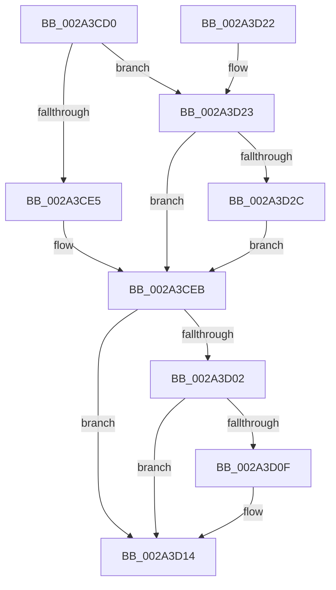

# MiReleaseLoadLock

- RVA: `0x002A3CD0`–`0x002A3D39` (길이 `105` bytes)
- VA: `0x00000001402A3CD0`
- 실행 섹션: `.text`
- PDB 이름 있음: `예`; PDB Function 태그: `아니요`
- unwind 정보 RVA: `0x00068804`
- 디코드: `28`개 명령, `105/105` bytes 표시
- 미해석 바이트: `0` (있으면 어셈블리에 `.byte`로 보존)

> 이 문서는 커널 이미지의 기계어와 PDB 기호를 분석해 생성했습니다. 4번과 5번은 함수 원형과 자료형을 바이너리 사용 방식에서 추정한 C 해석이며 원본 소스 복구 결과는 아닙니다.

## 1. Dependencies

- 직접 호출 지점: **3**; 고유 호출 대상: **3**
- 직접 호출자로 확인된 함수: **6**
- RIP 상대 이미지 참조: **3**

### Outgoing calls
- `0x002A3CF2` → [ExReleaseResourceLite](../25/ExReleaseResourceLite_function_0025FA10.md) (function, `0x0025FA10`)
- `0x002A3D0F` → [KiCheckForKernelApcDelivery](../2E/KiCheckForKernelApcDelivery_function_002E2C80.md) (function, `0x002E2C80`)
- `0x002A3D17` → [KeLeaveCriticalRegionThread](../25/KeLeaveCriticalRegionThread_function_0025EFF0.md) (function, `0x0025EFF0`)

### Direct callers
- [MiUnlockLoadedDataTableEntry](MiUnlockLoadedDataTableEntry_function_002A385C.md) at `0x002A387E`
- [MmUnlockLoadedDataTableEntry](MmUnlockLoadedDataTableEntry_function_002A3C98.md) at `0x002A3CB3`
- [MmReleaseLoadLockShared](MmReleaseLoadLockShared_function_002A3FB0.md) at `0x002A3FBB`
- [MmUnlockLoadedDataTableEntryShared](../4B/MmUnlockLoadedDataTableEntryShared_function_004BE49C.md) at `0x004BE4BA`
- [MmReleaseLoadLock](../4D/MmReleaseLoadLock_function_004D36D0.md) at `0x004D36DE`
- [sub_005AB06E](../5A/Unknown_function_005AB06E.md) at `0x005AB079`

### Static image references
- `0x002A3CEB` → RVA `0x00EF54E0` (`.data`; read)
- `0x002A3D23` → RVA `0x00E2D918` (`.data`; read/write)
- `0x002A3D2C` → RVA `0x00E2D910` (`.data`; write)

## 2. Other-region calls and transfers

- 다른 실행 섹션으로 향하는 call: **0**
- 별도 외부 분기/꼬리 이동을 확인하지 못했습니다.

## 3. Assembly (complete function range)

```asm
002A3CD0  40 53                           push rbx
002A3CD2  48 83 EC 20                     sub rsp, 0x20
002A3CD6  66 FF 89 E6 01 00 00            dec word ptr [rcx + 0x1e6]
002A3CDD  48 8B D9                        mov rbx, rcx
002A3CE0  90                              nop
002A3CE1  85 D2                           test edx, edx
002A3CE3  75 3E                           jne 0x1402a3d23
002A3CE5  FF 89 B0 05 00 00               dec dword ptr [rcx + 0x5b0]
002A3CEB  48 8D 0D EE 17 C5 00            lea rcx, [rip + 0xc517ee]
002A3CF2  E8 19 BD FB FF                  call 0x14025fa10
002A3CF7  90                              nop
002A3CF8  66 83 83 E6 01 00 00 01         add word ptr [rbx + 0x1e6], 1
002A3D00  75 12                           jne 0x1402a3d14
002A3D02  48 8D 83 98 00 00 00            lea rax, [rbx + 0x98]
002A3D09  90                              nop
002A3D0A  48 39 00                        cmp qword ptr [rax], rax
002A3D0D  74 05                           je 0x1402a3d14
002A3D0F  E8 6C EF 03 00                  call 0x1402e2c80
002A3D14  48 8B CB                        mov rcx, rbx
002A3D17  E8 D4 B2 FB FF                  call 0x14025eff0
002A3D1C  48 83 C4 20                     add rsp, 0x20
002A3D20  5B                              pop rbx
002A3D21  C3                              ret
002A3D22  CC                              int3
002A3D23  83 05 EE 9B B8 00 FF            add dword ptr [rip + 0xb89bee], -1
002A3D2A  75 BF                           jne 0x1402a3ceb
002A3D2C  48 C7 05 D9 9B B8 00 00 00 00 00  mov qword ptr [rip + 0xb89bd9], 0
002A3D37  EB B2                           jmp 0x1402a3ceb
```

## 4. C-style interpretation (structured pseudocode)

```c
__int64 __fastcall MiReleaseLoadLock(__int64 a1, int a2)
{
    __int64 result;
    __int64 v_rsp;

    v_rsp = (v_rsp) - (32);
    if (a2 != 0) goto loc_002A3D23;
loc_002A3CEB:
    result = ExReleaseResourceLite(v_rip + 12916718, a2, a3, a4);
    if (a2 != 0) goto loc_002A3D14;
    result = a1 + 152;
    if ((*(unsigned __int64 *)(a1 + 152)) != (a1 + 152)) {
        result = KiCheckForKernelApcDelivery(v_rip + 12916718, a2, a3, a4);
    }
    result = KeLeaveCriticalRegionThread(a1, a2, a3, a4);
    v_rsp = (v_rsp) + (32);
    return result;
loc_002A3D23:
    if (condition_is_not_equal) goto loc_002A3CEB;
    *(unsigned __int64 *)(v_rip + 12098521) = 0;
    goto loc_002A3CEB;
}
```

## 5. (Beta) C Style

```c
int64_t MiReleaseLoadLock(void *Arg1, int32_t Arg2)
{
    uint8_t *arg1 = (uint8_t *)Arg1;

    int64_t result;
    int64_t local_rsp;

    local_rsp = (local_rsp) - (32);
    if (Arg2 != 0) goto loc_002A3D23;
loc_002A3CEB:
    result = ExReleaseResourceLite(v_rip + 12916718, Arg2, a3, a4);
    if (Arg2 != 0) goto loc_002A3D14;
    result = Arg1 + 152;
    if ((*(uint64_t *)(arg1 + 0x98)) != (Arg1 + 152)) {
        result = KiCheckForKernelApcDelivery(v_rip + 12916718, Arg2, a3, a4);
    }
    result = KeLeaveCriticalRegionThread(Arg1, Arg2, a3, a4);
    local_rsp = (local_rsp) + (32);
    return result;
loc_002A3D23:
    if (condition_is_not_equal) goto loc_002A3CEB;
    *(uint64_t *)(v_rip + 0xB89BD9) = 0;
    goto loc_002A3CEB;
}
```

### 관측된 메모리 오프셋

구조체 형식이 확인되지 않은 접근은 인자 기준의 오프셋으로만 기록했습니다.

| 기준 인자 | 오프셋 표현 | 폭 (bit) | 접근 |
|---|---:|---:|---|
| `Arg1` | `+ 0x0` | `64` | `R` |
| `Arg1` | `+ 0x98` | `64` | `R` |
| `Arg1` | `+ 0x1E6` | `16` | `R/W` |
| `Arg1` | `+ 0x5B0` | `32` | `R/W` |

## 6. Execution-region graph

[열기: 2D/3D 그래프와 함수 탐색 컨트롤 패널](../../../control-panel.html?section=text&rva=0x002A3CD0&view=graph)

- 2D 그래프는 위에서 아래로 흐르고, 3D 그래프는 빈 공간을 드래그해 회전합니다. Shift+드래그는 이동, 휠은 확대·축소, 함수 노드 선택은 대상 보고서 이동입니다.

### Static fallback


