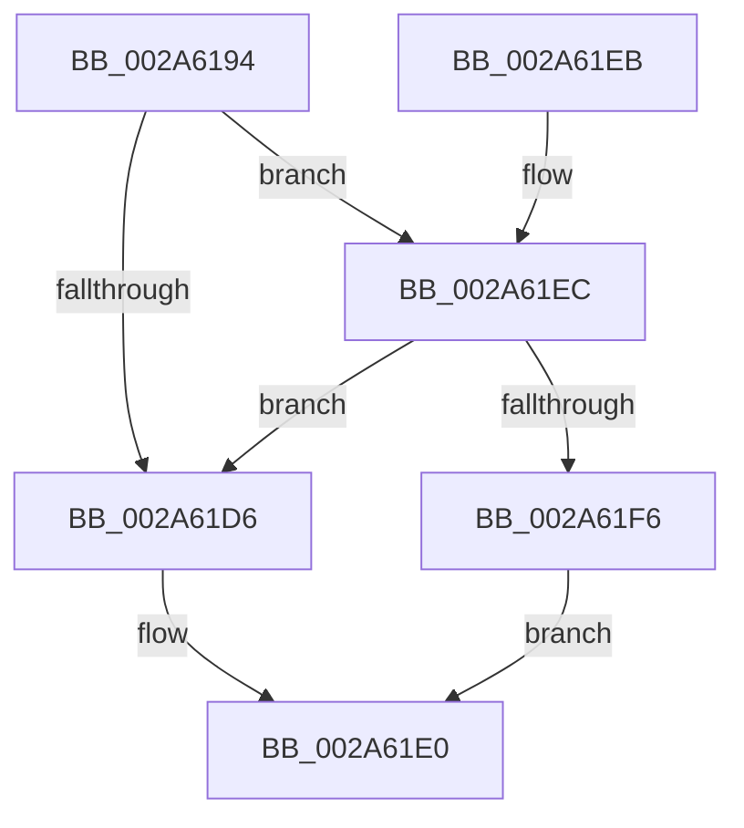

# MiRemoveUnusedSubsection

- RVA: `0x002A6194`–`0x002A6209` (길이 `117` bytes)
- VA: `0x00000001402A6194`
- 실행 섹션: `.text`
- PDB 이름 있음: `예`; PDB Function 태그: `아니요`
- unwind 정보 RVA: `0x00068A5C`
- 디코드: `28`개 명령, `117/117` bytes 표시
- 미해석 바이트: `0` (있으면 어셈블리에 `.byte`로 보존)

> 이 문서는 커널 이미지의 기계어와 PDB 기호를 분석해 생성했습니다. 4번과 5번은 함수 원형과 자료형을 바이너리 사용 방식에서 추정한 C 해석이며 원본 소스 복구 결과는 아닙니다.

## 1. Dependencies

- 직접 호출 지점: **3**; 고유 호출 대상: **3**
- 직접 호출자로 확인된 함수: **2**
- RIP 상대 이미지 참조: **3**

### Outgoing calls
- `0x002A61C0` → [ExAcquireSpinLockExclusiveAtDpcLevel](../24/ExAcquireSpinLockExclusiveAtDpcLevel_function_00248E80.md) (function, `0x00248E80`)
- `0x002A61C8` → [MiUnlinkUnusedSubsection](../24/MiUnlinkUnusedSubsection_function_002496F4.md) (function, `0x002496F4`)
- `0x002A6202` → [ExpReleaseSpinLockExclusiveFromDpcLevelInstrumented](../2C/ExpReleaseSpinLockExclusiveFromDpcLevelInstrumented_function_002C0F44.md) (function, `0x002C0F44`)

### Direct callers
- [MiDereferenceControlAreaPfnList](MiDereferenceControlAreaPfnList_function_002A45E8.md) at `0x002A46E5`
- [sub_00371EF8](../37/Unknown_function_00371EF8.md) at `0x00371F18`

### Static image references
- `0x002A61A8` → RVA `0x00E30088` (`.data`; read)
- `0x002A61CD` → RVA `0x00FC6B06` (`ALMOSTRO`; read)
- `0x002A61EC` → RVA `0x00F0DE58` (`.data`; read)

## 2. Other-region calls and transfers

- 다른 실행 섹션으로 향하는 call: **0**
- 별도 외부 분기/꼬리 이동을 확인하지 못했습니다.

## 3. Assembly (complete function range)

```asm
002A6194  48 89 5C 24 08                  mov qword ptr [rsp + 8], rbx
002A6199  57                              push rdi
002A619A  48 83 EC 20                     sub rsp, 0x20
002A619E  48 8B 01                        mov rax, qword ptr [rcx]
002A61A1  48 8B D9                        mov rbx, rcx
002A61A4  0F B7 50 3C                     movzx edx, word ptr [rax + 0x3c]
002A61A8  48 8B 05 D9 9E B8 00            mov rax, qword ptr [rip + 0xb89ed9]
002A61AF  81 E2 FF 03 00 00               and edx, 0x3ff
002A61B5  48 8B 3C D0                     mov rdi, qword ptr [rax + rdx*8]
002A61B9  48 8D 8F C0 06 00 00            lea rcx, [rdi + 0x6c0]
002A61C0  E8 BB 2C FA FF                  call 0x140248e80
002A61C5  48 8B CB                        mov rcx, rbx
002A61C8  E8 27 35 FA FF                  call 0x1402496f4
002A61CD  F6 05 32 09 D2 00 01            test byte ptr [rip + 0xd20932], 1
002A61D4  75 16                           jne 0x1402a61ec
002A61D6  C7 87 C0 06 00 00 00 00 00 00   mov dword ptr [rdi + 0x6c0], 0
002A61E0  48 8B 5C 24 30                  mov rbx, qword ptr [rsp + 0x30]
002A61E5  48 83 C4 20                     add rsp, 0x20
002A61E9  5F                              pop rdi
002A61EA  C3                              ret
002A61EB  CC                              int3
002A61EC  8B 05 66 7C C6 00               mov eax, dword ptr [rip + 0xc67c66]
002A61F2  85 C0                           test eax, eax
002A61F4  75 E0                           jne 0x1402a61d6
002A61F6  48 8B 54 24 28                  mov rdx, qword ptr [rsp + 0x28]
002A61FB  48 8D 8F C0 06 00 00            lea rcx, [rdi + 0x6c0]
002A6202  E8 3D AD 01 00                  call 0x1402c0f44
002A6207  EB D7                           jmp 0x1402a61e0
```

## 4. C-style interpretation (structured pseudocode)

```c
__int64 __fastcall MiRemoveUnusedSubsection(__int64 a1)
{
    __int64 result;
    __int64 v_rsp;
    unsigned __int64 v_stack_p28;
    unsigned __int64 v_stack_p8;

    v_stack_p8 = v_rbx;
    v_rsp = (v_rsp) - (32);
    a2 = (unsigned int)((*(unsigned __int16 *)(*(unsigned __int64 *)(a1) + 60)) & (0x3FFULL));
    result = ExAcquireSpinLockExclusiveAtDpcLevel(*(unsigned __int64 *)(*(unsigned __int64 *)(v_rip + 12099289) + a2 * 8) + 1728, a2, a3, a4);
    result = MiUnlinkUnusedSubsection(a1, a2, a3, a4);
    if (((*(unsigned __int8 *)(v_rip + 13764914)) & (1)) != 0) goto loc_002A61EC;
loc_002A61D6:
    *(unsigned int *)(*(unsigned __int64 *)(*(unsigned __int64 *)(v_rip + 12099289) + a2 * 8) + 1728) = 0;
loc_002A61E0:
    v_rsp = (v_rsp) + (32);
    return result;
loc_002A61EC:
    if ((unsigned int)((unsigned int)(*(unsigned int *)(v_rip + 13007974))) != 0) goto loc_002A61D6;
    result = ExpReleaseSpinLockExclusiveFromDpcLevelInstrumented(*(unsigned __int64 *)(*(unsigned __int64 *)(v_rip + 12099289) + a2 * 8) + 1728, v_stack_p28, a3, a4);
    goto loc_002A61E0;
}
```

## 5. (Beta) C Style

```c
int64_t MiRemoveUnusedSubsection(void *Arg1)
{
    uint8_t *arg1 = (uint8_t *)Arg1;

    int64_t result;
    int64_t local_rsp;
    uint64_t v_stack_p28;
    uint64_t v_stack_p8;

    v_stack_p8 = local_rbx;
    local_rsp = (local_rsp) - (32);
    a2 = (uint32_t)((*(uint16_t *)(*(uint64_t *)(arg1) + 0x3C)) & (0x3FFULL));
    result = ExAcquireSpinLockExclusiveAtDpcLevel(*(uint64_t *)(*(uint64_t *)(v_rip + 0xB89ED9) + a2 * 8) + 1728, a2, a3, a4);
    result = MiUnlinkUnusedSubsection(Arg1, a2, a3, a4);
    if (((*(uint8_t *)(v_rip + 0xD20932)) & (1)) != 0) goto loc_002A61EC;
loc_002A61D6:
    *(uint32_t *)(*(uint64_t *)(*(uint64_t *)(v_rip + 0xB89ED9) + a2 * 8) + 0x6C0) = 0;
loc_002A61E0:
    local_rsp = (local_rsp) + (32);
    return result;
loc_002A61EC:
    if ((uint32_t)((uint32_t)(*(uint32_t *)(v_rip + 0xC67C66))) != 0) goto loc_002A61D6;
    result = ExpReleaseSpinLockExclusiveFromDpcLevelInstrumented(*(uint64_t *)(*(uint64_t *)(v_rip + 0xB89ED9) + a2 * 8) + 1728, v_stack_p28, a3, a4);
    goto loc_002A61E0;
}
```

### 관측된 메모리 오프셋

구조체 형식이 확인되지 않은 접근은 인자 기준의 오프셋으로만 기록했습니다.

| 기준 인자 | 오프셋 표현 | 폭 (bit) | 접근 |
|---|---:|---:|---|
| `Arg1` | `+ 0x0` | `64` | `R` |

## 6. Execution-region graph

[열기: 2D/3D 그래프와 함수 탐색 컨트롤 패널](../../../control-panel.html?section=text&rva=0x002A6194&view=graph)

- 2D 그래프는 위에서 아래로 흐르고, 3D 그래프는 빈 공간을 드래그해 회전합니다. Shift+드래그는 이동, 휠은 확대·축소, 함수 노드 선택은 대상 보고서 이동입니다.

### Static fallback


