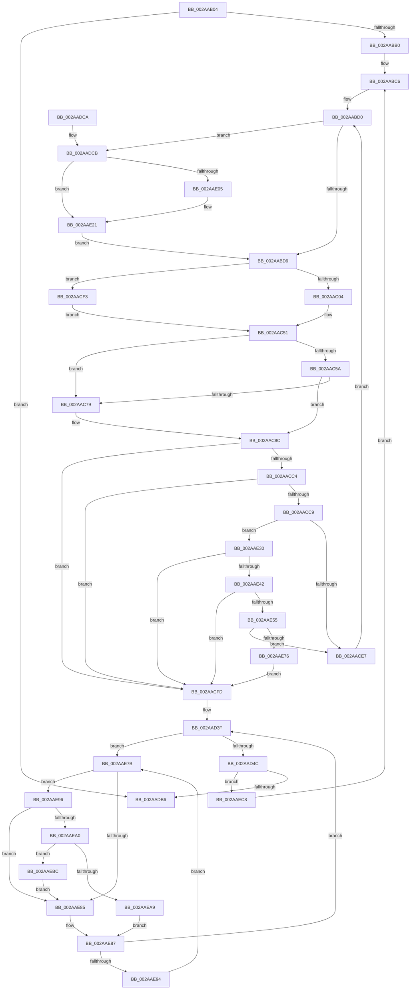

# MiReplaceRotateWithDemandZeroNoCopy

- RVA: `0x002AAB04`–`0x002AAF0E` (길이 `1,034` bytes)
- VA: `0x00000001402AAB04`
- 실행 섹션: `.text`
- PDB 이름 있음: `예`; PDB Function 태그: `아니요`
- unwind 정보 RVA: `0x0006D000`
- 디코드: `240`개 명령, `1,034/1,034` bytes 표시
- 미해석 바이트: `0` (있으면 어셈블리에 `.byte`로 보존)

> 이 문서는 커널 이미지의 기계어와 PDB 기호를 분석해 생성했습니다. 4번과 5번은 함수 원형과 자료형을 바이너리 사용 방식에서 추정한 C 해석이며 원본 소스 복구 결과는 아닙니다.

## 1. Dependencies

- 직접 호출 지점: **21**; 고유 호출 대상: **17**
- 직접 호출자로 확인된 함수: **1**
- RIP 상대 이미지 참조: **3**

### Outgoing calls
- `0x002AAB99` → [MiLockWorkingSetShared](../27/MiLockWorkingSetShared_function_0027CBF0.md) (function, `0x0027CBF0`)
- `0x002AABF6` → [MiUnmapFrameBuffer](MiUnmapFrameBuffer_function_002AAF14.md) (function, `0x002AAF14`)
- `0x002AAC04` → [MiGetProcessorFlushList](../24/MiGetProcessorFlushList_function_00242C90.md) (function, `0x00242C90`)
- `0x002AAC26` → [MiInitializeTbFlushList](../29/MiInitializeTbFlushList_function_00294F00.md) (function, `0x00294F00`)
- `0x002AAC4C` → [MiInitializeTbFlushList](../29/MiInitializeTbFlushList_function_00294F00.md) (function, `0x00294F00`)
- `0x002AAC87` → [MiInsertTbFlushEntry](../29/MiInsertTbFlushEntry_function_00293670.md) (function, `0x00293670`)
- `0x002AACAB` → [MiInsertTbFlushEntry](../29/MiInsertTbFlushEntry_function_00293670.md) (function, `0x00293670`)
- `0x002AAD00` → [MiFlushTbList](../31/MiFlushTbList_function_00311FC0.md) (function, `0x00311FC0`)
- `0x002AAD0A` → [MiDereferenceIoPageRuns](MiDereferenceIoPageRuns_function_002AB08C.md) (function, `0x002AB08C`)
- `0x002AAD0F` → [MiReleaseProcessorFlushList](../31/MiReleaseProcessorFlushList_function_00313C70.md) (function, `0x00313C70`)
- `0x002AAD97` → [MiUnlockPageTable](../21/MiUnlockPageTable_function_00216EC0.md) (function, `0x00216EC0`)
- `0x002AADA8` → [MiUnlockWorkingSetShared](../27/MiUnlockWorkingSetShared_function_0027D690.md) (function, `0x0027D690`)
- `0x002AADEB` → [MiLockNestedPageTable](../23/MiLockNestedPageTable_function_0023E890.md) (function, `0x0023E890`)
- `0x002AADFB` → [MiUnlockOpportunisticPagesInPageTable](MiUnlockOpportunisticPagesInPageTable_function_002AA88C.md) (function, `0x002AA88C`)
- `0x002AAE10` → [MiUnlockOpportunisticPagesInPageTable](MiUnlockOpportunisticPagesInPageTable_function_002AA88C.md) (function, `0x002AA88C`)
- `0x002AAE35` → [MiWorkingSetIsContended](MiWorkingSetIsContended_function_002AE520.md) (function, `0x002AE520`)
- `0x002AAE48` → [MiPageTableLockIsContended](MiPageTableLockIsContended_function_002AE650.md) (function, `0x002AE650`)
- `0x002AAE55` → [KeShouldYieldProcessor](../27/KeShouldYieldProcessor_function_002773E0.md) (function, `0x002773E0`)
- `0x002AAEA0` → [KiCheckVpBackingLongSpinWaitHypercall](../30/KiCheckVpBackingLongSpinWaitHypercall_function_0030F490.md) (function, `0x0030F490`)
- `0x002AAEAB` → [HvlNotifyLongSpinWait](../30/HvlNotifyLongSpinWait_function_0030F460.md) (function, `0x0030F460`)
- `0x002AAEFA` → [MiLockWorkingSetShared](../27/MiLockWorkingSetShared_function_0027CBF0.md) (function, `0x0027CBF0`)

### Direct callers
- [MmRotatePhysicalView](../../page/A3/MmRotatePhysicalView_function_00A37FE0.md) at `0x00A3813A`

### Static image references
- `0x002AAC51` → RVA `0x00E2DCE0` (`.data`; read)
- `0x002AAE7D` → RVA `0x00FC52AC` (`ALMOSTRO`; reference)
- `0x002AAE96` → RVA `0x00FC6AB8` (`ALMOSTRO`; read)

## 2. Other-region calls and transfers

- 다른 실행 섹션으로 향하는 call: **0**
- 별도 외부 분기/꼬리 이동을 확인하지 못했습니다.

## 3. Assembly (complete function range)

```asm
002AAB04  44 89 4C 24 20                  mov dword ptr [rsp + 0x20], r9d
002AAB09  48 89 4C 24 08                  mov qword ptr [rsp + 8], rcx
002AAB0E  53                              push rbx
002AAB0F  55                              push rbp
002AAB10  56                              push rsi
002AAB11  57                              push rdi
002AAB12  41 54                           push r12
002AAB14  41 55                           push r13
002AAB16  41 56                           push r14
002AAB18  41 57                           push r15
002AAB1A  48 83 EC 58                     sub rsp, 0x58
002AAB1E  48 8B FA                        mov rdi, rdx
002AAB21  48 B9 00 00 00 00 80 F6 FF FF   movabs rcx, 0xfffff68000000000
002AAB2B  33 D2                           xor edx, edx
002AAB2D  48 C1 EF 09                     shr rdi, 9
002AAB31  48 89 54 24 38                  mov qword ptr [rsp + 0x38], rdx
002AAB36  33 DB                           xor ebx, ebx
002AAB38  89 94 24 B0 00 00 00            mov dword ptr [rsp + 0xb0], edx
002AAB3F  4D 8B E0                        mov r12, r8
002AAB42  48 BA F8 FF FF FF 7F 00 00 00   movabs rdx, 0x7ffffffff8
002AAB4C  48 89 5C 24 40                  mov qword ptr [rsp + 0x40], rbx
002AAB51  48 23 FA                        and rdi, rdx
002AAB54  45 33 ED                        xor r13d, r13d
002AAB57  45 33 FF                        xor r15d, r15d
002AAB5A  48 8B C1                        mov rax, rcx
002AAB5D  49 C1 EC 09                     shr r12, 9
002AAB61  48 03 F8                        add rdi, rax
002AAB64  4C 23 E2                        and r12, rdx
002AAB67  48 8B C1                        mov rax, rcx
002AAB6A  48 8B F7                        mov rsi, rdi
002AAB6D  4C 03 E0                        add r12, rax
002AAB70  48 C1 EE 09                     shr rsi, 9
002AAB74  48 23 F2                        and rsi, rdx
002AAB77  48 8B C1                        mov rax, rcx
002AAB7A  48 03 F0                        add rsi, rax
002AAB7D  33 ED                           xor ebp, ebp
002AAB7F  65 48 8B 04 25 88 01 00 00      mov rax, qword ptr gs:[0x188]
002AAB88  4C 8B B0 B8 00 00 00            mov r14, qword ptr [rax + 0xb8]
002AAB8F  49 81 C6 00 04 00 00            add r14, 0x400
002AAB96  49 8B CE                        mov rcx, r14
002AAB99  E8 52 20 FD FF                  call 0x14027cbf0
002AAB9E  88 84 24 A8 00 00 00            mov byte ptr [rsp + 0xa8], al
002AABA5  8A D8                           mov bl, al
002AABA7  49 3B FC                        cmp rdi, r12
002AABAA  0F 87 06 02 00 00               ja 0x1402aadb6
002AABB0  48 B9 00 00 00 00 80 F6 FF FF   movabs rcx, 0xfffff68000000000
002AABBA  48 8B C1                        mov rax, rcx
002AABBD  48 C1 E0 19                     shl rax, 0x19
002AABC1  48 89 44 24 48                  mov qword ptr [rsp + 0x48], rax
002AABC6  48 B8 FF FF FF FF FF 00 00 00   movabs rax, 0xffffffffff
002AABD0  48 85 ED                        test rbp, rbp
002AABD3  0F 84 F2 01 00 00               je 0x1402aadcb
002AABD9  48 8B 1F                        mov rbx, qword ptr [rdi]
002AABDC  48 8B D7                        mov rdx, rdi
002AABDF  44 8B 84 24 B8 00 00 00         mov r8d, dword ptr [rsp + 0xb8]
002AABE7  48 8B 8C 24 A0 00 00 00         mov rcx, qword ptr [rsp + 0xa0]
002AABEF  48 C1 EB 0C                     shr rbx, 0xc
002AABF3  48 23 D8                        and rbx, rax
002AABF6  E8 19 03 00 00                  call 0x1402aaf14
002AABFB  4D 85 ED                        test r13, r13
002AABFE  0F 85 EF 00 00 00               jne 0x1402aacf3
002AAC04  E8 87 80 F9 FF                  call 0x140242c90
002AAC09  45 33 C9                        xor r9d, r9d
002AAC0C  48 89 44 24 40                  mov qword ptr [rsp + 0x40], rax
002AAC11  49 8B D6                        mov rdx, r14
002AAC14  C7 44 24 20 01 00 00 00         mov dword ptr [rsp + 0x20], 1
002AAC1C  48 8B C8                        mov rcx, rax
002AAC1F  4C 8B E8                        mov r13, rax
002AAC22  44 8B 40 0C                     mov r8d, dword ptr [rax + 0xc]
002AAC26  E8 D5 A2 FE FF                  call 0x140294f00
002AAC2B  48 8D 89 28 10 00 00            lea rcx, [rcx + 0x1028]
002AAC32  C7 44 24 20 01 00 00 00         mov dword ptr [rsp + 0x20], 1
002AAC3A  44 8B 41 0C                     mov r8d, dword ptr [rcx + 0xc]
002AAC3E  41 B9 18 00 00 00               mov r9d, 0x18
002AAC44  49 8B D6                        mov rdx, r14
002AAC47  48 89 4C 24 38                  mov qword ptr [rsp + 0x38], rcx
002AAC4C  E8 AF A2 FE FF                  call 0x140294f00
002AAC51  48 3B 1D 88 30 B8 00            cmp rbx, qword ptr [rip + 0xb83088]
002AAC58  77 1F                           ja 0x1402aac79
002AAC5A  48 8D 04 5B                     lea rax, [rbx + rbx*2]
002AAC5E  48 03 C0                        add rax, rax
002AAC61  48 BA 28 00 00 00 00 DE FF FF   movabs rdx, 0xffffde0000000028
002AAC6B  48 8B 04 C2                     mov rax, qword ptr [rdx + rax*8]
002AAC6F  48 C1 E8 36                     shr rax, 0x36
002AAC73  0F BA E0 00                     bt eax, 0
002AAC77  72 13                           jb 0x1402aac8c
002AAC79  45 33 C9                        xor r9d, r9d
002AAC7C  48 C1 E3 0C                     shl rbx, 0xc
002AAC80  48 8B D3                        mov rdx, rbx
002AAC83  45 8D 41 01                     lea r8d, [r9 + 1]
002AAC87  E8 E4 89 FE FF                  call 0x140293670
002AAC8C  48 8B 5C 24 40                  mov rbx, qword ptr [rsp + 0x40]
002AAC91  45 33 C9                        xor r9d, r9d
002AAC94  48 8B D7                        mov rdx, rdi
002AAC97  48 8B CB                        mov rcx, rbx
002AAC9A  48 C1 E2 19                     shl rdx, 0x19
002AAC9E  48 2B 54 24 48                  sub rdx, qword ptr [rsp + 0x48]
002AACA3  48 C1 FA 10                     sar rdx, 0x10
002AACA7  45 8D 41 01                     lea r8d, [r9 + 1]
002AACAB  E8 C0 89 FE FF                  call 0x140293670
002AACB0  FF 84 24 B0 00 00 00            inc dword ptr [rsp + 0xb0]
002AACB7  48 83 C7 08                     add rdi, 8
002AACBB  48 F7 C7 FF 0F 00 00            test rdi, 0xfff
002AACC2  74 39                           je 0x1402aacfd
002AACC4  49 3B FC                        cmp rdi, r12
002AACC7  77 34                           ja 0x1402aacfd
002AACC9  48 B9 00 00 00 00 80 F6 FF FF   movabs rcx, 0xfffff68000000000
002AACD3  48 B8 FF FF FF FF FF 00 00 00   movabs rax, 0xffffffffff
002AACDD  40 F6 C7 78                     test dil, 0x78
002AACE1  0F 84 49 01 00 00               je 0x1402aae30
002AACE7  8A 9C 24 A8 00 00 00            mov bl, byte ptr [rsp + 0xa8]
002AACEE  E9 DD FE FF FF                  jmp 0x1402aabd0
002AACF3  48 8B 4C 24 38                  mov rcx, qword ptr [rsp + 0x38]
002AACF8  E9 54 FF FF FF                  jmp 0x1402aac51
002AACFD  48 8B CB                        mov rcx, rbx
002AAD00  E8 BB 72 06 00                  call 0x140311fc0
002AAD05  48 8B 54 24 38                  mov rdx, qword ptr [rsp + 0x38]
002AAD0A  E8 7D 03 00 00                  call 0x1402ab08c
002AAD0F  E8 5C 8F 06 00                  call 0x140313c70
002AAD14  48 8B 06                        mov rax, qword ptr [rsi]
002AAD17  48 B9 FF FF FF FF FF 00 00 00   movabs rcx, 0xffffffffff
002AAD21  48 C1 E8 0C                     shr rax, 0xc
002AAD25  45 33 ED                        xor r13d, r13d
002AAD28  48 23 C1                        and rax, rcx
002AAD2B  48 8D 1C 40                     lea rbx, [rax + rax*2]
002AAD2F  48 C1 E3 04                     shl rbx, 4
002AAD33  33 F6                           xor esi, esi
002AAD35  49 B9 18 00 00 00 00 DE FF FF   movabs r9, 0xffffde0000000018
002AAD3F  F0 4A 0F BA 2C 0B 3F            lock bts qword ptr [rbx + r9], 0x3f
002AAD46  0F 82 2F 01 00 00               jb 0x1402aae7b
002AAD4C  4A 8B 04 0B                     mov rax, qword ptr [rbx + r9]
002AAD50  8B 94 24 B0 00 00 00            mov edx, dword ptr [rsp + 0xb0]
002AAD57  4C 8B C0                        mov r8, rax
002AAD5A  4C 2B C2                        sub r8, rdx
002AAD5D  49 8B C8                        mov rcx, r8
002AAD60  48 33 C8                        xor rcx, rax
002AAD63  48 B8 00 00 00 00 00 00 00 C0   movabs rax, 0xc000000000000000
002AAD6D  48 23 C8                        and rcx, rax
002AAD70  49 33 C8                        xor rcx, r8
002AAD73  48 B8 00 00 00 00 00 DE FF FF   movabs rax, 0xffffde0000000000
002AAD7D  48 89 4C 03 18                  mov qword ptr [rbx + rax + 0x18], rcx
002AAD82  48 B8 FF FF FF FF FF FF FF 7F   movabs rax, 0x7fffffffffffffff
002AAD8C  F0 4A 21 04 0B                  lock and qword ptr [rbx + r9], rax
002AAD91  48 8B D5                        mov rdx, rbp
002AAD94  49 8B CE                        mov rcx, r14
002AAD97  E8 24 C1 F6 FF                  call 0x140216ec0
002AAD9C  8A 9C 24 A8 00 00 00            mov bl, byte ptr [rsp + 0xa8]
002AADA3  49 8B CE                        mov rcx, r14
002AADA6  8A D3                           mov dl, bl
002AADA8  E8 E3 28 FD FF                  call 0x14027d690
002AADAD  49 3B FC                        cmp rdi, r12
002AADB0  0F 86 12 01 00 00               jbe 0x1402aaec8
002AADB6  41 8B C7                        mov eax, r15d
002AADB9  48 83 C4 58                     add rsp, 0x58
002AADBD  41 5F                           pop r15
002AADBF  41 5E                           pop r14
002AADC1  41 5D                           pop r13
002AADC3  41 5C                           pop r12
002AADC5  5F                              pop rdi
002AADC6  5E                              pop rsi
002AADC7  5D                              pop rbp
002AADC8  5B                              pop rbx
002AADC9  C3                              ret
002AADCA  CC                              int3
002AADCB  48 8B EF                        mov rbp, rdi
002AADCE  48 B8 F8 FF FF FF 7F 00 00 00   movabs rax, 0x7ffffffff8
002AADD8  48 C1 ED 09                     shr rbp, 9
002AADDC  48 23 E8                        and rbp, rax
002AADDF  48 8B C1                        mov rax, rcx
002AADE2  48 03 E8                        add rbp, rax
002AADE5  49 8B CE                        mov rcx, r14
002AADE8  48 8B D5                        mov rdx, rbp
002AADEB  E8 A0 3A F9 FF                  call 0x14023e890
002AADF0  4D 8B CC                        mov r9, r12
002AADF3  4C 8B C7                        mov r8, rdi
002AADF6  8A D3                           mov dl, bl
002AADF8  49 8B CE                        mov rcx, r14
002AADFB  E8 8C FA FF FF                  call 0x1402aa88c
002AAE00  45 85 FF                        test r15d, r15d
002AAE03  75 1C                           jne 0x1402aae21
002AAE05  4D 8B CC                        mov r9, r12
002AAE08  4C 8B C7                        mov r8, rdi
002AAE0B  B2 11                           mov dl, 0x11
002AAE0D  49 8B CE                        mov rcx, r14
002AAE10  E8 77 FA FF FF                  call 0x1402aa88c
002AAE15  48 85 C0                        test rax, rax
002AAE18  B9 19 00 00 40                  mov ecx, 0x40000019
002AAE1D  44 0F 45 F9                     cmovne r15d, ecx
002AAE21  48 B8 FF FF FF FF FF 00 00 00   movabs rax, 0xffffffffff
002AAE2B  E9 A9 FD FF FF                  jmp 0x1402aabd9
002AAE30  33 D2                           xor edx, edx
002AAE32  49 8B CE                        mov rcx, r14
002AAE35  E8 E6 36 00 00                  call 0x1402ae520
002AAE3A  85 C0                           test eax, eax
002AAE3C  0F 85 BB FE FF FF               jne 0x1402aacfd
002AAE42  48 8B D5                        mov rdx, rbp
002AAE45  49 8B CE                        mov rcx, r14
002AAE48  E8 03 38 00 00                  call 0x1402ae650
002AAE4D  85 C0                           test eax, eax
002AAE4F  0F 85 A8 FE FF FF               jne 0x1402aacfd
002AAE55  E8 86 C5 FC FF                  call 0x1402773e0
002AAE5A  85 C0                           test eax, eax
002AAE5C  48 B9 00 00 00 00 80 F6 FF FF   movabs rcx, 0xfffff68000000000
002AAE66  48 B8 FF FF FF FF FF 00 00 00   movabs rax, 0xffffffffff
002AAE70  0F 84 71 FE FF FF               je 0x1402aace7
002AAE76  E9 82 FE FF FF                  jmp 0x1402aacfd
002AAE7B  FF C6                           inc esi
002AAE7D  85 35 29 A4 D1 00               test dword ptr [rip + 0xd1a429], esi
002AAE83  74 11                           je 0x1402aae96
002AAE85  F3 90                           pause
002AAE87  4A 8B 04 0B                     mov rax, qword ptr [rbx + r9]
002AAE8B  48 85 C0                        test rax, rax
002AAE8E  0F 89 AB FE FF FF               jns 0x1402aad3f
002AAE94  EB E5                           jmp 0x1402aae7b
002AAE96  8B 05 1C BC D1 00               mov eax, dword ptr [rip + 0xd1bc1c]
002AAE9C  A8 40                           test al, 0x40
002AAE9E  74 E5                           je 0x1402aae85
002AAEA0  E8 EB 45 06 00                  call 0x14030f490
002AAEA5  84 C0                           test al, al
002AAEA7  74 13                           je 0x1402aaebc
002AAEA9  8B CE                           mov ecx, esi
002AAEAB  E8 B0 45 06 00                  call 0x14030f460
002AAEB0  49 B9 18 00 00 00 00 DE FF FF   movabs r9, 0xffffde0000000018
002AAEBA  EB CB                           jmp 0x1402aae87
002AAEBC  49 B9 18 00 00 00 00 DE FF FF   movabs r9, 0xffffde0000000018
002AAEC6  EB BD                           jmp 0x1402aae85
002AAEC8  48 B8 F8 FF FF FF 7F 00 00 00   movabs rax, 0x7ffffffff8
002AAED2  48 8B F7                        mov rsi, rdi
002AAED5  48 C1 EE 09                     shr rsi, 9
002AAED9  48 23 F0                        and rsi, rax
002AAEDC  48 B8 00 00 00 00 80 F6 FF FF   movabs rax, 0xfffff68000000000
002AAEE6  48 8B C0                        mov rax, rax
002AAEE9  33 D2                           xor edx, edx
002AAEEB  48 03 F0                        add rsi, rax
002AAEEE  33 ED                           xor ebp, ebp
002AAEF0  89 94 24 B0 00 00 00            mov dword ptr [rsp + 0xb0], edx
002AAEF7  49 8B CE                        mov rcx, r14
002AAEFA  E8 F1 1C FD FF                  call 0x14027cbf0
002AAEFF  48 B9 00 00 00 00 80 F6 FF FF   movabs rcx, 0xfffff68000000000
002AAF09  E9 B8 FC FF FF                  jmp 0x1402aabc6
```

## 4. C-style interpretation (structured pseudocode)

```c
__int64 __fastcall MiReplaceRotateWithDemandZeroNoCopy(__int64 a1, __int64 a2, __int64 a3, int a4)
{
    __int64 result;
    __int64 v_r12;
    __int64 v_r13;
    __int64 v_r14;
    __int64 v_r15;
    __int64 v_rbp;
    __int64 v_rbx;
    __int64 v_rdi;
    __int64 v_rsi;
    __int64 v_rsp;
    unsigned __int64 v_stack_m50;
    unsigned __int64 v_stack_m58;
    unsigned __int64 v_stack_m60;
    unsigned int v_stack_m78;
    unsigned __int8 v_stack_p10;
    unsigned int v_stack_p18;
    unsigned int v_stack_p20;
    unsigned __int64 v_stack_p8;
    unsigned int v_stack_pB0;

    v_stack_p20 = a4;
    v_stack_p8 = a1;
    v_rsp = (v_rsp) - (88);
    a2 = 0;
    v_rdi = (a2) >> (9);
    v_stack_m60 = 0;
    v_rbx = 0;
    v_stack_p18 = 0;
    v_stack_m58 = 0;
    v_rdi = (v_rdi) & (0);
    v_r13 = 0;
    v_r15 = 0;
    v_r12 = (a3) >> (9);
    v_rdi = (v_rdi) + (a1);
    v_r12 = (v_r12) & (0);
    v_r12 = (v_r12) + (a1);
    v_rsi = (v_rdi) >> (9);
    v_rsi = (v_rsi) & (0);
    v_rsi = (v_rsi) + (a1);
    v_rbp = 0;
    v_r14 = (*(unsigned __int64 *)(*(unsigned __int64 *)(gs_base + (0 + 392)) + 184)) + (0x400ULL);
    result = MiLockWorkingSetShared(v_r14, a2, a3, a4);
    v_stack_p10 = (unsigned __int8)(result);
    if (v_rdi > v_r12) goto loc_002AADB6;
    result = (v_r14) << (25);
    v_stack_m50 = result;
loc_002AABC6:
loc_002AABD0:
    if (0 == 0) goto loc_002AADCB;
loc_002AABD9:
    v_rbx = (*(unsigned __int64 *)(v_rdi)) >> (12);
    v_rbx = (v_rbx) & (result);
    result = MiUnmapFrameBuffer(v_stack_p8, v_rdi, (unsigned int)(v_stack_p20), a4);
    if (0 != 0) goto loc_002AACF3;
    result = MiGetProcessorFlushList(v_stack_p8, v_rdi, (unsigned int)(v_stack_p20), a4);
    a4 = 0;
    v_stack_m58 = result;
    v_stack_m78 = 1;
    result = MiInitializeTbFlushList(result, v_r14, (unsigned int)(*(unsigned int *)(result + 12)), a4);
    v_stack_m78 = 1;
    v_stack_m60 = result + 4136;
    result = MiInitializeTbFlushList(result + 4136, v_r14, (unsigned int)(*(unsigned int *)(result + 4136 + 12)), 24);
loc_002AAC51:
    if (v_rbx > (*(unsigned __int64 *)(v_rip + 12071048))) goto loc_002AAC79;
    result = (v_rbx + v_rbx * 2) + (v_rbx + v_rbx * 2);
    result = (*(unsigned __int64 *)(v_r14 + result * 8)) >> (54);
    if (!(condition_is_below)) {
        a4 = 0;
        v_rbx = (v_rbx) << (12);
        a2 = v_rbx;
        a3 = a4 + 1;
        result = MiInsertTbFlushEntry(result + 4136, a2, a3, a4);
    }
    a4 = 0;
    a2 = (v_rdi) << (25);
    a2 = (a2) - (v_stack_m50);
    a2 = (a2) >> (16);
    result = MiInsertTbFlushEntry(v_stack_m58, a2, a4 + 1, a4);
    v_rdi = (v_rdi) + (8);
    if (((v_rdi) & (0xFFFULL)) == 0) goto loc_002AACFD;
    if (v_rdi > v_r12) goto loc_002AACFD;
    if ((((unsigned __int8)(v_rdi)) & (120)) == 0) goto loc_002AAE30;
loc_002AACE7:
    goto loc_002AABD0;
loc_002AACF3:
    goto loc_002AAC51;
loc_002AACFD:
    result = MiFlushTbList(v_stack_p10, a2, a4 + 1, a4);
    result = MiDereferenceIoPageRuns(v_stack_p10, v_stack_m60, a4 + 1, a4);
    result = MiReleaseProcessorFlushList(v_stack_p10, v_stack_m60, a4 + 1, a4);
    result = (*(unsigned __int64 *)(v_rsi)) >> (12);
    v_r13 = 0;
    result = (result) & (v_stack_p10);
    v_rbx = (result + result * 2) << (4);
    v_rsi = 0;
loc_002AAD3F:
    if (condition_is_below) goto loc_002AAE7B;
    a3 = (*(unsigned __int64 *)(v_rbx + a4 * 1)) - ((unsigned int)(v_stack_p18));
    a1 = (a3) ^ (*(unsigned __int64 *)(v_rbx + a4 * 1));
    a1 = (a1) & (*(unsigned __int64 *)(v_rbx + a4 * 1));
    a1 = (a1) ^ (a3);
    *(unsigned __int64 *)(v_rbx + *(unsigned __int64 *)(v_rbx + a4 * 1) * 1 + 24) = a1;
    result = MiUnlockPageTable(v_r14, 0, a3, a4);
    result = MiUnlockWorkingSetShared(v_r14, (unsigned __int8)(v_stack_p10), a3, a4);
    if (v_rdi <= v_r12) goto loc_002AAEC8;
loc_002AADB6:
    v_rsp = (v_rsp) + (88);
    return 0;
loc_002AADCB:
    v_rbp = (v_rdi) >> (9);
    v_rbp = (v_rbp) & (0);
    v_rbp = (v_rbp) + (v_r14);
    result = MiLockNestedPageTable(v_r14, v_rbp, a3, a4);
    result = MiUnlockOpportunisticPagesInPageTable(v_r14, (unsigned __int8)(v_stack_p10), v_rdi, v_r12);
    if (0 == 0) {
        a4 = v_r12;
        a3 = v_rdi;
        a2 = 17;
        a1 = v_r14;
        result = MiUnlockOpportunisticPagesInPageTable(a1, a2, a3, a4);
        a1 = 0x40000019ULL;
        if (result != 0) { v_r15 = (unsigned int)(a1); }
    }
    goto loc_002AABD9;
loc_002AAE30:
    a2 = 0;
    result = MiWorkingSetIsContended(v_r14, a2, a3, a4);
    if ((unsigned int)(result) != 0) goto loc_002AACFD;
    result = MiPageTableLockIsContended(v_r14, v_rbp, a3, a4);
    if ((unsigned int)(result) != 0) goto loc_002AACFD;
    result = KeShouldYieldProcessor(v_r14, v_rbp, a3, a4);
    if ((unsigned int)(result) == 0) goto loc_002AACE7;
    goto loc_002AACFD;
loc_002AAE7B:
    v_rsi = (unsigned int)((v_rsi) + 1);
    if (((*(unsigned int *)(v_rip + 13739049)) & ((unsigned int)(v_rsi))) == 0) goto loc_002AAE96;
loc_002AAE85:
loc_002AAE87:
    if (!sign_flag) goto loc_002AAD3F;
    goto loc_002AAE7B;
loc_002AAE96:
    if ((((unsigned __int8)((unsigned int)(*(unsigned int *)(v_rip + 13745180)))) & (64)) == 0) goto loc_002AAE85;
    result = KiCheckVpBackingLongSpinWaitHypercall(v_r14, v_rbp, a3, a4);
    if ((unsigned __int8)(result) == 0) goto loc_002AAEBC;
    result = HvlNotifyLongSpinWait((unsigned int)((unsigned int)(v_rsi)), v_rbp, a3, a4);
    goto loc_002AAE87;
loc_002AAEBC:
    goto loc_002AAE85;
loc_002AAEC8:
    v_rsi = (v_rdi) >> (9);
    v_rsi = (v_rsi) & (result);
    a2 = 0;
    v_rsi = (v_rsi) + (result);
    v_rbp = 0;
    v_stack_pB0 = 0;
    result = MiLockWorkingSetShared(v_r14, a2, a3, a4);
    goto loc_002AABC6;
}
```

## 5. (Beta) C Style

```c
int64_t MiReplaceRotateWithDemandZeroNoCopy(int64_t Arg1, int64_t Arg2, int64_t Arg3, int32_t Arg4)
{
    int64_t result;
    int64_t local_r12;
    int64_t local_r13;
    int64_t local_r14;
    int64_t local_r15;
    int64_t local_rbp;
    int64_t local_rbx;
    int64_t local_rdi;
    int64_t local_rsi;
    int64_t local_rsp;
    uint64_t v_stack_m50;
    uint64_t v_stack_m58;
    uint64_t v_stack_m60;
    uint32_t v_stack_m78;
    uint8_t v_stack_p10;
    uint32_t v_stack_p18;
    uint32_t v_stack_p20;
    uint64_t v_stack_p8;
    uint32_t v_stack_pB0;

    v_stack_p20 = Arg4;
    v_stack_p8 = Arg1;
    local_rsp = (local_rsp) - (88);
    Arg2 = 0;
    local_rdi = (Arg2) >> (9);
    v_stack_m60 = 0;
    local_rbx = 0;
    v_stack_p18 = 0;
    v_stack_m58 = 0;
    local_rdi = (local_rdi) & (0);
    local_r13 = 0;
    local_r15 = 0;
    local_r12 = (Arg3) >> (9);
    local_rdi = (local_rdi) + (Arg1);
    local_r12 = (local_r12) & (0);
    local_r12 = (local_r12) + (Arg1);
    local_rsi = (local_rdi) >> (9);
    local_rsi = (local_rsi) & (0);
    local_rsi = (local_rsi) + (Arg1);
    local_rbp = 0;
    local_r14 = (*(uint64_t *)(*(uint64_t *)(gs_base + (0 + 0x188)) + 0xB8)) + (0x400ULL);
    result = MiLockWorkingSetShared(local_r14, Arg2, Arg3, Arg4);
    v_stack_p10 = (uint8_t)(result);
    if (local_rdi > local_r12) goto loc_002AADB6;
    result = (local_r14) << (25);
    v_stack_m50 = result;
loc_002AABC6:
loc_002AABD0:
    if (0 == 0) goto loc_002AADCB;
loc_002AABD9:
    local_rbx = (*(uint64_t *)(local_rdi)) >> (12);
    local_rbx = (local_rbx) & (result);
    result = MiUnmapFrameBuffer(v_stack_p8, local_rdi, (uint32_t)(v_stack_p20), Arg4);
    if (0 != 0) goto loc_002AACF3;
    result = MiGetProcessorFlushList(v_stack_p8, local_rdi, (uint32_t)(v_stack_p20), Arg4);
    Arg4 = 0;
    v_stack_m58 = result;
    v_stack_m78 = 1;
    result = MiInitializeTbFlushList(result, local_r14, (uint32_t)(*(uint32_t *)(result + 0xC)), Arg4);
    v_stack_m78 = 1;
    v_stack_m60 = result + 4136;
    result = MiInitializeTbFlushList(result + 4136, local_r14, (uint32_t)(*(uint32_t *)(result + 0x1028 + 0xC)), 24);
loc_002AAC51:
    if (local_rbx > (*(uint64_t *)(v_rip + 0xB83088))) goto loc_002AAC79;
    result = (local_rbx + local_rbx * 2) + (local_rbx + local_rbx * 2);
    result = (*(uint64_t *)(local_r14 + result * 8)) >> (54);
    if (!(condition_is_below)) {
        Arg4 = 0;
        local_rbx = (local_rbx) << (12);
        Arg2 = local_rbx;
        Arg3 = Arg4 + 1;
        result = MiInsertTbFlushEntry(result + 4136, Arg2, Arg3, Arg4);
    }
    Arg4 = 0;
    Arg2 = (local_rdi) << (25);
    Arg2 = (Arg2) - (v_stack_m50);
    Arg2 = (Arg2) >> (16);
    result = MiInsertTbFlushEntry(v_stack_m58, Arg2, Arg4 + 1, Arg4);
    local_rdi = (local_rdi) + (8);
    if (((local_rdi) & (0xFFFULL)) == 0) goto loc_002AACFD;
    if (local_rdi > local_r12) goto loc_002AACFD;
    if ((((uint8_t)(local_rdi)) & (120)) == 0) goto loc_002AAE30;
loc_002AACE7:
    goto loc_002AABD0;
loc_002AACF3:
    goto loc_002AAC51;
loc_002AACFD:
    result = MiFlushTbList(v_stack_p10, Arg2, Arg4 + 1, Arg4);
    result = MiDereferenceIoPageRuns(v_stack_p10, v_stack_m60, Arg4 + 1, Arg4);
    result = MiReleaseProcessorFlushList(v_stack_p10, v_stack_m60, Arg4 + 1, Arg4);
    result = (*(uint64_t *)(local_rsi)) >> (12);
    local_r13 = 0;
    result = (result) & (v_stack_p10);
    local_rbx = (result + result * 2) << (4);
    local_rsi = 0;
loc_002AAD3F:
    if (condition_is_below) goto loc_002AAE7B;
    Arg3 = (*(uint64_t *)(local_rbx + Arg4 * 1)) - ((uint32_t)(v_stack_p18));
    Arg1 = (Arg3) ^ (*(uint64_t *)(local_rbx + Arg4 * 1));
    Arg1 = (Arg1) & (*(uint64_t *)(local_rbx + Arg4 * 1));
    Arg1 = (Arg1) ^ (Arg3);
    *(uint64_t *)(local_rbx + *(uint64_t *)(local_rbx + Arg4 * 1) * 1 + 0x18) = Arg1;
    result = MiUnlockPageTable(local_r14, 0, Arg3, Arg4);
    result = MiUnlockWorkingSetShared(local_r14, (uint8_t)(v_stack_p10), Arg3, Arg4);
    if (local_rdi <= local_r12) goto loc_002AAEC8;
loc_002AADB6:
    local_rsp = (local_rsp) + (88);
    return 0;
loc_002AADCB:
    local_rbp = (local_rdi) >> (9);
    local_rbp = (local_rbp) & (0);
    local_rbp = (local_rbp) + (local_r14);
    result = MiLockNestedPageTable(local_r14, local_rbp, Arg3, Arg4);
    result = MiUnlockOpportunisticPagesInPageTable(local_r14, (uint8_t)(v_stack_p10), local_rdi, local_r12);
    if (0 == 0) {
        Arg4 = local_r12;
        Arg3 = local_rdi;
        Arg2 = 17;
        Arg1 = local_r14;
        result = MiUnlockOpportunisticPagesInPageTable(Arg1, Arg2, Arg3, Arg4);
        Arg1 = 0x40000019ULL;
        if (result != 0) { local_r15 = (uint32_t)(Arg1); }
    }
    goto loc_002AABD9;
loc_002AAE30:
    Arg2 = 0;
    result = MiWorkingSetIsContended(local_r14, Arg2, Arg3, Arg4);
    if ((uint32_t)(result) != 0) goto loc_002AACFD;
    result = MiPageTableLockIsContended(local_r14, local_rbp, Arg3, Arg4);
    if ((uint32_t)(result) != 0) goto loc_002AACFD;
    result = KeShouldYieldProcessor(local_r14, local_rbp, Arg3, Arg4);
    if ((uint32_t)(result) == 0) goto loc_002AACE7;
    goto loc_002AACFD;
loc_002AAE7B:
    local_rsi = (uint32_t)((local_rsi) + 1);
    if (((*(uint32_t *)(v_rip + 0xD1A429)) & ((uint32_t)(local_rsi))) == 0) goto loc_002AAE96;
loc_002AAE85:
loc_002AAE87:
    if (!sign_flag) goto loc_002AAD3F;
    goto loc_002AAE7B;
loc_002AAE96:
    if ((((uint8_t)((uint32_t)(*(uint32_t *)(v_rip + 0xD1BC1C)))) & (64)) == 0) goto loc_002AAE85;
    result = KiCheckVpBackingLongSpinWaitHypercall(local_r14, local_rbp, Arg3, Arg4);
    if ((uint8_t)(result) == 0) goto loc_002AAEBC;
    result = HvlNotifyLongSpinWait((uint32_t)((uint32_t)(local_rsi)), local_rbp, Arg3, Arg4);
    goto loc_002AAE87;
loc_002AAEBC:
    goto loc_002AAE85;
loc_002AAEC8:
    local_rsi = (local_rdi) >> (9);
    local_rsi = (local_rsi) & (result);
    Arg2 = 0;
    local_rsi = (local_rsi) + (result);
    local_rbp = 0;
    v_stack_pB0 = 0;
    result = MiLockWorkingSetShared(local_r14, Arg2, Arg3, Arg4);
    goto loc_002AABC6;
}
```

## 6. Execution-region graph

[열기: 2D/3D 그래프와 함수 탐색 컨트롤 패널](../../../control-panel.html?section=text&rva=0x002AAB04&view=graph)

- 2D 그래프는 위에서 아래로 흐르고, 3D 그래프는 빈 공간을 드래그해 회전합니다. Shift+드래그는 이동, 휠은 확대·축소, 함수 노드 선택은 대상 보고서 이동입니다.

### Static fallback


