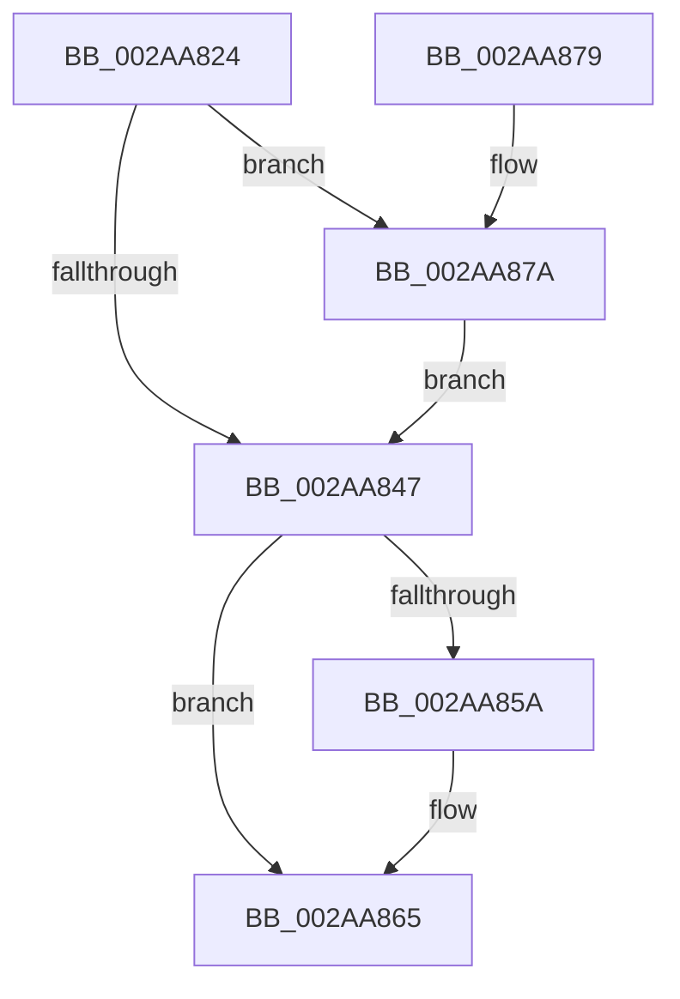

# MiReturnPfnReferenceCount

- RVA: `0x002AA824`–`0x002AA883` (길이 `95` bytes)
- VA: `0x00000001402AA824`
- 실행 섹션: `.text`
- PDB 이름 있음: `예`; PDB Function 태그: `아니요`
- unwind 정보 RVA: `0x00060BE4`
- 디코드: `28`개 명령, `95/95` bytes 표시
- 미해석 바이트: `0` (있으면 어셈블리에 `.byte`로 보존)

> 이 문서는 커널 이미지의 기계어와 PDB 기호를 분석해 생성했습니다. 4번과 5번은 함수 원형과 자료형을 바이너리 사용 방식에서 추정한 C 해석이며 원본 소스 복구 결과는 아닙니다.

## 1. Dependencies

- 직접 호출 지점: **3**; 고유 호출 대상: **3**
- 직접 호출자로 확인된 함수: **2**
- RIP 상대 이미지 참조: **1**

### Outgoing calls
- `0x002AA84A` → [MiReturnPfnReferenceCountAtDpc](../36/MiReturnPfnReferenceCountAtDpc_function_00364010.md) (function, `0x00364010`)
- `0x002AA860` → [KiLowerIrqlProcessIrqlFlags](../4F/KiLowerIrqlProcessIrqlFlags_function_004F5698.md) (function, `0x004F5698`)
- `0x002AA87C` → [KiRaiseIrqlProcessIrqlFlags](../4F/KiRaiseIrqlProcessIrqlFlags_function_004F56FC.md) (function, `0x004F56FC`)

### Direct callers
- [MiInitializeNewImageSectionProtos](MiInitializeNewImageSectionProtos_function_002ABB80.md) at `0x002ABD02`
- [MiDeleteImageCreationMdls](../../page/98/MiDeleteImageCreationMdls_function_009884FC.md) at `0x009885A2`

### Static image references
- `0x002AA83E` → RVA `0x00FC6D20` (`ALMOSTRO`; read)

## 2. Other-region calls and transfers

- 다른 실행 섹션으로 향하는 call: **0**
- 별도 외부 분기/꼬리 이동을 확인하지 못했습니다.

## 3. Assembly (complete function range)

```asm
002AA824  48 89 5C 24 08                  mov qword ptr [rsp + 8], rbx
002AA829  57                              push rdi
002AA82A  48 83 EC 20                     sub rsp, 0x20
002AA82E  48 8B F9                        mov rdi, rcx
002AA831  44 0F 20 C3                     mov rbx, cr8
002AA835  BA 02 00 00 00                  mov edx, 2
002AA83A  44 0F 22 C2                     mov cr8, rdx
002AA83E  83 3D DB C4 D1 00 00            cmp dword ptr [rip + 0xd1c4db], 0
002AA845  75 33                           jne 0x1402aa87a
002AA847  48 8B CF                        mov rcx, rdi
002AA84A  E8 C1 97 0B 00                  call 0x140364010
002AA84F  83 3D CA C4 D1 00 00            cmp dword ptr [rip + 0xd1c4ca], 0
002AA856  8B F8                           mov edi, eax
002AA858  74 0B                           je 0x1402aa865
002AA85A  44 0F 20 C1                     mov rcx, cr8
002AA85E  8A D3                           mov dl, bl
002AA860  E8 33 AE 24 00                  call 0x1404f5698
002AA865  0F B6 CB                        movzx ecx, bl
002AA868  44 0F 22 C1                     mov cr8, rcx
002AA86C  48 8B 5C 24 30                  mov rbx, qword ptr [rsp + 0x30]
002AA871  8B C7                           mov eax, edi
002AA873  48 83 C4 20                     add rsp, 0x20
002AA877  5F                              pop rdi
002AA878  C3                              ret
002AA879  CC                              int3
002AA87A  8A CB                           mov cl, bl
002AA87C  E8 7B AE 24 00                  call 0x1404f56fc
002AA881  EB C4                           jmp 0x1402aa847
```

## 4. C-style interpretation (structured pseudocode)

```c
__int64 __fastcall MiReturnPfnReferenceCount(__int64 a1)
{
    __int64 result;
    __int64 v_rsp;
    unsigned __int64 v_stack_p8;

    v_stack_p8 = v_rbx;
    v_rsp = (v_rsp) - (32);
    if ((*(unsigned int *)(v_rip + 13747419)) != 0) goto loc_002AA87A;
loc_002AA847:
    result = MiReturnPfnReferenceCountAtDpc(a1, 2, a3, a4);
    if ((*(unsigned int *)(v_rip + 13747402)) != 0) {
        a1 = 2;
        a2 = (unsigned __int8)(v_cr8);
        result = KiLowerIrqlProcessIrqlFlags(a1, a2, a3, a4);
    }
    v_rsp = (v_rsp) + (32);
    return (unsigned int)((unsigned int)((unsigned int)((unsigned int)(result))));
loc_002AA87A:
    result = KiRaiseIrqlProcessIrqlFlags((unsigned __int8)(v_stack_p8), a2, a3, a4);
    goto loc_002AA847;
}
```

## 5. (Beta) C Style

```c
int64_t MiReturnPfnReferenceCount(int64_t Arg1)
{
    int64_t result;
    int64_t local_rsp;
    uint64_t v_stack_p8;

    v_stack_p8 = local_rbx;
    local_rsp = (local_rsp) - (32);
    if ((*(uint32_t *)(v_rip + 0xD1C4DB)) != 0) goto loc_002AA87A;
loc_002AA847:
    result = MiReturnPfnReferenceCountAtDpc(Arg1, 2, a3, a4);
    if ((*(uint32_t *)(v_rip + 0xD1C4CA)) != 0) {
        Arg1 = 2;
        a2 = (uint8_t)(v_cr8);
        result = KiLowerIrqlProcessIrqlFlags(Arg1, a2, a3, a4);
    }
    local_rsp = (local_rsp) + (32);
    return (uint32_t)((uint32_t)((uint32_t)((uint32_t)(result))));
loc_002AA87A:
    result = KiRaiseIrqlProcessIrqlFlags((uint8_t)(v_stack_p8), a2, a3, a4);
    goto loc_002AA847;
}
```

## 6. Execution-region graph

[열기: 2D/3D 그래프와 함수 탐색 컨트롤 패널](../../../control-panel.html?section=text&rva=0x002AA824&view=graph)

- 2D 그래프는 위에서 아래로 흐르고, 3D 그래프는 빈 공간을 드래그해 회전합니다. Shift+드래그는 이동, 휠은 확대·축소, 함수 노드 선택은 대상 보고서 이동입니다.

### Static fallback


