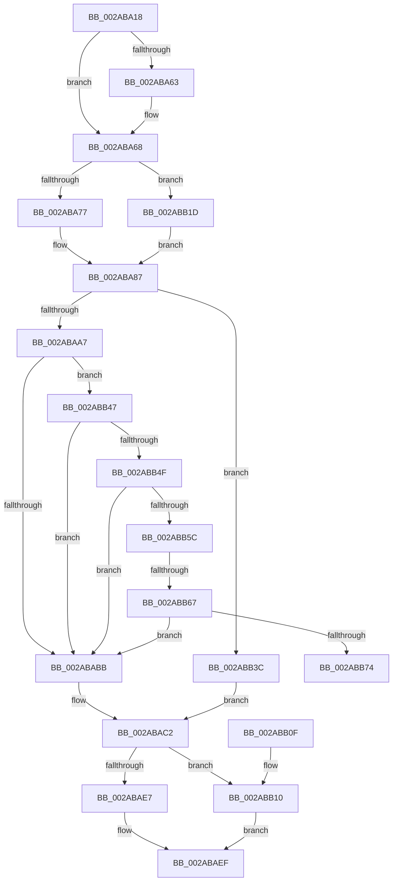

# MiSectionCreated

- RVA: `0x002ABA18`–`0x002ABB79` (길이 `353` bytes)
- VA: `0x00000001402ABA18`
- 실행 섹션: `.text`
- PDB 이름 있음: `예`; PDB Function 태그: `예`
- unwind 정보 RVA: `0x0006D0B8`
- 디코드: `94`개 명령, `353/353` bytes 표시
- 미해석 바이트: `0` (있으면 어셈블리에 `.byte`로 보존)

> 이 문서는 커널 이미지의 기계어와 PDB 기호를 분석해 생성했습니다. 4번과 5번은 함수 원형과 자료형을 바이너리 사용 방식에서 추정한 C 해석이며 원본 소스 복구 결과는 아닙니다.

## 1. Dependencies

- 직접 호출 지점: **9**; 고유 호출 대상: **6**
- 직접 호출자로 확인된 함수: **1**
- RIP 상대 이미지 참조: **1**

### Outgoing calls
- `0x002ABA49` → [ExAcquireSpinLockExclusive](../24/ExAcquireSpinLockExclusive_function_00248690.md) (function, `0x00248690`)
- `0x002ABA7E` → [ExAcquireSpinLockExclusiveAtDpcLevel](../24/ExAcquireSpinLockExclusiveAtDpcLevel_function_00248E80.md) (function, `0x00248E80`)
- `0x002ABA96` → [ExAcquireSpinLockExclusiveAtDpcLevel](../24/ExAcquireSpinLockExclusiveAtDpcLevel_function_00248E80.md) (function, `0x00248E80`)
- `0x002ABAC9` → [ExReleaseSpinLockExclusiveFromDpcLevel](../24/ExReleaseSpinLockExclusiveFromDpcLevel_function_002497E0.md) (function, `0x002497E0`)
- `0x002ABAD2` → [ExReleaseSpinLockExclusiveFromDpcLevel](../24/ExReleaseSpinLockExclusiveFromDpcLevel_function_002497E0.md) (function, `0x002497E0`)
- `0x002ABADE` → [MiReleaseSpinLockExclusive](../24/MiReleaseSpinLockExclusive_function_002482C0.md) (function, `0x002482C0`)
- `0x002ABAEA` → [KeAbPostRelease](../2E/KeAbPostRelease_function_002E1600.md) (function, `0x002E1600`)
- `0x002ABB16` → [MiInitializeNewImageSectionProtos](MiInitializeNewImageSectionProtos_function_002ABB80.md) (function, `0x002ABB80`)
- `0x002ABB2A` → [ExAcquireSpinLockExclusiveAtDpcLevel](../24/ExAcquireSpinLockExclusiveAtDpcLevel_function_00248E80.md) (function, `0x00248E80`)

### Direct callers
- [MiCreateNewSection](../../page/98/MiCreateNewSection_function_00985DB0.md) at `0x00985F12`

### Static image references
- `0x002ABA8B` → RVA `0x00E2CD00` (`.data`; read)

## 2. Other-region calls and transfers

- 다른 실행 섹션으로 향하는 call: **0**
- call이 아닌 외부 분기/꼬리 이동: **2**
  - `0x002ABB61` → [sub_006DB336](../6D/Unknown_function_006DB336.md) (`tail-transfer`)
  - `0x002ABB74` → [sub_006DB336](../6D/Unknown_function_006DB336.md) (`tail-transfer`)

## 3. Assembly (complete function range)

```asm
002ABA18  48 89 5C 24 08                  mov qword ptr [rsp + 8], rbx
002ABA1D  48 89 6C 24 10                  mov qword ptr [rsp + 0x10], rbp
002ABA22  48 89 74 24 18                  mov qword ptr [rsp + 0x18], rsi
002ABA27  57                              push rdi
002ABA28  41 54                           push r12
002ABA2A  41 55                           push r13
002ABA2C  41 56                           push r14
002ABA2E  41 57                           push r15
002ABA30  48 83 EC 20                     sub rsp, 0x20
002ABA34  4C 8B F9                        mov r15, rcx
002ABA37  4D 8B E1                        mov r12, r9
002ABA3A  49 8D 48 48                     lea rcx, [r8 + 0x48]
002ABA3E  49 8B D8                        mov rbx, r8
002ABA41  48 8B F2                        mov rsi, rdx
002ABA44  45 33 F6                        xor r14d, r14d
002ABA47  33 ED                           xor ebp, ebp
002ABA49  E8 42 CC F9 FF                  call 0x140248690
002ABA4E  44 8A E8                        mov r13b, al
002ABA51  65 48 8B 04 25 88 01 00 00      mov rax, qword ptr gs:[0x188]
002ABA5A  F6 80 A8 05 00 00 40            test byte ptr [rax + 0x5a8], 0x40
002ABA61  74 05                           je 0x1402aba68
002ABA63  0F BA 6B 38 09                  bts dword ptr [rbx + 0x38], 9
002ABA68  8B 43 38                        mov eax, dword ptr [rbx + 0x38]
002ABA6B  48 8B 7E 28                     mov rdi, qword ptr [rsi + 0x28]
002ABA6F  A8 20                           test al, 0x20
002ABA71  0F 85 A6 00 00 00               jne 0x1402abb1d
002ABA77  48 8B 3F                        mov rdi, qword ptr [rdi]
002ABA7A  48 8D 4F 48                     lea rcx, [rdi + 0x48]
002ABA7E  E8 FD D3 F9 FF                  call 0x140248e80
002ABA83  4C 8B 77 50                     mov r14, qword ptr [rdi + 0x50]
002ABA87  48 8B 47 40                     mov rax, qword ptr [rdi + 0x40]
002ABA8B  48 8D 0D 6E 12 B8 00            lea rcx, [rip + 0xb8126e]
002ABA92  48 89 43 40                     mov qword ptr [rbx + 0x40], rax
002ABA96  E8 E5 D3 F9 FF                  call 0x140248e80
002ABA9B  48 8B 76 28                     mov rsi, qword ptr [rsi + 0x28]
002ABA9F  85 ED                           test ebp, ebp
002ABAA1  0F 85 95 00 00 00               jne 0x1402abb3c
002ABAA7  41 8B 07                        mov eax, dword ptr [r15]
002ABAAA  8A 53 3E                        mov dl, byte ptr [rbx + 0x3e]
002ABAAD  25 00 80 00 00                  and eax, 0x8000
002ABAB2  F6 C2 0C                        test dl, 0xc
002ABAB5  0F 85 8C 00 00 00               jne 0x1402abb47
002ABABB  48 89 1E                        mov qword ptr [rsi], rbx
002ABABE  83 63 38 FD                     and dword ptr [rbx + 0x38], 0xfffffffd
002ABAC2  48 8D 0D 37 12 B8 00            lea rcx, [rip + 0xb81237]
002ABAC9  E8 12 DD F9 FF                  call 0x1402497e0
002ABACE  48 8D 4F 48                     lea rcx, [rdi + 0x48]
002ABAD2  E8 09 DD F9 FF                  call 0x1402497e0
002ABAD7  48 8D 4B 48                     lea rcx, [rbx + 0x48]
002ABADB  41 8A D5                        mov dl, r13b
002ABADE  E8 DD C7 F9 FF                  call 0x1402482c0
002ABAE3  85 ED                           test ebp, ebp
002ABAE5  75 29                           jne 0x1402abb10
002ABAE7  48 8B CE                        mov rcx, rsi
002ABAEA  E8 11 5B 03 00                  call 0x1402e1600
002ABAEF  48 8B 5C 24 50                  mov rbx, qword ptr [rsp + 0x50]
002ABAF4  49 8B C6                        mov rax, r14
002ABAF7  48 8B 6C 24 58                  mov rbp, qword ptr [rsp + 0x58]
002ABAFC  48 8B 74 24 60                  mov rsi, qword ptr [rsp + 0x60]
002ABB01  48 83 C4 20                     add rsp, 0x20
002ABB05  41 5F                           pop r15
002ABB07  41 5E                           pop r14
002ABB09  41 5D                           pop r13
002ABB0B  41 5C                           pop r12
002ABB0D  5F                              pop rdi
002ABB0E  C3                              ret
002ABB0F  CC                              int3
002ABB10  49 8B D4                        mov rdx, r12
002ABB13  48 8B CB                        mov rcx, rbx
002ABB16  E8 65 00 00 00                  call 0x1402abb80
002ABB1B  EB D2                           jmp 0x1402abaef
002ABB1D  48 8B 7F 10                     mov rdi, qword ptr [rdi + 0x10]
002ABB21  BD 01 00 00 00                  mov ebp, 1
002ABB26  48 8D 4F 48                     lea rcx, [rdi + 0x48]
002ABB2A  E8 51 D3 F9 FF                  call 0x140248e80
002ABB2F  48 8B 47 50                     mov rax, qword ptr [rdi + 0x50]
002ABB33  48 89 43 50                     mov qword ptr [rbx + 0x50], rax
002ABB37  E9 4B FF FF FF                  jmp 0x1402aba87
002ABB3C  48 89 5E 10                     mov qword ptr [rsi + 0x10], rbx
002ABB40  33 F6                           xor esi, esi
002ABB42  E9 7B FF FF FF                  jmp 0x1402abac2
002ABB47  85 C0                           test eax, eax
002ABB49  0F 85 6C FF FF FF               jne 0x1402ababb
002ABB4F  48 8B 4E 10                     mov rcx, qword ptr [rsi + 0x10]
002ABB53  48 85 C9                        test rcx, rcx
002ABB56  0F 84 5F FF FF FF               je 0x1402ababb
002ABB5C  8B 41 38                        mov eax, dword ptr [rcx + 0x38]
002ABB5F  A8 03                           test al, 3
002ABB61  0F 85 CF F7 42 00               jne 0x1406db336
002ABB67  8A 41 3E                        mov al, byte ptr [rcx + 0x3e]
002ABB6A  24 0C                           and al, 0xc
002ABB6C  3C 04                           cmp al, 4
002ABB6E  0F 85 47 FF FF FF               jne 0x1402ababb
002ABB74  E9 BD F7 42 00                  jmp 0x1406db336
```

## 4. C-style interpretation (structured pseudocode)

```c
__int64 __fastcall MiSectionCreated(__int64 a1, __int64 a2, __int64 a3, __int64 a4)
{
    __int64 result;
    __int64 v_r14;
    __int64 v_rbp;
    __int64 v_rsi;
    __int64 v_rsp;
    unsigned __int64 v_stack_p10;
    unsigned __int64 v_stack_p18;
    unsigned __int64 v_stack_p8;

    v_stack_p8 = v_rbx;
    v_stack_p10 = v_rbp;
    v_stack_p18 = v_rsi;
    v_rsp = (v_rsp) - (32);
    v_r14 = 0;
    v_rbp = 0;
    result = ExAcquireSpinLockExclusive(a3 + 72, a2, a3, a4);
    if (((*(unsigned __int8 *)(*(unsigned __int64 *)(gs_base + (0 + 392)) + 1448)) & (64)) != 0) {
    }
    if ((((unsigned __int8)((unsigned int)(*(unsigned int *)(a3 + 56)))) & (32)) != 0) goto loc_002ABB1D;
    result = ExAcquireSpinLockExclusiveAtDpcLevel(*(unsigned __int64 *)(*(unsigned __int64 *)(a2 + 40)) + 72, a2, a3, a4);
loc_002ABA87:
    *(unsigned __int64 *)(a3 + 64) = *(unsigned __int64 *)(*(unsigned __int64 *)(*(unsigned __int64 *)(a2 + 40)) + 64);
    result = ExAcquireSpinLockExclusiveAtDpcLevel(v_rip + 12063342, a2, a3, a4);
    if (0 != 0) goto loc_002ABB3C;
    result = (unsigned int)(((unsigned int)(*(unsigned int *)(a1))) & (0x8000ULL));
    if ((((unsigned __int8)(*(unsigned __int8 *)(a3 + 62))) & (12)) != 0) goto loc_002ABB47;
loc_002ABABB:
    *(unsigned __int64 *)(*(unsigned __int64 *)(a2 + 40)) = a3;
loc_002ABAC2:
    result = ExReleaseSpinLockExclusiveFromDpcLevel(v_rip + 12063287, *(unsigned __int8 *)(a3 + 62), a3, a4);
    result = ExReleaseSpinLockExclusiveFromDpcLevel(*(unsigned __int64 *)(*(unsigned __int64 *)(a2 + 40)) + 72, *(unsigned __int8 *)(a3 + 62), a3, a4);
    result = MiReleaseSpinLockExclusive(a3 + 72, (unsigned __int8)((unsigned __int8)(result)), a3, a4);
    if (0 != 0) goto loc_002ABB10;
    result = KeAbPostRelease(*(unsigned __int64 *)(a2 + 40), (unsigned __int8)((unsigned __int8)(result)), a3, a4);
loc_002ABAEF:
    v_rsp = (v_rsp) + (32);
    return *(unsigned __int64 *)(*(unsigned __int64 *)(*(unsigned __int64 *)(a2 + 40)) + 80);
loc_002ABB10:
    result = MiInitializeNewImageSectionProtos(v_stack_p8, a4, a3, a4);
    goto loc_002ABAEF;
loc_002ABB1D:
    result = ExAcquireSpinLockExclusiveAtDpcLevel(*(unsigned __int64 *)(*(unsigned __int64 *)(*(unsigned __int64 *)(a2 + 40)) + 16) + 72, a4, a3, a4);
    *(unsigned __int64 *)(v_stack_p8 + 80) = *(unsigned __int64 *)(*(unsigned __int64 *)(*(unsigned __int64 *)(*(unsigned __int64 *)(a2 + 40)) + 16) + 80);
    goto loc_002ABA87;
loc_002ABB3C:
    *(unsigned __int64 *)(v_stack_p18 + 16) = v_stack_p8;
    v_rsi = 0;
    goto loc_002ABAC2;
loc_002ABB47:
    if ((unsigned int)(*(unsigned __int64 *)(*(unsigned __int64 *)(*(unsigned __int64 *)(*(unsigned __int64 *)(a2 + 40)) + 16) + 80)) != 0) goto loc_002ABABB;
    if (*(unsigned __int64 *)(v_rsi + 16) == 0) goto loc_002ABABB;
    result = (unsigned __int8)((*(unsigned __int8 *)(*(unsigned __int64 *)(v_rsi + 16) + 62)) & (12));
    if (((unsigned __int8)(result)) != 4) goto loc_002ABABB;
}
```

## 5. (Beta) C Style

```c
int64_t MiSectionCreated(void *Arg1, void *Arg2, void *Arg3, int64_t Arg4)
{
    uint8_t *arg1 = (uint8_t *)Arg1;
    uint8_t *arg2 = (uint8_t *)Arg2;
    uint8_t *arg3 = (uint8_t *)Arg3;

    int64_t result;
    int64_t local_r14;
    int64_t local_rbp;
    int64_t local_rsi;
    int64_t local_rsp;
    uint64_t v_stack_p10;
    uint64_t v_stack_p18;
    uint64_t v_stack_p8;

    v_stack_p8 = local_rbx;
    v_stack_p10 = local_rbp;
    v_stack_p18 = local_rsi;
    local_rsp = (local_rsp) - (32);
    local_r14 = 0;
    local_rbp = 0;
    result = ExAcquireSpinLockExclusive(Arg3 + 72, Arg2, Arg3, Arg4);
    if (((*(uint8_t *)(*(uint64_t *)(gs_base + (0 + 0x188)) + 0x5A8)) & (64)) != 0) {
    }
    if ((((uint8_t)((uint32_t)(*(uint32_t *)(arg3 + 0x38)))) & (32)) != 0) goto loc_002ABB1D;
    result = ExAcquireSpinLockExclusiveAtDpcLevel(*(uint64_t *)(*(uint64_t *)(arg2 + 0x28)) + 72, Arg2, Arg3, Arg4);
loc_002ABA87:
    *(uint64_t *)(arg3 + 0x40) = *(uint64_t *)(*(uint64_t *)(*(uint64_t *)(arg2 + 0x28)) + 0x40);
    result = ExAcquireSpinLockExclusiveAtDpcLevel(v_rip + 12063342, Arg2, Arg3, Arg4);
    if (0 != 0) goto loc_002ABB3C;
    result = (uint32_t)(((uint32_t)(*(uint32_t *)(arg1))) & (0x8000ULL));
    if ((((uint8_t)(*(uint8_t *)(arg3 + 0x3E))) & (12)) != 0) goto loc_002ABB47;
loc_002ABABB:
    *(void **)(*(uint64_t *)(arg2 + 0x28)) = Arg3;
loc_002ABAC2:
    result = ExReleaseSpinLockExclusiveFromDpcLevel(v_rip + 12063287, *(uint8_t *)(arg3 + 0x3E), Arg3, Arg4);
    result = ExReleaseSpinLockExclusiveFromDpcLevel(*(uint64_t *)(*(uint64_t *)(arg2 + 0x28)) + 72, *(uint8_t *)(arg3 + 0x3E), Arg3, Arg4);
    result = MiReleaseSpinLockExclusive(Arg3 + 72, (uint8_t)((uint8_t)(result)), Arg3, Arg4);
    if (0 != 0) goto loc_002ABB10;
    result = KeAbPostRelease(*(uint64_t *)(arg2 + 0x28), (uint8_t)((uint8_t)(result)), Arg3, Arg4);
loc_002ABAEF:
    local_rsp = (local_rsp) + (32);
    return *(uint64_t *)(*(uint64_t *)(*(uint64_t *)(arg2 + 0x28)) + 0x50);
loc_002ABB10:
    result = MiInitializeNewImageSectionProtos(v_stack_p8, Arg4, Arg3, Arg4);
    goto loc_002ABAEF;
loc_002ABB1D:
    result = ExAcquireSpinLockExclusiveAtDpcLevel(*(uint64_t *)(*(uint64_t *)(*(uint64_t *)(arg2 + 0x28)) + 0x10) + 72, Arg4, Arg3, Arg4);
    *(uint64_t *)(v_stack_p8 + 0x50) = *(uint64_t *)(*(uint64_t *)(*(uint64_t *)(*(uint64_t *)(arg2 + 0x28)) + 0x10) + 0x50);
    goto loc_002ABA87;
loc_002ABB3C:
    *(uint64_t *)(v_stack_p18 + 0x10) = v_stack_p8;
    local_rsi = 0;
    goto loc_002ABAC2;
loc_002ABB47:
    if ((uint32_t)(*(uint64_t *)(*(uint64_t *)(*(uint64_t *)(*(uint64_t *)(arg2 + 0x28)) + 0x10) + 0x50)) != 0) goto loc_002ABABB;
    if (*(uint64_t *)(local_rsi + 0x10) == 0) goto loc_002ABABB;
    result = (uint8_t)((*(uint8_t *)(*(uint64_t *)(local_rsi + 0x10) + 0x3E)) & (12));
    if (((uint8_t)(result)) != 4) goto loc_002ABABB;
}
```

### 관측된 메모리 오프셋

구조체 형식이 확인되지 않은 접근은 인자 기준의 오프셋으로만 기록했습니다.

| 기준 인자 | 오프셋 표현 | 폭 (bit) | 접근 |
|---|---:|---:|---|
| `Arg1` | `+ 0x0` | `32` | `R` |
| `Arg2` | `+ 0x28` | `64` | `R` |
| `Arg3` | `+ 0x38` | `32` | `R` |
| `Arg3` | `+ 0x38` | `32` | `R/W` |
| `Arg3` | `+ 0x3E` | `8` | `R` |
| `Arg3` | `+ 0x40` | `64` | `W` |
| `Arg3` | `+ 0x48` | `64` | `R` |
| `Arg3` | `+ 0x50` | `64` | `W` |

## 6. Execution-region graph

[열기: 2D/3D 그래프와 함수 탐색 컨트롤 패널](../../../control-panel.html?section=text&rva=0x002ABA18&view=graph)

- 2D 그래프는 위에서 아래로 흐르고, 3D 그래프는 빈 공간을 드래그해 회전합니다. Shift+드래그는 이동, 휠은 확대·축소, 함수 노드 선택은 대상 보고서 이동입니다.

### Static fallback


