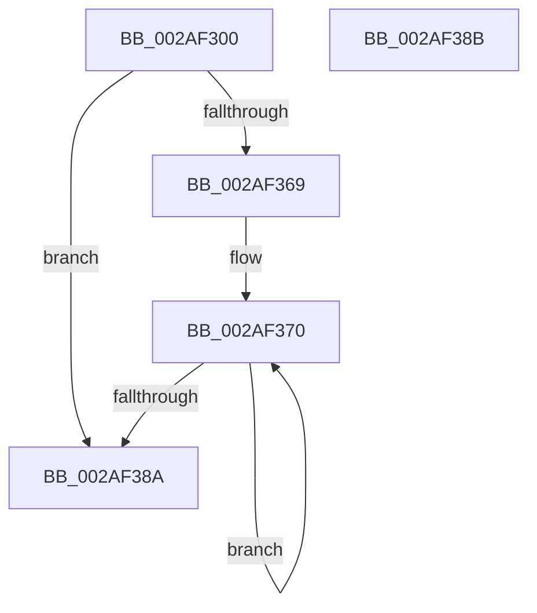

# MiSetNextStandbyPageSecondaryNoLockAsserts

- RVA: `0x002AF300`–`0x002AF38C` (길이 `140` bytes)
- VA: `0x00000001402AF300`
- 실행 섹션: `.text`
- PDB 이름 있음: `예`; PDB Function 태그: `아니요`
- unwind 정보 RVA: `0x000DB714`
- 디코드: `38`개 명령, `140/140` bytes 표시
- 미해석 바이트: `0` (있으면 어셈블리에 `.byte`로 보존)

> 이 문서는 커널 이미지의 기계어와 PDB 기호를 분석해 생성했습니다. 4번과 5번은 함수 원형과 자료형을 바이너리 사용 방식에서 추정한 C 해석이며 원본 소스 복구 결과는 아닙니다.

## 1. Dependencies

- 직접 호출 지점: **0**; 고유 호출 대상: **0**
- 직접 호출자로 확인된 함수: **2**
- RIP 상대 이미지 참조: **0**

### Outgoing calls
- 직접 디코드된 call 명령이 없습니다.

### Direct callers
- [MI_SET_SLAB_STANDBY_PAGE_SLAB_ENTRY](MI_SET_SLAB_STANDBY_PAGE_SLAB_ENTRY_function_002AF708.md) at `0x002AF750`
- [MiExclusiveInsertPfnChainInList](../44/MiExclusiveInsertPfnChainInList_function_00445C48.md) at `0x00445EEA`

### Static image references
- 디코드된 RIP-relative 메모리 참조가 없습니다.

## 2. Other-region calls and transfers

- 다른 실행 섹션으로 향하는 call: **0**
- 별도 외부 분기/꼬리 이동을 확인하지 못했습니다.

## 3. Assembly (complete function range)

```asm
002AF300  4C 8B 01                        mov r8, qword ptr [rcx]
002AF303  4C 8B C9                        mov r9, rcx
002AF306  48 B8 FF FF FF FF FF 00 00 00   movabs rax, 0xffffffffff
002AF310  4C 8B D2                        mov r10, rdx
002AF313  4C 23 C0                        and r8, rax
002AF316  49 C1 E2 14                     shl r10, 0x14
002AF31A  48 8B C2                        mov rax, rdx
002AF31D  48 C1 E0 28                     shl rax, 0x28
002AF321  4C 0B C0                        or r8, rax
002AF324  8B 41 24                        mov eax, dword ptr [rcx + 0x24]
002AF327  4C 89 01                        mov qword ptr [rcx], r8
002AF32A  25 FF FF 1F 00                  and eax, 0x1fffff
002AF32F  4C 8B C2                        mov r8, rdx
002AF332  49 C1 E8 18                     shr r8, 0x18
002AF336  41 C1 E0 15                     shl r8d, 0x15
002AF33A  44 0B C0                        or r8d, eax
002AF33D  44 89 41 24                     mov dword ptr [rcx + 0x24], r8d
002AF341  49 B8 FF FF FF FF FF FF 7F F0   movabs r8, 0xf07fffffffffffff
002AF34B  48 8B 51 28                     mov rdx, qword ptr [rcx + 0x28]
002AF34F  49 8B CA                        mov rcx, r10
002AF352  48 33 CA                        xor rcx, rdx
002AF355  48 8B C2                        mov rax, rdx
002AF358  49 23 C8                        and rcx, r8
002AF35B  49 33 CA                        xor rcx, r10
002AF35E  F0 49 0F B1 49 28               lock cmpxchg qword ptr [r9 + 0x28], rcx
002AF364  48 3B D0                        cmp rdx, rax
002AF367  74 21                           je 0x1402af38a
002AF369  0F 1F 80 00 00 00 00            nop dword ptr [rax]
002AF370  49 8B CA                        mov rcx, r10
002AF373  48 8B D0                        mov rdx, rax
002AF376  48 33 C8                        xor rcx, rax
002AF379  49 23 C8                        and rcx, r8
002AF37C  49 33 CA                        xor rcx, r10
002AF37F  F0 49 0F B1 49 28               lock cmpxchg qword ptr [r9 + 0x28], rcx
002AF385  48 3B D0                        cmp rdx, rax
002AF388  75 E6                           jne 0x1402af370
002AF38A  C3                              ret
002AF38B  CC                              int3
```

## 4. C-style interpretation (structured pseudocode)

```c
__int64 __fastcall MiSetNextStandbyPageSecondaryNoLockAsserts(__int64 a1, __int64 a2)
{
    __int64 result;
    __int64 v_r10;

    a3 = (*(unsigned __int64 *)(a1)) & (result);
    v_r10 = (a2) << (20);
    result = (a2) << (40);
    a3 = (a3) | (result);
    *(unsigned __int64 *)(a1) = a3;
    result = (unsigned int)(((unsigned int)(*(unsigned int *)(a1 + 36))) & (0x1FFFFFULL));
    a3 = (a2) >> (24);
    a3 = (unsigned int)((a3) << (21));
    a3 = (unsigned int)((a3) | ((unsigned int)(result)));
    *(unsigned int *)(a1 + 36) = (unsigned int)(a3);
    a1 = (v_r10) ^ (*(unsigned __int64 *)(a1 + 40));
    a1 = (a1) & (a3);
    a1 = (a1) ^ (v_r10);
    if ((*(unsigned __int64 *)(a1 + 40)) == (*(unsigned __int64 *)(a1 + 40))) goto loc_002AF38A;
loc_002AF370:
    a1 = (v_r10) ^ (*(unsigned __int64 *)(a1 + 40));
    a1 = (a1) & (a3);
    a1 = (a1) ^ (v_r10);
    if ((*(unsigned __int64 *)(a1 + 40)) != (*(unsigned __int64 *)(a1 + 40))) goto loc_002AF370;
loc_002AF38A:
    return *(unsigned __int64 *)(a1 + 40);
}
```

## 5. (Beta) C Style

```c
int64_t MiSetNextStandbyPageSecondaryNoLockAsserts(void *Arg1, int64_t Arg2)
{
    uint8_t *arg1 = (uint8_t *)Arg1;

    int64_t result;
    int64_t local_r10;

    a3 = (*(uint64_t *)(arg1)) & (result);
    local_r10 = (Arg2) << (20);
    result = (Arg2) << (40);
    a3 = (a3) | (result);
    *(uint64_t *)(arg1) = a3;
    result = (uint32_t)(((uint32_t)(*(uint32_t *)(arg1 + 0x24))) & (0x1FFFFFULL));
    a3 = (Arg2) >> (24);
    a3 = (uint32_t)((a3) << (21));
    a3 = (uint32_t)((a3) | ((uint32_t)(result)));
    *(uint32_t *)(arg1 + 0x24) = (uint32_t)(a3);
    Arg1 = (local_r10) ^ (*(uint64_t *)(arg1 + 0x28));
    Arg1 = (Arg1) & (a3);
    Arg1 = (Arg1) ^ (local_r10);
    if ((*(uint64_t *)(arg1 + 0x28)) == (*(uint64_t *)(arg1 + 0x28))) goto loc_002AF38A;
loc_002AF370:
    Arg1 = (local_r10) ^ (*(uint64_t *)(arg1 + 0x28));
    Arg1 = (Arg1) & (a3);
    Arg1 = (Arg1) ^ (local_r10);
    if ((*(uint64_t *)(arg1 + 0x28)) != (*(uint64_t *)(arg1 + 0x28))) goto loc_002AF370;
loc_002AF38A:
    return *(uint64_t *)(arg1 + 0x28);
}
```

### 관측된 메모리 오프셋

구조체 형식이 확인되지 않은 접근은 인자 기준의 오프셋으로만 기록했습니다.

| 기준 인자 | 오프셋 표현 | 폭 (bit) | 접근 |
|---|---:|---:|---|
| `Arg1` | `+ 0x0` | `64` | `R` |
| `Arg1` | `+ 0x0` | `64` | `W` |
| `Arg1` | `+ 0x24` | `32` | `R` |
| `Arg1` | `+ 0x24` | `32` | `W` |
| `Arg1` | `+ 0x28` | `64` | `R` |

## 6. Execution-region graph

[열기: 2D/3D 그래프와 함수 탐색 컨트롤 패널](../../../control-panel.html?section=text&rva=0x002AF300&view=graph)

- 2D 그래프는 위에서 아래로 흐르고, 3D 그래프는 빈 공간을 드래그해 회전합니다. Shift+드래그는 이동, 휠은 확대·축소, 함수 노드 선택은 대상 보고서 이동입니다.

### Static fallback


