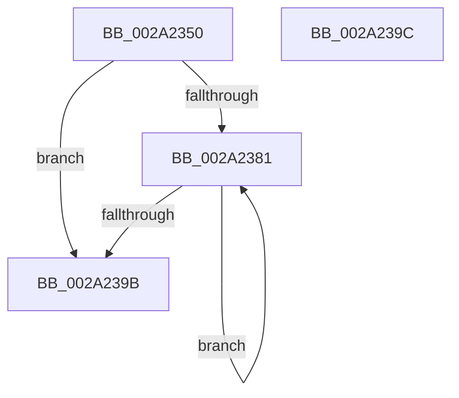

# MiSetPfnIdentity

- RVA: `0x002A2350`–`0x002A239D` (길이 `77` bytes)
- VA: `0x00000001402A2350`
- 실행 섹션: `.text`
- PDB 이름 있음: `예`; PDB Function 태그: `아니요`
- unwind 정보 RVA: `0x000DB714`
- 디코드: `23`개 명령, `77/77` bytes 표시
- 미해석 바이트: `0` (있으면 어셈블리에 `.byte`로 보존)

> 이 문서는 커널 이미지의 기계어와 PDB 기호를 분석해 생성했습니다. 4번과 5번은 함수 원형과 자료형을 바이너리 사용 방식에서 추정한 C 해석이며 원본 소스 복구 결과는 아닙니다.

## 1. Dependencies

- 직접 호출 지점: **0**; 고유 호출 대상: **0**
- 직접 호출자로 확인된 함수: **33**
- RIP 상대 이미지 참조: **0**

### Outgoing calls
- 직접 디코드된 call 명령이 없습니다.

### Direct callers
- [MiMigratePfn](../28/MiMigratePfn_function_0028DBB0.md) at `0x0028DFAA`
- [MiSwapStackPageNoDpc](MiSwapStackPageNoDpc_function_002A0270.md) at `0x002A03D5`
- [MiSwapStackPageNoDpc](MiSwapStackPageNoDpc_function_002A0270.md) at `0x002A04B3`
- [MiUpdateSlabPagePlaceholderState](MiUpdateSlabPagePlaceholderState_function_002A0FB0.md) at `0x002A1012`
- [MiUpdateSlabPagePlaceholderState](MiUpdateSlabPagePlaceholderState_function_002A0FB0.md) at `0x002A10A1`
- [MiOutPageSingleKernelStack](MiOutPageSingleKernelStack_function_002A1790.md) at `0x002A1A4F`
- [MiAllocateKernelStackPages](MiAllocateKernelStackPages_function_002A1BEC.md) at `0x002A2126`
- [MiMarkKernelStack](MiMarkKernelStack_function_002A2290.md) at `0x002A22AD`
- [MiInitializeMdlPfn](../2C/MiInitializeMdlPfn_function_002C9670.md) at `0x002C9755`
- [MiFreeSlabEntry](../2D/MiFreeSlabEntry_function_002DC650.md) at `0x002DC832`
- [MiCompletePrivateZeroFault](../33/MiCompletePrivateZeroFault_function_00330CC0.md) at `0x00331C8E`
- [sub_003354FB](../33/Unknown_function_003354FB.md) at `0x00335F80`
- [sub_0033603B](../33/Unknown_function_0033603B.md) at `0x0033608A`
- [MiRestoreTransitionPte](../33/MiRestoreTransitionPte_function_0033DD90.md) at `0x0033E205`
- [MiInPageSingleKernelStack](../36/MiInPageSingleKernelStack_function_0036A3E8.md) at `0x0036A670`
- [MiDecommitPrivatePageTail](../36/MiDecommitPrivatePageTail_function_0036F564.md) at `0x0036F85E`
- [MiDeleteSectionCluster](../37/MiDeleteSectionCluster_function_00373DF0.md) at `0x00374037`
- [MiCreateSlabEntry](../37/MiCreateSlabEntry_function_00374DEC.md) at `0x003752A6`
- [MiMarkPfnVerified](../38/MiMarkPfnVerified_function_003833C4.md) at `0x00383433`
- [MiSwapNumaStandbyPage](../38/MiSwapNumaStandbyPage_function_00385144.md) at `0x0038555E`
- [MiSwapHardFaultPage](../38/MiSwapHardFaultPage_function_00385F34.md) at `0x003860DD`
- [MiFreeSecureKernelPage](../3E/MiFreeSecureKernelPage_function_003E9394.md) at `0x003E945B`
- [MiFreeSecureKernelPage](../3E/MiFreeSecureKernelPage_function_003E9394.md) at `0x003E9577`
- [MiFreePagesFromMdl](../3F/MiFreePagesFromMdl_function_003F8300.md) at `0x003F8526`
- [sub_00407035](../40/Unknown_function_00407035.md) at `0x004070E4`
- [MiDeleteShadowStackPtes](../49/MiDeleteShadowStackPtes_function_00493AE4.md) at `0x00493CD9`
- [MiClearFileOnlyPfn](../4D/MiClearFileOnlyPfn_function_004D1B84.md) at `0x004D1BF4`
- [MiInitializeAwePfn](../4F/MiInitializeAwePfn_function_004F6D94.md) at `0x004F6DC3`
- [MiFreeLargeInitializationCodePages](../67/MiFreeLargeInitializationCodePages_function_00670080.md) at `0x006700F3`
- [MiCreatePfnTemplate](../67/MiCreatePfnTemplate_function_00671824.md) at `0x006718AE`
- [MiCopyKstack](../67/MiCopyKstack_function_0067B058.md) at `0x0067B187`
- [MiSwitchKstackPages](../67/MiSwitchKstackPages_function_0067B464.md) at `0x0067B493`
- [MiAddExpansionNonPagedPool](../68/MiAddExpansionNonPagedPool_function_00682B4C.md) at `0x00682C10`
- [MiClearAweLargePageMetadata](../68/MiClearAweLargePageMetadata_function_006880EC.md) at `0x006880F7`
- [MiPrepareLargePageSubPageForFree](../69/MiPrepareLargePageSubPageForFree_function_006994F0.md) at `0x0069958F`
- [MxInsertEnclaveBootPages](../../init/C6/MxInsertEnclaveBootPages_function_00C68CB0.md) at `0x00C68D9D`

### Static image references
- 디코드된 RIP-relative 메모리 참조가 없습니다.

## 2. Other-region calls and transfers

- 다른 실행 섹션으로 향하는 call: **0**
- 별도 외부 분기/꼬리 이동을 확인하지 못했습니다.

## 3. Assembly (complete function range)

```asm
002A2350  4C 8B 49 28                     mov r9, qword ptr [rcx + 0x28]
002A2354  49 BB FF FF FF FF FF FF FF 8F   movabs r11, 0x8fffffffffffffff
002A235E  8B D2                           mov edx, edx
002A2360  4C 8B D1                        mov r10, rcx
002A2363  48 C1 E2 3C                     shl rdx, 0x3c
002A2367  49 8B C1                        mov rax, r9
002A236A  4C 8B C2                        mov r8, rdx
002A236D  4D 33 C1                        xor r8, r9
002A2370  4D 23 C3                        and r8, r11
002A2373  4C 33 C2                        xor r8, rdx
002A2376  F0 4C 0F B1 41 28               lock cmpxchg qword ptr [rcx + 0x28], r8
002A237C  4C 3B C8                        cmp r9, rax
002A237F  74 1A                           je 0x1402a239b
002A2381  48 8B CA                        mov rcx, rdx
002A2384  4C 8B C0                        mov r8, rax
002A2387  48 33 C8                        xor rcx, rax
002A238A  49 23 CB                        and rcx, r11
002A238D  48 33 CA                        xor rcx, rdx
002A2390  F0 49 0F B1 4A 28               lock cmpxchg qword ptr [r10 + 0x28], rcx
002A2396  4C 3B C0                        cmp r8, rax
002A2399  75 E6                           jne 0x1402a2381
002A239B  C3                              ret
002A239C  CC                              int3
```

## 4. C-style interpretation (structured pseudocode)

```c
__int64 __fastcall MiSetPfnIdentity(__int64 a1, int a2)
{
    a2 = ((unsigned int)(a2)) << (60);
    a3 = (a2) ^ (*(unsigned __int64 *)(a1 + 40));
    a3 = (a3) & (v_r11);
    a3 = (a3) ^ (a2);
    if ((*(unsigned __int64 *)(a1 + 40)) == (*(unsigned __int64 *)(a1 + 40))) goto loc_002A239B;
loc_002A2381:
    a1 = (a2) ^ (*(unsigned __int64 *)(a1 + 40));
    a1 = (a1) & (v_r11);
    a1 = (a1) ^ (a2);
    if ((*(unsigned __int64 *)(a1 + 40)) != (*(unsigned __int64 *)(a1 + 40))) goto loc_002A2381;
loc_002A239B:
    return *(unsigned __int64 *)(a1 + 40);
}
```

## 5. (Beta) C Style

```c
int64_t MiSetPfnIdentity(void *Arg1, int32_t Arg2)
{
    uint8_t *arg1 = (uint8_t *)Arg1;

    Arg2 = ((uint32_t)(Arg2)) << (60);
    a3 = (Arg2) ^ (*(uint64_t *)(arg1 + 0x28));
    a3 = (a3) & (local_r11);
    a3 = (a3) ^ (Arg2);
    if ((*(uint64_t *)(arg1 + 0x28)) == (*(uint64_t *)(arg1 + 0x28))) goto loc_002A239B;
loc_002A2381:
    Arg1 = (Arg2) ^ (*(uint64_t *)(arg1 + 0x28));
    Arg1 = (Arg1) & (local_r11);
    Arg1 = (Arg1) ^ (Arg2);
    if ((*(uint64_t *)(arg1 + 0x28)) != (*(uint64_t *)(arg1 + 0x28))) goto loc_002A2381;
loc_002A239B:
    return *(uint64_t *)(arg1 + 0x28);
}
```

### 관측된 메모리 오프셋

구조체 형식이 확인되지 않은 접근은 인자 기준의 오프셋으로만 기록했습니다.

| 기준 인자 | 오프셋 표현 | 폭 (bit) | 접근 |
|---|---:|---:|---|
| `Arg1` | `+ 0x28` | `64` | `R` |

## 6. Execution-region graph

[열기: 2D/3D 그래프와 함수 탐색 컨트롤 패널](../../../control-panel.html?section=text&rva=0x002A2350&view=graph)

- 2D 그래프는 위에서 아래로 흐르고, 3D 그래프는 빈 공간을 드래그해 회전합니다. Shift+드래그는 이동, 휠은 확대·축소, 함수 노드 선택은 대상 보고서 이동입니다.

### Static fallback


