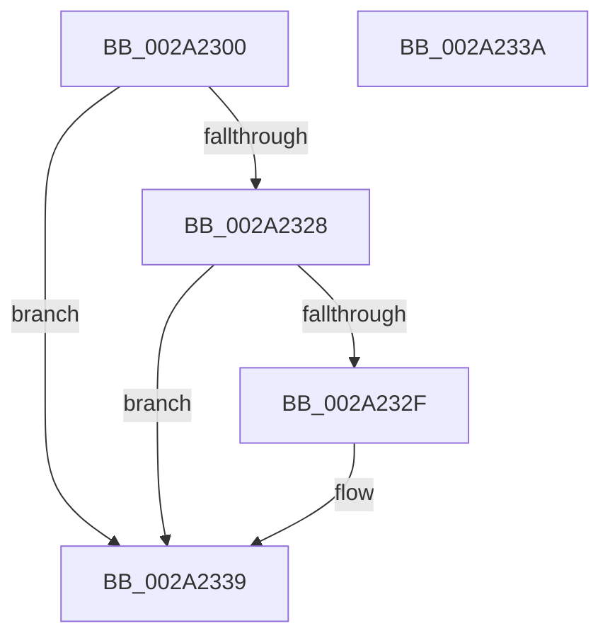

# MiSetPfnKernelStack

- RVA: `0x002A2300`–`0x002A233B` (길이 `59` bytes)
- VA: `0x00000001402A2300`
- 실행 섹션: `.text`
- PDB 이름 있음: `예`; PDB Function 태그: `아니요`
- unwind 정보 RVA: `0x000DB714`
- 디코드: `19`개 명령, `59/59` bytes 표시
- 미해석 바이트: `0` (있으면 어셈블리에 `.byte`로 보존)

> 이 문서는 커널 이미지의 기계어와 PDB 기호를 분석해 생성했습니다. 4번과 5번은 함수 원형과 자료형을 바이너리 사용 방식에서 추정한 C 해석이며 원본 소스 복구 결과는 아닙니다.

## 1. Dependencies

- 직접 호출 지점: **0**; 고유 호출 대상: **0**
- 직접 호출자로 확인된 함수: **2**
- RIP 상대 이미지 참조: **0**

### Outgoing calls
- 직접 디코드된 call 명령이 없습니다.

### Direct callers
- [MiMarkKernelStack](MiMarkKernelStack_function_002A2290.md) at `0x002A22B8`
- [MiInPageSingleKernelStack](../36/MiInPageSingleKernelStack_function_0036A3E8.md) at `0x0036A666`

### Static image references
- 디코드된 RIP-relative 메모리 참조가 없습니다.

## 2. Other-region calls and transfers

- 다른 실행 섹션으로 향하는 call: **0**
- 별도 외부 분기/꼬리 이동을 확인하지 못했습니다.

## 3. Assembly (complete function range)

```asm
002A2300  48 8B 01                        mov rax, qword ptr [rcx]
002A2303  4C 8B CA                        mov r9, rdx
002A2306  49 C1 E9 03                     shr r9, 3
002A230A  4D 8B C1                        mov r8, r9
002A230D  4C 33 C0                        xor r8, rax
002A2310  48 B8 01 00 00 00 00 F0 FF FF   movabs rax, 0xfffff00000000001
002A231A  4C 23 C0                        and r8, rax
002A231D  4D 33 C1                        xor r8, r9
002A2320  4C 89 01                        mov qword ptr [rcx], r8
002A2323  48 85 D2                        test rdx, rdx
002A2326  74 11                           je 0x1402a2339
002A2328  48 8B 01                        mov rax, qword ptr [rcx]
002A232B  A8 01                           test al, 1
002A232D  75 0A                           jne 0x1402a2339
002A232F  48 8B 01                        mov rax, qword ptr [rcx]
002A2332  48 83 C8 01                     or rax, 1
002A2336  48 89 01                        mov qword ptr [rcx], rax
002A2339  C3                              ret
002A233A  CC                              int3
```

## 4. C-style interpretation (structured pseudocode)

```c
__int64 __fastcall MiSetPfnKernelStack(__int64 a1, __int64 a2)
{
    __int64 result;

    a4 = (a2) >> (3);
    a3 = (a4) ^ (*(unsigned __int64 *)(a1));
    a3 = (a3) & (*(unsigned __int64 *)(a1));
    a3 = (a3) ^ (a4);
    *(unsigned __int64 *)(a1) = a3;
    if (a2 == 0) goto loc_002A2339;
    result = *(unsigned __int64 *)(a1);
    if ((((unsigned __int8)(*(unsigned __int64 *)(a1))) & (1)) == 0) {
        result = *(unsigned __int64 *)(a1);
        result = (result) | (1);
        *(unsigned __int64 *)(a1) = result;
    }
    return result;
}
```

## 5. (Beta) C Style

```c
int64_t MiSetPfnKernelStack(void *Arg1, int64_t Arg2)
{
    uint8_t *arg1 = (uint8_t *)Arg1;

    int64_t result;

    a4 = (Arg2) >> (3);
    a3 = (a4) ^ (*(uint64_t *)(arg1));
    a3 = (a3) & (*(uint64_t *)(arg1));
    a3 = (a3) ^ (a4);
    *(uint64_t *)(arg1) = a3;
    if (Arg2 == 0) goto loc_002A2339;
    result = *(uint64_t *)(arg1);
    if ((((uint8_t)(*(uint64_t *)(arg1))) & (1)) == 0) {
        result = *(uint64_t *)(arg1);
        result = (result) | (1);
        *(uint64_t *)(arg1) = result;
    }
    return result;
}
```

### 관측된 메모리 오프셋

구조체 형식이 확인되지 않은 접근은 인자 기준의 오프셋으로만 기록했습니다.

| 기준 인자 | 오프셋 표현 | 폭 (bit) | 접근 |
|---|---:|---:|---|
| `Arg1` | `+ 0x0` | `64` | `R` |
| `Arg1` | `+ 0x0` | `64` | `W` |

## 6. Execution-region graph

[열기: 2D/3D 그래프와 함수 탐색 컨트롤 패널](../../../control-panel.html?section=text&rva=0x002A2300&view=graph)

- 2D 그래프는 위에서 아래로 흐르고, 3D 그래프는 빈 공간을 드래그해 회전합니다. Shift+드래그는 이동, 휠은 확대·축소, 함수 노드 선택은 대상 보고서 이동입니다.

### Static fallback


