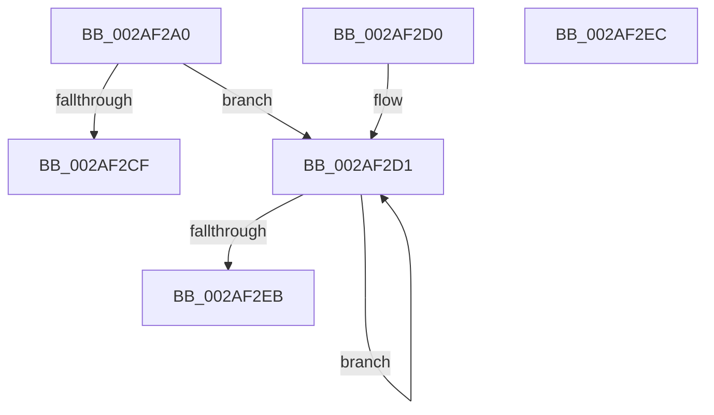

# MiSetPfnNodeBlinkLow

- RVA: `0x002AF2A0`–`0x002AF2ED` (길이 `77` bytes)
- VA: `0x00000001402AF2A0`
- 실행 섹션: `.text`
- PDB 이름 있음: `예`; PDB Function 태그: `아니요`
- unwind 정보 RVA: `0x000DB714`
- 디코드: `24`개 명령, `77/77` bytes 표시
- 미해석 바이트: `0` (있으면 어셈블리에 `.byte`로 보존)

> 이 문서는 커널 이미지의 기계어와 PDB 기호를 분석해 생성했습니다. 4번과 5번은 함수 원형과 자료형을 바이너리 사용 방식에서 추정한 C 해석이며 원본 소스 복구 결과는 아닙니다.

## 1. Dependencies

- 직접 호출 지점: **0**; 고유 호출 대상: **0**
- 직접 호출자로 확인된 함수: **3**
- RIP 상대 이미지 참조: **0**

### Outgoing calls
- 직접 디코드된 call 명령이 없습니다.

### Direct callers
- [MI_SET_SLAB_STANDBY_PAGE_SLAB_ENTRY](MI_SET_SLAB_STANDBY_PAGE_SLAB_ENTRY_function_002AF708.md) at `0x002AF730`
- [MiExclusiveInsertPfnChainInList](../44/MiExclusiveInsertPfnChainInList_function_00445C48.md) at `0x00445E69`
- [MiUpdateLargePageSectionPfns](../67/MiUpdateLargePageSectionPfns_function_00678F8C.md) at `0x006790E4`

### Static image references
- 디코드된 RIP-relative 메모리 참조가 없습니다.

## 2. Other-region calls and transfers

- 다른 실행 섹션으로 향하는 call: **0**
- 별도 외부 분기/꼬리 이동을 확인하지 못했습니다.

## 3. Assembly (complete function range)

```asm
002AF2A0  4C 8B 41 18                     mov r8, qword ptr [rcx + 0x18]
002AF2A4  49 BB FF FF FF FF FF 00 00 F8   movabs r11, 0xf80000ffffffffff
002AF2AE  48 C1 E2 28                     shl rdx, 0x28
002AF2B2  4C 8B D1                        mov r10, rcx
002AF2B5  4C 8B CA                        mov r9, rdx
002AF2B8  49 8B C0                        mov rax, r8
002AF2BB  4D 33 C8                        xor r9, r8
002AF2BE  4D 23 CB                        and r9, r11
002AF2C1  4C 33 CA                        xor r9, rdx
002AF2C4  F0 4C 0F B1 49 18               lock cmpxchg qword ptr [rcx + 0x18], r9
002AF2CA  4C 3B C0                        cmp r8, rax
002AF2CD  75 02                           jne 0x1402af2d1
002AF2CF  C3                              ret
002AF2D0  CC                              int3
002AF2D1  4C 8B C2                        mov r8, rdx
002AF2D4  48 8B C8                        mov rcx, rax
002AF2D7  4C 33 C0                        xor r8, rax
002AF2DA  4D 23 C3                        and r8, r11
002AF2DD  4C 33 C2                        xor r8, rdx
002AF2E0  F0 4D 0F B1 42 18               lock cmpxchg qword ptr [r10 + 0x18], r8
002AF2E6  48 3B C8                        cmp rcx, rax
002AF2E9  75 E6                           jne 0x1402af2d1
002AF2EB  C3                              ret
002AF2EC  CC                              int3
```

## 4. C-style interpretation (structured pseudocode)

```c
__int64 __fastcall MiSetPfnNodeBlinkLow(__int64 a1, __int64 a2)
{
    a2 = (a2) << (40);
    a4 = (a2) ^ (*(unsigned __int64 *)(a1 + 24));
    a4 = (a4) & (v_r11);
    a4 = (a4) ^ (a2);
    if ((*(unsigned __int64 *)(a1 + 24)) != (*(unsigned __int64 *)(a1 + 24))) goto loc_002AF2D1;
    return *(unsigned __int64 *)(a1 + 24);
loc_002AF2D1:
    a3 = (a2) ^ (*(unsigned __int64 *)(a1 + 24));
    a3 = (a3) & (v_r11);
    a3 = (a3) ^ (a2);
    if ((*(unsigned __int64 *)(a1 + 24)) != (*(unsigned __int64 *)(a1 + 24))) goto loc_002AF2D1;
    return *(unsigned __int64 *)(a1 + 24);
}
```

## 5. (Beta) C Style

```c
int64_t MiSetPfnNodeBlinkLow(void *Arg1, int64_t Arg2)
{
    uint8_t *arg1 = (uint8_t *)Arg1;

    Arg2 = (Arg2) << (40);
    a4 = (Arg2) ^ (*(uint64_t *)(arg1 + 0x18));
    a4 = (a4) & (local_r11);
    a4 = (a4) ^ (Arg2);
    if ((*(uint64_t *)(arg1 + 0x18)) != (*(uint64_t *)(arg1 + 0x18))) goto loc_002AF2D1;
    return *(uint64_t *)(arg1 + 0x18);
loc_002AF2D1:
    a3 = (Arg2) ^ (*(uint64_t *)(arg1 + 0x18));
    a3 = (a3) & (local_r11);
    a3 = (a3) ^ (Arg2);
    if ((*(uint64_t *)(arg1 + 0x18)) != (*(uint64_t *)(arg1 + 0x18))) goto loc_002AF2D1;
    return *(uint64_t *)(arg1 + 0x18);
}
```

### 관측된 메모리 오프셋

구조체 형식이 확인되지 않은 접근은 인자 기준의 오프셋으로만 기록했습니다.

| 기준 인자 | 오프셋 표현 | 폭 (bit) | 접근 |
|---|---:|---:|---|
| `Arg1` | `+ 0x18` | `64` | `R` |

## 6. Execution-region graph

[열기: 2D/3D 그래프와 함수 탐색 컨트롤 패널](../../../control-panel.html?section=text&rva=0x002AF2A0&view=graph)

- 2D 그래프는 위에서 아래로 흐르고, 3D 그래프는 빈 공간을 드래그해 회전합니다. Shift+드래그는 이동, 휠은 확대·축소, 함수 노드 선택은 대상 보고서 이동입니다.

### Static fallback


