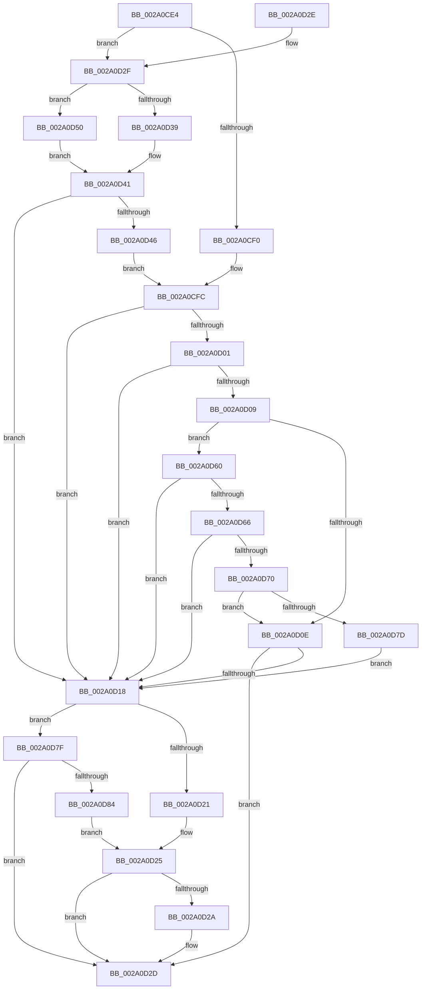

# MiSlabEntryPageFreed

- RVA: `0x002A0CE4`–`0x002A0D8E` (길이 `170` bytes)
- VA: `0x00000001402A0CE4`
- 실행 섹션: `.text`
- PDB 이름 있음: `예`; PDB Function 태그: `아니요`
- unwind 정보 RVA: `0x000DB714`
- 디코드: `54`개 명령, `170/170` bytes 표시
- 미해석 바이트: `0` (있으면 어셈블리에 `.byte`로 보존)

> 이 문서는 커널 이미지의 기계어와 PDB 기호를 분석해 생성했습니다. 4번과 5번은 함수 원형과 자료형을 바이너리 사용 방식에서 추정한 C 해석이며 원본 소스 복구 결과는 아닙니다.

## 1. Dependencies

- 직접 호출 지점: **0**; 고유 호출 대상: **0**
- 직접 호출자로 확인된 함수: **2**
- RIP 상대 이미지 참조: **0**

### Outgoing calls
- 직접 디코드된 call 명령이 없습니다.

### Direct callers
- [MiFreePageToSlabAllocator](MiFreePageToSlabAllocator_function_002A0A60.md) at `0x002A0B81`
- [MiInsertSlabEntry](../37/MiInsertSlabEntry_function_00378AF4.md) at `0x00378CAA`

### Static image references
- 디코드된 RIP-relative 메모리 참조가 없습니다.

## 2. Other-region calls and transfers

- 다른 실행 섹션으로 향하는 call: **0**
- 별도 외부 분기/꼬리 이동을 확인하지 못했습니다.

## 3. Assembly (complete function range)

```asm
002A0CE4  83 B9 80 00 00 00 08            cmp dword ptr [rcx + 0x80], 8
002A0CEB  4C 8B DA                        mov r11, rdx
002A0CEE  74 3F                           je 0x1402a0d2f
002A0CF0  B2 FF                           mov dl, 0xff
002A0CF2  4C 8D 51 20                     lea r10, [rcx + 0x20]
002A0CF6  41 B8 FF 00 00 00               mov r8d, 0xff
002A0CFC  4D 85 D2                        test r10, r10
002A0CFF  74 17                           je 0x1402a0d18
002A0D01  4D 8B 12                        mov r10, qword ptr [r10]
002A0D04  4D 85 D2                        test r10, r10
002A0D07  74 0F                           je 0x1402a0d18
002A0D09  80 FA FF                        cmp dl, 0xff
002A0D0C  75 52                           jne 0x1402a0d60
002A0D0E  41 8B 42 54                     mov eax, dword ptr [r10 + 0x54]
002A0D12  41 39 43 54                     cmp dword ptr [r11 + 0x54], eax
002A0D16  73 15                           jae 0x1402a0d2d
002A0D18  83 B9 80 00 00 00 08            cmp dword ptr [rcx + 0x80], 8
002A0D1F  74 5E                           je 0x1402a0d7f
002A0D21  48 83 C1 20                     add rcx, 0x20
002A0D25  48 85 C9                        test rcx, rcx
002A0D28  74 03                           je 0x1402a0d2d
002A0D2A  4C 89 19                        mov qword ptr [rcx], r11
002A0D2D  C3                              ret
002A0D2E  CC                              int3
002A0D2F  44 8B 42 5C                     mov r8d, dword ptr [rdx + 0x5c]
002A0D33  41 F6 C0 04                     test r8b, 4
002A0D37  75 17                           jne 0x1402a0d50
002A0D39  B2 FF                           mov dl, 0xff
002A0D3B  41 B8 FF 00 00 00               mov r8d, 0xff
002A0D41  80 FA FF                        cmp dl, 0xff
002A0D44  74 D2                           je 0x1402a0d18
002A0D46  48 8B 41 20                     mov rax, qword ptr [rcx + 0x20]
002A0D4A  4E 8D 14 C0                     lea r10, [rax + r8*8]
002A0D4E  EB AC                           jmp 0x1402a0cfc
002A0D50  41 C1 E8 03                     shr r8d, 3
002A0D54  41 8A D0                        mov dl, r8b
002A0D57  80 E2 3F                        and dl, 0x3f
002A0D5A  41 83 E0 3F                     and r8d, 0x3f
002A0D5E  EB E1                           jmp 0x1402a0d41
002A0D60  49 83 FA 01                     cmp r10, 1
002A0D64  74 B2                           je 0x1402a0d18
002A0D66  45 8B 4A 5C                     mov r9d, dword ptr [r10 + 0x5c]
002A0D6A  41 F6 C1 04                     test r9b, 4
002A0D6E  74 A8                           je 0x1402a0d18
002A0D70  41 C1 E9 03                     shr r9d, 3
002A0D74  41 83 E1 3F                     and r9d, 0x3f
002A0D78  44 3A CA                        cmp r9b, dl
002A0D7B  74 91                           je 0x1402a0d0e
002A0D7D  EB 99                           jmp 0x1402a0d18
002A0D7F  80 FA FF                        cmp dl, 0xff
002A0D82  74 A9                           je 0x1402a0d2d
002A0D84  48 8B 41 20                     mov rax, qword ptr [rcx + 0x20]
002A0D88  4A 8D 0C C0                     lea rcx, [rax + r8*8]
002A0D8C  EB 97                           jmp 0x1402a0d25
```

## 4. C-style interpretation (structured pseudocode)

```c
__int64 __fastcall MiSlabEntryPageFreed(__int64 a1, __int64 a2)
{
    if ((*(unsigned int *)(a1 + 128)) == 8) goto loc_002A0D2F;
loc_002A0CFC:
    if (a1 + 32 == 0) goto loc_002A0D18;
    if (*(unsigned __int64 *)(a1 + 32) == 0) goto loc_002A0D18;
    if (255 != 255) goto loc_002A0D60;
loc_002A0D0E:
    if ((*(unsigned int *)(a2 + 84)) >= ((unsigned int)((unsigned int)(*(unsigned int *)(*(unsigned __int64 *)(a1 + 32) + 84))))) goto loc_002A0D2D;
loc_002A0D18:
    if ((*(unsigned int *)(a1 + 128)) == 8) goto loc_002A0D7F;
    a1 = (a1) + (32);
loc_002A0D25:
    if (a1 != 0) {
        *(unsigned __int64 *)(a1) = a2;
    }
    return (unsigned int)(*(unsigned int *)(*(unsigned __int64 *)(a1 + 32) + 84));
loc_002A0D2F:
    if ((((unsigned __int8)((unsigned int)(*(unsigned int *)(255 + 92)))) & (4)) != 0) goto loc_002A0D50;
loc_002A0D41:
    if (255 == 255) goto loc_002A0D18;
    goto loc_002A0CFC;
loc_002A0D50:
    a3 = (unsigned int)((255) >> (3));
    a2 = (unsigned __int8)(((unsigned __int8)(a3)) & (63));
    a3 = (unsigned int)((a3) & (63));
    goto loc_002A0D41;
loc_002A0D60:
    if ((*(unsigned __int64 *)(a1 + 32) + 255 * 8) == 1) goto loc_002A0D18;
    if ((((unsigned __int8)((unsigned int)(*(unsigned int *)(*(unsigned __int64 *)(a1 + 32) + 255 * 8 + 92)))) & (4)) == 0) goto loc_002A0D18;
    a4 = (unsigned int)(((unsigned int)(*(unsigned int *)(*(unsigned __int64 *)(a1 + 32) + 255 * 8 + 92))) >> (3));
    a4 = (unsigned int)((a4) & (63));
    if (((unsigned __int8)(a4)) == ((unsigned __int8)(a2))) goto loc_002A0D0E;
    goto loc_002A0D18;
loc_002A0D7F:
    if (((unsigned __int8)(a2)) == 255) goto loc_002A0D2D;
    goto loc_002A0D25;
}
```

## 5. (Beta) C Style

```c
int64_t MiSlabEntryPageFreed(void *Arg1, void *Arg2)
{
    uint8_t *arg1 = (uint8_t *)Arg1;
    uint8_t *arg2 = (uint8_t *)Arg2;

    if ((*(uint32_t *)(arg1 + 0x80)) == 8) goto loc_002A0D2F;
loc_002A0CFC:
    if (Arg1 + 32 == 0) goto loc_002A0D18;
    if (*(uint64_t *)(arg1 + 0x20) == 0) goto loc_002A0D18;
    if (255 != 255) goto loc_002A0D60;
loc_002A0D0E:
    if ((*(uint32_t *)(arg2 + 0x54)) >= ((uint32_t)((uint32_t)(*(uint32_t *)(*(uint64_t *)(arg1 + 0x20) + 0x54))))) goto loc_002A0D2D;
loc_002A0D18:
    if ((*(uint32_t *)(arg1 + 0x80)) == 8) goto loc_002A0D7F;
    Arg1 = (Arg1) + (32);
loc_002A0D25:
    if (Arg1 != NULL) {
        *(void **)(arg1) = Arg2;
    }
    return (uint32_t)(*(uint32_t *)(*(uint64_t *)(arg1 + 0x20) + 0x54));
loc_002A0D2F:
    if ((((uint8_t)((uint32_t)(*(uint32_t *)(255 + 0x5C)))) & (4)) != 0) goto loc_002A0D50;
loc_002A0D41:
    if (255 == 255) goto loc_002A0D18;
    goto loc_002A0CFC;
loc_002A0D50:
    a3 = (uint32_t)((255) >> (3));
    Arg2 = (uint8_t)(((uint8_t)(a3)) & (63));
    a3 = (uint32_t)((a3) & (63));
    goto loc_002A0D41;
loc_002A0D60:
    if ((*(uint64_t *)(arg1 + 0x20) + 255 * 8) == 1) goto loc_002A0D18;
    if ((((uint8_t)((uint32_t)(*(uint32_t *)(*(uint64_t *)(arg1 + 0x20) + 0xFF * 8 + 0x5C)))) & (4)) == 0) goto loc_002A0D18;
    a4 = (uint32_t)(((uint32_t)(*(uint32_t *)(*(uint64_t *)(arg1 + 0x20) + 0xFF * 8 + 0x5C))) >> (3));
    a4 = (uint32_t)((a4) & (63));
    if (((uint8_t)(a4)) == ((uint8_t)(Arg2))) goto loc_002A0D0E;
    goto loc_002A0D18;
loc_002A0D7F:
    if (((uint8_t)(Arg2)) == 255) goto loc_002A0D2D;
    goto loc_002A0D25;
}
```

### 관측된 메모리 오프셋

구조체 형식이 확인되지 않은 접근은 인자 기준의 오프셋으로만 기록했습니다.

| 기준 인자 | 오프셋 표현 | 폭 (bit) | 접근 |
|---|---:|---:|---|
| `Arg1` | `+ 0x20` | `64` | `R` |
| `Arg1` | `+ 0x80` | `32` | `R` |
| `Arg2` | `+ 0x54` | `32` | `R` |
| `Arg2` | `+ 0x5C` | `32` | `R` |

## 6. Execution-region graph

[열기: 2D/3D 그래프와 함수 탐색 컨트롤 패널](../../../control-panel.html?section=text&rva=0x002A0CE4&view=graph)

- 2D 그래프는 위에서 아래로 흐르고, 3D 그래프는 빈 공간을 드래그해 회전합니다. Shift+드래그는 이동, 휠은 확대·축소, 함수 노드 선택은 대상 보고서 이동입니다.

### Static fallback


