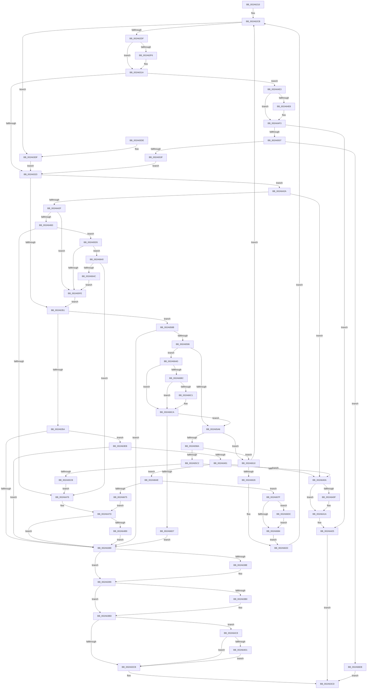

# MiSplitPrivatePage

- RVA: `0x002A6210`–`0x002A6708` (길이 `1,272` bytes)
- VA: `0x00000001402A6210`
- 실행 섹션: `.text`
- PDB 이름 있음: `예`; PDB Function 태그: `아니요`
- unwind 정보 RVA: `0x00068A6C`
- 디코드: `315`개 명령, `1,272/1,272` bytes 표시
- 미해석 바이트: `0` (있으면 어셈블리에 `.byte`로 보존)

> 이 문서는 커널 이미지의 기계어와 PDB 기호를 분석해 생성했습니다. 4번과 5번은 함수 원형과 자료형을 바이너리 사용 방식에서 추정한 C 해석이며 원본 소스 복구 결과는 아닙니다.

## 1. Dependencies

- 직접 호출 지점: **31**; 고유 호출 대상: **19**
- 직접 호출자로 확인된 함수: **1**
- RIP 상대 이미지 참조: **1**

### Outgoing calls
- `0x002A6262` → [MiVadPureReserve](../2C/MiVadPureReserve_function_002C34C0.md) (function, `0x002C34C0`)
- `0x002A629B` → [MiChargeFullProcessCommitment](../../page/88/MiChargeFullProcessCommitment_function_00887630.md) (function, `0x00887630`)
- `0x002A62C3` → [MiLockWorkingSetShared](../27/MiLockWorkingSetShared_function_0027CBF0.md) (function, `0x0027CBF0`)
- `0x002A62EC` → [MiGetNextPageTable](../2C/MiGetNextPageTable_function_002C2EE0.md) (function, `0x002C2EE0`)
- `0x002A633D` → [MiGetProtoPteAddress](../32/MiGetProtoPteAddress_function_0032E970.md) (function, `0x0032E970`)
- `0x002A6394` → [MiUnlockPageTable](../21/MiUnlockPageTable_function_00216EC0.md) (function, `0x00216EC0`)
- `0x002A639F` → [MiUnlockWorkingSetShared](../27/MiUnlockWorkingSetShared_function_0027D690.md) (function, `0x0027D690`)
- `0x002A63B8` → [UNLOCK_PAGE_TABLE_COMMITMENT](../2E/UNLOCK_PAGE_TABLE_COMMITMENT_function_002E27D0.md) (function, `0x002E27D0`)
- `0x002A63E1` → [MiMakeSystemAddressValid](../27/MiMakeSystemAddressValid_function_0027FF70.md) (function, `0x0027FF70`)
- `0x002A6415` → [MiUnlockPageTable](../21/MiUnlockPageTable_function_00216EC0.md) (function, `0x00216EC0`)
- `0x002A6420` → [MiUnlockWorkingSetShared](../27/MiUnlockWorkingSetShared_function_0027D690.md) (function, `0x0027D690`)
- `0x002A645D` → [MiIncreaseUsedPtes](../24/MiIncreaseUsedPtes_function_00243630.md) (function, `0x00243630`)
- `0x002A64BB` → [MiMakeDemandZeroPte](../33/MiMakeDemandZeroPte_function_00337A00.md) (function, `0x00337A00`)
- `0x002A64D9` → [MiReturnFullProcessCommitment](../../page/9E/MiReturnFullProcessCommitment_function_009E5D58.md) (function, `0x009E5D58`)
- `0x002A64EE` → [MiUnlockPageTable](../21/MiUnlockPageTable_function_00216EC0.md) (function, `0x00216EC0`)
- `0x002A64F9` → [MiUnlockWorkingSetShared](../27/MiUnlockWorkingSetShared_function_0027D690.md) (function, `0x0027D690`)
- `0x002A651D` → [LOCK_PAGE_TABLE_COMMITMENT](LOCK_PAGE_TABLE_COMMITMENT_function_002A6090.md) (function, `0x002A6090`)
- `0x002A6530` → [MiCommitPageTablesForVad](../../page/88/MiCommitPageTablesForVad_function_00886D50.md) (function, `0x00886D50`)
- `0x002A6566` → [MiLockWorkingSetShared](../27/MiLockWorkingSetShared_function_0027CBF0.md) (function, `0x0027CBF0`)
- `0x002A6579` → [MiMakeSystemAddressValid](../27/MiMakeSystemAddressValid_function_0027FF70.md) (function, `0x0027FF70`)
- `0x002A6599` → [MiIsPrototypePteVadLookup](../32/MiIsPrototypePteVadLookup_function_00328B70.md) (function, `0x00328B70`)
- `0x002A65B1` → [MiMakeProtoLeafValid](MiMakeProtoLeafValid_function_002A6710.md) (function, `0x002A6710`)
- `0x002A6600` → [MiMakePrototypePteVadLookup](../2C/MiMakePrototypePteVadLookup_function_002C3480.md) (function, `0x002C3480`)
- `0x002A662C` → [MiUnlockPageTable](../21/MiUnlockPageTable_function_00216EC0.md) (function, `0x00216EC0`)
- `0x002A666A` → [MiCopyOnWrite](../36/MiCopyOnWrite_function_00362A0C.md) (function, `0x00362A0C`)
- `0x002A668A` → [MiUnlockWorkingSetShared](../27/MiUnlockWorkingSetShared_function_0027D690.md) (function, `0x0027D690`)
- `0x002A6699` → [MiCopyOnWriteCheckConditions](MiCopyOnWriteCheckConditions_function_002A750C.md) (function, `0x002A750C`)
- `0x002A66A1` → [MiLockWorkingSetShared](../27/MiLockWorkingSetShared_function_0027CBF0.md) (function, `0x0027CBF0`)
- `0x002A66E2` → [MiUnlockPageTable](../21/MiUnlockPageTable_function_00216EC0.md) (function, `0x00216EC0`)
- `0x002A66F1` → [UNLOCK_PAGE_TABLE_COMMITMENT](../2E/UNLOCK_PAGE_TABLE_COMMITMENT_function_002E27D0.md) (function, `0x002E27D0`)
- `0x002A66FC` → [MiReturnFullProcessCommitment](../../page/9E/MiReturnFullProcessCommitment_function_009E5D58.md) (function, `0x009E5D58`)

### Direct callers
- [MiCopyToCfgBitMap](../../page/8D/MiCopyToCfgBitMap_function_008D1140.md) at `0x008D127E`

### Static image references
- `0x002A66AD` → RVA `0x00E2DC80` (`.data`; read)

## 2. Other-region calls and transfers

- 다른 실행 섹션으로 향하는 call: **4**
  - `0x002A629B` → [MiChargeFullProcessCommitment](../../page/88/MiChargeFullProcessCommitment_function_00887630.md) (`.text` → `PAGE`)
  - `0x002A64D9` → [MiReturnFullProcessCommitment](../../page/9E/MiReturnFullProcessCommitment_function_009E5D58.md) (`.text` → `PAGE`)
  - `0x002A6530` → [MiCommitPageTablesForVad](../../page/88/MiCommitPageTablesForVad_function_00886D50.md) (`.text` → `PAGE`)
  - `0x002A66FC` → [MiReturnFullProcessCommitment](../../page/9E/MiReturnFullProcessCommitment_function_009E5D58.md) (`.text` → `PAGE`)
- 별도 외부 분기/꼬리 이동을 확인하지 못했습니다.

## 3. Assembly (complete function range)

```asm
002A6210  48 8B C4                        mov rax, rsp
002A6213  44 89 40 18                     mov dword ptr [rax + 0x18], r8d
002A6217  48 89 50 10                     mov qword ptr [rax + 0x10], rdx
002A621B  48 89 48 08                     mov qword ptr [rax + 8], rcx
002A621F  53                              push rbx
002A6220  55                              push rbp
002A6221  56                              push rsi
002A6222  57                              push rdi
002A6223  41 54                           push r12
002A6225  41 55                           push r13
002A6227  41 56                           push r14
002A6229  41 57                           push r15
002A622B  48 83 EC 78                     sub rsp, 0x78
002A622F  33 FF                           xor edi, edi
002A6231  4C 8B F1                        mov r14, rcx
002A6234  48 89 78 90                     mov qword ptr [rax - 0x70], rdi
002A6238  48 8B CA                        mov rcx, rdx
002A623B  89 78 80                        mov dword ptr [rax - 0x80], edi
002A623E  48 8B DA                        mov rbx, rdx
002A6241  65 48 8B 04 25 88 01 00 00      mov rax, qword ptr gs:[0x188]
002A624A  48 89 44 24 50                  mov qword ptr [rsp + 0x50], rax
002A624F  4C 8B A8 B8 00 00 00            mov r13, qword ptr [rax + 0xb8]
002A6256  4C 89 6C 24 40                  mov qword ptr [rsp + 0x40], r13
002A625B  49 8D AD 00 04 00 00            lea rbp, [r13 + 0x400]
002A6262  E8 59 D2 01 00                  call 0x1402c34c0
002A6267  89 44 24 30                     mov dword ptr [rsp + 0x30], eax
002A626B  48 B8 F8 FF FF FF 7F 00 00 00   movabs rax, 0x7ffffffff8
002A6275  49 C1 EE 09                     shr r14, 9
002A6279  4C 23 F0                        and r14, rax
002A627C  48 B8 00 00 00 00 80 F6 FF FF   movabs rax, 0xfffff68000000000
002A6286  48 8B C8                        mov rcx, rax
002A6289  4C 03 F1                        add r14, rcx
002A628C  48 8B 4A 48                     mov rcx, qword ptr [rdx + 0x48]
002A6290  48 89 4C 24 58                  mov qword ptr [rsp + 0x58], rcx
002A6295  8D 57 01                        lea edx, [rdi + 1]
002A6298  49 8B CD                        mov rcx, r13
002A629B  E8 90 13 5E 00                  call 0x140887630
002A62A0  8B F7                           mov esi, edi
002A62A2  89 BC 24 D8 00 00 00            mov dword ptr [rsp + 0xd8], edi
002A62A9  89 BC 24 D0 00 00 00            mov dword ptr [rsp + 0xd0], edi
002A62B0  48 8B CD                        mov rcx, rbp
002A62B3  89 7C 24 34                     mov dword ptr [rsp + 0x34], edi
002A62B7  44 8B F8                        mov r15d, eax
002A62BA  8B 7B 30                        mov edi, dword ptr [rbx + 0x30]
002A62BD  C1 EF 0C                        shr edi, 0xc
002A62C0  83 E7 7F                        and edi, 0x7f
002A62C3  E8 28 69 FD FF                  call 0x14027cbf0
002A62C8  44 8A E0                        mov r12b, al
002A62CB  45 33 C9                        xor r9d, r9d
002A62CE  45 8A C4                        mov r8b, r12b
002A62D1  49 8B CE                        mov rcx, r14
002A62D4  44 39 4C 24 30                  cmp dword ptr [rsp + 0x30], r9d
002A62D9  0F 84 00 01 00 00               je 0x1402a63df
002A62DF  48 8D 44 24 38                  lea rax, [rsp + 0x38]
002A62E4  49 8B D6                        mov rdx, r14
002A62E7  48 89 44 24 20                  mov qword ptr [rsp + 0x20], rax
002A62EC  E8 EF CB 01 00                  call 0x1402c2ee0
002A62F1  48 85 C0                        test rax, rax
002A62F4  74 24                           je 0x1402a631a
002A62F6  48 B9 F8 FF FF FF 7F 00 00 00   movabs rcx, 0x7ffffffff8
002A6300  48 8B F0                        mov rsi, rax
002A6303  48 C1 EE 09                     shr rsi, 9
002A6307  48 23 F1                        and rsi, rcx
002A630A  48 B9 00 00 00 00 80 F6 FF FF   movabs rcx, 0xfffff68000000000
002A6314  48 8B C9                        mov rcx, rcx
002A6317  48 03 F1                        add rsi, rcx
002A631A  4C 3B F0                        cmp r14, rax
002A631D  0F 85 C0 01 00 00               jne 0x1402a64e3
002A6323  48 8B 94 24 C0 00 00 00         mov rdx, qword ptr [rsp + 0xc0]
002A632B  4C 8D 4C 24 58                  lea r9, [rsp + 0x58]
002A6330  48 C1 EA 0C                     shr rdx, 0xc
002A6334  41 B8 08 00 00 00               mov r8d, 8
002A633A  48 8B CB                        mov rcx, rbx
002A633D  E8 2E 86 08 00                  call 0x14032e970
002A6342  49 8B 1E                        mov rbx, qword ptr [r14]
002A6345  4C 8B E8                        mov r13, rax
002A6348  48 85 DB                        test rbx, rbx
002A634B  0F 84 D9 00 00 00               je 0x1402a642a
002A6351  F6 C3 01                        test bl, 1
002A6354  0F 84 31 02 00 00               je 0x1402a658b
002A635A  48 C1 EB 0C                     shr rbx, 0xc
002A635E  48 B8 FF FF FF FF FF 00 00 00   movabs rax, 0xffffffffff
002A6368  48 23 D8                        and rbx, rax
002A636B  48 8D 0C 5B                     lea rcx, [rbx + rbx*2]
002A636F  48 C1 E1 04                     shl rcx, 4
002A6373  48 B8 00 00 00 00 00 DE FF FF   movabs rax, 0xffffde0000000000
002A637D  48 03 C8                        add rcx, rax
002A6380  48 8B 41 28                     mov rax, qword ptr [rcx + 0x28]
002A6384  48 85 C0                        test rax, rax
002A6387  78 62                           js 0x1402a63eb
002A6389  48 85 F6                        test rsi, rsi
002A638C  74 0B                           je 0x1402a6399
002A638E  48 8B D6                        mov rdx, rsi
002A6391  48 8B CD                        mov rcx, rbp
002A6394  E8 27 0B F7 FF                  call 0x140216ec0
002A6399  41 8A D4                        mov dl, r12b
002A639C  48 8B CD                        mov rcx, rbp
002A639F  E8 EC 72 FD FF                  call 0x14027d690
002A63A4  83 7C 24 34 00                  cmp dword ptr [rsp + 0x34], 0
002A63A9  48 8B 5C 24 40                  mov rbx, qword ptr [rsp + 0x40]
002A63AE  74 0D                           je 0x1402a63bd
002A63B0  48 8B 4C 24 50                  mov rcx, qword ptr [rsp + 0x50]
002A63B5  48 8B D3                        mov rdx, rbx
002A63B8  E8 13 C4 03 00                  call 0x1402e27d0
002A63BD  83 BC 24 D0 00 00 00 00         cmp dword ptr [rsp + 0xd0], 0
002A63C5  0F 84 FD 00 00 00               je 0x1402a64c8
002A63CB  33 C0                           xor eax, eax
002A63CD  48 83 C4 78                     add rsp, 0x78
002A63D1  41 5F                           pop r15
002A63D3  41 5E                           pop r14
002A63D5  41 5D                           pop r13
002A63D7  41 5C                           pop r12
002A63D9  5F                              pop rdi
002A63DA  5E                              pop rsi
002A63DB  5D                              pop rbp
002A63DC  5B                              pop rbx
002A63DD  C3                              ret
002A63DE  CC                              int3
002A63DF  8B D7                           mov edx, edi
002A63E1  E8 8A 9B FD FF                  call 0x14027ff70
002A63E6  E9 38 FF FF FF                  jmp 0x1402a6323
002A63EB  48 8B 41 08                     mov rax, qword ptr [rcx + 8]
002A63EF  48 B9 00 00 00 00 00 00 00 80   movabs rcx, 0x8000000000000000
002A63F9  48 0B C1                        or rax, rcx
002A63FC  49 3B C5                        cmp rax, r13
002A63FF  75 88                           jne 0x1402a6389
002A6401  45 85 FF                        test r15d, r15d
002A6404  0F 89 44 02 00 00               jns 0x1402a664e
002A640A  48 85 F6                        test rsi, rsi
002A640D  74 0B                           je 0x1402a641a
002A640F  48 8B D6                        mov rdx, rsi
002A6412  48 8B CD                        mov rcx, rbp
002A6415  E8 A6 0A F7 FF                  call 0x140216ec0
002A641A  41 8A D4                        mov dl, r12b
002A641D  48 8B CD                        mov rcx, rbp
002A6420  E8 6B 72 FD FF                  call 0x14027d690
002A6425  41 8B C7                        mov eax, r15d
002A6428  EB A3                           jmp 0x1402a63cd
002A642A  45 85 FF                        test r15d, r15d
002A642D  78 DB                           js 0x1402a640a
002A642F  48 B8 F8 FF FF FF 7F 00 00 00   movabs rax, 0x7ffffffff8
002A6439  49 8B D6                        mov rdx, r14
002A643C  48 C1 EA 09                     shr rdx, 9
002A6440  48 23 D0                        and rdx, rax
002A6443  48 B8 00 00 00 00 80 F6 FF FF   movabs rax, 0xfffff68000000000
002A644D  48 8B C8                        mov rcx, rax
002A6450  45 33 C9                        xor r9d, r9d
002A6453  48 03 D1                        add rdx, rcx
002A6456  41 8D 59 01                     lea ebx, [r9 + 1]
002A645A  44 8B C3                        mov r8d, ebx
002A645D  E8 CE D1 F9 FF                  call 0x140243630
002A6462  83 7C 24 30 00                  cmp dword ptr [rsp + 0x30], 0
002A6467  0F 84 91 01 00 00               je 0x1402a65fe
002A646D  4D 85 ED                        test r13, r13
002A6470  0F 85 5F 01 00 00               jne 0x1402a65d5
002A6476  89 9C 24 D8 00 00 00            mov dword ptr [rsp + 0xd8], ebx
002A647D  89 9C 24 D0 00 00 00            mov dword ptr [rsp + 0xd0], ebx
002A6484  4C 8B 84 24 C8 00 00 00         mov r8, qword ptr [rsp + 0xc8]
002A648C  41 8B 48 34                     mov ecx, dword ptr [r8 + 0x34]
002A6490  41 0F B6 50 22                  movzx edx, byte ptr [r8 + 0x22]
002A6495  48 C1 E2 20                     shl rdx, 0x20
002A6499  48 0B D1                        or rdx, rcx
002A649C  48 03 D3                        add rdx, rbx
002A649F  41 89 50 34                     mov dword ptr [r8 + 0x34], edx
002A64A3  48 C1 EA 20                     shr rdx, 0x20
002A64A7  83 BC 24 D8 00 00 00 00         cmp dword ptr [rsp + 0xd8], 0
002A64AF  41 88 50 22                     mov byte ptr [r8 + 0x22], dl
002A64B3  0F 84 D0 FE FF FF               je 0x1402a6389
002A64B9  8B CB                           mov ecx, ebx
002A64BB  E8 40 15 09 00                  call 0x140337a00
002A64C0  49 89 06                        mov qword ptr [r14], rax
002A64C3  E9 C1 FE FF FF                  jmp 0x1402a6389
002A64C8  45 85 FF                        test r15d, r15d
002A64CB  0F 88 FA FE FF FF               js 0x1402a63cb
002A64D1  BA 01 00 00 00                  mov edx, 1
002A64D6  48 8B CB                        mov rcx, rbx
002A64D9  E8 7A F8 73 00                  call 0x1409e5d58
002A64DE  E9 E8 FE FF FF                  jmp 0x1402a63cb
002A64E3  48 85 F6                        test rsi, rsi
002A64E6  74 0B                           je 0x1402a64f3
002A64E8  48 8B D6                        mov rdx, rsi
002A64EB  48 8B CD                        mov rcx, rbp
002A64EE  E8 CD 09 F7 FF                  call 0x140216ec0
002A64F3  41 8A D4                        mov dl, r12b
002A64F6  48 8B CD                        mov rcx, rbp
002A64F9  E8 92 71 FD FF                  call 0x14027d690
002A64FE  45 85 FF                        test r15d, r15d
002A6501  0F 88 1E FF FF FF               js 0x1402a6425
002A6507  48 8B 74 24 50                  mov rsi, qword ptr [rsp + 0x50]
002A650C  41 BC 01 00 00 00               mov r12d, 1
002A6512  48 8B CE                        mov rcx, rsi
002A6515  44 89 64 24 34                  mov dword ptr [rsp + 0x34], r12d
002A651A  49 8B D5                        mov rdx, r13
002A651D  E8 6E FB FF FF                  call 0x1402a6090
002A6522  4C 8B 84 24 C0 00 00 00         mov r8, qword ptr [rsp + 0xc0]
002A652A  48 8B CB                        mov rcx, rbx
002A652D  49 8B D0                        mov rdx, r8
002A6530  E8 1B 08 5E 00                  call 0x140886d50
002A6535  8B D8                           mov ebx, eax
002A6537  85 C0                           test eax, eax
002A6539  0F 88 AC 01 00 00               js 0x1402a66eb
002A653F  48 B8 F8 FF FF FF 7F 00 00 00   movabs rax, 0x7ffffffff8
002A6549  49 8B F6                        mov rsi, r14
002A654C  48 C1 EE 09                     shr rsi, 9
002A6550  48 23 F0                        and rsi, rax
002A6553  48 B8 00 00 00 00 80 F6 FF FF   movabs rax, 0xfffff68000000000
002A655D  48 8B C0                        mov rax, rax
002A6560  48 8B CD                        mov rcx, rbp
002A6563  48 03 F0                        add rsi, rax
002A6566  E8 85 66 FD FF                  call 0x14027cbf0
002A656B  45 33 C9                        xor r9d, r9d
002A656E  44 8A C0                        mov r8b, al
002A6571  8B D7                           mov edx, edi
002A6573  49 8B CE                        mov rcx, r14
002A6576  44 8A E0                        mov r12b, al
002A6579  E8 F2 99 FD FF                  call 0x14027ff70
002A657E  48 8B 9C 24 C8 00 00 00         mov rbx, qword ptr [rsp + 0xc8]
002A6586  E9 98 FD FF FF                  jmp 0x1402a6323
002A658B  48 0F BA E3 0A                  bt rbx, 0xa
002A6590  0F 83 F3 FD FF FF               jae 0x1402a6389
002A6596  48 8B CB                        mov rcx, rbx
002A6599  E8 D2 25 08 00                  call 0x140328b70
002A659E  85 C0                           test eax, eax
002A65A0  0F 84 07 01 00 00               je 0x1402a66ad
002A65A6  45 8A C4                        mov r8b, r12b
002A65A9  BA 18 00 00 00                  mov edx, 0x18
002A65AE  49 8B CE                        mov rcx, r14
002A65B1  E8 5A 01 00 00                  call 0x1402a6710
002A65B6  85 C0                           test eax, eax
002A65B8  79 56                           jns 0x1402a6610
002A65BA  49 8B 06                        mov rax, qword ptr [r14]
002A65BD  48 3B D8                        cmp rbx, rax
002A65C0  75 4E                           jne 0x1402a6610
002A65C2  45 85 FF                        test r15d, r15d
002A65C5  0F 88 3F FE FF FF               js 0x1402a640a
002A65CB  BB 01 00 00 00                  mov ebx, 1
002A65D0  E9 A1 FE FF FF                  jmp 0x1402a6476
002A65D5  48 B8 F8 FF FF FF 7F 00 00 00   movabs rax, 0x7ffffffff8
002A65DF  49 8B CD                        mov rcx, r13
002A65E2  48 C1 E9 09                     shr rcx, 9
002A65E6  48 23 C8                        and rcx, rax
002A65E9  48 B8 00 00 00 00 80 F6 FF FF   movabs rax, 0xfffff68000000000
002A65F3  48 8B C0                        mov rax, rax
002A65F6  48 8B 04 01                     mov rax, qword ptr [rcx + rax]
002A65FA  84 C3                           test bl, al
002A65FC  74 42                           je 0x1402a6640
002A65FE  8B CB                           mov ecx, ebx
002A6600  E8 7B CE 01 00                  call 0x1402c3480
002A6605  48 8B D8                        mov rbx, rax
002A6608  49 89 06                        mov qword ptr [r14], rax
002A660B  E9 41 FD FF FF                  jmp 0x1402a6351
002A6610  4C 8B 6C 24 40                  mov r13, qword ptr [rsp + 0x40]
002A6615  48 8B 9C 24 C8 00 00 00         mov rbx, qword ptr [rsp + 0xc8]
002A661D  48 85 F6                        test rsi, rsi
002A6620  0F 84 A5 FC FF FF               je 0x1402a62cb
002A6626  48 8B D6                        mov rdx, rsi
002A6629  48 8B CD                        mov rcx, rbp
002A662C  E8 8F 08 F7 FF                  call 0x140216ec0
002A6631  33 F6                           xor esi, esi
002A6633  48 8B 9C 24 C8 00 00 00         mov rbx, qword ptr [rsp + 0xc8]
002A663B  E9 8B FC FF FF                  jmp 0x1402a62cb
002A6640  48 A9 E0 03 00 00               test rax, 0x3e0
002A6646  0F 84 2A FE FF FF               je 0x1402a6476
002A664C  EB B0                           jmp 0x1402a65fe
002A664E  48 8B 8C 24 C0 00 00 00         mov rcx, qword ptr [rsp + 0xc0]
002A6656  48 8D 44 24 48                  lea rax, [rsp + 0x48]
002A665B  45 33 C9                        xor r9d, r9d
002A665E  48 89 44 24 20                  mov qword ptr [rsp + 0x20], rax
002A6663  49 83 C8 FF                     or r8, 0xffffffffffffffff
002A6667  49 8B D6                        mov rdx, r14
002A666A  E8 9D C3 0B 00                  call 0x140362a0c
002A666F  8B D8                           mov ebx, eax
002A6671  85 C0                           test eax, eax
002A6673  78 0A                           js 0x1402a667f
002A6675  BB 01 00 00 00                  mov ebx, 1
002A667A  E9 FE FD FF FF                  jmp 0x1402a647d
002A667F  48 85 F6                        test rsi, rsi
002A6682  75 58                           jne 0x1402a66dc
002A6684  41 8A D4                        mov dl, r12b
002A6687  48 8B CD                        mov rcx, rbp
002A668A  E8 01 70 FD FF                  call 0x14027d690
002A668F  4C 8B 44 24 48                  mov r8, qword ptr [rsp + 0x48]
002A6694  8B D3                           mov edx, ebx
002A6696  48 8B CD                        mov rcx, rbp
002A6699  E8 6E 0E 00 00                  call 0x1402a750c
002A669E  48 8B CD                        mov rcx, rbp
002A66A1  E8 4A 65 FD FF                  call 0x14027cbf0
002A66A6  4C 8B 6C 24 40                  mov r13, qword ptr [rsp + 0x40]
002A66AB  EB 86                           jmp 0x1402a6633
002A66AD  48 8B 0D CC 75 B8 00            mov rcx, qword ptr [rip + 0xb875cc]
002A66B4  48 8B C3                        mov rax, rbx
002A66B7  48 85 C9                        test rcx, rcx
002A66BA  74 0E                           je 0x1402a66ca
002A66BC  F6 C3 10                        test bl, 0x10
002A66BF  75 09                           jne 0x1402a66ca
002A66C1  48 8B C1                        mov rax, rcx
002A66C4  48 F7 D0                        not rax
002A66C7  48 23 C3                        and rax, rbx
002A66CA  48 C1 F8 10                     sar rax, 0x10
002A66CE  49 3B C5                        cmp rax, r13
002A66D1  0F 84 CF FE FF FF               je 0x1402a65a6
002A66D7  E9 AD FC FF FF                  jmp 0x1402a6389
002A66DC  48 8B D6                        mov rdx, rsi
002A66DF  48 8B CD                        mov rcx, rbp
002A66E2  E8 D9 07 F7 FF                  call 0x140216ec0
002A66E7  33 F6                           xor esi, esi
002A66E9  EB 99                           jmp 0x1402a6684
002A66EB  49 8B D5                        mov rdx, r13
002A66EE  48 8B CE                        mov rcx, rsi
002A66F1  E8 DA C0 03 00                  call 0x1402e27d0
002A66F6  49 8B D4                        mov rdx, r12
002A66F9  49 8B CD                        mov rcx, r13
002A66FC  E8 57 F6 73 00                  call 0x1409e5d58
002A6701  8B C3                           mov eax, ebx
002A6703  E9 C5 FC FF FF                  jmp 0x1402a63cd
```

## 4. C-style interpretation (structured pseudocode)

```c
__int64 __fastcall MiSplitPrivatePage(__int64 a1, __int64 a2, int a3, int a4)
{
    __int64 result;
    __int64 v_r14;
    __int64 v_rbx;
    __int64 v_rdi;
    __int64 v_rsi;
    __int64 v_rsp;
    unsigned __int64 v_stack_m60;
    unsigned __int64 v_stack_m68;
    unsigned __int64 v_stack_m78;
    unsigned __int64 v_stack_m80;
    unsigned int v_stack_m84;
    unsigned int v_stack_m88;
    unsigned __int64 v_stack_m98;
    unsigned int v_stack_p18;
    unsigned int v_stack_p20;
    unsigned int v_stack_p30;
    unsigned int v_stack_p34;
    unsigned __int64 v_stack_p40;
    unsigned __int64 v_stack_p48;
    unsigned __int64 v_stack_p50;
    unsigned __int64 v_stack_p8;
    unsigned __int64 v_stack_pC0;
    unsigned __int64 v_stack_pC8;
    unsigned int v_stack_pD0;
    unsigned int v_stack_pD8;

    *(unsigned int *)(v_rsp + 24) = a3;
    *(unsigned __int64 *)(v_rsp + 16) = a2;
    *(unsigned __int64 *)(v_rsp + 8) = a1;
    v_rsp = (v_rsp) - (120);
    v_rdi = 0;
    *(unsigned __int64 *)(v_rsp - 112) = 0;
    *(unsigned int *)(v_rsp - 128) = 0;
    v_stack_m68 = *(unsigned __int64 *)(gs_base + (0 + 392));
    v_stack_m78 = *(unsigned __int64 *)(*(unsigned __int64 *)(gs_base + (0 + 392)) + 184);
    result = MiVadPureReserve(a2, a2, a3, a4);
    v_stack_m88 = (unsigned int)(result);
    v_r14 = (a1) >> (9);
    v_r14 = (v_r14) & (result);
    v_r14 = (v_r14) + (result);
    v_stack_m60 = *(unsigned __int64 *)(a2 + 72);
    result = MiChargeFullProcessCommitment(*(unsigned __int64 *)(*(unsigned __int64 *)(gs_base + (0 + 392)) + 184), v_rdi + 1, a3, a4);
    v_stack_p20 = 0;
    v_stack_p18 = 0;
    v_stack_m84 = 0;
    v_rdi = (unsigned int)(((unsigned int)(*(unsigned int *)(a2 + 48))) >> (12));
    v_rdi = (unsigned int)((v_rdi) & (127));
    result = MiLockWorkingSetShared(*(unsigned __int64 *)(*(unsigned __int64 *)(gs_base + (0 + 392)) + 184) + 1024, v_rdi + 1, a3, a4);
loc_002A62CB:
    a4 = 0;
    if (v_stack_m88 == 0) goto loc_002A63DF;
    v_stack_m98 = v_stack_m80;
    result = MiGetNextPageTable(v_r14, v_r14, (unsigned __int8)((unsigned __int8)(result)), a4);
    v_rsi = 0;
    if (result != 0) {
        v_rsi = result;
        v_rsi = (v_rsi) >> (9);
        v_rsi = (v_rsi) & (v_r14);
        a1 = v_r14;
        v_rsi = (v_rsi) + (a1);
    }
    if (v_r14 != result) goto loc_002A64E3;
loc_002A6323:
    a2 = (v_stack_p8) >> (12);
    result = MiGetProtoPteAddress(a2, a2, 8, v_stack_m60);
    if (*(unsigned __int64 *)(v_r14) == 0) goto loc_002A642A;
loc_002A6351:
    if ((((unsigned __int8)(*(unsigned __int64 *)(v_r14))) & (1)) == 0) goto loc_002A658B;
    v_rbx = (*(unsigned __int64 *)(v_r14)) >> (12);
    v_rbx = (v_rbx) & (result);
    a1 = (v_rbx + v_rbx * 2) << (4);
    a1 = (a1) + (result);
    if (sign_flag) goto loc_002A63EB;
loc_002A6389:
    result = *(unsigned __int64 *)(a1 + 40);
    if (v_rsi != 0) {
        a2 = v_rsi;
        a1 = *(unsigned __int64 *)(*(unsigned __int64 *)(gs_base + (0 + 392)) + 184) + 1024;
        result = MiUnlockPageTable(a1, a2, 8, v_stack_m60);
    }
    result = MiUnlockWorkingSetShared(*(unsigned __int64 *)(*(unsigned __int64 *)(gs_base + (0 + 392)) + 184) + 1024, (unsigned __int8)((unsigned __int8)(result)), 8, v_stack_m60);
    if (v_stack_m84 != 0) {
        a1 = v_stack_m68;
        a2 = v_stack_m78;
        result = UNLOCK_PAGE_TABLE_COMMITMENT(a1, a2, 8, v_stack_m60);
    }
    if (v_stack_p18 == 0) goto loc_002A64C8;
loc_002A63CB:
    result = 0;
loc_002A63CD:
    v_rsp = (v_rsp) + (120);
    return result;
loc_002A63DF:
    result = MiMakeSystemAddressValid(a1, (unsigned int)((unsigned int)(v_rdi)), 8, v_stack_m60);
    goto loc_002A6323;
loc_002A63EB:
    result = (*(unsigned __int64 *)(a1 + 8)) | (a1);
    if (result != result) goto loc_002A6389;
    if (!sign_flag) goto loc_002A664E;
loc_002A640A:
    if (v_rsi != 0) {
        a2 = v_rsi;
        a1 = *(unsigned __int64 *)(*(unsigned __int64 *)(gs_base + (0 + 392)) + 184) + 1024;
        result = MiUnlockPageTable(a1, a2, 8, v_stack_m60);
    }
    result = MiUnlockWorkingSetShared(*(unsigned __int64 *)(*(unsigned __int64 *)(gs_base + (0 + 392)) + 184) + 1024, (unsigned __int8)((unsigned __int8)(result)), 8, v_stack_m60);
loc_002A6425:
    goto loc_002A63CD;
loc_002A642A:
    if (sign_flag) goto loc_002A640A;
    a2 = (v_r14) >> (9);
    a2 = (a2) & ((unsigned int)((unsigned int)((unsigned int)((unsigned int)(result)))));
    a4 = 0;
    a2 = (a2) + ((unsigned int)((unsigned int)((unsigned int)((unsigned int)(result)))));
    result = MiIncreaseUsedPtes((unsigned int)((unsigned int)((unsigned int)((unsigned int)(result)))), a2, (unsigned int)((unsigned int)(a4 + 1)), a4);
    if (v_stack_p30 == 0) goto loc_002A65FE;
    if (result != 0) goto loc_002A65D5;
loc_002A6476:
    v_stack_pD8 = (unsigned int)(a4 + 1);
loc_002A647D:
    v_stack_pD0 = (unsigned int)(a4 + 1);
    a2 = (*(unsigned __int8 *)(v_stack_pC8 + 34)) << (32);
    a2 = (a2) | ((unsigned int)(*(unsigned int *)(v_stack_pC8 + 52)));
    a2 = (a2) + (a4 + 1);
    *(unsigned int *)(v_stack_pC8 + 52) = (unsigned int)(a2);
    a2 = (a2) >> (32);
    *(unsigned __int8 *)(v_stack_pC8 + 34) = (unsigned __int8)(a2);
    if (v_stack_pD8 == 0) goto loc_002A6389;
    result = MiMakeDemandZeroPte((unsigned int)((unsigned int)(a4 + 1)), a2, v_stack_pC8, a4);
    *(unsigned __int64 *)(v_r14) = result;
    goto loc_002A6389;
loc_002A64C8:
    if (sign_flag) goto loc_002A63CB;
    result = MiReturnFullProcessCommitment(a4 + 1, 1, v_stack_pC8, a4);
    goto loc_002A63CB;
loc_002A64E3:
    if (v_rsi != 0) {
        a2 = v_rsi;
        a1 = *(unsigned __int64 *)(*(unsigned __int64 *)(gs_base + (0 + 392)) + 184) + 1024;
        result = MiUnlockPageTable(a1, a2, v_stack_pC8, a4);
    }
    result = MiUnlockWorkingSetShared(*(unsigned __int64 *)(*(unsigned __int64 *)(gs_base + (0 + 392)) + 184) + 1024, (unsigned __int8)((unsigned __int8)(result)), v_stack_pC8, a4);
    if (sign_flag) goto loc_002A6425;
    v_stack_p34 = 1;
    result = LOCK_PAGE_TABLE_COMMITMENT(v_stack_p50, result, v_stack_pC8, a4);
    result = MiCommitPageTablesForVad(a4 + 1, v_stack_pC0, v_stack_pC0, a4);
    if (sign_flag) goto loc_002A66EB;
    v_rsi = (v_r14) >> (9);
    v_rsi = (v_rsi) & (result);
    v_rsi = (v_rsi) + (result);
    result = MiLockWorkingSetShared(*(unsigned __int64 *)(*(unsigned __int64 *)(gs_base + (0 + 392)) + 184) + 1024, v_stack_pC0, v_stack_pC0, a4);
    a4 = 0;
    result = MiMakeSystemAddressValid(v_r14, (unsigned int)((unsigned int)(v_rdi)), (unsigned __int8)(result), a4);
    goto loc_002A6323;
loc_002A658B:
    if (condition_is_above_or_equal) goto loc_002A6389;
    result = MiIsPrototypePteVadLookup(v_stack_pC8, (unsigned int)((unsigned int)(v_rdi)), (unsigned __int8)(result), a4);
    if ((unsigned int)(result) == 0) goto loc_002A66AD;
loc_002A65A6:
    result = MiMakeProtoLeafValid(v_r14, 24, (unsigned __int8)((unsigned __int8)(result)), a4);
    if (!sign_flag) goto loc_002A6610;
    if (v_stack_pC8 != (*(unsigned __int64 *)(v_r14))) goto loc_002A6610;
    if (sign_flag) goto loc_002A640A;
    goto loc_002A6476;
loc_002A65D5:
    a1 = (result) >> (9);
    a1 = (a1) & (*(unsigned __int64 *)(v_r14));
    if (((1) & ((unsigned __int8)(*(unsigned __int64 *)(a1 + *(unsigned __int64 *)(v_r14) * 1)))) == 0) goto loc_002A6640;
loc_002A65FE:
    result = MiMakePrototypePteVadLookup(1, 24, (unsigned __int8)((unsigned __int8)(result)), a4);
    *(unsigned __int64 *)(v_r14) = result;
    goto loc_002A6351;
loc_002A6610:
    if (v_rsi == 0) goto loc_002A62CB;
    result = MiUnlockPageTable(*(unsigned __int64 *)(*(unsigned __int64 *)(gs_base + (0 + 392)) + 184) + 1024, v_rsi, (unsigned __int8)((unsigned __int8)(result)), a4);
    v_rsi = 0;
loc_002A6633:
    goto loc_002A62CB;
loc_002A6640:
    if (((result) & (992)) == 0) goto loc_002A6476;
    goto loc_002A65FE;
loc_002A664E:
    a4 = 0;
    v_stack_p20 = v_stack_p48;
    a3 = ((unsigned __int8)((unsigned __int8)(result))) | (-1);
    result = MiCopyOnWrite(v_stack_pC0, v_r14, a3, a4);
    if (sign_flag) goto loc_002A667F;
    goto loc_002A647D;
loc_002A667F:
    if (0 != 0) goto loc_002A66DC;
loc_002A6684:
    result = MiUnlockWorkingSetShared(*(unsigned __int64 *)(*(unsigned __int64 *)(gs_base + (0 + 392)) + 184) + 1024, (unsigned __int8)((unsigned __int8)(result)), a3, a4);
    result = MiCopyOnWriteCheckConditions(*(unsigned __int64 *)(*(unsigned __int64 *)(gs_base + (0 + 392)) + 184) + 1024, 1, v_stack_p48, a4);
    result = MiLockWorkingSetShared(*(unsigned __int64 *)(*(unsigned __int64 *)(gs_base + (0 + 392)) + 184) + 1024, 1, v_stack_p48, a4);
    goto loc_002A6633;
loc_002A66AD:
    if (*(unsigned __int64 *)(v_rip + 12088780) == 0) goto loc_002A66CA;
    result = 1;
    if (((1) & (16)) == 0) {
        result = *(unsigned __int64 *)(v_rip + 12088780);
        result = ~(result);
        result = (result) & (1);
    }
    result = (result) >> (16);
    if (result == v_stack_p40) goto loc_002A65A6;
    goto loc_002A6389;
loc_002A66DC:
    result = MiUnlockPageTable(*(unsigned __int64 *)(*(unsigned __int64 *)(gs_base + (0 + 392)) + 184) + 1024, 0, v_stack_p48, a4);
    v_rsi = 0;
    goto loc_002A6684;
loc_002A66EB:
    result = UNLOCK_PAGE_TABLE_COMMITMENT(0, v_stack_p40, v_stack_p48, a4);
    result = MiReturnFullProcessCommitment(v_stack_p40, (unsigned __int8)(result), v_stack_p48, a4);
    goto loc_002A63CD;
}
```

## 5. (Beta) C Style

```c
int64_t MiSplitPrivatePage(int64_t Arg1, void *Arg2, int32_t Arg3, int32_t Arg4)
{
    uint8_t *arg2 = (uint8_t *)Arg2;

    int64_t result;
    int64_t local_r14;
    int64_t local_rbx;
    int64_t local_rdi;
    int64_t local_rsi;
    int64_t local_rsp;
    uint64_t v_stack_m60;
    uint64_t v_stack_m68;
    uint64_t v_stack_m78;
    uint64_t v_stack_m80;
    uint32_t v_stack_m84;
    uint32_t v_stack_m88;
    uint64_t v_stack_m98;
    uint32_t v_stack_p18;
    uint32_t v_stack_p20;
    uint32_t v_stack_p30;
    uint32_t v_stack_p34;
    uint64_t v_stack_p40;
    uint64_t v_stack_p48;
    uint64_t v_stack_p50;
    uint64_t v_stack_p8;
    uint64_t v_stack_pC0;
    uint64_t v_stack_pC8;
    uint32_t v_stack_pD0;
    uint32_t v_stack_pD8;

    *(uint32_t *)(local_rsp + 0x18) = Arg3;
    *(void **)(local_rsp + 0x10) = Arg2;
    *(uint64_t *)(local_rsp + 0x8) = Arg1;
    local_rsp = (local_rsp) - (120);
    local_rdi = 0;
    *(uint64_t *)(local_rsp - 0x70) = 0;
    *(uint32_t *)(local_rsp - 0x80) = 0;
    v_stack_m68 = *(uint64_t *)(gs_base + (0 + 0x188));
    v_stack_m78 = *(uint64_t *)(*(uint64_t *)(gs_base + (0 + 0x188)) + 0xB8);
    result = MiVadPureReserve(Arg2, Arg2, Arg3, Arg4);
    v_stack_m88 = (uint32_t)(result);
    local_r14 = (Arg1) >> (9);
    local_r14 = (local_r14) & (result);
    local_r14 = (local_r14) + (result);
    v_stack_m60 = *(uint64_t *)(arg2 + 0x48);
    result = MiChargeFullProcessCommitment(*(uint64_t *)(*(uint64_t *)(gs_base + (0 + 0x188)) + 0xB8), local_rdi + 1, Arg3, Arg4);
    v_stack_p20 = 0;
    v_stack_p18 = 0;
    v_stack_m84 = 0;
    local_rdi = (uint32_t)(((uint32_t)(*(uint32_t *)(arg2 + 0x30))) >> (12));
    local_rdi = (uint32_t)((local_rdi) & (127));
    result = MiLockWorkingSetShared(*(uint64_t *)(*(uint64_t *)(gs_base + (0 + 0x188)) + 0xB8) + 1024, local_rdi + 1, Arg3, Arg4);
loc_002A62CB:
    Arg4 = 0;
    if (v_stack_m88 == 0) goto loc_002A63DF;
    v_stack_m98 = v_stack_m80;
    result = MiGetNextPageTable(local_r14, local_r14, (uint8_t)((uint8_t)(result)), Arg4);
    local_rsi = 0;
    if (result != 0) {
        local_rsi = result;
        local_rsi = (local_rsi) >> (9);
        local_rsi = (local_rsi) & (local_r14);
        Arg1 = local_r14;
        local_rsi = (local_rsi) + (Arg1);
    }
    if (local_r14 != result) goto loc_002A64E3;
loc_002A6323:
    Arg2 = (v_stack_p8) >> (12);
    result = MiGetProtoPteAddress(Arg2, Arg2, 8, v_stack_m60);
    if (*(uint64_t *)(local_r14) == 0) goto loc_002A642A;
loc_002A6351:
    if ((((uint8_t)(*(uint64_t *)(local_r14))) & (1)) == 0) goto loc_002A658B;
    local_rbx = (*(uint64_t *)(local_r14)) >> (12);
    local_rbx = (local_rbx) & (result);
    Arg1 = (local_rbx + local_rbx * 2) << (4);
    Arg1 = (Arg1) + (result);
    if (sign_flag) goto loc_002A63EB;
loc_002A6389:
    result = *(uint64_t *)(Arg1 + 0x28);
    if (local_rsi != 0) {
        Arg2 = local_rsi;
        Arg1 = *(uint64_t *)(*(uint64_t *)(gs_base + (0 + 0x188)) + 0xB8) + 1024;
        result = MiUnlockPageTable(Arg1, Arg2, 8, v_stack_m60);
    }
    result = MiUnlockWorkingSetShared(*(uint64_t *)(*(uint64_t *)(gs_base + (0 + 0x188)) + 0xB8) + 1024, (uint8_t)((uint8_t)(result)), 8, v_stack_m60);
    if (v_stack_m84 != 0) {
        Arg1 = v_stack_m68;
        Arg2 = v_stack_m78;
        result = UNLOCK_PAGE_TABLE_COMMITMENT(Arg1, Arg2, 8, v_stack_m60);
    }
    if (v_stack_p18 == 0) goto loc_002A64C8;
loc_002A63CB:
    result = 0;
loc_002A63CD:
    local_rsp = (local_rsp) + (120);
    return result;
loc_002A63DF:
    result = MiMakeSystemAddressValid(Arg1, (uint32_t)((uint32_t)(local_rdi)), 8, v_stack_m60);
    goto loc_002A6323;
loc_002A63EB:
    result = (*(uint64_t *)(Arg1 + 0x8)) | (Arg1);
    if (result != result) goto loc_002A6389;
    if (!sign_flag) goto loc_002A664E;
loc_002A640A:
    if (local_rsi != 0) {
        Arg2 = local_rsi;
        Arg1 = *(uint64_t *)(*(uint64_t *)(gs_base + (0 + 0x188)) + 0xB8) + 1024;
        result = MiUnlockPageTable(Arg1, Arg2, 8, v_stack_m60);
    }
    result = MiUnlockWorkingSetShared(*(uint64_t *)(*(uint64_t *)(gs_base + (0 + 0x188)) + 0xB8) + 1024, (uint8_t)((uint8_t)(result)), 8, v_stack_m60);
loc_002A6425:
    goto loc_002A63CD;
loc_002A642A:
    if (sign_flag) goto loc_002A640A;
    Arg2 = (local_r14) >> (9);
    Arg2 = (Arg2) & ((uint32_t)((uint32_t)((uint32_t)((uint32_t)(result)))));
    Arg4 = 0;
    Arg2 = (Arg2) + ((uint32_t)((uint32_t)((uint32_t)((uint32_t)(result)))));
    result = MiIncreaseUsedPtes((uint32_t)((uint32_t)((uint32_t)((uint32_t)(result)))), Arg2, (uint32_t)((uint32_t)(Arg4 + 1)), Arg4);
    if (v_stack_p30 == 0) goto loc_002A65FE;
    if (result != 0) goto loc_002A65D5;
loc_002A6476:
    v_stack_pD8 = (uint32_t)(Arg4 + 1);
loc_002A647D:
    v_stack_pD0 = (uint32_t)(Arg4 + 1);
    Arg2 = (*(uint8_t *)(v_stack_pC8 + 0x22)) << (32);
    Arg2 = (Arg2) | ((uint32_t)(*(uint32_t *)(v_stack_pC8 + 0x34)));
    Arg2 = (Arg2) + (Arg4 + 1);
    *(uint32_t *)(v_stack_pC8 + 0x34) = (uint32_t)(Arg2);
    Arg2 = (Arg2) >> (32);
    *(uint8_t *)(v_stack_pC8 + 0x22) = (uint8_t)(Arg2);
    if (v_stack_pD8 == 0) goto loc_002A6389;
    result = MiMakeDemandZeroPte((uint32_t)((uint32_t)(Arg4 + 1)), Arg2, v_stack_pC8, Arg4);
    *(uint64_t *)(local_r14) = result;
    goto loc_002A6389;
loc_002A64C8:
    if (sign_flag) goto loc_002A63CB;
    result = MiReturnFullProcessCommitment(Arg4 + 1, 1, v_stack_pC8, Arg4);
    goto loc_002A63CB;
loc_002A64E3:
    if (local_rsi != 0) {
        Arg2 = local_rsi;
        Arg1 = *(uint64_t *)(*(uint64_t *)(gs_base + (0 + 0x188)) + 0xB8) + 1024;
        result = MiUnlockPageTable(Arg1, Arg2, v_stack_pC8, Arg4);
    }
    result = MiUnlockWorkingSetShared(*(uint64_t *)(*(uint64_t *)(gs_base + (0 + 0x188)) + 0xB8) + 1024, (uint8_t)((uint8_t)(result)), v_stack_pC8, Arg4);
    if (sign_flag) goto loc_002A6425;
    v_stack_p34 = 1;
    result = LOCK_PAGE_TABLE_COMMITMENT(v_stack_p50, result, v_stack_pC8, Arg4);
    result = MiCommitPageTablesForVad(Arg4 + 1, v_stack_pC0, v_stack_pC0, Arg4);
    if (sign_flag) goto loc_002A66EB;
    local_rsi = (local_r14) >> (9);
    local_rsi = (local_rsi) & (result);
    local_rsi = (local_rsi) + (result);
    result = MiLockWorkingSetShared(*(uint64_t *)(*(uint64_t *)(gs_base + (0 + 0x188)) + 0xB8) + 1024, v_stack_pC0, v_stack_pC0, Arg4);
    Arg4 = 0;
    result = MiMakeSystemAddressValid(local_r14, (uint32_t)((uint32_t)(local_rdi)), (uint8_t)(result), Arg4);
    goto loc_002A6323;
loc_002A658B:
    if (condition_is_above_or_equal) goto loc_002A6389;
    result = MiIsPrototypePteVadLookup(v_stack_pC8, (uint32_t)((uint32_t)(local_rdi)), (uint8_t)(result), Arg4);
    if ((uint32_t)(result) == 0) goto loc_002A66AD;
loc_002A65A6:
    result = MiMakeProtoLeafValid(local_r14, 24, (uint8_t)((uint8_t)(result)), Arg4);
    if (!sign_flag) goto loc_002A6610;
    if (v_stack_pC8 != (*(uint64_t *)(local_r14))) goto loc_002A6610;
    if (sign_flag) goto loc_002A640A;
    goto loc_002A6476;
loc_002A65D5:
    Arg1 = (result) >> (9);
    Arg1 = (Arg1) & (*(uint64_t *)(local_r14));
    if (((1) & ((uint8_t)(*(uint64_t *)(Arg1 + *(uint64_t *)(local_r14) * 1)))) == 0) goto loc_002A6640;
loc_002A65FE:
    result = MiMakePrototypePteVadLookup(1, 24, (uint8_t)((uint8_t)(result)), Arg4);
    *(uint64_t *)(local_r14) = result;
    goto loc_002A6351;
loc_002A6610:
    if (local_rsi == 0) goto loc_002A62CB;
    result = MiUnlockPageTable(*(uint64_t *)(*(uint64_t *)(gs_base + (0 + 0x188)) + 0xB8) + 1024, local_rsi, (uint8_t)((uint8_t)(result)), Arg4);
    local_rsi = 0;
loc_002A6633:
    goto loc_002A62CB;
loc_002A6640:
    if (((result) & (992)) == 0) goto loc_002A6476;
    goto loc_002A65FE;
loc_002A664E:
    Arg4 = 0;
    v_stack_p20 = v_stack_p48;
    Arg3 = ((uint8_t)((uint8_t)(result))) | (-1);
    result = MiCopyOnWrite(v_stack_pC0, local_r14, Arg3, Arg4);
    if (sign_flag) goto loc_002A667F;
    goto loc_002A647D;
loc_002A667F:
    if (0 != 0) goto loc_002A66DC;
loc_002A6684:
    result = MiUnlockWorkingSetShared(*(uint64_t *)(*(uint64_t *)(gs_base + (0 + 0x188)) + 0xB8) + 1024, (uint8_t)((uint8_t)(result)), Arg3, Arg4);
    result = MiCopyOnWriteCheckConditions(*(uint64_t *)(*(uint64_t *)(gs_base + (0 + 0x188)) + 0xB8) + 1024, 1, v_stack_p48, Arg4);
    result = MiLockWorkingSetShared(*(uint64_t *)(*(uint64_t *)(gs_base + (0 + 0x188)) + 0xB8) + 1024, 1, v_stack_p48, Arg4);
    goto loc_002A6633;
loc_002A66AD:
    if (*(uint64_t *)(v_rip + 0xB875CC) == 0) goto loc_002A66CA;
    result = 1;
    if (((1) & (16)) == 0) {
        result = *(uint64_t *)(v_rip + 0xB875CC);
        result = ~(result);
        result = (result) & (1);
    }
    result = (result) >> (16);
    if (result == v_stack_p40) goto loc_002A65A6;
    goto loc_002A6389;
loc_002A66DC:
    result = MiUnlockPageTable(*(uint64_t *)(*(uint64_t *)(gs_base + (0 + 0x188)) + 0xB8) + 1024, 0, v_stack_p48, Arg4);
    local_rsi = 0;
    goto loc_002A6684;
loc_002A66EB:
    result = UNLOCK_PAGE_TABLE_COMMITMENT(0, v_stack_p40, v_stack_p48, Arg4);
    result = MiReturnFullProcessCommitment(v_stack_p40, (uint8_t)(result), v_stack_p48, Arg4);
    goto loc_002A63CD;
}
```

### 관측된 메모리 오프셋

구조체 형식이 확인되지 않은 접근은 인자 기준의 오프셋으로만 기록했습니다.

| 기준 인자 | 오프셋 표현 | 폭 (bit) | 접근 |
|---|---:|---:|---|
| `Arg2` | `+ 0x30` | `32` | `R` |

## 6. Execution-region graph

[열기: 2D/3D 그래프와 함수 탐색 컨트롤 패널](../../../control-panel.html?section=text&rva=0x002A6210&view=graph)

- 2D 그래프는 위에서 아래로 흐르고, 3D 그래프는 빈 공간을 드래그해 회전합니다. Shift+드래그는 이동, 휠은 확대·축소, 함수 노드 선택은 대상 보고서 이동입니다.

### Static fallback


