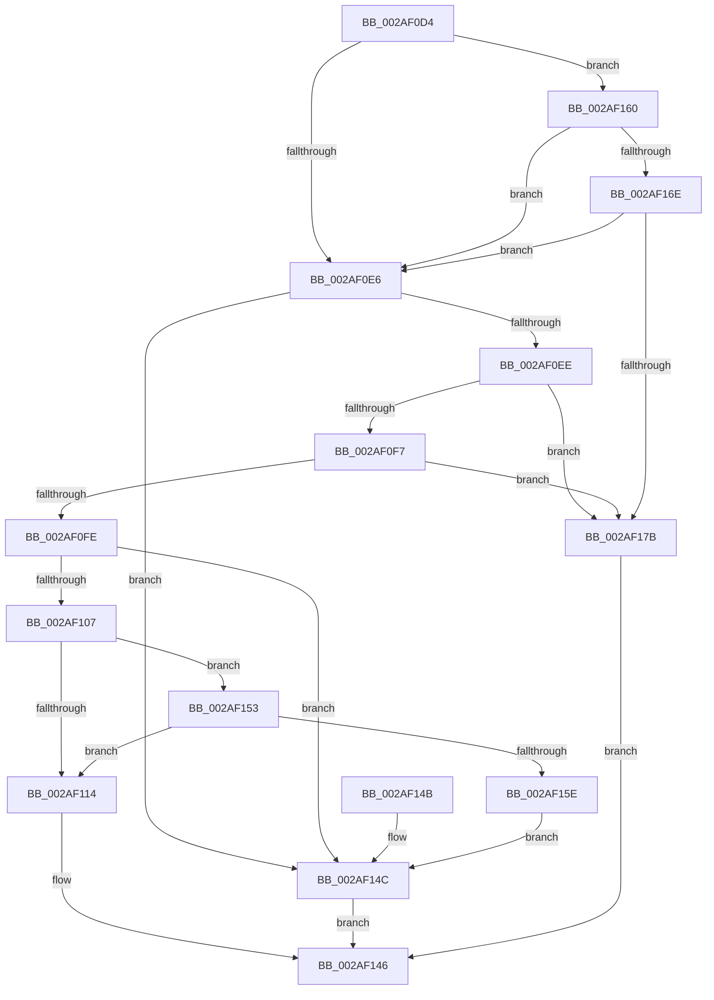

# MiStandbyPageContentsIntact

- RVA: `0x002AF0D4`–`0x002AF17F` (길이 `171` bytes)
- VA: `0x00000001402AF0D4`
- 실행 섹션: `.text`
- PDB 이름 있음: `예`; PDB Function 태그: `아니요`
- unwind 정보 RVA: `0x0006D4A0`
- 디코드: `52`개 명령, `171/171` bytes 표시
- 미해석 바이트: `0` (있으면 어셈블리에 `.byte`로 보존)

> 이 문서는 커널 이미지의 기계어와 PDB 기호를 분석해 생성했습니다. 4번과 5번은 함수 원형과 자료형을 바이너리 사용 방식에서 추정한 C 해석이며 원본 소스 복구 결과는 아닙니다.

## 1. Dependencies

- 직접 호출 지점: **3**; 고유 호출 대상: **3**
- 직접 호출자로 확인된 함수: **5**
- RIP 상대 이미지 참조: **1**

### Outgoing calls
- `0x002AF10A` → [MiGetPfnSlabType](../28/MiGetPfnSlabType_function_0028E2D0.md) (function, `0x0028E2D0`)
- `0x002AF130` → [MiGetPfnPriority](../32/MiGetPfnPriority_function_003226F0.md) (function, `0x003226F0`)
- `0x002AF16E` → [MiCheckWriteInProgressFault](../48/MiCheckWriteInProgressFault_function_0048DDA8.md) (function, `0x0048DDA8`)

### Direct callers
- [MiStandbyPageStillCombineCandidate](../22/MiStandbyPageStillCombineCandidate_function_0022A148.md) at `0x0022A180`
- [MiCopyDataPageToImagePage](MiCopyDataPageToImagePage_function_002AE818.md) at `0x002AEA26`
- [MiConfirmCombinePageContents](MiConfirmCombinePageContents_function_002AF394.md) at `0x002AF3E6`
- [MiCopyHeaderIfResident](../48/MiCopyHeaderIfResident_function_00482184.md) at `0x00482249`
- [sub_006D6E94](../6D/Unknown_function_006D6E94.md) at `0x006D6EE8`
- [sub_006D6E94](../6D/Unknown_function_006D6E94.md) at `0x006D7049`

### Static image references
- `0x002AF118` → RVA `0x00E30088` (`.data`; read)

## 2. Other-region calls and transfers

- 다른 실행 섹션으로 향하는 call: **0**
- 별도 외부 분기/꼬리 이동을 확인하지 못했습니다.

## 3. Assembly (complete function range)

```asm
002AF0D4  48 83 EC 28                     sub rsp, 0x28
002AF0D8  8A 51 22                        mov dl, byte ptr [rcx + 0x22]
002AF0DB  45 33 DB                        xor r11d, r11d
002AF0DE  4C 8B C1                        mov r8, rcx
002AF0E1  F6 C2 08                        test dl, 8
002AF0E4  75 7A                           jne 0x1402af160
002AF0E6  8A C2                           mov al, dl
002AF0E8  24 07                           and al, 7
002AF0EA  3C 02                           cmp al, 2
002AF0EC  75 5E                           jne 0x1402af14c
002AF0EE  F6 C2 20                        test dl, 0x20
002AF0F1  0F 85 84 00 00 00               jne 0x1402af17b
002AF0F7  41 F6 40 23 10                  test byte ptr [r8 + 0x23], 0x10
002AF0FC  75 7D                           jne 0x1402af17b
002AF0FE  41 8B 40 20                     mov eax, dword ptr [r8 + 0x20]
002AF102  66 85 C0                        test ax, ax
002AF105  75 45                           jne 0x1402af14c
002AF107  49 8B C8                        mov rcx, r8
002AF10A  E8 C1 F1 FD FF                  call 0x14028e2d0
002AF10F  83 F8 09                        cmp eax, 9
002AF112  75 3F                           jne 0x1402af153
002AF114  49 8B 48 28                     mov rcx, qword ptr [r8 + 0x28]
002AF118  48 8B 15 69 0F B8 00            mov rdx, qword ptr [rip + 0xb80f69]
002AF11F  48 C1 E9 2B                     shr rcx, 0x2b
002AF123  81 E1 FF 03 00 00               and ecx, 0x3ff
002AF129  4C 8B 14 CA                     mov r10, qword ptr [rdx + rcx*8]
002AF12D  49 8B C8                        mov rcx, r8
002AF130  E8 BB 35 07 00                  call 0x1403226f0
002AF135  41 0F B6 8A E4 3E 00 00         movzx ecx, byte ptr [r10 + 0x3ee4]
002AF13D  3B C1                           cmp eax, ecx
002AF13F  41 0F 93 C3                     setae r11b
002AF143  41 8B C3                        mov eax, r11d
002AF146  48 83 C4 28                     add rsp, 0x28
002AF14A  C3                              ret
002AF14B  CC                              int3
002AF14C  B8 01 00 00 00                  mov eax, 1
002AF151  EB F3                           jmp 0x1402af146
002AF153  41 8B 40 20                     mov eax, dword ptr [r8 + 0x20]
002AF157  C1 E8 18                        shr eax, 0x18
002AF15A  A8 08                           test al, 8
002AF15C  74 B6                           je 0x1402af114
002AF15E  EB EC                           jmp 0x1402af14c
002AF160  8A C2                           mov al, dl
002AF162  24 07                           and al, 7
002AF164  2C 03                           sub al, 3
002AF166  A8 FB                           test al, 0xfb
002AF168  0F 85 78 FF FF FF               jne 0x1402af0e6
002AF16E  E8 35 EC 1D 00                  call 0x14048dda8
002AF173  85 C0                           test eax, eax
002AF175  0F 89 6B FF FF FF               jns 0x1402af0e6
002AF17B  33 C0                           xor eax, eax
002AF17D  EB C7                           jmp 0x1402af146
```

## 4. C-style interpretation (structured pseudocode)

```c
__int64 __fastcall MiStandbyPageContentsIntact(__int64 a1)
{
    __int64 result;
    __int64 v_r11;
    __int64 v_rsp;

    v_rsp = (v_rsp) - (40);
    v_r11 = 0;
    if ((((unsigned __int8)(*(unsigned __int8 *)(a1 + 34))) & (8)) != 0) goto loc_002AF160;
loc_002AF0E6:
    result = (unsigned __int8)(((unsigned __int8)(*(unsigned __int8 *)(a1 + 34))) & (7));
    if (((unsigned __int8)(result)) != 2) goto loc_002AF14C;
    if ((((unsigned __int8)(*(unsigned __int8 *)(a1 + 34))) & (32)) != 0) goto loc_002AF17B;
    if (((*(unsigned __int8 *)(a1 + 35)) & (16)) != 0) goto loc_002AF17B;
    if ((unsigned __int16)((unsigned int)(*(unsigned int *)(a1 + 32))) != 0) goto loc_002AF14C;
    result = MiGetPfnSlabType(a1, *(unsigned __int8 *)(a1 + 34), a1, a4);
    if (((unsigned int)(result)) != 9) goto loc_002AF153;
loc_002AF114:
    a1 = (*(unsigned __int64 *)(a1 + 40)) >> (43);
    a1 = (unsigned int)((a1) & (0x3FFULL));
    result = MiGetPfnPriority(a1, *(unsigned __int64 *)(v_rip + 12062569), a1, a4);
    v_r11 = (((unsigned int)(result)) >= ((unsigned int)(*(unsigned __int8 *)(*(unsigned __int64 *)(*(unsigned __int64 *)(v_rip + 12062569) + a1 * 8) + 16100)))) ? 1 : 0;
loc_002AF146:
    v_rsp = (v_rsp) + (40);
    return (unsigned int)((unsigned int)(v_r11));
loc_002AF14C:
    goto loc_002AF146;
loc_002AF153:
    result = (unsigned int)(((unsigned int)(*(unsigned int *)(a1 + 32))) >> (24));
    if ((((unsigned __int8)(result)) & (8)) == 0) goto loc_002AF114;
    goto loc_002AF14C;
loc_002AF160:
    result = (unsigned __int8)(((unsigned __int8)(*(unsigned __int64 *)(v_rip + 12062569))) & (7));
    result = (unsigned __int8)((result) - (3));
    if ((((unsigned __int8)(result)) & (251)) != 0) goto loc_002AF0E6;
    result = MiCheckWriteInProgressFault(*(unsigned __int8 *)(*(unsigned __int64 *)(*(unsigned __int64 *)(v_rip + 12062569) + a1 * 8) + 16100), *(unsigned __int64 *)(v_rip + 12062569), a1, a4);
    if (!sign_flag) goto loc_002AF0E6;
loc_002AF17B:
    result = 0;
    goto loc_002AF146;
}
```

## 5. (Beta) C Style

```c
int64_t MiStandbyPageContentsIntact(void *Arg1)
{
    uint8_t *arg1 = (uint8_t *)Arg1;

    int64_t result;
    int64_t local_r11;
    int64_t local_rsp;

    local_rsp = (local_rsp) - (40);
    local_r11 = 0;
    if ((((uint8_t)(*(uint8_t *)(arg1 + 0x22))) & (8)) != 0) goto loc_002AF160;
loc_002AF0E6:
    result = (uint8_t)(((uint8_t)(*(uint8_t *)(arg1 + 0x22))) & (7));
    if (((uint8_t)(result)) != 2) goto loc_002AF14C;
    if ((((uint8_t)(*(uint8_t *)(arg1 + 0x22))) & (32)) != 0) goto loc_002AF17B;
    if (((*(uint8_t *)(arg1 + 0x23)) & (16)) != 0) goto loc_002AF17B;
    if ((uint16_t)((uint32_t)(*(uint32_t *)(arg1 + 0x20))) != 0) goto loc_002AF14C;
    result = MiGetPfnSlabType(Arg1, *(uint8_t *)(arg1 + 0x22), Arg1, a4);
    if (((uint32_t)(result)) != 9) goto loc_002AF153;
loc_002AF114:
    Arg1 = (*(uint64_t *)(arg1 + 0x28)) >> (43);
    Arg1 = (uint32_t)((Arg1) & (0x3FFULL));
    result = MiGetPfnPriority(Arg1, *(uint64_t *)(v_rip + 0xB80F69), Arg1, a4);
    local_r11 = (((uint32_t)(result)) >= ((uint32_t)(*(uint8_t *)(*(uint64_t *)(*(uint64_t *)(v_rip + 0xB80F69) + arg1 * 8) + 0x3EE4)))) ? 1 : 0;
loc_002AF146:
    local_rsp = (local_rsp) + (40);
    return (uint32_t)((uint32_t)(local_r11));
loc_002AF14C:
    goto loc_002AF146;
loc_002AF153:
    result = (uint32_t)(((uint32_t)(*(uint32_t *)(arg1 + 0x20))) >> (24));
    if ((((uint8_t)(result)) & (8)) == 0) goto loc_002AF114;
    goto loc_002AF14C;
loc_002AF160:
    result = (uint8_t)(((uint8_t)(*(uint64_t *)(v_rip + 0xB80F69))) & (7));
    result = (uint8_t)((result) - (3));
    if ((((uint8_t)(result)) & (251)) != 0) goto loc_002AF0E6;
    result = MiCheckWriteInProgressFault(*(uint8_t *)(*(uint64_t *)(*(uint64_t *)(v_rip + 0xB80F69) + arg1 * 8) + 0x3EE4), *(uint64_t *)(v_rip + 0xB80F69), Arg1, a4);
    if (!sign_flag) goto loc_002AF0E6;
loc_002AF17B:
    result = 0;
    goto loc_002AF146;
}
```

### 관측된 메모리 오프셋

구조체 형식이 확인되지 않은 접근은 인자 기준의 오프셋으로만 기록했습니다.

| 기준 인자 | 오프셋 표현 | 폭 (bit) | 접근 |
|---|---:|---:|---|
| `Arg1` | `+ 0x22` | `8` | `R` |

## 6. Execution-region graph

[열기: 2D/3D 그래프와 함수 탐색 컨트롤 패널](../../../control-panel.html?section=text&rva=0x002AF0D4&view=graph)

- 2D 그래프는 위에서 아래로 흐르고, 3D 그래프는 빈 공간을 드래그해 회전합니다. Shift+드래그는 이동, 휠은 확대·축소, 함수 노드 선택은 대상 보고서 이동입니다.

### Static fallback


