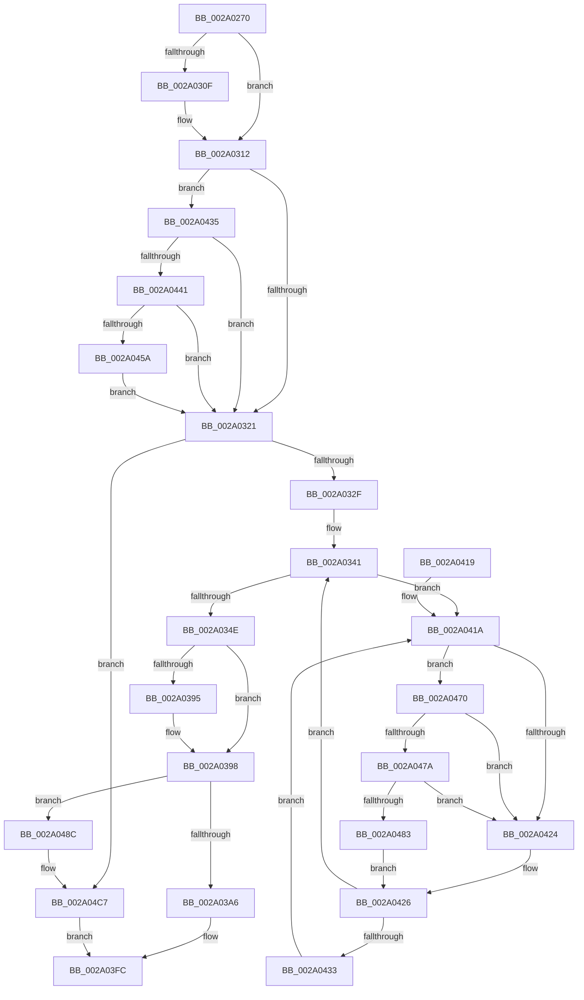

# MiSwapStackPageNoDpc

- RVA: `0x002A0270`–`0x002A04CE` (길이 `606` bytes)
- VA: `0x00000001402A0270`
- 실행 섹션: `.text`
- PDB 이름 있음: `예`; PDB Function 태그: `아니요`
- unwind 정보 RVA: `0x000683A8`
- 디코드: `150`개 명령, `606/606` bytes 표시
- 미해석 바이트: `0` (있으면 어셈블리에 `.byte`로 보존)

> 이 문서는 커널 이미지의 기계어와 PDB 기호를 분석해 생성했습니다. 4번과 5번은 함수 원형과 자료형을 바이너리 사용 방식에서 추정한 C 해석이며 원본 소스 복구 결과는 아닙니다.

## 1. Dependencies

- 직접 호출 지점: **10**; 고유 호출 대상: **9**
- 직접 호출자로 확인된 함수: **2**
- RIP 상대 이미지 참조: **3**

### Outgoing calls
- `0x002A033A` → [MiFlushSingleTbEntry](../28/MiFlushSingleTbEntry_function_0028E730.md) (function, `0x0028E730`)
- `0x002A0354` → [MiCopyPfnEntryEx](../2B/MiCopyPfnEntryEx_function_002B2670.md) (function, `0x002B2670`)
- `0x002A0365` → [MiCopyPage](../2B/MiCopyPage_function_002B1B30.md) (function, `0x002B1B30`)
- `0x002A03D5` → [MiSetPfnIdentity](MiSetPfnIdentity_function_002A2350.md) (function, `0x002A2350`)
- `0x002A03DD` → [MiClearPfnReuseFields](../37/MiClearPfnReuseFields_function_003759F0.md) (function, `0x003759F0`)
- `0x002A0466` → [MiCheckLinearProtectedPteAccessedBit](../29/MiCheckLinearProtectedPteAccessedBit_function_00292D80.md) (function, `0x00292D80`)
- `0x002A047A` → [KiCheckVpBackingLongSpinWaitHypercall](../30/KiCheckVpBackingLongSpinWaitHypercall_function_0030F490.md) (function, `0x0030F490`)
- `0x002A0485` → [HvlNotifyLongSpinWait](../30/HvlNotifyLongSpinWait_function_0030F460.md) (function, `0x0030F460`)
- `0x002A04A9` → [MiSetOriginalPtePfnFromFreeList](../28/MiSetOriginalPtePfnFromFreeList_function_0028A99C.md) (function, `0x0028A99C`)
- `0x002A04B3` → [MiSetPfnIdentity](MiSetPfnIdentity_function_002A2350.md) (function, `0x002A2350`)

### Direct callers
- [MiSwapStackPage](../29/MiSwapStackPage_function_0029FDE0.md) at `0x002A0068`
- [sub_006F60F8](../6F/Unknown_function_006F60F8.md) at `0x006F62C9`

### Static image references
- `0x002A0302` → RVA `0x00FC6A88` (`ALMOSTRO`; read)
- `0x002A041C` → RVA `0x00FC52AC` (`ALMOSTRO`; reference)
- `0x002A0470` → RVA `0x00FC6AB8` (`ALMOSTRO`; read)

## 2. Other-region calls and transfers

- 다른 실행 섹션으로 향하는 call: **0**
- 별도 외부 분기/꼬리 이동을 확인하지 못했습니다.

## 3. Assembly (complete function range)

```asm
002A0270  48 89 5C 24 10                  mov qword ptr [rsp + 0x10], rbx
002A0275  48 89 6C 24 18                  mov qword ptr [rsp + 0x18], rbp
002A027A  48 89 74 24 20                  mov qword ptr [rsp + 0x20], rsi
002A027F  57                              push rdi
002A0280  41 54                           push r12
002A0282  41 55                           push r13
002A0284  41 56                           push r14
002A0286  41 57                           push r15
002A0288  48 83 EC 20                     sub rsp, 0x20
002A028C  4C 8B 71 08                     mov r14, qword ptr [rcx + 8]
002A0290  48 B8 00 00 00 00 00 00 00 80   movabs rax, 0x8000000000000000
002A029A  4C 0B F0                        or r14, rax
002A029D  49 B8 00 00 00 00 80 F6 FF FF   movabs r8, 0xfffff68000000000
002A02A7  4D 8B E6                        mov r12, r14
002A02AA  48 8B F2                        mov rsi, rdx
002A02AD  49 C1 E4 19                     shl r12, 0x19
002A02B1  48 8B E9                        mov rbp, rcx
002A02B4  49 8B C0                        mov rax, r8
002A02B7  48 C1 E0 19                     shl rax, 0x19
002A02BB  4C 2B E0                        sub r12, rax
002A02BE  48 B9 00 00 00 00 00 DE FF FF   movabs rcx, 0xffffde0000000000
002A02C8  49 C1 FC 10                     sar r12, 0x10
002A02CC  48 8B C1                        mov rax, rcx
002A02CF  4C 8B ED                        mov r13, rbp
002A02D2  48 BA AB AA AA AA AA AA AA AA   movabs rdx, 0xaaaaaaaaaaaaaaab
002A02DC  4C 2B E8                        sub r13, rax
002A02DF  49 C1 FD 04                     sar r13, 4
002A02E3  4C 0F AF EA                     imul r13, rdx
002A02E7  48 8B C1                        mov rax, rcx
002A02EA  49 8B 3E                        mov rdi, qword ptr [r14]
002A02ED  4C 8B FE                        mov r15, rsi
002A02F0  4C 2B F8                        sub r15, rax
002A02F3  48 8B DF                        mov rbx, rdi
002A02F6  49 C1 FF 04                     sar r15, 4
002A02FA  48 83 E3 DF                     and rbx, 0xffffffffffffffdf
002A02FE  4C 0F AF FA                     imul r15, rdx
002A0302  48 F7 05 7B 67 D2 00 00 00 00 02  test qword ptr [rip + 0xd2677b], 0x2000000
002A030D  74 03                           je 0x1402a0312
002A030F  0F AE E8                        lfence
002A0312  48 0F BA 25 6D 67 D2 00 24      bt qword ptr [rip + 0xd2676d], 0x24
002A031B  0F 82 14 01 00 00               jb 0x1402a0435
002A0321  48 8B C7                        mov rax, rdi
002A0324  F0 49 0F B1 1E                  lock cmpxchg qword ptr [r14], rbx
002A0329  0F 85 98 01 00 00               jne 0x1402a04c7
002A032F  BA 02 00 00 00                  mov edx, 2
002A0334  49 8B CC                        mov rcx, r12
002A0337  44 8B C2                        mov r8d, edx
002A033A  E8 F1 E3 FE FF                  call 0x14028e730
002A033F  33 FF                           xor edi, edi
002A0341  F0 48 0F BA 6E 18 3F            lock bts qword ptr [rsi + 0x18], 0x3f
002A0348  0F 82 CC 00 00 00               jb 0x1402a041a
002A034E  48 8B D5                        mov rdx, rbp
002A0351  48 8B CE                        mov rcx, rsi
002A0354  E8 17 23 01 00                  call 0x1402b2670
002A0359  41 B8 44 00 00 00               mov r8d, 0x44
002A035F  49 8B D5                        mov rdx, r13
002A0362  49 8B CF                        mov rcx, r15
002A0365  E8 C6 17 01 00                  call 0x1402b1b30
002A036A  49 C1 E7 0C                     shl r15, 0xc
002A036E  48 B8 FF 0F 00 00 00 00 F0 FF   movabs rax, 0xfff0000000000fff
002A0378  49 8B CF                        mov rcx, r15
002A037B  48 33 CB                        xor rcx, rbx
002A037E  48 23 C8                        and rcx, rax
002A0381  49 33 CF                        xor rcx, r15
002A0384  48 83 C9 20                     or rcx, 0x20
002A0388  48 F7 05 F5 66 D2 00 00 00 00 02  test qword ptr [rip + 0xd266f5], 0x2000000
002A0393  74 03                           je 0x1402a0398
002A0395  0F AE E8                        lfence
002A0398  48 8B C3                        mov rax, rbx
002A039B  F0 49 0F B1 0E                  lock cmpxchg qword ptr [r14], rcx
002A03A0  0F 85 E6 00 00 00               jne 0x1402a048c
002A03A6  48 B8 FF FF FF FF FF FF FF 7F   movabs rax, 0x7fffffffffffffff
002A03B0  F0 48 21 46 18                  lock and qword ptr [rsi + 0x18], rax
002A03B5  8B 4D 20                        mov ecx, dword ptr [rbp + 0x20]
002A03B8  33 D2                           xor edx, edx
002A03BA  89 4C 24 50                     mov dword ptr [rsp + 0x50], ecx
002A03BE  C1 E9 10                        shr ecx, 0x10
002A03C1  80 E1 FD                        and cl, 0xfd
002A03C4  80 C9 05                        or cl, 5
002A03C7  88 4C 24 52                     mov byte ptr [rsp + 0x52], cl
002A03CB  8B 4C 24 50                     mov ecx, dword ptr [rsp + 0x50]
002A03CF  89 4D 20                        mov dword ptr [rbp + 0x20], ecx
002A03D2  48 8B CD                        mov rcx, rbp
002A03D5  E8 76 1F 00 00                  call 0x1402a2350
002A03DA  48 8B CD                        mov rcx, rbp
002A03DD  E8 0E 56 0D 00                  call 0x1403759f0
002A03E2  48 8B 4D 18                     mov rcx, qword ptr [rbp + 0x18]
002A03E6  48 BA 00 00 00 00 00 00 00 C0   movabs rdx, 0xc000000000000000
002A03F0  48 23 CA                        and rcx, rdx
002A03F3  B8 01 00 00 00                  mov eax, 1
002A03F8  48 89 4D 18                     mov qword ptr [rbp + 0x18], rcx
002A03FC  48 8B 5C 24 58                  mov rbx, qword ptr [rsp + 0x58]
002A0401  48 8B 6C 24 60                  mov rbp, qword ptr [rsp + 0x60]
002A0406  48 8B 74 24 68                  mov rsi, qword ptr [rsp + 0x68]
002A040B  48 83 C4 20                     add rsp, 0x20
002A040F  41 5F                           pop r15
002A0411  41 5E                           pop r14
002A0413  41 5D                           pop r13
002A0415  41 5C                           pop r12
002A0417  5F                              pop rdi
002A0418  C3                              ret
002A0419  CC                              int3
002A041A  FF C7                           inc edi
002A041C  85 3D 8A 4E D2 00               test dword ptr [rip + 0xd24e8a], edi
002A0422  74 4C                           je 0x1402a0470
002A0424  F3 90                           pause
002A0426  48 8B 46 18                     mov rax, qword ptr [rsi + 0x18]
002A042A  48 85 C0                        test rax, rax
002A042D  0F 89 0E FF FF FF               jns 0x1402a0341
002A0433  EB E5                           jmp 0x1402a041a
002A0435  8A C3                           mov al, bl
002A0437  24 21                           and al, 0x21
002A0439  3C 01                           cmp al, 1
002A043B  0F 85 E0 FE FF FF               jne 0x1402a0321
002A0441  49 8B C0                        mov rax, r8
002A0444  48 B9 00 00 00 00 40 00 00 00   movabs rcx, 0x4000000000
002A044E  48 03 C1                        add rax, rcx
002A0451  4C 3B F0                        cmp r14, rax
002A0454  0F 82 C7 FE FF FF               jb 0x1402a0321
002A045A  41 B8 80 00 00 00               mov r8d, 0x80
002A0460  48 8B D3                        mov rdx, rbx
002A0463  49 8B CE                        mov rcx, r14
002A0466  E8 15 29 FF FF                  call 0x140292d80
002A046B  E9 B1 FE FF FF                  jmp 0x1402a0321
002A0470  8B 05 42 66 D2 00               mov eax, dword ptr [rip + 0xd26642]
002A0476  A8 40                           test al, 0x40
002A0478  74 AA                           je 0x1402a0424
002A047A  E8 11 F0 06 00                  call 0x14030f490
002A047F  84 C0                           test al, al
002A0481  74 A1                           je 0x1402a0424
002A0483  8B CF                           mov ecx, edi
002A0485  E8 D6 EF 06 00                  call 0x14030f460
002A048A  EB 9A                           jmp 0x1402a0426
002A048C  8B 46 20                        mov eax, dword ptr [rsi + 0x20]
002A048F  48 8D 4E 10                     lea rcx, [rsi + 0x10]
002A0493  89 44 24 50                     mov dword ptr [rsp + 0x50], eax
002A0497  C1 E8 10                        shr eax, 0x10
002A049A  24 FD                           and al, 0xfd
002A049C  0C 05                           or al, 5
002A049E  88 44 24 52                     mov byte ptr [rsp + 0x52], al
002A04A2  8B 44 24 50                     mov eax, dword ptr [rsp + 0x50]
002A04A6  89 46 20                        mov dword ptr [rsi + 0x20], eax
002A04A9  E8 EE A4 FE FF                  call 0x14028a99c
002A04AE  33 D2                           xor edx, edx
002A04B0  48 8B CE                        mov rcx, rsi
002A04B3  E8 98 1E 00 00                  call 0x1402a2350
002A04B8  48 B8 FF FF FF FF FF FF FF 7F   movabs rax, 0x7fffffffffffffff
002A04C2  F0 48 21 46 18                  lock and qword ptr [rsi + 0x18], rax
002A04C7  33 C0                           xor eax, eax
002A04C9  E9 2E FF FF FF                  jmp 0x1402a03fc
```

## 4. C-style interpretation (structured pseudocode)

```c
__int64 __fastcall MiSwapStackPageNoDpc(__int64 a1, __int64 a2)
{
    __int64 result;
    __int64 v_r12;
    __int64 v_r13;
    __int64 v_r14;
    __int64 v_r15;
    __int64 v_rbx;
    __int64 v_rdi;
    __int64 v_rsp;
    unsigned __int64 v_stack_p10;
    unsigned __int64 v_stack_p18;
    unsigned __int64 v_stack_p20;
    unsigned int v_stack_p50;
    unsigned __int8 v_stack_p52;
    unsigned int v_stack_p8;
    unsigned __int8 v_stack_pA;

    v_stack_p10 = v_rbx;
    v_stack_p18 = v_rbp;
    v_stack_p20 = v_rsi;
    v_rsp = (v_rsp) - (32);
    v_r14 = (*(unsigned __int64 *)(a1 + 8)) | (result);
    v_r12 = (v_r14) << (25);
    result = (a3) << (25);
    v_r12 = (v_r12) - (result);
    v_r12 = (v_r12) >> (16);
    v_r13 = (a1) - (a1);
    v_r13 = (v_r13) >> (4);
    v_r13 = (v_r13) * (a2);
    v_r15 = (a2) - (a1);
    v_r15 = (v_r15) >> (4);
    v_rbx = (*(unsigned __int64 *)(v_r14)) & (-33);
    v_r15 = (v_r15) * (a2);
    if (((*(unsigned __int64 *)(v_rip + 13789051)) & (0x2000000ULL)) != 0) {
    }
    if (condition_is_below) goto loc_002A0435;
loc_002A0321:
    if (((*(unsigned __int64 *)(v_rip + 13789051)) & (0x2000000ULL)) != 0) goto loc_002A04C7;
    result = MiFlushSingleTbEntry(v_r12, 2, 2, a4);
    v_rdi = 0;
loc_002A0341:
    if (condition_is_below) goto loc_002A041A;
    result = MiCopyPfnEntryEx(a2, a1, 2, a4);
    result = MiCopyPage(v_r15, v_r13, 68, a4);
    v_r15 = (v_r15) << (12);
    a1 = (v_r15) ^ (v_rbx);
    a1 = (a1) & (result);
    a1 = (a1) ^ (v_r15);
    a1 = (a1) | (32);
    if (((*(unsigned __int64 *)(v_rip + 13788917)) & (0x2000000ULL)) != 0) {
    }
    if (((*(unsigned __int64 *)(v_rip + 13788917)) & (0x2000000ULL)) != 0) goto loc_002A048C;
    a2 = 0;
    v_stack_p8 = (unsigned int)((unsigned int)(*(unsigned int *)(a1 + 32)));
    a1 = (unsigned int)(((unsigned int)(*(unsigned int *)(a1 + 32))) >> (16));
    a1 = (unsigned __int8)((a1) & (253));
    a1 = (unsigned __int8)((a1) | (5));
    v_stack_pA = (unsigned __int8)(a1);
    *(unsigned int *)(a1 + 32) = (unsigned int)((unsigned int)(v_stack_p8));
    result = MiSetPfnIdentity(a1, a2, 68, a4);
    result = MiClearPfnReuseFields(a1, a2, 68, a4);
    a1 = (*(unsigned __int64 *)(a1 + 24)) & (0);
    *(unsigned __int64 *)(a1 + 24) = a1;
loc_002A03FC:
    v_rsp = (v_rsp) + (32);
    return 1;
loc_002A041A:
    v_rdi = (unsigned int)((v_rdi) + 1);
    if (((*(unsigned int *)(v_rip + 13782666)) & ((unsigned int)(v_rdi))) == 0) goto loc_002A0470;
loc_002A0424:
loc_002A0426:
    if (!sign_flag) goto loc_002A0341;
    goto loc_002A041A;
loc_002A0435:
    result = (unsigned __int8)(((unsigned __int8)(v_stack_p10)) & (33));
    if (((unsigned __int8)(result)) != 1) goto loc_002A0321;
    result = (68) + (a1);
    if (v_r14 < result) goto loc_002A0321;
    result = MiCheckLinearProtectedPteAccessedBit(v_r14, v_stack_p10, 128, a4);
    goto loc_002A0321;
loc_002A0470:
    if ((((unsigned __int8)((unsigned int)(*(unsigned int *)(v_rip + 13788738)))) & (64)) == 0) goto loc_002A0424;
    result = KiCheckVpBackingLongSpinWaitHypercall(v_r14, v_stack_p10, 128, a4);
    if ((unsigned __int8)(result) == 0) goto loc_002A0424;
    result = HvlNotifyLongSpinWait((unsigned int)((unsigned int)(v_rdi)), v_stack_p10, 128, a4);
    goto loc_002A0426;
loc_002A048C:
    v_stack_p50 = (unsigned int)((unsigned int)(*(unsigned int *)(v_stack_p20 + 32)));
    result = (unsigned int)(((unsigned int)(*(unsigned int *)(v_stack_p20 + 32))) >> (16));
    result = (unsigned __int8)((result) & (253));
    result = (unsigned __int8)((result) | (5));
    v_stack_p52 = (unsigned __int8)(result);
    *(unsigned int *)(v_stack_p20 + 32) = (unsigned int)((unsigned int)(v_stack_p50));
    result = MiSetOriginalPtePfnFromFreeList(v_stack_p20 + 16, v_stack_p10, 128, a4);
    a2 = 0;
    result = MiSetPfnIdentity(v_stack_p20, a2, 128, a4);
loc_002A04C7:
    result = 0;
    goto loc_002A03FC;
}
```

## 5. (Beta) C Style

```c
int64_t MiSwapStackPageNoDpc(void *Arg1, void *Arg2)
{
    uint8_t *arg1 = (uint8_t *)Arg1;
    uint8_t *arg2 = (uint8_t *)Arg2;

    int64_t result;
    int64_t local_r12;
    int64_t local_r13;
    int64_t local_r14;
    int64_t local_r15;
    int64_t local_rbx;
    int64_t local_rdi;
    int64_t local_rsp;
    uint64_t v_stack_p10;
    uint64_t v_stack_p18;
    uint64_t v_stack_p20;
    uint32_t v_stack_p50;
    uint8_t v_stack_p52;
    uint32_t v_stack_p8;
    uint8_t v_stack_pA;

    v_stack_p10 = local_rbx;
    v_stack_p18 = local_rbp;
    v_stack_p20 = local_rsi;
    local_rsp = (local_rsp) - (32);
    local_r14 = (*(uint64_t *)(arg1 + 0x8)) | (result);
    local_r12 = (local_r14) << (25);
    result = (a3) << (25);
    local_r12 = (local_r12) - (result);
    local_r12 = (local_r12) >> (16);
    local_r13 = (Arg1) - (Arg1);
    local_r13 = (local_r13) >> (4);
    local_r13 = (local_r13) * (Arg2);
    local_r15 = (Arg2) - (Arg1);
    local_r15 = (local_r15) >> (4);
    local_rbx = (*(uint64_t *)(local_r14)) & (-33);
    local_r15 = (local_r15) * (Arg2);
    if (((*(uint64_t *)(v_rip + 0xD2677B)) & (0x2000000ULL)) != 0) {
    }
    if (condition_is_below) goto loc_002A0435;
loc_002A0321:
    if (((*(uint64_t *)(v_rip + 0xD2677B)) & (0x2000000ULL)) != 0) goto loc_002A04C7;
    result = MiFlushSingleTbEntry(local_r12, 2, 2, a4);
    local_rdi = 0;
loc_002A0341:
    if (condition_is_below) goto loc_002A041A;
    result = MiCopyPfnEntryEx(Arg2, Arg1, 2, a4);
    result = MiCopyPage(local_r15, local_r13, 68, a4);
    local_r15 = (local_r15) << (12);
    Arg1 = (local_r15) ^ (local_rbx);
    Arg1 = (Arg1) & (result);
    Arg1 = (Arg1) ^ (local_r15);
    Arg1 = (Arg1) | (32);
    if (((*(uint64_t *)(v_rip + 0xD266F5)) & (0x2000000ULL)) != 0) {
    }
    if (((*(uint64_t *)(v_rip + 0xD266F5)) & (0x2000000ULL)) != 0) goto loc_002A048C;
    Arg2 = 0;
    v_stack_p8 = (uint32_t)((uint32_t)(*(uint32_t *)(arg1 + 0x20)));
    Arg1 = (uint32_t)(((uint32_t)(*(uint32_t *)(arg1 + 0x20))) >> (16));
    Arg1 = (uint8_t)((Arg1) & (253));
    Arg1 = (uint8_t)((Arg1) | (5));
    v_stack_pA = (uint8_t)(Arg1);
    *(uint32_t *)(arg1 + 0x20) = (uint32_t)((uint32_t)(v_stack_p8));
    result = MiSetPfnIdentity(Arg1, Arg2, 68, a4);
    result = MiClearPfnReuseFields(Arg1, Arg2, 68, a4);
    Arg1 = (*(uint64_t *)(arg1 + 0x18)) & (0);
    *(void **)(arg1 + 0x18) = Arg1;
loc_002A03FC:
    local_rsp = (local_rsp) + (32);
    return 1;
loc_002A041A:
    local_rdi = (uint32_t)((local_rdi) + 1);
    if (((*(uint32_t *)(v_rip + 0xD24E8A)) & ((uint32_t)(local_rdi))) == 0) goto loc_002A0470;
loc_002A0424:
loc_002A0426:
    if (!sign_flag) goto loc_002A0341;
    goto loc_002A041A;
loc_002A0435:
    result = (uint8_t)(((uint8_t)(v_stack_p10)) & (33));
    if (((uint8_t)(result)) != 1) goto loc_002A0321;
    result = (68) + (Arg1);
    if (local_r14 < result) goto loc_002A0321;
    result = MiCheckLinearProtectedPteAccessedBit(local_r14, v_stack_p10, 128, a4);
    goto loc_002A0321;
loc_002A0470:
    if ((((uint8_t)((uint32_t)(*(uint32_t *)(v_rip + 0xD26642)))) & (64)) == 0) goto loc_002A0424;
    result = KiCheckVpBackingLongSpinWaitHypercall(local_r14, v_stack_p10, 128, a4);
    if ((uint8_t)(result) == 0) goto loc_002A0424;
    result = HvlNotifyLongSpinWait((uint32_t)((uint32_t)(local_rdi)), v_stack_p10, 128, a4);
    goto loc_002A0426;
loc_002A048C:
    v_stack_p50 = (uint32_t)((uint32_t)(*(uint32_t *)(v_stack_p20 + 0x20)));
    result = (uint32_t)(((uint32_t)(*(uint32_t *)(v_stack_p20 + 0x20))) >> (16));
    result = (uint8_t)((result) & (253));
    result = (uint8_t)((result) | (5));
    v_stack_p52 = (uint8_t)(result);
    *(uint32_t *)(v_stack_p20 + 0x20) = (uint32_t)((uint32_t)(v_stack_p50));
    result = MiSetOriginalPtePfnFromFreeList(v_stack_p20 + 16, v_stack_p10, 128, a4);
    Arg2 = 0;
    result = MiSetPfnIdentity(v_stack_p20, Arg2, 128, a4);
loc_002A04C7:
    result = 0;
    goto loc_002A03FC;
}
```

### 관측된 메모리 오프셋

구조체 형식이 확인되지 않은 접근은 인자 기준의 오프셋으로만 기록했습니다.

| 기준 인자 | 오프셋 표현 | 폭 (bit) | 접근 |
|---|---:|---:|---|
| `Arg1` | `+ 0x8` | `64` | `R` |
| `Arg1` | `+ 0x18` | `64` | `R` |
| `Arg1` | `+ 0x18` | `64` | `W` |
| `Arg1` | `+ 0x20` | `32` | `R` |
| `Arg1` | `+ 0x20` | `32` | `W` |
| `Arg2` | `+ 0x10` | `64` | `R` |
| `Arg2` | `+ 0x18` | `64` | `R` |
| `Arg2` | `+ 0x18` | `64` | `R/W` |
| `Arg2` | `+ 0x20` | `32` | `R` |
| `Arg2` | `+ 0x20` | `32` | `W` |

## 6. Execution-region graph

[열기: 2D/3D 그래프와 함수 탐색 컨트롤 패널](../../../control-panel.html?section=text&rva=0x002A0270&view=graph)

- 2D 그래프는 위에서 아래로 흐르고, 3D 그래프는 빈 공간을 드래그해 회전합니다. Shift+드래그는 이동, 휠은 확대·축소, 함수 노드 선택은 대상 보고서 이동입니다.

### Static fallback


