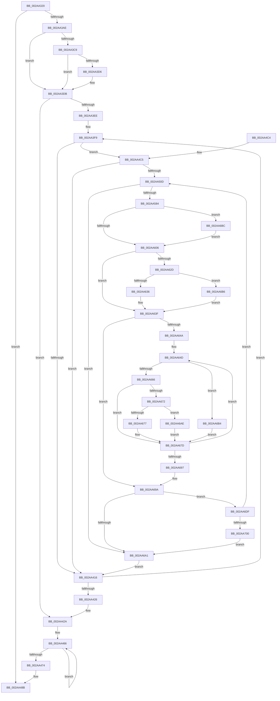

# MiTrimUnusedPageFileRegionsWorker

- RVA: `0x002AA320`–`0x002AA702` (길이 `994` bytes)
- VA: `0x00000001402AA320`
- 실행 섹션: `.text`
- PDB 이름 있음: `예`; PDB Function 태그: `아니요`
- unwind 정보 RVA: `0x00068EAC`
- 디코드: `243`개 명령, `994/994` bytes 표시
- 미해석 바이트: `0` (있으면 어셈블리에 `.byte`로 보존)

> 이 문서는 커널 이미지의 기계어와 PDB 기호를 분석해 생성했습니다. 4번과 5번은 함수 원형과 자료형을 바이너리 사용 방식에서 추정한 C 해석이며 원본 소스 복구 결과는 아닙니다.

## 1. Dependencies

- 직접 호출 지점: **20**; 고유 호출 대상: **18**
- 직접 호출자로 확인된 함수: **0**
- RIP 상대 이미지 참조: **5**

### Outgoing calls
- `0x002AA35E` → [memset](../6C/memset_function_006C6C40.md) (function, `0x006C6C40`)
- `0x002AA392` → [MiMakePageFilePte](../38/MiMakePageFilePte_function_003823C8.md) (function, `0x003823C8`)
- `0x002AA3A1` → [ExAcquireRundownProtection](../21/ExAcquireRundownProtection_function_00216620.md) (function, `0x00216620`)
- `0x002AA3B4` → [MiLockWsSwapExclusive](MiLockWsSwapExclusive_function_002A8A70.md) (function, `0x002A8A70`)
- `0x002AA3D6` → [KiCheckForKernelApcDelivery](../2E/KiCheckForKernelApcDelivery_function_002E2C80.md) (function, `0x002E2C80`)
- `0x002AA439` → [MiUnlockWsSwapExclusive](MiUnlockWsSwapExclusive_function_002A74A8.md) (function, `0x002A74A8`)
- `0x002AA441` → [MiContractWsSwapPageFile](../../page/A1/MiContractWsSwapPageFile_function_00A182C4.md) (function, `0x00A182C4`)
- `0x002AA44D` → [ExReleaseRundownProtection](../34/ExReleaseRundownProtection_function_00349E80.md) (function, `0x00349E80`)
- `0x002AA492` → [PsDereferencePartition](../34/PsDereferencePartition_function_00342E70.md) (function, `0x00342E70`)
- `0x002AA49E` → [_security_check_cookie](../6A/_security_check_cookie_function_006AC640.md) (function, `0x006AC640`)
- `0x002AA4FE` → [MiPageFileLargestBitmapsRun](MiPageFileLargestBitmapsRun_function_002AA708.md) (function, `0x002AA708`)
- `0x002AA55D` → [KeInsertQueueApc](../20/KeInsertQueueApc_function_00203F10.md) (function, `0x00203F10`)
- `0x002AA574` → [KeWaitForSingleObject](../20/KeWaitForSingleObject_function_0020E6B0.md) (function, `0x0020E6B0`)
- `0x002AA5A9` → [KeResetEvent](../24/KeResetEvent_function_00248350.md) (function, `0x00248350`)
- `0x002AA5EF` → [ZwFsControlFile](../6A/ZwFsControlFile_function_006AD7F0.md) (function, `0x006AD7F0`)
- `0x002AA616` → [MiTransferSoftwarePte](../38/MiTransferSoftwarePte_function_003821F0.md) (function, `0x003821F0`)
- `0x002AA659` → [MiReleasePageFileInfo](../28/MiReleasePageFileInfo_function_00283FD0.md) (function, `0x00283FD0`)
- `0x002AA689` → [MiSwizzleInvalidPte](../28/MiSwizzleInvalidPte_function_0028F5E0.md) (function, `0x0028F5E0`)
- `0x002AA6CE` → [KeWaitForSingleObject](../20/KeWaitForSingleObject_function_0020E6B0.md) (function, `0x0020E6B0`)
- `0x002AA6E4` → [KeResetEvent](../24/KeResetEvent_function_00248350.md) (function, `0x00248350`)

### Direct callers
- 이 함수 시작 RVA로 연결되는 직접 call은 확인되지 않았습니다. 간접 호출은 완전히 역산할 수 없습니다.

### Static image references
- `0x002AA343` → RVA `0x00E0A740` (`.data`; read)
- `0x002AA529` → RVA `0x0049E550` (`EmpCheckErrataList`; read)
- `0x002AA53D` → RVA `0x004D3700` (`MiTrimUnusedPageFileRegionsApc`; read)
- `0x002AA5C8` → RVA `0x00680390` (`MiIrpCompletionApcRoutine`; read)
- `0x002AA621` → RVA `0x00E2DC80` (`.data`; read)

## 2. Other-region calls and transfers

- 다른 실행 섹션으로 향하는 call: **1**
  - `0x002AA441` → [MiContractWsSwapPageFile](../../page/A1/MiContractWsSwapPageFile_function_00A182C4.md) (`.text` → `PAGE`)
- 별도 외부 분기/꼬리 이동을 확인하지 못했습니다.

## 3. Assembly (complete function range)

```asm
002AA320  48 8B C4                        mov rax, rsp
002AA323  48 89 58 10                     mov qword ptr [rax + 0x10], rbx
002AA327  48 89 70 18                     mov qword ptr [rax + 0x18], rsi
002AA32B  48 89 78 20                     mov qword ptr [rax + 0x20], rdi
002AA32F  55                              push rbp
002AA330  41 54                           push r12
002AA332  41 55                           push r13
002AA334  41 56                           push r14
002AA336  41 57                           push r15
002AA338  48 8D 68 A8                     lea rbp, [rax - 0x58]
002AA33C  48 81 EC 30 01 00 00            sub rsp, 0x130
002AA343  48 8B 05 F6 03 B6 00            mov rax, qword ptr [rip + 0xb603f6]
002AA34A  48 33 C4                        xor rax, rsp
002AA34D  48 89 45 28                     mov qword ptr [rbp + 0x28], rax
002AA351  33 D2                           xor edx, edx
002AA353  48 8B F1                        mov rsi, rcx
002AA356  48 8D 4D B0                     lea rcx, [rbp - 0x50]
002AA35A  44 8D 42 58                     lea r8d, [rdx + 0x58]
002AA35E  E8 DD C8 41 00                  call 0x1406c6c40
002AA363  0F 57 C0                        xorps xmm0, xmm0
002AA366  33 C0                           xor eax, eax
002AA368  48 89 45 20                     mov qword ptr [rbp + 0x20], rax
002AA36C  33 C9                           xor ecx, ecx
002AA36E  0F 11 44 24 58                  movups xmmword ptr [rsp + 0x58], xmm0
002AA373  0F 11 44 24 68                  movups xmmword ptr [rsp + 0x68], xmm0
002AA378  0F 11 44 24 78                  movups xmmword ptr [rsp + 0x78], xmm0
002AA37D  0F 11 45 10                     movups xmmword ptr [rbp + 0x10], xmm0
002AA381  0F 11 45 A0                     movups xmmword ptr [rbp - 0x60], xmm0
002AA385  65 4C 8B 3C 25 88 01 00 00      mov r15, qword ptr gs:[0x188]
002AA38E  4C 89 7D 98                     mov qword ptr [rbp - 0x68], r15
002AA392  E8 31 80 0D 00                  call 0x1403823c8
002AA397  48 8D 8E E8 03 00 00            lea rcx, [rsi + 0x3e8]
002AA39E  48 8B F8                        mov rdi, rax
002AA3A1  E8 7A C2 F6 FF                  call 0x140216620
002AA3A6  84 C0                           test al, al
002AA3A8  0F 84 DD 00 00 00               je 0x1402aa48b
002AA3AE  48 8B D6                        mov rdx, rsi
002AA3B1  49 8B CF                        mov rcx, r15
002AA3B4  E8 B7 E6 FF FF                  call 0x1402a8a70
002AA3B9  B9 01 00 00 00                  mov ecx, 1
002AA3BE  90                              nop
002AA3BF  66 41 01 8F E6 01 00 00         add word ptr [r15 + 0x1e6], cx
002AA3C7  75 12                           jne 0x1402aa3db
002AA3C9  49 8D 87 98 00 00 00            lea rax, [r15 + 0x98]
002AA3D0  90                              nop
002AA3D1  48 39 00                        cmp qword ptr [rax], rax
002AA3D4  74 05                           je 0x1402aa3db
002AA3D6  E8 A5 88 03 00                  call 0x1402e2c80
002AA3DB  44 8B B6 58 48 00 00            mov r14d, dword ptr [rsi + 0x4858]
002AA3E2  45 33 E4                        xor r12d, r12d
002AA3E5  44 89 75 8C                     mov dword ptr [rbp - 0x74], r14d
002AA3E9  45 85 F6                        test r14d, r14d
002AA3EC  74 3C                           je 0x1402aa42a
002AA3EE  48 8D 9E 60 48 00 00            lea rbx, [rsi + 0x4860]
002AA3F5  48 89 5D 90                     mov qword ptr [rbp - 0x70], rbx
002AA3F9  4C 8B 2B                        mov r13, qword ptr [rbx]
002AA3FC  B9 50 08 00 00                  mov ecx, 0x850
002AA401  41 0F B7 85 AC 00 00 00         movzx eax, word ptr [r13 + 0xac]
002AA409  66 23 C1                        and ax, cx
002AA40C  66 83 F8 10                     cmp ax, 0x10
002AA410  0F 84 AF 00 00 00               je 0x1402aa4c5
002AA416  48 83 C3 08                     add rbx, 8
002AA41A  41 FF C4                        inc r12d
002AA41D  48 89 5D 90                     mov qword ptr [rbp - 0x70], rbx
002AA421  45 3B E6                        cmp r12d, r14d
002AA424  72 D3                           jb 0x1402aa3f9
002AA426  4C 8B 7D 98                     mov r15, qword ptr [rbp - 0x68]
002AA42A  66 41 FF 8F E6 01 00 00         dec word ptr [r15 + 0x1e6]
002AA432  48 8B D6                        mov rdx, rsi
002AA435  49 8B CF                        mov rcx, r15
002AA438  90                              nop
002AA439  E8 6A D0 FF FF                  call 0x1402a74a8
002AA43E  48 8B CE                        mov rcx, rsi
002AA441  E8 7E DE 76 00                  call 0x140a182c4
002AA446  48 8D 8E E8 03 00 00            lea rcx, [rsi + 0x3e8]
002AA44D  E8 2E FA 09 00                  call 0x140349e80
002AA452  49 B8 B0 03 00 00 80 F7 FF FF   movabs r8, 0xfffff780000003b0
002AA45C  49 B9 08 00 00 00 80 F7 FF FF   movabs r9, 0xfffff78000000008
002AA466  49 8B 08                        mov rcx, qword ptr [r8]
002AA469  49 8B 11                        mov rdx, qword ptr [r9]
002AA46C  49 8B 00                        mov rax, qword ptr [r8]
002AA46F  48 3B C8                        cmp rcx, rax
002AA472  75 F2                           jne 0x1402aa466
002AA474  48 2B D1                        sub rdx, rcx
002AA477  48 89 96 68 04 00 00            mov qword ptr [rsi + 0x468], rdx
002AA47E  F0 83 0C 24 00                  lock or dword ptr [rsp], 0
002AA483  48 83 A6 60 04 00 00 00         and qword ptr [rsi + 0x460], 0
002AA48B  48 8B 8E B8 00 00 00            mov rcx, qword ptr [rsi + 0xb8]
002AA492  E8 D9 89 09 00                  call 0x140342e70
002AA497  48 8B 4D 28                     mov rcx, qword ptr [rbp + 0x28]
002AA49B  48 33 CC                        xor rcx, rsp
002AA49E  E8 9D 21 40 00                  call 0x1406ac640
002AA4A3  4C 8D 9C 24 30 01 00 00         lea r11, [rsp + 0x130]
002AA4AB  49 8B 5B 38                     mov rbx, qword ptr [r11 + 0x38]
002AA4AF  49 8B 73 40                     mov rsi, qword ptr [r11 + 0x40]
002AA4B3  49 8B 7B 48                     mov rdi, qword ptr [r11 + 0x48]
002AA4B7  49 8B E3                        mov rsp, r11
002AA4BA  41 5F                           pop r15
002AA4BC  41 5E                           pop r14
002AA4BE  41 5D                           pop r13
002AA4C0  41 5C                           pop r12
002AA4C2  5D                              pop rbp
002AA4C3  C3                              ret
002AA4C4  CC                              int3
002AA4C5  48 8D 44 24 60                  lea rax, [rsp + 0x60]
002AA4CA  48 C7 44 24 58 00 00 06 00      mov qword ptr [rsp + 0x58], 0x60000
002AA4D3  48 89 44 24 68                  mov qword ptr [rsp + 0x68], rax
002AA4D8  45 33 FF                        xor r15d, r15d
002AA4DB  48 8D 44 24 60                  lea rax, [rsp + 0x60]
002AA4E0  4C 89 7D 80                     mov qword ptr [rbp - 0x80], r15
002AA4E4  49 8B CD                        mov rcx, r13
002AA4E7  48 89 44 24 60                  mov qword ptr [rsp + 0x60], rax
002AA4EC  44 89 64 24 78                  mov dword ptr [rsp + 0x78], r12d
002AA4F1  C7 44 24 7C 00 20 00 00         mov dword ptr [rsp + 0x7c], 0x2000
002AA4F9  48 89 74 24 70                  mov qword ptr [rsp + 0x70], rsi
002AA4FE  E8 05 02 00 00                  call 0x1402aa708
002AA503  3B 44 24 7C                     cmp eax, dword ptr [rsp + 0x7c]
002AA507  0F 82 09 FF FF FF               jb 0x1402aa416
002AA50D  48 8B 86 E0 03 00 00            mov rax, qword ptr [rsi + 0x3e0]
002AA514  48 8D 54 24 58                  lea rdx, [rsp + 0x58]
002AA519  66 83 65 00 00                  and word ptr [rbp], 0
002AA51E  48 8D 4D B0                     lea rcx, [rbp - 0x50]
002AA522  48 89 45 B8                     mov qword ptr [rbp - 0x48], rax
002AA526  45 33 C9                        xor r9d, r9d
002AA529  48 8D 05 20 40 1F 00            lea rax, [rip + 0x1f4020]
002AA530  66 C7 45 B0 12 00               mov word ptr [rbp - 0x50], 0x12
002AA536  48 89 45 D0                     mov qword ptr [rbp - 0x30], rax
002AA53A  45 33 C0                        xor r8d, r8d
002AA53D  48 8D 05 BC 91 22 00            lea rax, [rip + 0x2291bc]
002AA544  C6 45 B2 58                     mov byte ptr [rbp - 0x4e], 0x58
002AA548  48 89 45 E0                     mov qword ptr [rbp - 0x20], rax
002AA54C  48 8D 44 24 58                  lea rax, [rsp + 0x58]
002AA551  48 89 45 E8                     mov qword ptr [rbp - 0x18], rax
002AA555  4C 89 7D D8                     mov qword ptr [rbp - 0x28], r15
002AA559  44 88 7D 02                     mov byte ptr [rbp + 2], r15b
002AA55D  E8 AE 99 F5 FF                  call 0x140203f10
002AA562  45 33 C9                        xor r9d, r9d
002AA565  4C 89 7C 24 20                  mov qword ptr [rsp + 0x20], r15
002AA56A  45 33 C0                        xor r8d, r8d
002AA56D  48 8D 4C 24 58                  lea rcx, [rsp + 0x58]
002AA572  33 D2                           xor edx, edx
002AA574  E8 37 41 F6 FF                  call 0x14020e6b0
002AA579  8B 4D 84                        mov ecx, dword ptr [rbp - 0x7c]
002AA57C  85 C9                           test ecx, ecx
002AA57E  0F 84 1D 01 00 00               je 0x1402aa6a1
002AA584  8B 45 80                        mov eax, dword ptr [rbp - 0x80]
002AA587  48 C1 E0 0C                     shl rax, 0xc
002AA58B  48 89 45 18                     mov qword ptr [rbp + 0x18], rax
002AA58F  8B C1                           mov eax, ecx
002AA591  48 C1 E0 0C                     shl rax, 0xc
002AA595  48 8D 4C 24 58                  lea rcx, [rsp + 0x58]
002AA59A  48 89 45 20                     mov qword ptr [rbp + 0x20], rax
002AA59E  44 89 7D 10                     mov dword ptr [rbp + 0x10], r15d
002AA5A2  C7 45 14 01 00 00 00            mov dword ptr [rbp + 0x14], 1
002AA5A9  E8 A2 DD F9 FF                  call 0x140248350
002AA5AE  49 8B 8D C0 00 00 00            mov rcx, qword ptr [r13 + 0xc0]
002AA5B5  48 8D 45 10                     lea rax, [rbp + 0x10]
002AA5B9  44 89 7C 24 48                  mov dword ptr [rsp + 0x48], r15d
002AA5BE  4C 8D 4C 24 58                  lea r9, [rsp + 0x58]
002AA5C3  4C 89 7C 24 40                  mov qword ptr [rsp + 0x40], r15
002AA5C8  4C 8D 05 C1 5D 3D 00            lea r8, [rip + 0x3d5dc1]
002AA5CF  C7 44 24 38 18 00 00 00         mov dword ptr [rsp + 0x38], 0x18
002AA5D7  33 D2                           xor edx, edx
002AA5D9  48 89 44 24 30                  mov qword ptr [rsp + 0x30], rax
002AA5DE  48 8D 45 A0                     lea rax, [rbp - 0x60]
002AA5E2  C7 44 24 28 08 82 09 00         mov dword ptr [rsp + 0x28], 0x98208
002AA5EA  48 89 44 24 20                  mov qword ptr [rsp + 0x20], rax
002AA5EF  E8 FC 31 40 00                  call 0x1406ad7f0
002AA5F4  45 33 FF                        xor r15d, r15d
002AA5F7  89 44 24 50                     mov dword ptr [rsp + 0x50], eax
002AA5FB  3D 03 01 00 00                  cmp eax, 0x103
002AA600  0F 84 B6 00 00 00               je 0x1402aa6bc
002AA606  44 8B 45 80                     mov r8d, dword ptr [rbp - 0x80]
002AA60A  41 B9 03 00 00 00               mov r9d, 3
002AA610  49 8B D5                        mov rdx, r13
002AA613  48 8B CF                        mov rcx, rdi
002AA616  E8 D5 7B 0D 00                  call 0x1403821f0
002AA61B  48 8B D8                        mov rbx, rax
002AA61E  4C 8B F0                        mov r14, rax
002AA621  48 8B 05 58 36 B8 00            mov rax, qword ptr [rip + 0xb83658]
002AA628  48 85 C0                        test rax, rax
002AA62B  74 12                           je 0x1402aa63f
002AA62D  F6 C3 10                        test bl, 0x10
002AA630  0F 85 80 00 00 00               jne 0x1402aa6b6
002AA636  4C 8B F0                        mov r14, rax
002AA639  49 F7 D6                        not r14
002AA63C  4C 23 F3                        and r14, rbx
002AA63F  8B 45 84                        mov eax, dword ptr [rbp - 0x7c]
002AA642  49 C1 EE 20                     shr r14, 0x20
002AA646  85 C0                           test eax, eax
002AA648  74 50                           je 0x1402aa69a
002AA64A  44 8B F8                        mov r15d, eax
002AA64D  41 B8 02 00 00 00               mov r8d, 2
002AA653  48 8B D3                        mov rdx, rbx
002AA656  48 8B CE                        mov rcx, rsi
002AA659  E8 72 99 FD FF                  call 0x140283fd0
002AA65E  49 FF C6                        inc r14
002AA661  48 85 DB                        test rbx, rbx
002AA664  74 4E                           je 0x1402aa6b4
002AA666  48 8B 05 13 36 B8 00            mov rax, qword ptr [rip + 0xb83613]
002AA66D  48 85 C0                        test rax, rax
002AA670  74 0B                           je 0x1402aa67d
002AA672  F6 C3 10                        test bl, 0x10
002AA675  75 37                           jne 0x1402aa6ae
002AA677  48 F7 D0                        not rax
002AA67A  48 23 D8                        and rbx, rax
002AA67D  49 8B C6                        mov rax, r14
002AA680  8B CB                           mov ecx, ebx
002AA682  48 C1 E0 20                     shl rax, 0x20
002AA686  48 0B C8                        or rcx, rax
002AA689  E8 52 4F FE FF                  call 0x14028f5e0
002AA68E  48 8B D8                        mov rbx, rax
002AA691  41 83 C7 FF                     add r15d, -1
002AA695  75 B6                           jne 0x1402aa64d
002AA697  45 33 FF                        xor r15d, r15d
002AA69A  44 39 7C 24 50                  cmp dword ptr [rsp + 0x50], r15d
002AA69F  7D 3E                           jge 0x1402aa6df
002AA6A1  48 8B 5D 90                     mov rbx, qword ptr [rbp - 0x70]
002AA6A5  44 8B 75 8C                     mov r14d, dword ptr [rbp - 0x74]
002AA6A9  E9 68 FD FF FF                  jmp 0x1402aa416
002AA6AE  48 83 E3 EF                     and rbx, 0xffffffffffffffef
002AA6B2  EB C9                           jmp 0x1402aa67d
002AA6B4  EB C7                           jmp 0x1402aa67d
002AA6B6  49 83 E6 EF                     and r14, 0xffffffffffffffef
002AA6BA  EB 83                           jmp 0x1402aa63f
002AA6BC  45 33 C9                        xor r9d, r9d
002AA6BF  4C 89 7C 24 20                  mov qword ptr [rsp + 0x20], r15
002AA6C4  45 33 C0                        xor r8d, r8d
002AA6C7  48 8D 4C 24 58                  lea rcx, [rsp + 0x58]
002AA6CC  33 D2                           xor edx, edx
002AA6CE  E8 DD 3F F6 FF                  call 0x14020e6b0
002AA6D3  8B 45 A0                        mov eax, dword ptr [rbp - 0x60]
002AA6D6  89 44 24 50                     mov dword ptr [rsp + 0x50], eax
002AA6DA  E9 27 FF FF FF                  jmp 0x1402aa606
002AA6DF  48 8D 4C 24 58                  lea rcx, [rsp + 0x58]
002AA6E4  E8 67 DC F9 FF                  call 0x140248350
002AA6E9  8B 45 80                        mov eax, dword ptr [rbp - 0x80]
002AA6EC  03 45 84                        add eax, dword ptr [rbp - 0x7c]
002AA6EF  89 45 80                        mov dword ptr [rbp - 0x80], eax
002AA6F2  44 89 7D 84                     mov dword ptr [rbp - 0x7c], r15d
002AA6F6  41 3B 45 00                     cmp eax, dword ptr [r13]
002AA6FA  0F 82 0D FE FF FF               jb 0x1402aa50d
002AA700  EB 9F                           jmp 0x1402aa6a1
```

## 4. C-style interpretation (structured pseudocode)

```c
__int64 __fastcall MiTrimUnusedPageFileRegionsWorker(__int64 a1, int a2)
{
    __int64 result;
    __int64 v_r12;
    __int64 v_r14;
    __int64 v_r15;
    __int64 v_rbx;
    __int64 v_rsp;
    unsigned __int64 v_stack_m100;
    unsigned int v_stack_m108;
    unsigned __int64 v_stack_m110;
    unsigned int v_stack_m158;
    unsigned __int64 v_stack_m28;
    unsigned int v_stack_mB4;
    unsigned int v_stack_mB8;
    unsigned __int64 v_stack_mC0;
    unsigned __int64 v_stack_mC8;
    unsigned __int64 v_stack_mD0;
    unsigned __int64 v_stack_mD8;
    unsigned __int64 v_stack_mE0;
    unsigned int v_stack_mE8;
    unsigned __int64 v_stack_mF0;
    unsigned int v_stack_mF8;

    *(unsigned __int64 *)(v_rsp + 16) = v_rbx;
    *(unsigned __int64 *)(v_rsp + 24) = v_rsi;
    *(unsigned __int64 *)(v_rsp + 32) = v_rdi;
    v_rsp = (v_rsp) - (304);
    result = (*(unsigned __int64 *)(v_rip + 11928566)) ^ (v_rsp);
    *(unsigned __int64 *)(v_rsp - 88 + 40) = result;
    a2 = 0;
    result = memset(v_rsp - 88 - 80, a2, a2 + 88, a4);
    result = 0;
    *(unsigned __int64 *)(v_rsp - 88 + 32) = 0;
    a1 = 0;
    v_stack_m100 = v_xmm0;
    v_stack_mF0 = v_xmm0;
    v_stack_mE0 = v_xmm0;
    *(unsigned __int64 *)(v_rsp - 88 + 16) = v_xmm0;
    *(unsigned __int64 *)(v_rsp - 88 - 96) = v_xmm0;
    *(unsigned __int64 *)(v_rsp - 88 - 104) = *(unsigned __int64 *)(gs_base + (0 + 392));
    result = MiMakePageFilePte(a1, a2, a2 + 88, a4);
    result = ExAcquireRundownProtection(a1 + 1000, a2, a2 + 88, a4);
    if ((unsigned __int8)(result) == 0) goto loc_002AA48B;
    result = MiLockWsSwapExclusive(*(unsigned __int64 *)(gs_base + (0 + 392)), 0, a2 + 88, a4);
    if ((unsigned __int8)(result) != 0) goto loc_002AA3DB;
    result = *(unsigned __int64 *)(gs_base + (0 + 392)) + 152;
    if ((*(unsigned __int64 *)(*(unsigned __int64 *)(gs_base + (0 + 392)) + 152)) != (*(unsigned __int64 *)(gs_base + (0 + 392)) + 152)) {
        result = KiCheckForKernelApcDelivery(1, 0, a2 + 88, a4);
    }
    v_r12 = 0;
    *(unsigned int *)(v_rsp - 88 - 116) = (unsigned int)((unsigned int)(*(unsigned int *)(a1 + 18520)));
    if ((unsigned int)((unsigned int)(*(unsigned int *)(a1 + 18520))) == 0) goto loc_002AA42A;
    *(unsigned __int64 *)(v_rsp - 88 - 112) = a1 + 18528;
loc_002AA3F9:
    result = (unsigned __int16)((*(unsigned __int16 *)(*(unsigned __int64 *)(a1 + 18528) + 172)) & ((unsigned __int16)((unsigned int)(0x850ULL))));
    if (((unsigned __int16)(result)) == 16) goto loc_002AA4C5;
loc_002AA416:
    v_rbx = (a1 + 18528) + (8);
    v_r12 = (unsigned int)((v_r12) + 1);
    *(unsigned __int64 *)(v_rsp - 88 - 112) = v_rbx;
    if (((unsigned int)(v_r12)) < ((unsigned int)((unsigned int)(*(unsigned int *)(a1 + 18520))))) goto loc_002AA3F9;
loc_002AA42A:
    result = MiUnlockWsSwapExclusive(*(unsigned __int64 *)(v_rsp - 88 - 104), 0, a2 + 88, a4);
    result = MiContractWsSwapPageFile(0, 0, a2 + 88, a4);
    result = ExReleaseRundownProtection(a1 + 1000, 0, a2 + 88, a4);
loc_002AA466:
    if ((*(unsigned __int64 *)(a2 + 88)) != (*(unsigned __int64 *)(a2 + 88))) goto loc_002AA466;
    a2 = (*(unsigned __int64 *)(a4)) - (*(unsigned __int64 *)(a2 + 88));
    *(unsigned __int64 *)(a1 + 1128) = a2;
loc_002AA48B:
    result = PsDereferencePartition(*(unsigned __int64 *)(a1 + 184), a2, a2 + 88, a4);
    a1 = (*(unsigned __int64 *)(v_rsp - 88 + 40)) ^ (v_rsp);
    result = _security_check_cookie(a1, a2, a2 + 88, a4);
    return result;
loc_002AA4C5:
    v_stack_mD8 = 0x60000ULL;
    v_stack_mC8 = v_stack_mD0;
    v_r15 = 0;
    *(unsigned __int64 *)(v_rsp - 88 - 128) = 0;
    v_stack_mD0 = v_stack_mD0;
    v_stack_mB8 = (unsigned int)(v_r12);
    v_stack_mB4 = 0x2000ULL;
    v_stack_mC0 = *(unsigned __int64 *)(v_stack_m28 + 64);
    result = MiPageFileLargestBitmapsRun(*(unsigned __int64 *)(a1 + 18528), a2, a2 + 88, a4);
    if (((unsigned int)(result)) < v_stack_mB4) goto loc_002AA416;
loc_002AA50D:
    *(unsigned __int64 *)(v_rsp - 88 - 72) = *(unsigned __int64 *)(*(unsigned __int64 *)(v_stack_m28 + 64) + 992);
    a4 = 0;
    *(unsigned __int16 *)(v_rsp - 88 - 80) = 18;
    *(unsigned __int64 *)(v_rsp - 88 - 48) = v_rip + 2048032;
    a3 = 0;
    *(unsigned __int8 *)(v_rsp - 88 - 78) = 88;
    *(unsigned __int64 *)(v_rsp - 88 - 32) = v_rip + 2265532;
    *(unsigned __int64 *)(v_rsp - 88 - 24) = v_stack_mD8;
    *(unsigned __int64 *)(v_rsp - 88 - 40) = 0;
    *(unsigned __int8 *)(v_rsp - 88 + 2) = 0;
    result = KeInsertQueueApc(v_rsp - 88 - 80, v_stack_mD8, a3, a4);
    a4 = 0;
    v_stack_m110 = 0;
    a3 = 0;
    a2 = 0;
    result = KeWaitForSingleObject(v_stack_mD8, a2, a3, a4);
    if ((unsigned int)((unsigned int)(*(unsigned int *)(v_rsp - 88 - 124))) == 0) goto loc_002AA6A1;
    result = ((unsigned int)(*(unsigned int *)(v_rsp - 88 - 128))) << (12);
    *(unsigned __int64 *)(v_rsp - 88 + 24) = result;
    result = ((unsigned int)((unsigned int)((unsigned int)(*(unsigned int *)(v_rsp - 88 - 124))))) << (12);
    *(unsigned __int64 *)(v_rsp - 88 + 32) = result;
    *(unsigned int *)(v_rsp - 88 + 16) = 0;
    *(unsigned int *)(v_rsp - 88 + 20) = 1;
    result = KeResetEvent(v_stack_mD8, a2, a3, a4);
    v_stack_mE8 = 0;
    v_stack_mF0 = 0;
    v_stack_mF8 = 24;
    a2 = 0;
    v_stack_m100 = v_rsp - 88 + 16;
    v_stack_m108 = 0x98208ULL;
    v_stack_m110 = v_rsp - 88 - 96;
    result = ZwFsControlFile(*(unsigned __int64 *)(*(unsigned __int64 *)(a1 + 18528) + 192), a2, v_rip + 4021697, v_stack_mD8);
    v_r15 = 0;
    v_stack_mE0 = (unsigned int)(result);
    if (((unsigned int)(result)) == 259) goto loc_002AA6BC;
loc_002AA606:
    result = MiTransferSoftwarePte(*(unsigned __int64 *)(v_stack_m28 + 72), *(unsigned __int64 *)(a1 + 18528), (unsigned int)(*(unsigned int *)(v_rsp - 88 - 128)), 3);
    if (*(unsigned __int64 *)(v_rip + 12072536) == 0) goto loc_002AA63F;
    if ((((unsigned __int8)(result)) & (16)) != 0) goto loc_002AA6B6;
    v_r14 = ~(*(unsigned __int64 *)(v_rip + 12072536));
    v_r14 = (v_r14) & (result);
loc_002AA63F:
    v_r14 = (v_r14) >> (32);
    if ((unsigned int)((unsigned int)(*(unsigned int *)(v_rsp - 88 - 124))) == 0) goto loc_002AA69A;
loc_002AA64D:
    result = MiReleasePageFileInfo(*(unsigned __int64 *)(v_stack_m28 + 64), result, 2, 3);
    v_r14 = (v_r14) + 1;
    if (result == 0) goto loc_002AA6B4;
    if (*(unsigned __int64 *)(v_rip + 12072467) == 0) goto loc_002AA67D;
    if ((((unsigned __int8)(result)) & (16)) != 0) goto loc_002AA6AE;
    result = ~(*(unsigned __int64 *)(v_rip + 12072467));
    v_rbx = (result) & (result);
loc_002AA67D:
    result = (v_r14) << (32);
    a1 = ((unsigned int)((unsigned int)(v_rbx))) | (result);
    result = MiSwizzleInvalidPte(a1, result, 2, 3);
    v_r15 = (unsigned int)(((unsigned int)((unsigned int)((unsigned int)(*(unsigned int *)(v_rsp - 88 - 124))))) + (-1));
    if (condition_is_not_equal) goto loc_002AA64D;
    v_r15 = 0;
loc_002AA69A:
    if (v_stack_mE0 >= 0) goto loc_002AA6DF;
loc_002AA6A1:
    goto loc_002AA416;
loc_002AA6AE:
    v_rbx = (*(unsigned __int64 *)(v_rsp - 88 - 112)) & (-17);
    goto loc_002AA67D;
loc_002AA6B4:
    goto loc_002AA67D;
loc_002AA6B6:
    v_r14 = ((unsigned int)(*(unsigned int *)(v_rsp - 88 - 116))) & (-17);
    goto loc_002AA63F;
loc_002AA6BC:
    a4 = 0;
    v_stack_m110 = 0;
    a3 = 0;
    a2 = 0;
    result = KeWaitForSingleObject(v_stack_mD8, a2, a3, a4);
    v_stack_mE0 = (unsigned int)((unsigned int)(*(unsigned int *)(v_rsp - 88 - 96)));
    goto loc_002AA606;
loc_002AA6DF:
    result = KeResetEvent(v_stack_mD8, a2, a3, a4);
    result = (unsigned int)(((unsigned int)(*(unsigned int *)(v_rsp - 88 - 128))) + (*(unsigned int *)(v_rsp - 88 - 124)));
    *(unsigned int *)(v_rsp - 88 - 128) = (unsigned int)(result);
    *(unsigned int *)(v_rsp - 88 - 124) = 0;
    if (((unsigned int)(result)) < (*(unsigned int *)(*(unsigned __int64 *)(a1 + 18528)))) goto loc_002AA50D;
    goto loc_002AA6A1;
}
```

## 5. (Beta) C Style

```c
int64_t MiTrimUnusedPageFileRegionsWorker(void *Arg1, int32_t Arg2)
{
    uint8_t *arg1 = (uint8_t *)Arg1;

    int64_t result;
    int64_t local_r12;
    int64_t local_r14;
    int64_t local_r15;
    int64_t local_rbx;
    int64_t local_rsp;
    uint64_t v_stack_m100;
    uint32_t v_stack_m108;
    uint64_t v_stack_m110;
    uint32_t v_stack_m158;
    uint64_t v_stack_m28;
    uint32_t v_stack_mB4;
    uint32_t v_stack_mB8;
    uint64_t v_stack_mC0;
    uint64_t v_stack_mC8;
    uint64_t v_stack_mD0;
    uint64_t v_stack_mD8;
    uint64_t v_stack_mE0;
    uint32_t v_stack_mE8;
    uint64_t v_stack_mF0;
    uint32_t v_stack_mF8;

    *(uint64_t *)(local_rsp + 0x10) = local_rbx;
    *(uint64_t *)(local_rsp + 0x18) = local_rsi;
    *(uint64_t *)(local_rsp + 0x20) = local_rdi;
    local_rsp = (local_rsp) - (304);
    result = (*(uint64_t *)(v_rip + 0xB603F6)) ^ (local_rsp);
    *(uint64_t *)(local_rsp - 0x58 + 0x28) = result;
    Arg2 = 0;
    result = memset(local_rsp - 88 - 80, Arg2, Arg2 + 88, a4);
    result = 0;
    *(uint64_t *)(local_rsp - 0x58 + 0x20) = 0;
    Arg1 = 0;
    v_stack_m100 = v_xmm0;
    v_stack_mF0 = v_xmm0;
    v_stack_mE0 = v_xmm0;
    *(uint64_t *)(local_rsp - 0x58 + 0x10) = v_xmm0;
    *(uint64_t *)(local_rsp - 0x58 - 0x60) = v_xmm0;
    *(uint64_t *)(local_rsp - 0x58 - 0x68) = *(uint64_t *)(gs_base + (0 + 0x188));
    result = MiMakePageFilePte(Arg1, Arg2, Arg2 + 88, a4);
    result = ExAcquireRundownProtection(Arg1 + 1000, Arg2, Arg2 + 88, a4);
    if ((uint8_t)(result) == 0) goto loc_002AA48B;
    result = MiLockWsSwapExclusive(*(uint64_t *)(gs_base + (0 + 0x188)), 0, Arg2 + 88, a4);
    if ((uint8_t)(result) != 0) goto loc_002AA3DB;
    result = *(uint64_t *)(gs_base + (0 + 0x188)) + 152;
    if ((*(uint64_t *)(*(uint64_t *)(gs_base + (0 + 0x188)) + 0x98)) != (*(uint64_t *)(gs_base + (0 + 0x188)) + 152)) {
        result = KiCheckForKernelApcDelivery(1, 0, Arg2 + 88, a4);
    }
    local_r12 = 0;
    *(uint32_t *)(local_rsp - 0x58 - 0x74) = (uint32_t)((uint32_t)(*(uint32_t *)(arg1 + 0x4858)));
    if ((uint32_t)((uint32_t)(*(uint32_t *)(arg1 + 0x4858))) == 0) goto loc_002AA42A;
    *(void **)(local_rsp - 0x58 - 0x70) = Arg1 + 18528;
loc_002AA3F9:
    result = (uint16_t)((*(uint16_t *)(*(uint64_t *)(arg1 + 0x4860) + 0xAC)) & ((uint16_t)((uint32_t)(0x850ULL))));
    if (((uint16_t)(result)) == 16) goto loc_002AA4C5;
loc_002AA416:
    local_rbx = (Arg1 + 18528) + (8);
    local_r12 = (uint32_t)((local_r12) + 1);
    *(uint64_t *)(local_rsp - 0x58 - 0x70) = local_rbx;
    if (((uint32_t)(local_r12)) < ((uint32_t)((uint32_t)(*(uint32_t *)(arg1 + 0x4858))))) goto loc_002AA3F9;
loc_002AA42A:
    result = MiUnlockWsSwapExclusive(*(uint64_t *)(local_rsp - 0x58 - 0x68), 0, Arg2 + 88, a4);
    result = MiContractWsSwapPageFile(0, 0, Arg2 + 88, a4);
    result = ExReleaseRundownProtection(Arg1 + 1000, 0, Arg2 + 88, a4);
loc_002AA466:
    if ((*(uint64_t *)(Arg2 + 0x58)) != (*(uint64_t *)(Arg2 + 0x58))) goto loc_002AA466;
    Arg2 = (*(uint64_t *)(a4)) - (*(uint64_t *)(Arg2 + 0x58));
    *(uint64_t *)(arg1 + 0x468) = Arg2;
loc_002AA48B:
    result = PsDereferencePartition(*(uint64_t *)(arg1 + 0xB8), Arg2, Arg2 + 88, a4);
    Arg1 = (*(uint64_t *)(local_rsp - 0x58 + 0x28)) ^ (local_rsp);
    result = _security_check_cookie(Arg1, Arg2, Arg2 + 88, a4);
    return result;
loc_002AA4C5:
    v_stack_mD8 = 0x60000ULL;
    v_stack_mC8 = v_stack_mD0;
    local_r15 = 0;
    *(uint64_t *)(local_rsp - 0x58 - 0x80) = 0;
    v_stack_mD0 = v_stack_mD0;
    v_stack_mB8 = (uint32_t)(local_r12);
    v_stack_mB4 = 0x2000ULL;
    v_stack_mC0 = *(uint64_t *)(v_stack_m28 + 0x40);
    result = MiPageFileLargestBitmapsRun(*(uint64_t *)(arg1 + 0x4860), Arg2, Arg2 + 88, a4);
    if (((uint32_t)(result)) < v_stack_mB4) goto loc_002AA416;
loc_002AA50D:
    *(uint64_t *)(local_rsp - 0x58 - 0x48) = *(uint64_t *)(*(uint64_t *)(v_stack_m28 + 0x40) + 0x3E0);
    a4 = 0;
    *(uint16_t *)(local_rsp - 0x58 - 0x50) = 18;
    *(uint64_t *)(local_rsp - 0x58 - 0x30) = v_rip + 2048032;
    a3 = 0;
    *(uint8_t *)(local_rsp - 0x58 - 0x4E) = 88;
    *(uint64_t *)(local_rsp - 0x58 - 0x20) = v_rip + 2265532;
    *(uint64_t *)(local_rsp - 0x58 - 0x18) = v_stack_mD8;
    *(uint64_t *)(local_rsp - 0x58 - 0x28) = 0;
    *(uint8_t *)(local_rsp - 0x58 + 0x2) = 0;
    result = KeInsertQueueApc(local_rsp - 88 - 80, v_stack_mD8, a3, a4);
    a4 = 0;
    v_stack_m110 = 0;
    a3 = 0;
    Arg2 = 0;
    result = KeWaitForSingleObject(v_stack_mD8, Arg2, a3, a4);
    if ((uint32_t)((uint32_t)(*(uint32_t *)(local_rsp - 0x58 - 0x7C))) == 0) goto loc_002AA6A1;
    result = ((uint32_t)(*(uint32_t *)(local_rsp - 0x58 - 0x80))) << (12);
    *(uint64_t *)(local_rsp - 0x58 + 0x18) = result;
    result = ((uint32_t)((uint32_t)((uint32_t)(*(uint32_t *)(local_rsp - 0x58 - 0x7C))))) << (12);
    *(uint64_t *)(local_rsp - 0x58 + 0x20) = result;
    *(uint32_t *)(local_rsp - 0x58 + 0x10) = 0;
    *(uint32_t *)(local_rsp - 0x58 + 0x14) = 1;
    result = KeResetEvent(v_stack_mD8, Arg2, a3, a4);
    v_stack_mE8 = 0;
    v_stack_mF0 = 0;
    v_stack_mF8 = 24;
    Arg2 = 0;
    v_stack_m100 = local_rsp - 88 + 16;
    v_stack_m108 = 0x98208ULL;
    v_stack_m110 = local_rsp - 88 - 96;
    result = ZwFsControlFile(*(uint64_t *)(*(uint64_t *)(arg1 + 0x4860) + 0xC0), Arg2, v_rip + 4021697, v_stack_mD8);
    local_r15 = 0;
    v_stack_mE0 = (uint32_t)(result);
    if (((uint32_t)(result)) == 259) goto loc_002AA6BC;
loc_002AA606:
    result = MiTransferSoftwarePte(*(uint64_t *)(v_stack_m28 + 0x48), *(uint64_t *)(arg1 + 0x4860), (uint32_t)(*(uint32_t *)(local_rsp - 0x58 - 0x80)), 3);
    if (*(uint64_t *)(v_rip + 0xB83658) == 0) goto loc_002AA63F;
    if ((((uint8_t)(result)) & (16)) != 0) goto loc_002AA6B6;
    local_r14 = ~(*(uint64_t *)(v_rip + 0xB83658));
    local_r14 = (local_r14) & (result);
loc_002AA63F:
    local_r14 = (local_r14) >> (32);
    if ((uint32_t)((uint32_t)(*(uint32_t *)(local_rsp - 0x58 - 0x7C))) == 0) goto loc_002AA69A;
loc_002AA64D:
    result = MiReleasePageFileInfo(*(uint64_t *)(v_stack_m28 + 0x40), result, 2, 3);
    local_r14 = (local_r14) + 1;
    if (result == 0) goto loc_002AA6B4;
    if (*(uint64_t *)(v_rip + 0xB83613) == 0) goto loc_002AA67D;
    if ((((uint8_t)(result)) & (16)) != 0) goto loc_002AA6AE;
    result = ~(*(uint64_t *)(v_rip + 0xB83613));
    local_rbx = (result) & (result);
loc_002AA67D:
    result = (local_r14) << (32);
    Arg1 = ((uint32_t)((uint32_t)(local_rbx))) | (result);
    result = MiSwizzleInvalidPte(Arg1, result, 2, 3);
    local_r15 = (uint32_t)(((uint32_t)((uint32_t)((uint32_t)(*(uint32_t *)(local_rsp - 0x58 - 0x7C))))) + (-1));
    if (condition_is_not_equal) goto loc_002AA64D;
    local_r15 = 0;
loc_002AA69A:
    if (v_stack_mE0 >= 0) goto loc_002AA6DF;
loc_002AA6A1:
    goto loc_002AA416;
loc_002AA6AE:
    local_rbx = (*(uint64_t *)(local_rsp - 0x58 - 0x70)) & (-17);
    goto loc_002AA67D;
loc_002AA6B4:
    goto loc_002AA67D;
loc_002AA6B6:
    local_r14 = ((uint32_t)(*(uint32_t *)(local_rsp - 0x58 - 0x74))) & (-17);
    goto loc_002AA63F;
loc_002AA6BC:
    a4 = 0;
    v_stack_m110 = 0;
    a3 = 0;
    Arg2 = 0;
    result = KeWaitForSingleObject(v_stack_mD8, Arg2, a3, a4);
    v_stack_mE0 = (uint32_t)((uint32_t)(*(uint32_t *)(local_rsp - 0x58 - 0x60)));
    goto loc_002AA606;
loc_002AA6DF:
    result = KeResetEvent(v_stack_mD8, Arg2, a3, a4);
    result = (uint32_t)(((uint32_t)(*(uint32_t *)(local_rsp - 0x58 - 0x80))) + (*(uint32_t *)(local_rsp - 0x58 - 0x7C)));
    *(uint32_t *)(local_rsp - 0x58 - 0x80) = (uint32_t)(result);
    *(uint32_t *)(local_rsp - 0x58 - 0x7C) = 0;
    if (((uint32_t)(result)) < (*(uint32_t *)(*(uint64_t *)(arg1 + 0x4860)))) goto loc_002AA50D;
    goto loc_002AA6A1;
}
```

### 관측된 메모리 오프셋

구조체 형식이 확인되지 않은 접근은 인자 기준의 오프셋으로만 기록했습니다.

| 기준 인자 | 오프셋 표현 | 폭 (bit) | 접근 |
|---|---:|---:|---|
| `Arg1` | `+ 0xB8` | `64` | `R` |
| `Arg1` | `+ 0x3E0` | `64` | `R` |
| `Arg1` | `+ 0x3E8` | `64` | `R` |
| `Arg1` | `+ 0x460` | `64` | `R/W` |
| `Arg1` | `+ 0x468` | `64` | `W` |
| `Arg1` | `+ 0x4858` | `32` | `R` |
| `Arg1` | `+ 0x4860` | `64` | `R` |

## 6. Execution-region graph

[열기: 2D/3D 그래프와 함수 탐색 컨트롤 패널](../../../control-panel.html?section=text&rva=0x002AA320&view=graph)

- 2D 그래프는 위에서 아래로 흐르고, 3D 그래프는 빈 공간을 드래그해 회전합니다. Shift+드래그는 이동, 휠은 확대·축소, 함수 노드 선택은 대상 보고서 이동입니다.

### Static fallback


