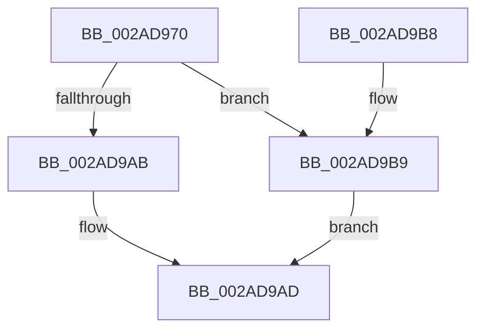

# MiTrimWorkingSetTail

- RVA: `0x002AD970`–`0x002AD9CE` (길이 `94` bytes)
- VA: `0x00000001402AD970`
- 실행 섹션: `.text`
- PDB 이름 있음: `예`; PDB Function 태그: `아니요`
- unwind 정보 RVA: `0x0006D2F4`
- 디코드: `26`개 명령, `94/94` bytes 표시
- 미해석 바이트: `0` (있으면 어셈블리에 `.byte`로 보존)

> 이 문서는 커널 이미지의 기계어와 PDB 기호를 분석해 생성했습니다. 4번과 5번은 함수 원형과 자료형을 바이너리 사용 방식에서 추정한 C 해석이며 원본 소스 복구 결과는 아닙니다.

## 1. Dependencies

- 직접 호출 지점: **2**; 고유 호출 대상: **2**
- 직접 호출자로 확인된 함수: **1**
- RIP 상대 이미지 참조: **2**

### Outgoing calls
- `0x002AD99E` → [MiAgeTrimListsTail](../23/MiAgeTrimListsTail_function_00239E90.md) (function, `0x00239E90`)
- `0x002AD9C0` → [MiTrimmedEnough](../40/MiTrimmedEnough_function_0040FDA0.md) (function, `0x0040FDA0`)

### Direct callers
- [MiFastTrimWorkingSet](MiFastTrimWorkingSet_function_002AD420.md) at `0x002AD5B1`

### Static image references
- `0x002AD981` → RVA `0x0040FCD0` (`MiTrimWorkingSetVpabCallback`; read)
- `0x002AD990` → RVA `0x003E03B0` (`MiTrimWorkingSetTailHelper`; read)

## 2. Other-region calls and transfers

- 다른 실행 섹션으로 향하는 call: **0**
- 별도 외부 분기/꼬리 이동을 확인하지 못했습니다.

## 3. Assembly (complete function range)

```asm
002AD970  48 89 5C 24 08                  mov qword ptr [rsp + 8], rbx
002AD975  57                              push rdi
002AD976  48 83 EC 30                     sub rsp, 0x30
002AD97A  48 8B B9 B8 00 00 00            mov rdi, qword ptr [rcx + 0xb8]
002AD981  48 8D 05 48 23 16 00            lea rax, [rip + 0x162348]
002AD988  45 33 C9                        xor r9d, r9d
002AD98B  48 89 44 24 20                  mov qword ptr [rsp + 0x20], rax
002AD990  4C 8D 05 19 2A 13 00            lea r8, [rip + 0x132a19]
002AD997  48 8B D9                        mov rbx, rcx
002AD99A  48 8D 57 40                     lea rdx, [rdi + 0x40]
002AD99E  E8 ED C4 F8 FF                  call 0x140239e90
002AD9A3  F7 07 00 80 00 00               test dword ptr [rdi], 0x8000
002AD9A9  75 0E                           jne 0x1402ad9b9
002AD9AB  33 C0                           xor eax, eax
002AD9AD  48 8B 5C 24 40                  mov rbx, qword ptr [rsp + 0x40]
002AD9B2  48 83 C4 30                     add rsp, 0x30
002AD9B6  5F                              pop rdi
002AD9B7  C3                              ret
002AD9B8  CC                              int3
002AD9B9  48 8B 4B 20                     mov rcx, qword ptr [rbx + 0x20]
002AD9BD  48 8B D7                        mov rdx, rdi
002AD9C0  E8 DB 23 16 00                  call 0x14040fda0
002AD9C5  F7 D8                           neg eax
002AD9C7  1B C0                           sbb eax, eax
002AD9C9  83 E0 05                        and eax, 5
002AD9CC  EB DF                           jmp 0x1402ad9ad
```

## 4. C-style interpretation (structured pseudocode)

```c
__int64 __fastcall MiTrimWorkingSetTail(__int64 a1, __int64 a2, __int64 a3, int a4)
{
    __int64 result;
    __int64 v_rsp;
    unsigned __int64 v_stack_m18;
    unsigned __int64 v_stack_p8;

    v_stack_p8 = v_rbx;
    v_rsp = (v_rsp) - (48);
    a4 = 0;
    v_stack_m18 = v_rip + 1450824;
    result = MiAgeTrimListsTail(a1, *(unsigned __int64 *)(a1 + 184) + 64, v_rip + 1255961, a4);
    if (((*(unsigned int *)(*(unsigned __int64 *)(a1 + 184))) & (0x8000ULL)) != 0) goto loc_002AD9B9;
    result = 0;
loc_002AD9AD:
    v_rsp = (v_rsp) + (48);
    return result;
loc_002AD9B9:
    result = MiTrimmedEnough(*(unsigned __int64 *)(v_stack_p8 + 32), *(unsigned __int64 *)(a1 + 184), v_rip + 1255961, a4);
    result = (unsigned int)(-(result));
    result = (unsigned int)((result) & (5));
    goto loc_002AD9AD;
}
```

## 5. (Beta) C Style

```c
int64_t MiTrimWorkingSetTail(void *Arg1, int64_t Arg2, int64_t Arg3, int32_t Arg4)
{
    uint8_t *arg1 = (uint8_t *)Arg1;

    int64_t result;
    int64_t local_rsp;
    uint64_t v_stack_m18;
    uint64_t v_stack_p8;

    v_stack_p8 = local_rbx;
    local_rsp = (local_rsp) - (48);
    Arg4 = 0;
    v_stack_m18 = v_rip + 1450824;
    result = MiAgeTrimListsTail(Arg1, *(uint64_t *)(arg1 + 0xB8) + 64, v_rip + 1255961, Arg4);
    if (((*(uint32_t *)(*(uint64_t *)(arg1 + 0xB8))) & (0x8000ULL)) != 0) goto loc_002AD9B9;
    result = 0;
loc_002AD9AD:
    local_rsp = (local_rsp) + (48);
    return result;
loc_002AD9B9:
    result = MiTrimmedEnough(*(uint64_t *)(v_stack_p8 + 0x20), *(uint64_t *)(arg1 + 0xB8), v_rip + 1255961, Arg4);
    result = (uint32_t)(-(result));
    result = (uint32_t)((result) & (5));
    goto loc_002AD9AD;
}
```

### 관측된 메모리 오프셋

구조체 형식이 확인되지 않은 접근은 인자 기준의 오프셋으로만 기록했습니다.

| 기준 인자 | 오프셋 표현 | 폭 (bit) | 접근 |
|---|---:|---:|---|
| `Arg1` | `+ 0x20` | `64` | `R` |
| `Arg1` | `+ 0xB8` | `64` | `R` |

## 6. Execution-region graph

[열기: 2D/3D 그래프와 함수 탐색 컨트롤 패널](../../../control-panel.html?section=text&rva=0x002AD970&view=graph)

- 2D 그래프는 위에서 아래로 흐르고, 3D 그래프는 빈 공간을 드래그해 회전합니다. Shift+드래그는 이동, 휠은 확대·축소, 함수 노드 선택은 대상 보고서 이동입니다.

### Static fallback


