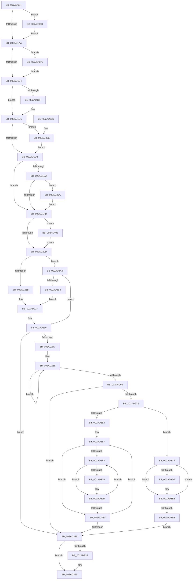

# MiTrimWorkingSet

- RVA: `0x002AD134`–`0x002AD412` (길이 `734` bytes)
- VA: `0x00000001402AD134`
- 실행 섹션: `.text`
- PDB 이름 있음: `예`; PDB Function 태그: `아니요`
- unwind 정보 RVA: `0x0006D29C`
- 디코드: `190`개 명령, `734/734` bytes 표시
- 미해석 바이트: `0` (있으면 어셈블리에 `.byte`로 보존)

> 이 문서는 커널 이미지의 기계어와 PDB 기호를 분석해 생성했습니다. 4번과 5번은 함수 원형과 자료형을 바이너리 사용 방식에서 추정한 C 해석이며 원본 소스 복구 결과는 아닙니다.

## 1. Dependencies

- 직접 호출 지점: **7**; 고유 호출 대상: **5**
- 직접 호출자로 확인된 함수: **5**
- RIP 상대 이미지 참조: **4**

### Outgoing calls
- `0x002AD179` → [memset](../6C/memset_function_006C6C40.md) (function, `0x006C6C40`)
- `0x002AD18B` → [memset](../6C/memset_function_006C6C40.md) (function, `0x006C6C40`)
- `0x002AD200` → [MiVmAccessLoggingEnabled](../36/MiVmAccessLoggingEnabled_function_003629D4.md) (function, `0x003629D4`)
- `0x002AD326` → [MiFastTrimWorkingSet](MiFastTrimWorkingSet_function_002AD420.md) (function, `0x002AD420`)
- `0x002AD361` → [MiLogTrimWs](MiLogTrimWs_function_002AC4B4.md) (function, `0x002AC4B4`)
- `0x002AD374` → [_security_check_cookie](../6A/_security_check_cookie_function_006AC640.md) (function, `0x006AC640`)
- `0x002AD3DE` → [MiFastTrimWorkingSet](MiFastTrimWorkingSet_function_002AD420.md) (function, `0x002AD420`)

### Direct callers
- [MiReduceWs](../27/MiReduceWs_function_0027E908.md) at `0x0027E968`
- [MiEmptyWorkingSetInitiate](MiEmptyWorkingSetInitiate_function_002A7128.md) at `0x002A725E`
- [MiForcedTrim](../34/MiForcedTrim_function_0034DC0C.md) at `0x0034DD9B`
- [MiTrimOrAgeWorkingSet](../34/MiTrimOrAgeWorkingSet_function_0034EFC0.md) at `0x0034F09D`
- [MiTrimOrAgeWorkingSet](../34/MiTrimOrAgeWorkingSet_function_0034EFC0.md) at `0x0034F0BF`
- [MiTrimOrAgeWorkingSet](../34/MiTrimOrAgeWorkingSet_function_0034EFC0.md) at `0x0034F14F`
- [MmAdjustWorkingSetSizeEx](../47/MmAdjustWorkingSetSizeEx_function_0047D8D4.md) at `0x0047DBA8`

### Static image references
- `0x002AD150` → RVA `0x00E0A740` (`.data`; read)
- `0x002AD2AC` → RVA `0x00292F30` (`MiTrimPte`; read)
- `0x002AD2B7` → RVA `0x002AD970` (`MiTrimWorkingSetTail`; read)
- `0x002AD3A4` → RVA `0x00FC6A88` (`ALMOSTRO`; read)

## 2. Other-region calls and transfers

- 다른 실행 섹션으로 향하는 call: **0**
- 별도 외부 분기/꼬리 이동을 확인하지 못했습니다.

## 3. Assembly (complete function range)

```asm
002AD134  40 55                           push rbp
002AD136  53                              push rbx
002AD137  56                              push rsi
002AD138  57                              push rdi
002AD139  41 54                           push r12
002AD13B  41 55                           push r13
002AD13D  41 56                           push r14
002AD13F  41 57                           push r15
002AD141  48 8D AC 24 E8 FE FF FF         lea rbp, [rsp - 0x118]
002AD149  48 81 EC 18 02 00 00            sub rsp, 0x218
002AD150  48 8B 05 E9 D5 B5 00            mov rax, qword ptr [rip + 0xb5d5e9]
002AD157  48 33 C4                        xor rax, rsp
002AD15A  48 89 85 00 01 00 00            mov qword ptr [rbp + 0x100], rax
002AD161  45 8A E8                        mov r13b, r8b
002AD164  45 8B E1                        mov r12d, r9d
002AD167  48 8B F2                        mov rsi, rdx
002AD16A  48 8B F9                        mov rdi, rcx
002AD16D  33 D2                           xor edx, edx
002AD16F  48 8D 4D 00                     lea rcx, [rbp]
002AD173  41 B8 F8 00 00 00               mov r8d, 0xf8
002AD179  E8 C2 9A 41 00                  call 0x1406c6c40
002AD17E  33 D2                           xor edx, edx
002AD180  48 8D 4C 24 40                  lea rcx, [rsp + 0x40]
002AD185  41 B8 C0 00 00 00               mov r8d, 0xc0
002AD18B  E8 B0 9A 41 00                  call 0x1406c6c40
002AD190  44 8B B5 80 01 00 00            mov r14d, dword ptr [rbp + 0x180]
002AD197  41 8B C4                        mov eax, r12d
002AD19A  83 E0 0F                        and eax, 0xf
002AD19D  89 45 00                        mov dword ptr [rbp], eax
002AD1A0  41 F6 C6 02                     test r14b, 2
002AD1A4  0F 85 46 02 00 00               jne 0x1402ad3f0
002AD1AA  41 F6 C6 04                     test r14b, 4
002AD1AE  0F 85 48 02 00 00               jne 0x1402ad3fc
002AD1B4  41 BB 01 00 00 00               mov r11d, 1
002AD1BA  45 84 F3                        test r11b, r14b
002AD1BD  74 07                           je 0x1402ad1c6
002AD1BF  0F BA E8 0B                     bts eax, 0xb
002AD1C3  89 45 00                        mov dword ptr [rbp], eax
002AD1C6  BB 08 00 00 00                  mov ebx, 8
002AD1CB  44 84 F3                        test bl, r14b
002AD1CE  0F 85 BA 01 00 00               jne 0x1402ad38e
002AD1D4  41 F6 C6 10                     test r14b, 0x10
002AD1D8  74 23                           je 0x1402ad1fd
002AD1DA  0F BA E8 0E                     bts eax, 0xe
002AD1DE  89 45 00                        mov dword ptr [rbp], eax
002AD1E1  48 8B 87 90 00 00 00            mov rax, qword ptr [rdi + 0x90]
002AD1E8  48 3B F0                        cmp rsi, rax
002AD1EB  48 89 45 38                     mov qword ptr [rbp + 0x38], rax
002AD1EF  48 0F 47 F0                     cmova rsi, rax
002AD1F3  41 F6 C6 20                     test r14b, 0x20
002AD1F7  0F 85 9D 01 00 00               jne 0x1402ad39a
002AD1FD  48 8B CF                        mov rcx, rdi
002AD200  E8 CF 57 0B 00                  call 0x1403629d4
002AD205  85 C0                           test eax, eax
002AD207  0F 85 FB 01 00 00               jne 0x1402ad408
002AD20D  8B 87 B8 00 00 00               mov eax, dword ptr [rdi + 0xb8]
002AD213  A8 0F                           test al, 0xf
002AD215  0F 85 89 01 00 00               jne 0x1402ad3a4
002AD21B  33 C9                           xor ecx, ecx
002AD21D  48 39 8F 70 02 00 00            cmp qword ptr [rdi + 0x270], rcx
002AD224  0F 95 C1                        setne cl
002AD227  48 8B 45 50                     mov rax, qword ptr [rbp + 0x50]
002AD22B  85 C9                           test ecx, ecx
002AD22D  49 0F 45 C3                     cmovne rax, r11
002AD231  48 89 45 50                     mov qword ptr [rbp + 0x50], rax
002AD235  48 83 65 30 00                  and qword ptr [rbp + 0x30], 0
002AD23A  4C 8B 57 10                     mov r10, qword ptr [rdi + 0x10]
002AD23E  44 3B E3                        cmp r12d, ebx
002AD241  0F 83 F2 00 00 00               jae 0x1402ad339
002AD247  49 8D 54 24 05                  lea rdx, [r12 + 5]
002AD24C  44 8B CB                        mov r9d, ebx
002AD24F  48 8D 14 D7                     lea rdx, [rdi + rdx*8]
002AD253  45 2B CC                        sub r9d, r12d
002AD256  4C 8B 02                        mov r8, qword ptr [rdx]
002AD259  48 03 D3                        add rdx, rbx
002AD25C  4C 03 45 30                     add r8, qword ptr [rbp + 0x30]
002AD260  4C 89 45 30                     mov qword ptr [rbp + 0x30], r8
002AD264  4D 2B CB                        sub r9, r11
002AD267  75 ED                           jne 0x1402ad256
002AD269  4D 85 C0                        test r8, r8
002AD26C  0F 84 C7 00 00 00               je 0x1402ad339
002AD272  8B 44 24 44                     mov eax, dword ptr [rsp + 0x44]
002AD276  48 83 CA FF                     or rdx, 0xffffffffffffffff
002AD27A  25 FF 0F FF FF                  and eax, 0xffff0fff
002AD27F  48 89 75 08                     mov qword ptr [rbp + 8], rsi
002AD283  41 8B CC                        mov ecx, r12d
002AD286  C7 44 24 40 16 00 00 00         mov dword ptr [rsp + 0x40], 0x16
002AD28E  83 E1 0F                        and ecx, 0xf
002AD291  48 89 7C 24 60                  mov qword ptr [rsp + 0x60], rdi
002AD296  C1 E1 0C                        shl ecx, 0xc
002AD299  0B C8                           or ecx, eax
002AD29B  44 88 6C 24 49                  mov byte ptr [rsp + 0x49], r13b
002AD2A0  89 4C 24 44                     mov dword ptr [rsp + 0x44], ecx
002AD2A4  48 8D 45 00                     lea rax, [rbp]
002AD2A8  48 89 45 F8                     mov qword ptr [rbp - 8], rax
002AD2AC  48 8D 05 7D 5C FE FF            lea rax, [rip - 0x1a383]
002AD2B3  48 89 45 E8                     mov qword ptr [rbp - 0x18], rax
002AD2B7  48 8D 05 B2 06 00 00            lea rax, [rip + 0x6b2]
002AD2BE  48 89 45 F0                     mov qword ptr [rbp - 0x10], rax
002AD2C2  49 8B 02                        mov rax, qword ptr [r10]
002AD2C5  48 8B 4C 24 70                  mov rcx, qword ptr [rsp + 0x70]
002AD2CA  48 85 C0                        test rax, rax
002AD2CD  48 89 45 80                     mov qword ptr [rbp - 0x80], rax
002AD2D1  48 0F 44 CA                     cmove rcx, rdx
002AD2D5  48 89 4C 24 70                  mov qword ptr [rsp + 0x70], rcx
002AD2DA  41 F6 C6 46                     test r14b, 0x46
002AD2DE  0F 85 E3 00 00 00               jne 0x1402ad3c7
002AD2E4  40 8A F3                        mov sil, bl
002AD2E7  40 80 C6 FF                     add sil, 0xff
002AD2EB  44 8A FB                        mov r15b, bl
002AD2EE  40 3A F3                        cmp sil, bl
002AD2F1  74 3D                           je 0x1402ad330
002AD2F3  41 80 C7 FF                     add r15b, 0xff
002AD2F7  41 0F B6 C7                     movzx eax, r15b
002AD2FB  48 8B 4C C7 28                  mov rcx, qword ptr [rdi + rax*8 + 0x28]
002AD300  48 85 C9                        test rcx, rcx
002AD303  74 26                           je 0x1402ad32b
002AD305  8B 44 24 44                     mov eax, dword ptr [rsp + 0x44]
002AD309  41 8A D7                        mov dl, r15b
002AD30C  40 0F B6 CE                     movzx ecx, sil
002AD310  25 FF 0F FF FF                  and eax, 0xffff0fff
002AD315  83 E1 0F                        and ecx, 0xf
002AD318  C1 E1 0C                        shl ecx, 0xc
002AD31B  0B C8                           or ecx, eax
002AD31D  89 4C 24 44                     mov dword ptr [rsp + 0x44], ecx
002AD321  48 8D 4C 24 40                  lea rcx, [rsp + 0x40]
002AD326  E8 F5 00 00 00                  call 0x1402ad420
002AD32B  44 3A FE                        cmp r15b, sil
002AD32E  75 C3                           jne 0x1402ad2f3
002AD330  40 0F B6 C6                     movzx eax, sil
002AD334  41 3B C4                        cmp eax, r12d
002AD337  75 AE                           jne 0x1402ad2e7
002AD339  41 F6 C6 40                     test r14b, 0x40
002AD33D  75 27                           jne 0x1402ad366
002AD33F  48 8B 45 30                     mov rax, qword ptr [rbp + 0x30]
002AD343  48 8B CF                        mov rcx, rdi
002AD346  4C 8B 4D 10                     mov r9, qword ptr [rbp + 0x10]
002AD34A  4C 8B 45 28                     mov r8, qword ptr [rbp + 0x28]
002AD34E  48 8B 55 20                     mov rdx, qword ptr [rbp + 0x20]
002AD352  44 89 74 24 30                  mov dword ptr [rsp + 0x30], r14d
002AD357  44 89 64 24 28                  mov dword ptr [rsp + 0x28], r12d
002AD35C  48 89 44 24 20                  mov qword ptr [rsp + 0x20], rax
002AD361  E8 4E F1 FF FF                  call 0x1402ac4b4
002AD366  48 8B 45 10                     mov rax, qword ptr [rbp + 0x10]
002AD36A  48 8B 8D 00 01 00 00            mov rcx, qword ptr [rbp + 0x100]
002AD371  48 33 CC                        xor rcx, rsp
002AD374  E8 C7 F2 3F 00                  call 0x1406ac640
002AD379  48 81 C4 18 02 00 00            add rsp, 0x218
002AD380  41 5F                           pop r15
002AD382  41 5E                           pop r14
002AD384  41 5D                           pop r13
002AD386  41 5C                           pop r12
002AD388  5F                              pop rdi
002AD389  5E                              pop rsi
002AD38A  5B                              pop rbx
002AD38B  5D                              pop rbp
002AD38C  C3                              ret
002AD38D  CC                              int3
002AD38E  0F BA E8 0C                     bts eax, 0xc
002AD392  89 45 00                        mov dword ptr [rbp], eax
002AD395  E9 3A FE FF FF                  jmp 0x1402ad1d4
002AD39A  0F BA 6D 00 0F                  bts dword ptr [rbp], 0xf
002AD39F  E9 59 FE FF FF                  jmp 0x1402ad1fd
002AD3A4  48 0F BA 25 DB 96 D1 00 24      bt qword ptr [rip + 0xd196db], 0x24
002AD3AD  0F 83 82 FE FF FF               jae 0x1402ad235
002AD3B3  8B 8F B8 00 00 00               mov ecx, dword ptr [rdi + 0xb8]
002AD3B9  C1 E9 08                        shr ecx, 8
002AD3BC  C1 E9 03                        shr ecx, 3
002AD3BF  41 23 CB                        and ecx, r11d
002AD3C2  E9 60 FE FF FF                  jmp 0x1402ad227
002AD3C7  80 C3 FF                        add bl, 0xff
002AD3CA  0F B6 C3                        movzx eax, bl
002AD3CD  48 8B 4C C7 28                  mov rcx, qword ptr [rdi + rax*8 + 0x28]
002AD3D2  48 85 C9                        test rcx, rcx
002AD3D5  74 0C                           je 0x1402ad3e3
002AD3D7  8A D3                           mov dl, bl
002AD3D9  48 8D 4C 24 40                  lea rcx, [rsp + 0x40]
002AD3DE  E8 3D 00 00 00                  call 0x1402ad420
002AD3E3  0F B6 C3                        movzx eax, bl
002AD3E6  41 3B C4                        cmp eax, r12d
002AD3E9  75 DC                           jne 0x1402ad3c7
002AD3EB  E9 49 FF FF FF                  jmp 0x1402ad339
002AD3F0  0F BA E8 09                     bts eax, 9
002AD3F4  89 45 00                        mov dword ptr [rbp], eax
002AD3F7  E9 AE FD FF FF                  jmp 0x1402ad1aa
002AD3FC  0F BA E8 0A                     bts eax, 0xa
002AD400  89 45 00                        mov dword ptr [rbp], eax
002AD403  E9 AC FD FF FF                  jmp 0x1402ad1b4
002AD408  0F BA 6D 00 08                  bts dword ptr [rbp], 8
002AD40D  E9 FB FD FF FF                  jmp 0x1402ad20d
```

## 4. C-style interpretation (structured pseudocode)

```c
__int64 __fastcall MiTrimWorkingSet(__int64 a1, __int64 a2, unsigned __int8 a3, int a4, unsigned int a5)
{
    __int64 result;
    __int64 v_r15;
    __int64 v_rbx;
    __int64 v_rsi;
    __int64 v_rsp;
    unsigned __int64 v_stack_m108;
    unsigned __int64 v_stack_m120;
    unsigned __int64 v_stack_m128;
    unsigned __int64 v_stack_m130;
    unsigned __int64 v_stack_m138;
    unsigned __int64 v_stack_m148;
    unsigned __int64 v_stack_m150;
    unsigned __int64 v_stack_m158;
    unsigned __int64 v_stack_m160;
    unsigned __int64 v_stack_m168;
    unsigned __int64 v_stack_m170;
    unsigned __int64 v_stack_m1D8;
    unsigned __int64 v_stack_m1E8;
    unsigned __int64 v_stack_m1F8;
    unsigned __int8 v_stack_m20F;
    unsigned int v_stack_m214;
    unsigned __int64 v_stack_m218;
    unsigned int v_stack_m228;
    unsigned int v_stack_m230;
    unsigned __int64 v_stack_m238;
    unsigned __int64 v_stack_m58;
    unsigned __int64 v_stack_p40;

    v_rsp = (v_rsp) - (536);
    result = (*(unsigned __int64 *)(v_rip + 11916777)) ^ (v_rsp);
    v_stack_m58 = result;
    a2 = 0;
    result = memset(v_stack_m158, a2, 248, a4);
    a2 = 0;
    result = memset(v_stack_m218, a2, 192, a4);
    result = (unsigned int)(((unsigned int)((unsigned int)((unsigned int)(a4)))) & (15));
    v_stack_m158 = (unsigned int)(result);
    if ((((unsigned __int8)((unsigned int)(a5))) & (2)) != 0) goto loc_002AD3F0;
loc_002AD1AA:
    if ((((unsigned __int8)((unsigned int)(a5))) & (4)) != 0) goto loc_002AD3FC;
loc_002AD1B4:
    if (((1) & ((unsigned __int8)((unsigned int)(a5)))) != 0) {
        v_stack_m158 = (unsigned int)(result);
    }
    if (((8) & ((unsigned __int8)((unsigned int)(a5)))) != 0) goto loc_002AD38E;
loc_002AD1D4:
    if ((((unsigned __int8)((unsigned int)(a5))) & (16)) == 0) goto loc_002AD1FD;
    v_stack_m158 = (unsigned int)(result);
    v_stack_m120 = *(unsigned __int64 *)(a1 + 144);
    if (0 > (*(unsigned __int64 *)(a1 + 144))) { a2 = *(unsigned __int64 *)(a1 + 144); }
    if ((((unsigned __int8)((unsigned int)(a5))) & (32)) != 0) goto loc_002AD39A;
loc_002AD1FD:
    result = MiVmAccessLoggingEnabled(a1, a2, 192, a4);
    if ((unsigned int)(result) != 0) goto loc_002AD408;
loc_002AD20D:
    if ((((unsigned __int8)((unsigned int)(*(unsigned int *)(a1 + 184)))) & (15)) != 0) goto loc_002AD3A4;
    a1 = 0;
    a1 = ((*(unsigned __int64 *)(a1 + 624)) != 0) ? 1 : 0;
loc_002AD227:
    result = v_stack_m108;
    if ((unsigned int)(a1) != 0) { result = 1; }
    v_stack_m108 = result;
loc_002AD235:
    if (((unsigned int)((unsigned int)(a4))) >= 8) goto loc_002AD339;
    a4 = (unsigned int)((8) - ((unsigned int)((unsigned int)(a4))));
loc_002AD256:
    a2 = (a1 + (unsigned int)(a4) + 5 * 8) + (8);
    a3 = (*(unsigned __int64 *)(a1 + (unsigned int)(a4) + 5 * 8)) + (v_stack_m128);
    v_stack_m128 = a3;
    a4 = (a4) - (1);
    if (condition_is_not_equal) goto loc_002AD256;
    if (a3 == 0) goto loc_002AD339;
    a2 = (a2) | (-1);
    result = (unsigned int)(((unsigned int)(v_stack_m214)) & (0xFFFF0FFFULL));
    v_stack_m150 = a2;
    v_stack_m218 = 22;
    a1 = (unsigned int)(((unsigned int)((unsigned int)((unsigned int)(a4)))) & (15));
    v_stack_m1F8 = a1;
    a1 = (unsigned int)((a1) << (12));
    a1 = (unsigned int)((a1) | ((unsigned int)(result)));
    v_stack_m20F = a3;
    v_stack_m214 = (unsigned int)(a1);
    v_stack_m160 = v_stack_m158;
    v_stack_m170 = v_rip - 107395;
    v_stack_m168 = v_rip + 1714;
    v_stack_m1D8 = *(unsigned __int64 *)(*(unsigned __int64 *)(a1 + 16));
    a1 = v_stack_m1E8;
    if (*(unsigned __int64 *)(*(unsigned __int64 *)(a1 + 16)) == 0) { a1 = a2; }
    v_stack_m1E8 = a1;
    if ((((unsigned __int8)((unsigned int)(a5))) & (70)) != 0) goto loc_002AD3C7;
loc_002AD2E7:
    v_rsi = (unsigned __int8)((8) + (255));
    if (((unsigned __int8)(v_rsi)) == 8) goto loc_002AD330;
loc_002AD2F3:
    v_r15 = (unsigned __int8)((8) + (255));
    result = (unsigned __int8)(v_r15);
    if (*(unsigned __int64 *)(a1 + (unsigned __int8)(v_r15) * 8 + 40) != 0) {
        result = v_stack_m214;
        a2 = (unsigned __int8)(v_r15);
        a1 = (unsigned __int8)(v_rsi);
        result = (unsigned int)((result) & (0xFFFF0FFFULL));
        a1 = (unsigned int)((a1) & (15));
        a1 = (unsigned int)((a1) << (12));
        a1 = (unsigned int)((a1) | ((unsigned int)(result)));
        v_stack_m214 = (unsigned int)(a1);
        a1 = v_stack_m218;
        result = MiFastTrimWorkingSet(a1, a2, a3, a4);
    }
    if (((unsigned __int8)(v_r15)) != ((unsigned __int8)(v_rsi))) goto loc_002AD2F3;
loc_002AD330:
    if (((unsigned int)((unsigned __int8)(v_rsi))) != ((unsigned int)((unsigned int)(a4)))) goto loc_002AD2E7;
loc_002AD339:
    result = (unsigned __int8)(v_rsi);
    if ((((unsigned __int8)((unsigned int)(a5))) & (64)) == 0) {
        result = v_stack_m128;
        a1 = a1;
        a4 = v_stack_m148;
        a3 = v_stack_m130;
        a2 = v_stack_m138;
        v_stack_m228 = (unsigned int)((unsigned int)(a5));
        v_stack_m230 = (unsigned int)((unsigned int)(a4));
        v_stack_m238 = result;
        result = MiLogTrimWs(a1, a2, a3, a4);
    }
    a1 = (v_stack_m58) ^ (v_rsp);
    result = _security_check_cookie(a1, a2, a3, a4);
    v_rsp = (v_rsp) + (536);
    return result;
loc_002AD38E:
    v_stack_m158 = (unsigned int)(result);
    goto loc_002AD1D4;
loc_002AD39A:
    goto loc_002AD1FD;
loc_002AD3A4:
    if (condition_is_above_or_equal) goto loc_002AD235;
    a1 = (unsigned int)(((unsigned int)(*(unsigned int *)(a1 + 184))) >> (8));
    a1 = (unsigned int)((a1) >> (3));
    a1 = (unsigned int)((a1) & (1));
    goto loc_002AD227;
loc_002AD3C7:
    v_rbx = (unsigned __int8)((8) + (255));
    result = (unsigned __int8)(v_rbx);
    if (*(unsigned __int64 *)(a1 + (unsigned __int8)(v_rbx) * 8 + 40) != 0) {
        a2 = (unsigned __int8)(v_rbx);
        a1 = v_stack_p40;
        result = MiFastTrimWorkingSet(a1, a2, a3, a4);
    }
    if (((unsigned int)((unsigned __int8)(v_rbx))) != ((unsigned int)((unsigned int)(a4)))) goto loc_002AD3C7;
    goto loc_002AD339;
loc_002AD3F0:
    v_stack_m158 = (unsigned int)((unsigned __int8)(v_rbx));
    goto loc_002AD1AA;
loc_002AD3FC:
    v_stack_m158 = (unsigned int)((unsigned __int8)(v_rbx));
    goto loc_002AD1B4;
loc_002AD408:
    goto loc_002AD20D;
}
```

## 5. (Beta) C Style

```c
int64_t MiTrimWorkingSet(void *Arg1, int64_t Arg2, uint8_t Arg3, int32_t Arg4, uint32_t Arg5)
{
    uint8_t *arg1 = (uint8_t *)Arg1;

    int64_t result;
    int64_t local_r15;
    int64_t local_rbx;
    int64_t local_rsi;
    int64_t local_rsp;
    uint64_t v_stack_m108;
    uint64_t v_stack_m120;
    uint64_t v_stack_m128;
    uint64_t v_stack_m130;
    uint64_t v_stack_m138;
    uint64_t v_stack_m148;
    uint64_t v_stack_m150;
    uint64_t v_stack_m158;
    uint64_t v_stack_m160;
    uint64_t v_stack_m168;
    uint64_t v_stack_m170;
    uint64_t v_stack_m1D8;
    uint64_t v_stack_m1E8;
    uint64_t v_stack_m1F8;
    uint8_t v_stack_m20F;
    uint32_t v_stack_m214;
    uint64_t v_stack_m218;
    uint32_t v_stack_m228;
    uint32_t v_stack_m230;
    uint64_t v_stack_m238;
    uint64_t v_stack_m58;
    uint64_t v_stack_p40;

    local_rsp = (local_rsp) - (536);
    result = (*(uint64_t *)(v_rip + 0xB5D5E9)) ^ (local_rsp);
    v_stack_m58 = result;
    Arg2 = 0;
    result = memset(v_stack_m158, Arg2, 248, Arg4);
    Arg2 = 0;
    result = memset(v_stack_m218, Arg2, 192, Arg4);
    result = (uint32_t)(((uint32_t)((uint32_t)((uint32_t)(Arg4)))) & (15));
    v_stack_m158 = (uint32_t)(result);
    if ((((uint8_t)((uint32_t)(Arg5))) & (2)) != 0) goto loc_002AD3F0;
loc_002AD1AA:
    if ((((uint8_t)((uint32_t)(Arg5))) & (4)) != 0) goto loc_002AD3FC;
loc_002AD1B4:
    if (((1) & ((uint8_t)((uint32_t)(Arg5)))) != 0) {
        v_stack_m158 = (uint32_t)(result);
    }
    if (((8) & ((uint8_t)((uint32_t)(Arg5)))) != 0) goto loc_002AD38E;
loc_002AD1D4:
    if ((((uint8_t)((uint32_t)(Arg5))) & (16)) == 0) goto loc_002AD1FD;
    v_stack_m158 = (uint32_t)(result);
    v_stack_m120 = *(uint64_t *)(arg1 + 0x90);
    if (0 > (*(uint64_t *)(arg1 + 0x90))) { Arg2 = *(uint64_t *)(arg1 + 0x90); }
    if ((((uint8_t)((uint32_t)(Arg5))) & (32)) != 0) goto loc_002AD39A;
loc_002AD1FD:
    result = MiVmAccessLoggingEnabled(Arg1, Arg2, 192, Arg4);
    if ((uint32_t)(result) != 0) goto loc_002AD408;
loc_002AD20D:
    if ((((uint8_t)((uint32_t)(*(uint32_t *)(arg1 + 0xB8)))) & (15)) != 0) goto loc_002AD3A4;
    Arg1 = 0;
    Arg1 = ((*(uint64_t *)(arg1 + 0x270)) != 0) ? 1 : 0;
loc_002AD227:
    result = v_stack_m108;
    if ((uint32_t)(Arg1) != 0) { result = 1; }
    v_stack_m108 = result;
loc_002AD235:
    if (((uint32_t)((uint32_t)(Arg4))) >= 8) goto loc_002AD339;
    Arg4 = (uint32_t)((8) - ((uint32_t)((uint32_t)(Arg4))));
loc_002AD256:
    Arg2 = (Arg1 + (uint32_t)(Arg4) + 5 * 8) + (8);
    Arg3 = (*(uint64_t *)(arg1 + (uint32_t)(Arg4) + 0x5 * 8)) + (v_stack_m128);
    v_stack_m128 = Arg3;
    Arg4 = (Arg4) - (1);
    if (condition_is_not_equal) goto loc_002AD256;
    if (Arg3 == 0) goto loc_002AD339;
    Arg2 = (Arg2) | (-1);
    result = (uint32_t)(((uint32_t)(v_stack_m214)) & (0xFFFF0FFFULL));
    v_stack_m150 = Arg2;
    v_stack_m218 = 22;
    Arg1 = (uint32_t)(((uint32_t)((uint32_t)((uint32_t)(Arg4)))) & (15));
    v_stack_m1F8 = Arg1;
    Arg1 = (uint32_t)((Arg1) << (12));
    Arg1 = (uint32_t)((Arg1) | ((uint32_t)(result)));
    v_stack_m20F = Arg3;
    v_stack_m214 = (uint32_t)(Arg1);
    v_stack_m160 = v_stack_m158;
    v_stack_m170 = v_rip - 107395;
    v_stack_m168 = v_rip + 1714;
    v_stack_m1D8 = *(uint64_t *)(*(uint64_t *)(arg1 + 0x10));
    Arg1 = v_stack_m1E8;
    if (*(uint64_t *)(*(uint64_t *)(arg1 + 0x10)) == 0) { Arg1 = Arg2; }
    v_stack_m1E8 = Arg1;
    if ((((uint8_t)((uint32_t)(Arg5))) & (70)) != 0) goto loc_002AD3C7;
loc_002AD2E7:
    local_rsi = (uint8_t)((8) + (255));
    if (((uint8_t)(local_rsi)) == 8) goto loc_002AD330;
loc_002AD2F3:
    local_r15 = (uint8_t)((8) + (255));
    result = (uint8_t)(local_r15);
    if (*(uint64_t *)(arg1 + (uint8_t)(local_r15) * 8 + 0x28) != 0) {
        result = v_stack_m214;
        Arg2 = (uint8_t)(local_r15);
        Arg1 = (uint8_t)(local_rsi);
        result = (uint32_t)((result) & (0xFFFF0FFFULL));
        Arg1 = (uint32_t)((Arg1) & (15));
        Arg1 = (uint32_t)((Arg1) << (12));
        Arg1 = (uint32_t)((Arg1) | ((uint32_t)(result)));
        v_stack_m214 = (uint32_t)(Arg1);
        Arg1 = v_stack_m218;
        result = MiFastTrimWorkingSet(Arg1, Arg2, Arg3, Arg4);
    }
    if (((uint8_t)(local_r15)) != ((uint8_t)(local_rsi))) goto loc_002AD2F3;
loc_002AD330:
    if (((uint32_t)((uint8_t)(local_rsi))) != ((uint32_t)((uint32_t)(Arg4)))) goto loc_002AD2E7;
loc_002AD339:
    result = (uint8_t)(local_rsi);
    if ((((uint8_t)((uint32_t)(Arg5))) & (64)) == 0) {
        result = v_stack_m128;
        Arg1 = Arg1;
        Arg4 = v_stack_m148;
        Arg3 = v_stack_m130;
        Arg2 = v_stack_m138;
        v_stack_m228 = (uint32_t)((uint32_t)(Arg5));
        v_stack_m230 = (uint32_t)((uint32_t)(Arg4));
        v_stack_m238 = result;
        result = MiLogTrimWs(Arg1, Arg2, Arg3, Arg4);
    }
    Arg1 = (v_stack_m58) ^ (local_rsp);
    result = _security_check_cookie(Arg1, Arg2, Arg3, Arg4);
    local_rsp = (local_rsp) + (536);
    return result;
loc_002AD38E:
    v_stack_m158 = (uint32_t)(result);
    goto loc_002AD1D4;
loc_002AD39A:
    goto loc_002AD1FD;
loc_002AD3A4:
    if (condition_is_above_or_equal) goto loc_002AD235;
    Arg1 = (uint32_t)(((uint32_t)(*(uint32_t *)(arg1 + 0xB8))) >> (8));
    Arg1 = (uint32_t)((Arg1) >> (3));
    Arg1 = (uint32_t)((Arg1) & (1));
    goto loc_002AD227;
loc_002AD3C7:
    local_rbx = (uint8_t)((8) + (255));
    result = (uint8_t)(local_rbx);
    if (*(uint64_t *)(arg1 + (uint8_t)(local_rbx) * 8 + 0x28) != 0) {
        Arg2 = (uint8_t)(local_rbx);
        Arg1 = v_stack_p40;
        result = MiFastTrimWorkingSet(Arg1, Arg2, Arg3, Arg4);
    }
    if (((uint32_t)((uint8_t)(local_rbx))) != ((uint32_t)((uint32_t)(Arg4)))) goto loc_002AD3C7;
    goto loc_002AD339;
loc_002AD3F0:
    v_stack_m158 = (uint32_t)((uint8_t)(local_rbx));
    goto loc_002AD1AA;
loc_002AD3FC:
    v_stack_m158 = (uint32_t)((uint8_t)(local_rbx));
    goto loc_002AD1B4;
loc_002AD408:
    goto loc_002AD20D;
}
```

### 관측된 메모리 오프셋

구조체 형식이 확인되지 않은 접근은 인자 기준의 오프셋으로만 기록했습니다.

| 기준 인자 | 오프셋 표현 | 폭 (bit) | 접근 |
|---|---:|---:|---|
| `Arg1` | `+ 0x0` | `64` | `R` |
| `Arg1` | `+ 0x0 + rdx*8` | `64` | `R` |
| `Arg1` | `+ 0x10` | `64` | `R` |
| `Arg1` | `+ 0x28 + rax*8` | `64` | `R` |
| `Arg1` | `+ 0x90` | `64` | `R` |
| `Arg1` | `+ 0xB8` | `32` | `R` |
| `Arg1` | `+ 0x270` | `64` | `R` |

## 6. Execution-region graph

[열기: 2D/3D 그래프와 함수 탐색 컨트롤 패널](../../../control-panel.html?section=text&rva=0x002AD134&view=graph)

- 2D 그래프는 위에서 아래로 흐르고, 3D 그래프는 빈 공간을 드래그해 회전합니다. Shift+드래그는 이동, 휠은 확대·축소, 함수 노드 선택은 대상 보고서 이동입니다.

### Static fallback


