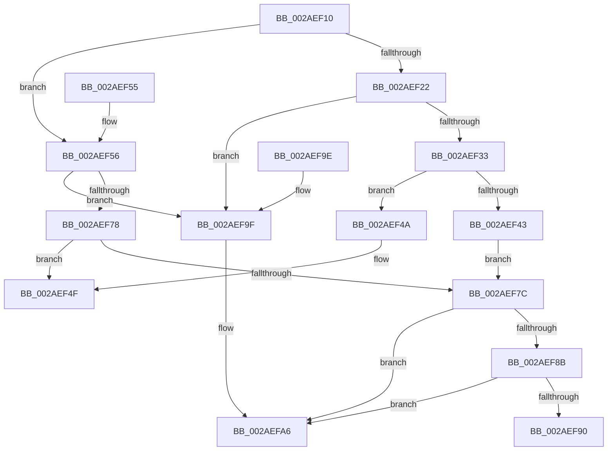

# MiUnlockAndDereferenceVadShared

- RVA: `0x002AEF10`–`0x002AEFC3` (길이 `179` bytes)
- VA: `0x00000001402AEF10`
- 실행 섹션: `.text`
- PDB 이름 있음: `예`; PDB Function 태그: `아니요`
- unwind 정보 RVA: `0x0006D490`
- 디코드: `52`개 명령, `179/179` bytes 표시
- 미해석 바이트: `0` (있으면 어셈블리에 `.byte`로 보존)

> 이 문서는 커널 이미지의 기계어와 PDB 기호를 분석해 생성했습니다. 4번과 5번은 함수 원형과 자료형을 바이너리 사용 방식에서 추정한 C 해석이며 원본 소스 복구 결과는 아닙니다.

## 1. Dependencies

- 직접 호출 지점: **6**; 고유 호출 대상: **4**
- 직접 호출자로 확인된 함수: **22**
- RIP 상대 이미지 참조: **0**

### Outgoing calls
- `0x002AEF19` → [Feature_2429262139__private_IsEnabledNoReportingNoInline](../66/Feature_2429262139__private_IsEnabledNoReportingNoInline_function_0066E0A8.md) (function, `0x0066E0A8`)
- `0x002AEF43` → [MiUnlockVadShared](../2E/MiUnlockVadShared_function_002E2420.md) (function, `0x002E2420`)
- `0x002AEF4A` → [MiUnlockVadShared](../2E/MiUnlockVadShared_function_002E2420.md) (function, `0x002E2420`)
- `0x002AEF62` → [MiUnlockVadShared](../2E/MiUnlockVadShared_function_002E2420.md) (function, `0x002E2420`)
- `0x002AEF93` → [ExFreeHeapPool](../35/ExFreeHeapPool_function_0035FAE0.md) (function, `0x0035FAE0`)
- `0x002AEFBD` → [KeBugCheckEx](../4F/KeBugCheckEx_function_004FD660.md) (function, `0x004FD660`)

### Direct callers
- [MiGetWorkingSetInfoList](MiGetWorkingSetInfoList_function_002AF770.md) at `0x002AFF63`
- [MiGetWorkingSetInfoList](MiGetWorkingSetInfoList_function_002AF770.md) at `0x002B0315`
- [sub_00316832](../31/Unknown_function_00316832.md) at `0x003168B2`
- [MiReturnLockedVadOrNextVa](../31/MiReturnLockedVadOrNextVa_function_00316980.md) at `0x00316DCF`
- [MiPrefetchPreallocatePages](../36/MiPrefetchPreallocatePages_function_0036B1F0.md) at `0x0036B362`
- [MiPrefetchPreallocatePages](../36/MiPrefetchPreallocatePages_function_0036B1F0.md) at `0x0036B490`
- [MiCleanCfg](../49/MiCleanCfg_function_00492778.md) at `0x004927CD`
- [MiQueryImageExtensionInformation](../4E/MiQueryImageExtensionInformation_function_004EE3C8.md) at `0x004EE5F6`
- [MmGetEnclaveModuleList](../68/MmGetEnclaveModuleList_function_0068719C.md) at `0x00687288`
- [MiQueryImageExtensionInformationOld](../68/MiQueryImageExtensionInformationOld_function_00687384.md) at `0x00687573`
- [MiProcessVaContiguityInformation](../69/MiProcessVaContiguityInformation_function_006939C0.md) at `0x00693B1C`
- [MiProcessVaContiguityInformation](../69/MiProcessVaContiguityInformation_function_006939C0.md) at `0x00693CCE`
- [sub_006F9816](../6F/Unknown_function_006F9816.md) at `0x006F9837`
- [MiHandleEnclaveFault](../../page/70/MiHandleEnclaveFault_function_00702708.md) at `0x00702756`
- [MiHotPatchProcess](../../page/80/MiHotPatchProcess_function_00803B78.md) at `0x00803D37`
- [NtAreMappedFilesTheSame](../../page/87/NtAreMappedFilesTheSame_function_0087EC70.md) at `0x0087EDD1`
- [NtAreMappedFilesTheSame](../../page/87/NtAreMappedFilesTheSame_function_0087EC70.md) at `0x0087EDE4`
- [NtAreMappedFilesTheSame](../../page/87/NtAreMappedFilesTheSame_function_0087EC70.md) at `0x0087EE80`
- [NtAreMappedFilesTheSame](../../page/87/NtAreMappedFilesTheSame_function_0087EC70.md) at `0x0087EE93`
- [NtAreMappedFilesTheSame](../../page/87/NtAreMappedFilesTheSame_function_0087EC70.md) at `0x0087EEC1`
- [NtAreMappedFilesTheSame](../../page/87/NtAreMappedFilesTheSame_function_0087EC70.md) at `0x0087EEE9`
- [MmGetImageInformation](../../page/8D/MmGetImageInformation_function_008D9C68.md) at `0x008D9CC2`
- [MiCopyVirtualMemory](../../page/9B/MiCopyVirtualMemory_function_009BBB50.md) at `0x009BBF81`
- [MiCopyVirtualMemory](../../page/9B/MiCopyVirtualMemory_function_009BBB50.md) at `0x009BC16F`
- [MiCopyVirtualMemory](../../page/9B/MiCopyVirtualMemory_function_009BBB50.md) at `0x009BC1F6`
- [MiCopyVirtualMemory](../../page/9B/MiCopyVirtualMemory_function_009BBB50.md) at `0x009BC24B`
- [MmFlushVirtualMemory](../../page/9D/MmFlushVirtualMemory_function_009D6F5C.md) at `0x009D711F`
- [MmFlushVirtualMemory](../../page/9D/MmFlushVirtualMemory_function_009D6F5C.md) at `0x009D71D9`
- [MmQueryVirtualMemory](../../page/9D/MmQueryVirtualMemory_function_009D9280.md) at `0x009D9D3E`
- [MmQueryVirtualMemory](../../page/9D/MmQueryVirtualMemory_function_009D9280.md) at `0x009D9DE8`
- [MmQueryVirtualMemory](../../page/9D/MmQueryVirtualMemory_function_009D9280.md) at `0x009DA05F`
- [MmGetFileNameForAddress](../../page/A2/MmGetFileNameForAddress_function_00A2B878.md) at `0x00A2B8D5`
- [MmGetFileNameForAddress](../../page/A2/MmGetFileNameForAddress_function_00A2B878.md) at `0x00A2B969`
- [MiCheckShadowStackOverflow](../../page/A3/MiCheckShadowStackOverflow_function_00A30B68.md) at `0x00A30BCE`
- [MiQueryMemoryPhysicalContiguity](../../page/AD/MiQueryMemoryPhysicalContiguity_function_00AD5B98.md) at `0x00AD5F06`
- [MiQueryMemoryPhysicalContiguity](../../page/AD/MiQueryMemoryPhysicalContiguity_function_00AD5B98.md) at `0x00AD5FE5`
- [MiQueryMemoryPhysicalContiguity](../../page/AD/MiQueryMemoryPhysicalContiguity_function_00AD5B98.md) at `0x00AD6075`
- [sub_00B39A5E](../../page/B3/Unknown_function_00B39A5E.md) at `0x00B39A71`
- [sub_00B44B9C](../../page/B4/Unknown_function_00B44B9C.md) at `0x00B44C0F`

### Static image references
- 디코드된 RIP-relative 메모리 참조가 없습니다.

## 2. Other-region calls and transfers

- 다른 실행 섹션으로 향하는 call: **0**
- 별도 외부 분기/꼬리 이동을 확인하지 못했습니다.

## 3. Assembly (complete function range)

```asm
002AEF10  40 53                           push rbx
002AEF12  48 83 EC 30                     sub rsp, 0x30
002AEF16  48 8B D9                        mov rbx, rcx
002AEF19  E8 8A F1 3B 00                  call 0x14066e0a8
002AEF1E  85 C0                           test eax, eax
002AEF20  75 34                           jne 0x1402aef56
002AEF22  B8 FF FF FF FF                  mov eax, 0xffffffff
002AEF27  F0 0F C1 43 24                  lock xadd dword ptr [rbx + 0x24], eax
002AEF2C  FF C8                           dec eax
002AEF2E  83 F8 FF                        cmp eax, -1
002AEF31  74 6C                           je 0x1402aef9f
002AEF33  65 48 8B 0C 25 88 01 00 00      mov rcx, qword ptr gs:[0x188]
002AEF3C  48 8B D3                        mov rdx, rbx
002AEF3F  85 C0                           test eax, eax
002AEF41  75 07                           jne 0x1402aef4a
002AEF43  E8 D8 34 03 00                  call 0x1402e2420
002AEF48  EB 32                           jmp 0x1402aef7c
002AEF4A  E8 D1 34 03 00                  call 0x1402e2420
002AEF4F  48 83 C4 30                     add rsp, 0x30
002AEF53  5B                              pop rbx
002AEF54  C3                              ret
002AEF55  CC                              int3
002AEF56  65 48 8B 0C 25 88 01 00 00      mov rcx, qword ptr gs:[0x188]
002AEF5F  48 8B D3                        mov rdx, rbx
002AEF62  E8 B9 34 03 00                  call 0x1402e2420
002AEF67  B8 FF FF FF FF                  mov eax, 0xffffffff
002AEF6C  F0 0F C1 43 24                  lock xadd dword ptr [rbx + 0x24], eax
002AEF71  FF C8                           dec eax
002AEF73  83 F8 FF                        cmp eax, -1
002AEF76  74 27                           je 0x1402aef9f
002AEF78  85 C0                           test eax, eax
002AEF7A  75 D3                           jne 0x1402aef4f
002AEF7C  48 B8 00 00 00 00 00 80 FF FF   movabs rax, 0xffff800000000000
002AEF86  48 3B D8                        cmp rbx, rax
002AEF89  72 1B                           jb 0x1402aefa6
002AEF8B  F6 C3 0F                        test bl, 0xf
002AEF8E  75 16                           jne 0x1402aefa6
002AEF90  48 8B CB                        mov rcx, rbx
002AEF93  E8 48 0B 0B 00                  call 0x14035fae0
002AEF98  48 83 C4 30                     add rsp, 0x30
002AEF9C  5B                              pop rbx
002AEF9D  C3                              ret
002AEF9E  CC                              int3
002AEF9F  B9 0E 00 00 00                  mov ecx, 0xe
002AEFA4  CD 29                           int 0x29
002AEFA6  BA 99 00 00 00                  mov edx, 0x99
002AEFAB  48 C7 44 24 20 00 00 00 00      mov qword ptr [rsp + 0x20], 0
002AEFB4  45 33 C9                        xor r9d, r9d
002AEFB7  4C 8B C3                        mov r8, rbx
002AEFBA  8D 4A 29                        lea ecx, [rdx + 0x29]
002AEFBD  E8 9E E6 24 00                  call 0x1404fd660
002AEFC2  CC                              int3
```

## 4. C-style interpretation (structured pseudocode)

```c
__int64 __fastcall MiUnlockAndDereferenceVadShared(__int64 a1, __int64 a2, __int64 a3, int a4)
{
    __int64 result;
    __int64 v_rsp;
    unsigned __int64 v_stack_p58;

    v_rsp = (v_rsp) - (48);
    result = Feature_2429262139__private_IsEnabledNoReportingNoInline(a1, a2, a3, a4);
    if ((unsigned int)(result) != 0) goto loc_002AEF56;
    result = (unsigned int)(((unsigned int)(0xFFFFFFFFULL)) - 1);
    if (((unsigned int)(result)) == -1) goto loc_002AEF9F;
    if ((unsigned int)(result) != 0) goto loc_002AEF4A;
    result = MiUnlockVadShared(*(unsigned __int64 *)(gs_base + (0 + 392)), a1, a3, a4);
    goto loc_002AEF7C;
loc_002AEF4A:
    result = MiUnlockVadShared(*(unsigned __int64 *)(gs_base + (0 + 392)), a1, a3, a4);
loc_002AEF4F:
    v_rsp = (v_rsp) + (48);
    return result;
loc_002AEF56:
    result = MiUnlockVadShared(*(unsigned __int64 *)(gs_base + (0 + 392)), a1, a3, a4);
    result = (unsigned int)(((unsigned int)(0xFFFFFFFFULL)) - 1);
    if (((unsigned int)(result)) == -1) goto loc_002AEF9F;
    if ((unsigned int)(result) != 0) goto loc_002AEF4F;
loc_002AEF7C:
    if (a1 < result) goto loc_002AEFA6;
    if ((((unsigned __int8)(a1)) & (15)) != 0) goto loc_002AEFA6;
    result = ExFreeHeapPool(a1, a1, a3, a4);
    v_rsp = (v_rsp) + (48);
    return result;
loc_002AEF9F:
loc_002AEFA6:
    v_stack_p58 = 0;
    a4 = 0;
    result = KeBugCheckEx(153 + 41, 153, a1, a4);
    return result;
}
```

## 5. (Beta) C Style

```c
int64_t MiUnlockAndDereferenceVadShared(void *Arg1, int64_t Arg2, int64_t Arg3, int32_t Arg4)
{
    uint8_t *arg1 = (uint8_t *)Arg1;

    int64_t result;
    int64_t local_rsp;
    uint64_t v_stack_p58;

    local_rsp = (local_rsp) - (48);
    result = Feature_2429262139__private_IsEnabledNoReportingNoInline(Arg1, Arg2, Arg3, Arg4);
    if ((uint32_t)(result) != 0) goto loc_002AEF56;
    result = (uint32_t)(((uint32_t)(0xFFFFFFFFULL)) - 1);
    if (((uint32_t)(result)) == -1) goto loc_002AEF9F;
    if ((uint32_t)(result) != 0) goto loc_002AEF4A;
    result = MiUnlockVadShared(*(uint64_t *)(gs_base + (0 + 0x188)), Arg1, Arg3, Arg4);
    goto loc_002AEF7C;
loc_002AEF4A:
    result = MiUnlockVadShared(*(uint64_t *)(gs_base + (0 + 0x188)), Arg1, Arg3, Arg4);
loc_002AEF4F:
    local_rsp = (local_rsp) + (48);
    return result;
loc_002AEF56:
    result = MiUnlockVadShared(*(uint64_t *)(gs_base + (0 + 0x188)), Arg1, Arg3, Arg4);
    result = (uint32_t)(((uint32_t)(0xFFFFFFFFULL)) - 1);
    if (((uint32_t)(result)) == -1) goto loc_002AEF9F;
    if ((uint32_t)(result) != 0) goto loc_002AEF4F;
loc_002AEF7C:
    if (Arg1 < result) goto loc_002AEFA6;
    if ((((uint8_t)(Arg1)) & (15)) != 0) goto loc_002AEFA6;
    result = ExFreeHeapPool(Arg1, Arg1, Arg3, Arg4);
    local_rsp = (local_rsp) + (48);
    return result;
loc_002AEF9F:
loc_002AEFA6:
    v_stack_p58 = 0;
    Arg4 = 0;
    result = KeBugCheckEx(153 + 41, 153, Arg1, Arg4);
    return result;
}
```

### 관측된 메모리 오프셋

구조체 형식이 확인되지 않은 접근은 인자 기준의 오프셋으로만 기록했습니다.

| 기준 인자 | 오프셋 표현 | 폭 (bit) | 접근 |
|---|---:|---:|---|
| `Arg1` | `+ 0x24` | `32` | `R/W` |

## 6. Execution-region graph

[열기: 2D/3D 그래프와 함수 탐색 컨트롤 패널](../../../control-panel.html?section=text&rva=0x002AEF10&view=graph)

- 2D 그래프는 위에서 아래로 흐르고, 3D 그래프는 빈 공간을 드래그해 회전합니다. Shift+드래그는 이동, 휠은 확대·축소, 함수 노드 선택은 대상 보고서 이동입니다.

### Static fallback


