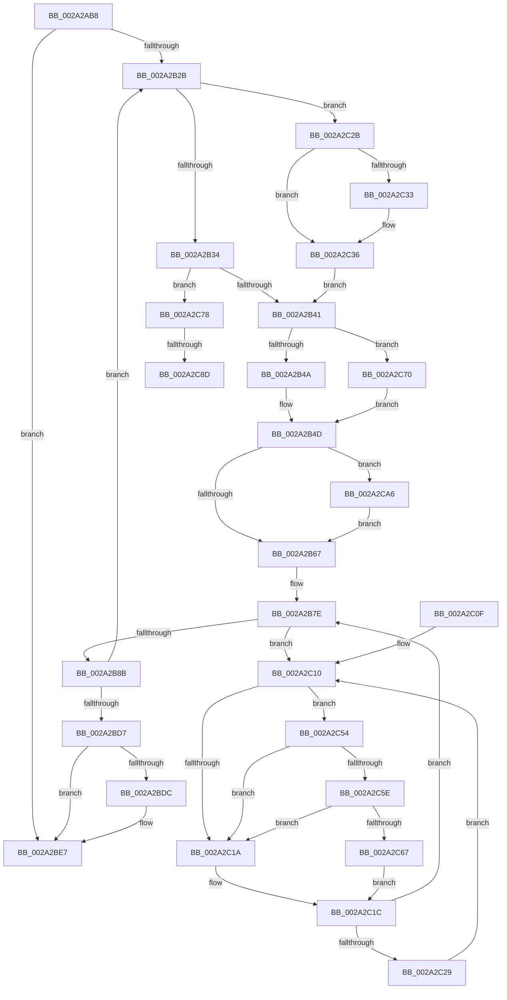

# MiUnlockCodePage

- RVA: `0x002A2AB8`–`0x002A2CBA` (길이 `514` bytes)
- VA: `0x00000001402A2AB8`
- 실행 섹션: `.text`
- PDB 이름 있음: `예`; PDB Function 태그: `예`
- unwind 정보 RVA: `0x00068618`
- 디코드: `130`개 명령, `514/514` bytes 표시
- 미해석 바이트: `0` (있으면 어셈블리에 `.byte`로 보존)

> 이 문서는 커널 이미지의 기계어와 PDB 기호를 분석해 생성했습니다. 4번과 5번은 함수 원형과 자료형을 바이너리 사용 방식에서 추정한 C 해석이며 원본 소스 복구 결과는 아닙니다.

## 1. Dependencies

- 직접 호출 지점: **12**; 고유 호출 대상: **9**
- 직접 호출자로 확인된 함수: **6**
- RIP 상대 이미지 참조: **2**

### Outgoing calls
- `0x002A2AE3` → [MiGetLeafVa](../27/MiGetLeafVa_function_0027C0A0.md) (function, `0x0027C0A0`)
- `0x002A2AEB` → [MiVaToFlushVm](../31/MiVaToFlushVm_function_0031AD84.md) (function, `0x0031AD84`)
- `0x002A2AF6` → [MiLockWorkingSetShared](../27/MiLockWorkingSetShared_function_0027CBF0.md) (function, `0x0027CBF0`)
- `0x002A2B8E` → [MiRemoveLockedPageChargeAndDecRef](../24/MiRemoveLockedPageChargeAndDecRef_function_002459D0.md) (function, `0x002459D0`)
- `0x002A2BE2` → [MiUnlockPageTable](../21/MiUnlockPageTable_function_00216EC0.md) (function, `0x00216EC0`)
- `0x002A2BED` → [MiUnlockWorkingSetShared](../27/MiUnlockWorkingSetShared_function_0027D690.md) (function, `0x0027D690`)
- `0x002A2C4A` → [MiLockNestedPageTable](../23/MiLockNestedPageTable_function_0023E890.md) (function, `0x0023E890`)
- `0x002A2C5E` → [KiCheckVpBackingLongSpinWaitHypercall](../30/KiCheckVpBackingLongSpinWaitHypercall_function_0030F490.md) (function, `0x0030F490`)
- `0x002A2C69` → [HvlNotifyLongSpinWait](../30/HvlNotifyLongSpinWait_function_0030F460.md) (function, `0x0030F460`)
- `0x002A2C7E` → [MiUnlockPageTable](../21/MiUnlockPageTable_function_00216EC0.md) (function, `0x00216EC0`)
- `0x002A2C93` → [MiUnlockWorkingSetShared](../27/MiUnlockWorkingSetShared_function_0027D690.md) (function, `0x0027D690`)
- `0x002A2C9B` → [MiLockWorkingSetShared](../27/MiLockWorkingSetShared_function_0027CBF0.md) (function, `0x0027CBF0`)

### Direct callers
- [MiUnlockImageSection](MiUnlockImageSection_function_002A3AF0.md) at `0x002A3BAA`
- [MiHandleDriverNonPagedSections](../../page/A4/MiHandleDriverNonPagedSections_function_00A4AEA8.md) at `0x00A4B034`
- [MiUnlockDriverCode](../../page/A9/MiUnlockDriverCode_function_00A9FFEC.md) at `0x00AA007C`
- [MmUnlockPreChargedPagedPool](../../page/AC/MmUnlockPreChargedPagedPool_function_00AC5940.md) at `0x00AC596E`
- [sub_00B3B7F6](../../page/B3/Unknown_function_00B3B7F6.md) at `0x00B3B80A`
- [sub_00B3B822](../../page/B3/Unknown_function_00B3B822.md) at `0x00B3B845`

### Static image references
- `0x002A2C12` → RVA `0x00FC52AC` (`ALMOSTRO`; reference)
- `0x002A2C54` → RVA `0x00FC6AB8` (`ALMOSTRO`; read)

## 2. Other-region calls and transfers

- 다른 실행 섹션으로 향하는 call: **0**
- call이 아닌 외부 분기/꼬리 이동: **2**
  - `0x002A2C87` → [sub_006DAE5A](../6D/Unknown_function_006DAE5A.md) (`tail-transfer`)
  - `0x002A2CA1` → [sub_006DAE5A](../6D/Unknown_function_006DAE5A.md) (`tail-transfer`)

## 3. Assembly (complete function range)

```asm
002A2AB8  48 8B C4                        mov rax, rsp
002A2ABB  48 89 58 08                     mov qword ptr [rax + 8], rbx
002A2ABF  48 89 68 18                     mov qword ptr [rax + 0x18], rbp
002A2AC3  48 89 70 20                     mov qword ptr [rax + 0x20], rsi
002A2AC7  48 89 50 10                     mov qword ptr [rax + 0x10], rdx
002A2ACB  57                              push rdi
002A2ACC  41 54                           push r12
002A2ACE  41 55                           push r13
002A2AD0  41 56                           push r14
002A2AD2  41 57                           push r15
002A2AD4  48 83 EC 20                     sub rsp, 0x20
002A2AD8  45 8B E8                        mov r13d, r8d
002A2ADB  48 8B DA                        mov rbx, rdx
002A2ADE  4C 8B F1                        mov r14, rcx
002A2AE1  33 FF                           xor edi, edi
002A2AE3  E8 B8 95 FD FF                  call 0x14027c0a0
002A2AE8  48 8B C8                        mov rcx, rax
002A2AEB  E8 94 82 07 00                  call 0x14031ad84
002A2AF0  48 8B C8                        mov rcx, rax
002A2AF3  48 8B F0                        mov rsi, rax
002A2AF6  E8 F5 A0 FD FF                  call 0x14027cbf0
002A2AFB  4D 8B FE                        mov r15, r14
002A2AFE  48 BA 00 00 00 00 80 F6 FF FF   movabs rdx, 0xfffff68000000000
002A2B08  44 8A E0                        mov r12b, al
002A2B0B  49 C1 EF 09                     shr r15, 9
002A2B0F  48 B8 F8 FF FF FF 7F 00 00 00   movabs rax, 0x7ffffffff8
002A2B19  4C 23 F8                        and r15, rax
002A2B1C  48 8B CA                        mov rcx, rdx
002A2B1F  4C 03 F9                        add r15, rcx
002A2B22  4C 3B F3                        cmp r14, rbx
002A2B25  0F 87 BC 00 00 00               ja 0x1402a2be7
002A2B2B  48 85 FF                        test rdi, rdi
002A2B2E  0F 84 F7 00 00 00               je 0x1402a2c2b
002A2B34  49 F7 C6 FF 0F 00 00            test r14, 0xfff
002A2B3B  0F 84 37 01 00 00               je 0x1402a2c78
002A2B41  45 85 ED                        test r13d, r13d
002A2B44  0F 85 26 01 00 00               jne 0x1402a2c70
002A2B4A  49 8B 0E                        mov rcx, qword ptr [r14]
002A2B4D  48 C1 E9 0C                     shr rcx, 0xc
002A2B51  48 B8 FF FF FF FF FF 00 00 00   movabs rax, 0xffffffffff
002A2B5B  48 23 C8                        and rcx, rax
002A2B5E  45 85 ED                        test r13d, r13d
002A2B61  0F 85 3F 01 00 00               jne 0x1402a2ca6
002A2B67  48 8D 1C 49                     lea rbx, [rcx + rcx*2]
002A2B6B  48 C1 E3 04                     shl rbx, 4
002A2B6F  48 B8 00 00 00 00 00 DE FF FF   movabs rax, 0xffffde0000000000
002A2B79  48 03 D8                        add rbx, rax
002A2B7C  33 ED                           xor ebp, ebp
002A2B7E  F0 48 0F BA 6B 18 3F            lock bts qword ptr [rbx + 0x18], 0x3f
002A2B85  0F 82 85 00 00 00               jb 0x1402a2c10
002A2B8B  48 8B CB                        mov rcx, rbx
002A2B8E  E8 3D 2E FA FF                  call 0x1402459d0
002A2B93  48 B8 FF FF FF FF FF FF FF 7F   movabs rax, 0x7fffffffffffffff
002A2B9D  F0 48 21 43 18                  lock and qword ptr [rbx + 0x18], rax
002A2BA2  49 83 C6 08                     add r14, 8
002A2BA6  48 BA 00 00 00 00 80 F6 FF FF   movabs rdx, 0xfffff68000000000
002A2BB0  49 F7 C6 FF 0F 00 00            test r14, 0xfff
002A2BB7  49 8D 47 08                     lea rax, [r15 + 8]
002A2BBB  49 0F 45 C7                     cmovne rax, r15
002A2BBF  4C 8B F8                        mov r15, rax
002A2BC2  48 B8 F8 FF FF FF 7F 00 00 00   movabs rax, 0x7ffffffff8
002A2BCC  4C 3B 74 24 58                  cmp r14, qword ptr [rsp + 0x58]
002A2BD1  0F 86 54 FF FF FF               jbe 0x1402a2b2b
002A2BD7  48 85 FF                        test rdi, rdi
002A2BDA  74 0B                           je 0x1402a2be7
002A2BDC  48 8B D7                        mov rdx, rdi
002A2BDF  48 8B CE                        mov rcx, rsi
002A2BE2  E8 D9 42 F7 FF                  call 0x140216ec0
002A2BE7  41 8A D4                        mov dl, r12b
002A2BEA  48 8B CE                        mov rcx, rsi
002A2BED  E8 9E AA FD FF                  call 0x14027d690
002A2BF2  48 8B 5C 24 50                  mov rbx, qword ptr [rsp + 0x50]
002A2BF7  48 8B 6C 24 60                  mov rbp, qword ptr [rsp + 0x60]
002A2BFC  48 8B 74 24 68                  mov rsi, qword ptr [rsp + 0x68]
002A2C01  48 83 C4 20                     add rsp, 0x20
002A2C05  41 5F                           pop r15
002A2C07  41 5E                           pop r14
002A2C09  41 5D                           pop r13
002A2C0B  41 5C                           pop r12
002A2C0D  5F                              pop rdi
002A2C0E  C3                              ret
002A2C0F  CC                              int3
002A2C10  FF C5                           inc ebp
002A2C12  85 2D 94 26 D2 00               test dword ptr [rip + 0xd22694], ebp
002A2C18  74 3A                           je 0x1402a2c54
002A2C1A  F3 90                           pause
002A2C1C  48 8B 43 18                     mov rax, qword ptr [rbx + 0x18]
002A2C20  48 85 C0                        test rax, rax
002A2C23  0F 89 55 FF FF FF               jns 0x1402a2b7e
002A2C29  EB E5                           jmp 0x1402a2c10
002A2C2B  49 8B CF                        mov rcx, r15
002A2C2E  45 85 ED                        test r13d, r13d
002A2C31  75 03                           jne 0x1402a2c36
002A2C33  49 8B CE                        mov rcx, r14
002A2C36  48 C1 E9 09                     shr rcx, 9
002A2C3A  48 23 C8                        and rcx, rax
002A2C3D  48 8B C2                        mov rax, rdx
002A2C40  48 8D 3C 01                     lea rdi, [rcx + rax]
002A2C44  48 8B CE                        mov rcx, rsi
002A2C47  48 8B D7                        mov rdx, rdi
002A2C4A  E8 41 BC F9 FF                  call 0x14023e890
002A2C4F  E9 ED FE FF FF                  jmp 0x1402a2b41
002A2C54  8B 05 5E 3E D2 00               mov eax, dword ptr [rip + 0xd23e5e]
002A2C5A  A8 40                           test al, 0x40
002A2C5C  74 BC                           je 0x1402a2c1a
002A2C5E  E8 2D C8 06 00                  call 0x14030f490
002A2C63  84 C0                           test al, al
002A2C65  74 B3                           je 0x1402a2c1a
002A2C67  8B CD                           mov ecx, ebp
002A2C69  E8 F2 C7 06 00                  call 0x14030f460
002A2C6E  EB AC                           jmp 0x1402a2c1c
002A2C70  49 8B 0F                        mov rcx, qword ptr [r15]
002A2C73  E9 D5 FE FF FF                  jmp 0x1402a2b4d
002A2C78  48 8B D7                        mov rdx, rdi
002A2C7B  48 8B CE                        mov rcx, rsi
002A2C7E  E8 3D 42 F7 FF                  call 0x140216ec0
002A2C83  41 80 FC 02                     cmp r12b, 2
002A2C87  0F 83 CD 81 43 00               jae 0x1406dae5a
002A2C8D  41 8A D4                        mov dl, r12b
002A2C90  48 8B CE                        mov rcx, rsi
002A2C93  E8 F8 A9 FD FF                  call 0x14027d690
002A2C98  48 8B CE                        mov rcx, rsi
002A2C9B  E8 50 9F FD FF                  call 0x14027cbf0
002A2CA0  90                              nop
002A2CA1  E9 B4 81 43 00                  jmp 0x1406dae5a
002A2CA6  49 8B C6                        mov rax, r14
002A2CA9  48 C1 E8 03                     shr rax, 3
002A2CAD  25 FF 01 00 00                  and eax, 0x1ff
002A2CB2  48 03 C8                        add rcx, rax
002A2CB5  E9 AD FE FF FF                  jmp 0x1402a2b67
```

## 4. C-style interpretation (structured pseudocode)

```c
__int64 __fastcall MiUnlockCodePage(__int64 a1, __int64 a2, int a3)
{
    __int64 result;
    __int64 v_r14;
    __int64 v_r15;
    __int64 v_rbp;
    __int64 v_rbx;
    __int64 v_rdi;
    __int64 v_rsp;
    unsigned __int64 v_stack_p10;
    unsigned __int64 v_stack_p18;
    unsigned __int64 v_stack_p20;
    unsigned __int64 v_stack_p8;

    *(unsigned __int64 *)(v_rsp + 8) = v_rbx;
    *(unsigned __int64 *)(v_rsp + 24) = v_rbp;
    *(unsigned __int64 *)(v_rsp + 32) = v_rsi;
    *(unsigned __int64 *)(v_rsp + 16) = a2;
    v_rsp = (v_rsp) - (32);
    v_rdi = 0;
    result = MiGetLeafVa(a1, a2, a3, a4);
    result = MiVaToFlushVm(result, a2, a3, a4);
    result = MiLockWorkingSetShared(result, a2, a3, a4);
    v_r15 = (a1) >> (9);
    v_r15 = (v_r15) & (result);
    v_r15 = (v_r15) + (a2);
    if (a1 > a2) goto loc_002A2BE7;
loc_002A2B2B:
    if (0 == 0) goto loc_002A2C2B;
    if (((a1) & (0xFFFULL)) == 0) goto loc_002A2C78;
loc_002A2B41:
    if ((unsigned int)((unsigned int)(a3)) != 0) goto loc_002A2C70;
loc_002A2B4D:
    a1 = (*(unsigned __int64 *)(a1)) >> (12);
    a1 = (a1) & (result);
    if ((unsigned int)((unsigned int)(a3)) != 0) goto loc_002A2CA6;
loc_002A2B67:
    v_rbx = (a1 + a1 * 2) << (4);
    v_rbx = (v_rbx) + (result);
    v_rbp = 0;
loc_002A2B7E:
    if (condition_is_below) goto loc_002A2C10;
    result = MiRemoveLockedPageChargeAndDecRef(v_rbx, a2, a3, a4);
    v_r14 = (a1) + (8);
    result = v_r15 + 8;
    if (((v_r14) & (0xFFFULL)) != 0) { result = v_r15; }
    if (v_r14 <= v_stack_p10) goto loc_002A2B2B;
    if (0 != 0) {
        a2 = 0;
        a1 = result;
        result = MiUnlockPageTable(a1, a2, a3, a4);
    }
    result = MiUnlockWorkingSetShared(result, (unsigned __int8)((unsigned __int8)(result)), a3, a4);
    v_rsp = (v_rsp) + (32);
    return result;
loc_002A2C10:
    v_rbp = (unsigned int)((v_stack_p18) + 1);
    if (((*(unsigned int *)(v_rip + 13772436)) & ((unsigned int)(v_rbp))) == 0) goto loc_002A2C54;
loc_002A2C1A:
loc_002A2C1C:
    if (!sign_flag) goto loc_002A2B7E;
    goto loc_002A2C10;
loc_002A2C2B:
    if ((unsigned int)((unsigned int)(a3)) == 0) {
        a1 = v_r14;
    }
    a1 = (a1) >> (9);
    a1 = (a1) & (*(unsigned __int64 *)(v_stack_p8 + 24));
    result = MiLockNestedPageTable(v_stack_p20, a1 + (unsigned __int8)((unsigned __int8)(result)) * 1, a3, a4);
    goto loc_002A2B41;
loc_002A2C54:
    if ((((unsigned __int8)((unsigned int)(*(unsigned int *)(v_rip + 13778526)))) & (64)) == 0) goto loc_002A2C1A;
    result = KiCheckVpBackingLongSpinWaitHypercall(v_stack_p20, a1 + (unsigned __int8)((unsigned __int8)(result)) * 1, a3, a4);
    if ((unsigned __int8)(result) == 0) goto loc_002A2C1A;
    result = HvlNotifyLongSpinWait((unsigned int)((unsigned int)(v_rbp)), a1 + (unsigned __int8)((unsigned __int8)(result)) * 1, a3, a4);
    goto loc_002A2C1C;
loc_002A2C70:
    goto loc_002A2B4D;
loc_002A2C78:
    result = MiUnlockPageTable(v_stack_p20, a1 + (unsigned __int8)((unsigned __int8)(result)) * 1, a3, a4);
    result = MiUnlockWorkingSetShared(v_stack_p20, (unsigned __int8)((unsigned __int8)(result)), a3, a4);
    result = MiLockWorkingSetShared(v_stack_p20, (unsigned __int8)((unsigned __int8)(result)), a3, a4);
loc_002A2CA6:
    result = (v_r14) >> (3);
    result = (unsigned int)((result) & (511));
    a1 = (v_stack_p20) + (result);
    goto loc_002A2B67;
}
```

## 5. (Beta) C Style

```c
int64_t MiUnlockCodePage(int64_t Arg1, int64_t Arg2, int32_t Arg3)
{
    int64_t result;
    int64_t local_r14;
    int64_t local_r15;
    int64_t local_rbp;
    int64_t local_rbx;
    int64_t local_rdi;
    int64_t local_rsp;
    uint64_t v_stack_p10;
    uint64_t v_stack_p18;
    uint64_t v_stack_p20;
    uint64_t v_stack_p8;

    *(uint64_t *)(local_rsp + 0x8) = local_rbx;
    *(uint64_t *)(local_rsp + 0x18) = local_rbp;
    *(uint64_t *)(local_rsp + 0x20) = local_rsi;
    *(uint64_t *)(local_rsp + 0x10) = Arg2;
    local_rsp = (local_rsp) - (32);
    local_rdi = 0;
    result = MiGetLeafVa(Arg1, Arg2, Arg3, a4);
    result = MiVaToFlushVm(result, Arg2, Arg3, a4);
    result = MiLockWorkingSetShared(result, Arg2, Arg3, a4);
    local_r15 = (Arg1) >> (9);
    local_r15 = (local_r15) & (result);
    local_r15 = (local_r15) + (Arg2);
    if (Arg1 > Arg2) goto loc_002A2BE7;
loc_002A2B2B:
    if (0 == 0) goto loc_002A2C2B;
    if (((Arg1) & (0xFFFULL)) == 0) goto loc_002A2C78;
loc_002A2B41:
    if ((uint32_t)((uint32_t)(Arg3)) != 0) goto loc_002A2C70;
loc_002A2B4D:
    Arg1 = (*(uint64_t *)(Arg1)) >> (12);
    Arg1 = (Arg1) & (result);
    if ((uint32_t)((uint32_t)(Arg3)) != 0) goto loc_002A2CA6;
loc_002A2B67:
    local_rbx = (Arg1 + Arg1 * 2) << (4);
    local_rbx = (local_rbx) + (result);
    local_rbp = 0;
loc_002A2B7E:
    if (condition_is_below) goto loc_002A2C10;
    result = MiRemoveLockedPageChargeAndDecRef(local_rbx, Arg2, Arg3, a4);
    local_r14 = (Arg1) + (8);
    result = local_r15 + 8;
    if (((local_r14) & (0xFFFULL)) != 0) { result = local_r15; }
    if (local_r14 <= v_stack_p10) goto loc_002A2B2B;
    if (0 != 0) {
        Arg2 = 0;
        Arg1 = result;
        result = MiUnlockPageTable(Arg1, Arg2, Arg3, a4);
    }
    result = MiUnlockWorkingSetShared(result, (uint8_t)((uint8_t)(result)), Arg3, a4);
    local_rsp = (local_rsp) + (32);
    return result;
loc_002A2C10:
    local_rbp = (uint32_t)((v_stack_p18) + 1);
    if (((*(uint32_t *)(v_rip + 0xD22694)) & ((uint32_t)(local_rbp))) == 0) goto loc_002A2C54;
loc_002A2C1A:
loc_002A2C1C:
    if (!sign_flag) goto loc_002A2B7E;
    goto loc_002A2C10;
loc_002A2C2B:
    if ((uint32_t)((uint32_t)(Arg3)) == 0) {
        Arg1 = local_r14;
    }
    Arg1 = (Arg1) >> (9);
    Arg1 = (Arg1) & (*(uint64_t *)(v_stack_p8 + 0x18));
    result = MiLockNestedPageTable(v_stack_p20, Arg1 + (uint8_t)((uint8_t)(result)) * 1, Arg3, a4);
    goto loc_002A2B41;
loc_002A2C54:
    if ((((uint8_t)((uint32_t)(*(uint32_t *)(v_rip + 0xD23E5E)))) & (64)) == 0) goto loc_002A2C1A;
    result = KiCheckVpBackingLongSpinWaitHypercall(v_stack_p20, Arg1 + (uint8_t)((uint8_t)(result)) * 1, Arg3, a4);
    if ((uint8_t)(result) == 0) goto loc_002A2C1A;
    result = HvlNotifyLongSpinWait((uint32_t)((uint32_t)(local_rbp)), Arg1 + (uint8_t)((uint8_t)(result)) * 1, Arg3, a4);
    goto loc_002A2C1C;
loc_002A2C70:
    goto loc_002A2B4D;
loc_002A2C78:
    result = MiUnlockPageTable(v_stack_p20, Arg1 + (uint8_t)((uint8_t)(result)) * 1, Arg3, a4);
    result = MiUnlockWorkingSetShared(v_stack_p20, (uint8_t)((uint8_t)(result)), Arg3, a4);
    result = MiLockWorkingSetShared(v_stack_p20, (uint8_t)((uint8_t)(result)), Arg3, a4);
loc_002A2CA6:
    result = (local_r14) >> (3);
    result = (uint32_t)((result) & (511));
    Arg1 = (v_stack_p20) + (result);
    goto loc_002A2B67;
}
```

## 6. Execution-region graph

[열기: 2D/3D 그래프와 함수 탐색 컨트롤 패널](../../../control-panel.html?section=text&rva=0x002A2AB8&view=graph)

- 2D 그래프는 위에서 아래로 흐르고, 3D 그래프는 빈 공간을 드래그해 회전합니다. Shift+드래그는 이동, 휠은 확대·축소, 함수 노드 선택은 대상 보고서 이동입니다.

### Static fallback


