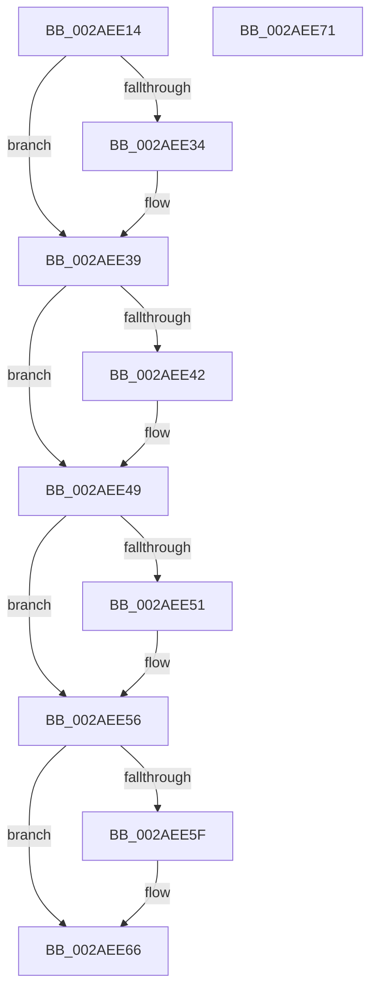

# MiUnlockDataCopyPages

- RVA: `0x002AEE14`–`0x002AEE72` (길이 `94` bytes)
- VA: `0x00000001402AEE14`
- 실행 섹션: `.text`
- PDB 이름 있음: `예`; PDB Function 태그: `아니요`
- unwind 정보 RVA: `0x0005CAAC`
- 디코드: `28`개 명령, `94/94` bytes 표시
- 미해석 바이트: `0` (있으면 어셈블리에 `.byte`로 보존)

> 이 문서는 커널 이미지의 기계어와 PDB 기호를 분석해 생성했습니다. 4번과 5번은 함수 원형과 자료형을 바이너리 사용 방식에서 추정한 C 해석이며 원본 소스 복구 결과는 아닙니다.

## 1. Dependencies

- 직접 호출 지점: **2**; 고유 호출 대상: **1**
- 직접 호출자로 확인된 함수: **1**
- RIP 상대 이미지 참조: **0**

### Outgoing calls
- `0x002AEE44` → [MiUnlockProtoPoolPage](../24/MiUnlockProtoPoolPage_function_00246090.md) (function, `0x00246090`)
- `0x002AEE61` → [MiUnlockProtoPoolPage](../24/MiUnlockProtoPoolPage_function_00246090.md) (function, `0x00246090`)

### Direct callers
- [MiCopyDataPageToImagePage](MiCopyDataPageToImagePage_function_002AE818.md) at `0x002AE8FD`
- [MiCopyDataPageToImagePage](MiCopyDataPageToImagePage_function_002AE818.md) at `0x002AEBDB`

### Static image references
- 디코드된 RIP-relative 메모리 참조가 없습니다.

## 2. Other-region calls and transfers

- 다른 실행 섹션으로 향하는 call: **0**
- 별도 외부 분기/꼬리 이동을 확인하지 못했습니다.

## 3. Assembly (complete function range)

```asm
002AEE14  48 89 5C 24 08                  mov qword ptr [rsp + 8], rbx
002AEE19  57                              push rdi
002AEE1A  48 83 EC 20                     sub rsp, 0x20
002AEE1E  48 8B 41 18                     mov rax, qword ptr [rcx + 0x18]
002AEE22  48 8B D9                        mov rbx, rcx
002AEE25  48 BF FF FF FF FF FF FF FF 7F   movabs rdi, 0x7fffffffffffffff
002AEE2F  48 85 C0                        test rax, rax
002AEE32  74 05                           je 0x1402aee39
002AEE34  F0 48 21 78 18                  lock and qword ptr [rax + 0x18], rdi
002AEE39  48 8B 49 20                     mov rcx, qword ptr [rcx + 0x20]
002AEE3D  48 85 C9                        test rcx, rcx
002AEE40  74 07                           je 0x1402aee49
002AEE42  B2 12                           mov dl, 0x12
002AEE44  E8 47 72 F9 FF                  call 0x140246090
002AEE49  48 8B 03                        mov rax, qword ptr [rbx]
002AEE4C  48 85 C0                        test rax, rax
002AEE4F  74 05                           je 0x1402aee56
002AEE51  F0 48 21 78 18                  lock and qword ptr [rax + 0x18], rdi
002AEE56  48 8B 4B 08                     mov rcx, qword ptr [rbx + 8]
002AEE5A  48 85 C9                        test rcx, rcx
002AEE5D  74 07                           je 0x1402aee66
002AEE5F  B2 11                           mov dl, 0x11
002AEE61  E8 2A 72 F9 FF                  call 0x140246090
002AEE66  48 8B 5C 24 30                  mov rbx, qword ptr [rsp + 0x30]
002AEE6B  48 83 C4 20                     add rsp, 0x20
002AEE6F  5F                              pop rdi
002AEE70  C3                              ret
002AEE71  CC                              int3
```

## 4. C-style interpretation (structured pseudocode)

```c
__int64 __fastcall MiUnlockDataCopyPages(__int64 a1)
{
    __int64 result;
    __int64 v_rsp;
    unsigned __int64 v_stack_p8;

    v_stack_p8 = v_rbx;
    v_rsp = (v_rsp) - (32);
    if (*(unsigned __int64 *)(a1 + 24) != 0) {
    }
    result = *(unsigned __int64 *)(a1 + 24);
    if (*(unsigned __int64 *)(a1 + 32) != 0) {
        a2 = 18;
        result = MiUnlockProtoPoolPage(*(unsigned __int64 *)(a1 + 32), a2, a3, a4);
    }
    if (*(unsigned __int64 *)(a1) != 0) {
    }
    result = *(unsigned __int64 *)(a1);
    if (*(unsigned __int64 *)(a1 + 8) != 0) {
        a2 = 17;
        result = MiUnlockProtoPoolPage(*(unsigned __int64 *)(a1 + 8), a2, a3, a4);
    }
    v_rsp = (v_rsp) + (32);
    return result;
}
```

## 5. (Beta) C Style

```c
int64_t MiUnlockDataCopyPages(void *Arg1)
{
    uint8_t *arg1 = (uint8_t *)Arg1;

    int64_t result;
    int64_t local_rsp;
    uint64_t v_stack_p8;

    v_stack_p8 = local_rbx;
    local_rsp = (local_rsp) - (32);
    if (*(uint64_t *)(arg1 + 0x18) != 0) {
    }
    result = *(uint64_t *)(arg1 + 0x18);
    if (*(uint64_t *)(arg1 + 0x20) != 0) {
        a2 = 18;
        result = MiUnlockProtoPoolPage(*(uint64_t *)(arg1 + 0x20), a2, a3, a4);
    }
    if (*(uint64_t *)(arg1) != 0) {
    }
    result = *(uint64_t *)(arg1);
    if (*(uint64_t *)(arg1 + 0x8) != 0) {
        a2 = 17;
        result = MiUnlockProtoPoolPage(*(uint64_t *)(arg1 + 0x8), a2, a3, a4);
    }
    local_rsp = (local_rsp) + (32);
    return result;
}
```

### 관측된 메모리 오프셋

구조체 형식이 확인되지 않은 접근은 인자 기준의 오프셋으로만 기록했습니다.

| 기준 인자 | 오프셋 표현 | 폭 (bit) | 접근 |
|---|---:|---:|---|
| `Arg1` | `+ 0x0` | `64` | `R` |
| `Arg1` | `+ 0x8` | `64` | `R` |
| `Arg1` | `+ 0x18` | `64` | `R` |
| `Arg1` | `+ 0x20` | `64` | `R` |

## 6. Execution-region graph

[열기: 2D/3D 그래프와 함수 탐색 컨트롤 패널](../../../control-panel.html?section=text&rva=0x002AEE14&view=graph)

- 2D 그래프는 위에서 아래로 흐르고, 3D 그래프는 빈 공간을 드래그해 회전합니다. Shift+드래그는 이동, 휠은 확대·축소, 함수 노드 선택은 대상 보고서 이동입니다.

### Static fallback


