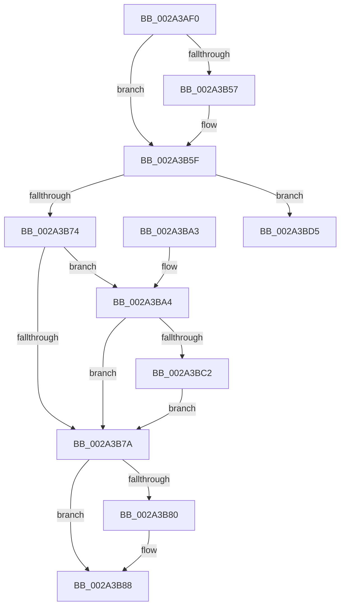

# MiUnlockImageSection

- RVA: `0x002A3AF0`–`0x002A3C05` (길이 `277` bytes)
- VA: `0x00000001402A3AF0`
- 실행 섹션: `.text`
- PDB 이름 있음: `예`; PDB Function 태그: `아니요`
- unwind 정보 RVA: `0x000687CC`
- 디코드: `72`개 명령, `277/277` bytes 표시
- 미해석 바이트: `0` (있으면 어셈블리에 `.byte`로 보존)

> 이 문서는 커널 이미지의 기계어와 PDB 기호를 분석해 생성했습니다. 4번과 5번은 함수 원형과 자료형을 바이너리 사용 방식에서 추정한 C 해석이며 원본 소스 복구 결과는 아닙니다.

## 1. Dependencies

- 직접 호출 지점: **4**; 고유 호출 대상: **4**
- 직접 호출자로 확인된 함수: **1**
- RIP 상대 이미지 참조: **1**

### Outgoing calls
- `0x002A3B83` → [KeLeaveCriticalRegionThread](../25/KeLeaveCriticalRegionThread_function_0025EFF0.md) (function, `0x0025EFF0`)
- `0x002A3BAA` → [MiUnlockCodePage](MiUnlockCodePage_function_002A2AB8.md) (function, `0x002A2AB8`)
- `0x002A3BCE` → [ExpUnblockPushLock](ExpUnblockPushLock_function_002A40FC.md) (function, `0x002A40FC`)
- `0x002A3BFF` → [KeBugCheckEx](../4F/KeBugCheckEx_function_004FD660.md) (function, `0x004FD660`)

### Direct callers
- [MiLockPagableImageSection](MiLockPagableImageSection_function_002A3A60.md) at `0x002A3AB7`

### Static image references
- `0x002A3BB8` → RVA `0x00E2D978` (`.data`; read)

## 2. Other-region calls and transfers

- 다른 실행 섹션으로 향하는 call: **0**
- 별도 외부 분기/꼬리 이동을 확인하지 못했습니다.

## 3. Assembly (complete function range)

```asm
002A3AF0  48 8B C4                        mov rax, rsp
002A3AF3  48 89 58 08                     mov qword ptr [rax + 8], rbx
002A3AF7  48 89 68 10                     mov qword ptr [rax + 0x10], rbp
002A3AFB  48 89 70 18                     mov qword ptr [rax + 0x18], rsi
002A3AFF  48 89 78 20                     mov qword ptr [rax + 0x20], rdi
002A3B03  41 56                           push r14
002A3B05  48 83 EC 30                     sub rsp, 0x30
002A3B09  4C 8B 49 30                     mov r9, qword ptr [rcx + 0x30]
002A3B0D  48 B8 F8 FF FF FF 7F 00 00 00   movabs rax, 0x7ffffffff8
002A3B17  49 C1 E9 09                     shr r9, 9
002A3B1B  4D 8B D8                        mov r11, r8
002A3B1E  4C 23 C8                        and r9, rax
002A3B21  49 BE 00 00 00 00 80 F6 FF FF   movabs r14, 0xfffff68000000000
002A3B2B  48 8B DA                        mov rbx, rdx
002A3B2E  49 8B C6                        mov rax, r14
002A3B31  65 48 8B 3C 25 88 01 00 00      mov rdi, qword ptr gs:[0x188]
002A3B3A  4C 03 C8                        add r9, rax
002A3B3D  8B 02                           mov eax, dword ptr [rdx]
002A3B3F  4D 8D 14 C1                     lea r10, [r9 + rax*8]
002A3B43  8B 42 04                        mov eax, dword ptr [rdx + 4]
002A3B46  49 8D 14 C1                     lea rdx, [r9 + rax*8]
002A3B4A  44 0F 20 C6                     mov rsi, cr8
002A3B4E  83 CD FF                        or ebp, 0xffffffff
002A3B51  40 80 FE 01                     cmp sil, 1
002A3B55  73 08                           jae 0x1402a3b5f
002A3B57  66 01 AF E4 01 00 00            add word ptr [rdi + 0x1e4], bp
002A3B5E  90                              nop
002A3B5F  44 8B C5                        mov r8d, ebp
002A3B62  F0 44 0F C1 43 08               lock xadd dword ptr [rbx + 8], r8d
002A3B68  44 03 C5                        add r8d, ebp
002A3B6B  41 8D 40 01                     lea eax, [r8 + 1]
002A3B6F  83 F8 01                        cmp eax, 1
002A3B72  76 61                           jbe 0x1402a3bd5
002A3B74  41 83 F8 01                     cmp r8d, 1
002A3B78  74 2A                           je 0x1402a3ba4
002A3B7A  40 80 FE 01                     cmp sil, 1
002A3B7E  73 08                           jae 0x1402a3b88
002A3B80  48 8B CF                        mov rcx, rdi
002A3B83  E8 68 B4 FB FF                  call 0x14025eff0
002A3B88  48 8B 5C 24 40                  mov rbx, qword ptr [rsp + 0x40]
002A3B8D  48 8B 6C 24 48                  mov rbp, qword ptr [rsp + 0x48]
002A3B92  48 8B 74 24 50                  mov rsi, qword ptr [rsp + 0x50]
002A3B97  48 8B 7C 24 58                  mov rdi, qword ptr [rsp + 0x58]
002A3B9C  48 83 C4 30                     add rsp, 0x30
002A3BA0  41 5E                           pop r14
002A3BA2  C3                              ret
002A3BA3  CC                              int3
002A3BA4  45 33 C0                        xor r8d, r8d
002A3BA7  49 8B CA                        mov rcx, r10
002A3BAA  E8 09 EF FF FF                  call 0x1402a2ab8
002A3BAF  F0 01 6B 08                     lock add dword ptr [rbx + 8], ebp
002A3BB3  F0 83 0C 24 00                  lock or dword ptr [rsp], 0
002A3BB8  48 83 3D B8 9D B8 00 00         cmp qword ptr [rip + 0xb89db8], 0
002A3BC0  74 B8                           je 0x1402a3b7a
002A3BC2  45 33 C0                        xor r8d, r8d
002A3BC5  48 8D 0D AC 9D B8 00            lea rcx, [rip + 0xb89dac]
002A3BCC  33 D2                           xor edx, edx
002A3BCE  E8 29 05 00 00                  call 0x1402a40fc
002A3BD3  EB A5                           jmp 0x1402a3b7a
002A3BD5  49 63 C8                        movsxd rcx, r8d
002A3BD8  49 C1 E2 19                     shl r10, 0x19
002A3BDC  49 8B C6                        mov rax, r14
002A3BDF  48 C1 E0 19                     shl rax, 0x19
002A3BE3  4D 8B CB                        mov r9, r11
002A3BE6  4C 2B D0                        sub r10, rax
002A3BE9  48 89 4C 24 20                  mov qword ptr [rsp + 0x20], rcx
002A3BEE  49 C1 FA 10                     sar r10, 0x10
002A3BF2  BA 10 10 00 00                  mov edx, 0x1010
002A3BF7  4D 8B C2                        mov r8, r10
002A3BFA  B9 1A 00 00 00                  mov ecx, 0x1a
002A3BFF  E8 5C 9A 25 00                  call 0x1404fd660
002A3C04  CC                              int3
```

## 4. C-style interpretation (structured pseudocode)

```c
__int64 __fastcall MiUnlockImageSection(__int64 a1, __int64 a2, __int64 a3)
{
    __int64 result;
    __int64 v_r10;
    __int64 v_rbp;
    __int64 v_rsp;
    unsigned int v_stack_p0;
    unsigned __int64 v_stack_p10;
    unsigned __int64 v_stack_p18;
    unsigned __int64 v_stack_p20;
    unsigned __int64 v_stack_p8;

    *(unsigned __int64 *)(v_rsp + 8) = v_rbx;
    *(unsigned __int64 *)(v_rsp + 16) = v_rbp;
    *(unsigned __int64 *)(v_rsp + 24) = v_rsi;
    *(unsigned __int64 *)(v_rsp + 32) = v_rdi;
    v_rsp = (v_rsp) - (48);
    a4 = (*(unsigned __int64 *)(a1 + 48)) >> (9);
    a4 = (a4) & (v_rsp);
    a4 = (a4) + (v_r14);
    v_rbp = (unsigned int)((v_rbp) | (0xFFFFFFFFULL));
    if (((unsigned __int8)(v_cr8)) < 1) {
    }
    a3 = (unsigned int)(((unsigned int)((unsigned int)(v_rbp))) + ((unsigned int)(v_rbp)));
    if (((unsigned int)(a3 + 1)) <= 1) goto loc_002A3BD5;
    if (((unsigned int)(a3)) == 1) goto loc_002A3BA4;
loc_002A3B7A:
    result = a3 + 1;
    if (((unsigned __int8)(v_cr8)) < 1) {
        a1 = *(unsigned __int64 *)(gs_base + (0 + 392));
        result = KeLeaveCriticalRegionThread(a1, a4 + (unsigned int)(*(unsigned int *)(a2 + 4)) * 8, a3, a4);
    }
    v_rsp = (v_rsp) + (48);
    return result;
loc_002A3BA4:
    a3 = 0;
    result = MiUnlockCodePage(a4 + (unsigned int)(*(unsigned int *)(a2)) * 8, a4 + (unsigned int)(*(unsigned int *)(a2 + 4)) * 8, a3, a4);
    if ((*(unsigned __int64 *)(v_rip + 12099000)) == 0) goto loc_002A3B7A;
    a3 = 0;
    a2 = 0;
    result = ExpUnblockPushLock(v_rip + 12098988, a2, a3, a4);
    goto loc_002A3B7A;
loc_002A3BD5:
    v_r10 = (a4 + (unsigned int)(*(unsigned int *)(a2)) * 8) << (25);
    result = (v_r14) << (25);
    v_r10 = (v_r10) - (result);
    v_stack_p20 = (int)(0);
    v_r10 = (v_r10) >> (16);
    result = KeBugCheckEx(26, (unsigned int)(0x1010ULL), v_r10, 0);
    return result;
}
```

## 5. (Beta) C Style

```c
int64_t MiUnlockImageSection(void *Arg1, void *Arg2, int64_t Arg3)
{
    uint8_t *arg1 = (uint8_t *)Arg1;
    uint8_t *arg2 = (uint8_t *)Arg2;

    int64_t result;
    int64_t local_r10;
    int64_t local_rbp;
    int64_t local_rsp;
    uint32_t v_stack_p0;
    uint64_t v_stack_p10;
    uint64_t v_stack_p18;
    uint64_t v_stack_p20;
    uint64_t v_stack_p8;

    *(uint64_t *)(local_rsp + 0x8) = local_rbx;
    *(uint64_t *)(local_rsp + 0x10) = local_rbp;
    *(uint64_t *)(local_rsp + 0x18) = local_rsi;
    *(uint64_t *)(local_rsp + 0x20) = local_rdi;
    local_rsp = (local_rsp) - (48);
    a4 = (*(uint64_t *)(arg1 + 0x30)) >> (9);
    a4 = (a4) & (local_rsp);
    a4 = (a4) + (local_r14);
    local_rbp = (uint32_t)((local_rbp) | (0xFFFFFFFFULL));
    if (((uint8_t)(v_cr8)) < 1) {
    }
    Arg3 = (uint32_t)(((uint32_t)((uint32_t)(local_rbp))) + ((uint32_t)(local_rbp)));
    if (((uint32_t)(Arg3 + 1)) <= 1) goto loc_002A3BD5;
    if (((uint32_t)(Arg3)) == 1) goto loc_002A3BA4;
loc_002A3B7A:
    result = Arg3 + 1;
    if (((uint8_t)(v_cr8)) < 1) {
        Arg1 = *(uint64_t *)(gs_base + (0 + 0x188));
        result = KeLeaveCriticalRegionThread(Arg1, a4 + (uint32_t)(*(uint32_t *)(arg2 + 0x4)) * 8, Arg3, a4);
    }
    local_rsp = (local_rsp) + (48);
    return result;
loc_002A3BA4:
    Arg3 = 0;
    result = MiUnlockCodePage(a4 + (uint32_t)(*(uint32_t *)(arg2)) * 8, a4 + (uint32_t)(*(uint32_t *)(arg2 + 0x4)) * 8, Arg3, a4);
    if ((*(uint64_t *)(v_rip + 0xB89DB8)) == 0) goto loc_002A3B7A;
    Arg3 = 0;
    Arg2 = 0;
    result = ExpUnblockPushLock(v_rip + 12098988, Arg2, Arg3, a4);
    goto loc_002A3B7A;
loc_002A3BD5:
    local_r10 = (a4 + (uint32_t)(*(uint32_t *)(arg2)) * 8) << (25);
    result = (local_r14) << (25);
    local_r10 = (local_r10) - (result);
    v_stack_p20 = (int32_t)(0);
    local_r10 = (local_r10) >> (16);
    result = KeBugCheckEx(26, (uint32_t)(0x1010ULL), local_r10, 0);
    return result;
}
```

### 관측된 메모리 오프셋

구조체 형식이 확인되지 않은 접근은 인자 기준의 오프셋으로만 기록했습니다.

| 기준 인자 | 오프셋 표현 | 폭 (bit) | 접근 |
|---|---:|---:|---|
| `Arg1` | `+ 0x30` | `64` | `R` |
| `Arg2` | `+ 0x0` | `32` | `R` |
| `Arg2` | `+ 0x4` | `32` | `R` |
| `Arg2` | `+ 0x8` | `32` | `R/W` |

## 6. Execution-region graph

[열기: 2D/3D 그래프와 함수 탐색 컨트롤 패널](../../../control-panel.html?section=text&rva=0x002A3AF0&view=graph)

- 2D 그래프는 위에서 아래로 흐르고, 3D 그래프는 빈 공간을 드래그해 회전합니다. Shift+드래그는 이동, 휠은 확대·축소, 함수 노드 선택은 대상 보고서 이동입니다.

### Static fallback


