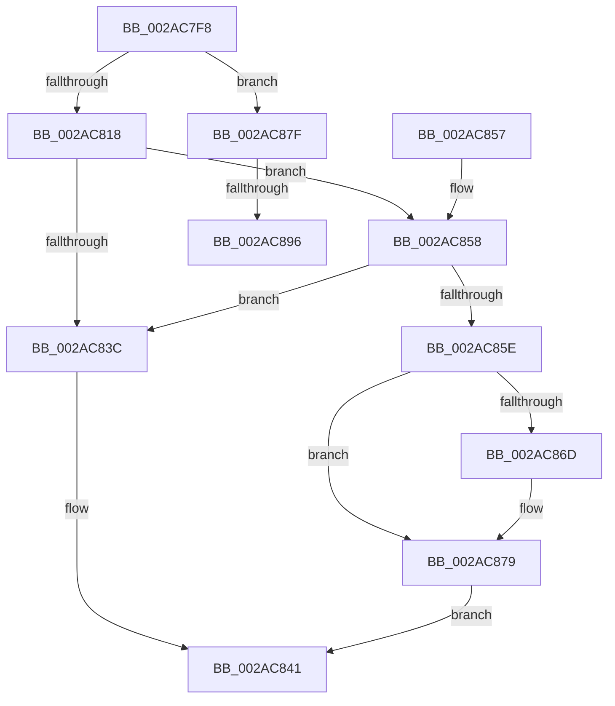

# MiUnlockIoPfnTree

- RVA: `0x002AC7F8`–`0x002AC89B` (길이 `163` bytes)
- VA: `0x00000001402AC7F8`
- 실행 섹션: `.text`
- PDB 이름 있음: `예`; PDB Function 태그: `예`
- unwind 정보 RVA: `0x0006D1C4`
- 디코드: `39`개 명령, `163/163` bytes 표시
- 미해석 바이트: `0` (있으면 어셈블리에 `.byte`로 보존)

> 이 문서는 커널 이미지의 기계어와 PDB 기호를 분석해 생성했습니다. 4번과 5번은 함수 원형과 자료형을 바이너리 사용 방식에서 추정한 C 해석이며 원본 소스 복구 결과는 아닙니다.

## 1. Dependencies

- 직접 호출 지점: **3**; 고유 호출 대상: **2**
- 직접 호출자로 확인된 함수: **11**
- RIP 상대 이미지 참조: **3**

### Outgoing calls
- `0x002AC83C` → [ExReleaseSpinLockSharedFromDpcLevel](../24/ExReleaseSpinLockSharedFromDpcLevel_function_0024A590.md) (function, `0x0024A590`)
- `0x002AC85E` → [ExReleaseSpinLockSharedFromDpcLevel](../24/ExReleaseSpinLockSharedFromDpcLevel_function_0024A590.md) (function, `0x0024A590`)
- `0x002AC874` → [KiLowerIrqlProcessIrqlFlags](../4F/KiLowerIrqlProcessIrqlFlags_function_004F5698.md) (function, `0x004F5698`)

### Direct callers
- [MiReferenceIoPages](../23/MiReferenceIoPages_function_0023C804.md) at `0x0023CA9A`
- [MiUnlockOpportunisticPagesInPageTable](MiUnlockOpportunisticPagesInPageTable_function_002AA88C.md) at `0x002AA9C7`
- [MiLookupIoPageNode](MiLookupIoPageNode_function_002AC5C8.md) at `0x002AC690`
- [MiMarkHugeRangeTransition](../43/MiMarkHugeRangeTransition_function_004374C0.md) at `0x004375A7`
- [MiMarkHugeRangeTransition](../43/MiMarkHugeRangeTransition_function_004374C0.md) at `0x004375FA`
- [MiCreateIoPageExclusion](../67/MiCreateIoPageExclusion_function_0067B638.md) at `0x0067B707`
- [MiDeleteStaleCacheMaps](../67/MiDeleteStaleCacheMaps_function_0067B780.md) at `0x0067BA79`
- [MiDeleteStaleCacheMaps](../67/MiDeleteStaleCacheMaps_function_0067B780.md) at `0x0067BAA7`
- [MiDeleteStaleCacheMaps](../67/MiDeleteStaleCacheMaps_function_0067B780.md) at `0x0067BACB`
- [MiDeleteStaleCacheMaps](../67/MiDeleteStaleCacheMaps_function_0067B780.md) at `0x0067BB46`
- [MiIsProbeActive](../67/MiIsProbeActive_function_0067C16C.md) at `0x0067C277`
- [MiMakeIoRangePermanent](../67/MiMakeIoRangePermanent_function_0067C29C.md) at `0x0067C4DC`
- [MiMarkHugeRangeIoPfnDeleted](../67/MiMarkHugeRangeIoPfnDeleted_function_0067C770.md) at `0x0067C844`
- [MiMarkHugeRangeIoPfnDeleted](../67/MiMarkHugeRangeIoPfnDeleted_function_0067C770.md) at `0x0067C8F4`
- [MiRemoveIoPageExclusion](../67/MiRemoveIoPageExclusion_function_0067C91C.md) at `0x0067C94B`
- [sub_006DB1E0](../6D/Unknown_function_006DB1E0.md) at `0x006DB250`

### Static image references
- `0x002AC865` → RVA `0x00FC6D20` (`ALMOSTRO`; read)
- `0x002AC87F` → RVA `0x00E2DBF8` (`.data`; read)
- `0x002AC888` → RVA `0x00FC5000` (`ALMOSTRO`; read)

## 2. Other-region calls and transfers

- 다른 실행 섹션으로 향하는 call: **0**
- call이 아닌 외부 분기/꼬리 이동: **2**
  - `0x002AC890` → [sub_006DB548](../6D/Unknown_function_006DB548.md) (`tail-transfer`)
  - `0x002AC896` → [sub_006DB548 + 0x29](../6D/Unknown_function_006DB548.md) (`tail-transfer`)

## 3. Assembly (complete function range)

```asm
002AC7F8  48 89 5C 24 08                  mov qword ptr [rsp + 8], rbx
002AC7FD  48 89 6C 24 10                  mov qword ptr [rsp + 0x10], rbp
002AC802  48 89 7C 24 18                  mov qword ptr [rsp + 0x18], rdi
002AC807  41 56                           push r14
002AC809  48 83 EC 20                     sub rsp, 0x20
002AC80D  0F B6 F9                        movzx edi, cl
002AC810  44 8B F2                        mov r14d, edx
002AC813  F6 C2 01                        test dl, 1
002AC816  74 67                           je 0x1402ac87f
002AC818  65 48 8B 04 25 20 00 00 00      mov rax, qword ptr gs:[0x20]
002AC821  4C 8B 80 38 88 00 00            mov r8, qword ptr [rax + 0x8838]
002AC828  49 8B 88 48 01 00 00            mov rcx, qword ptr [r8 + 0x148]
002AC82F  48 81 C1 80 02 00 00            add rcx, 0x280
002AC836  41 F6 C6 04                     test r14b, 4
002AC83A  74 1C                           je 0x1402ac858
002AC83C  E8 4F DD F9 FF                  call 0x14024a590
002AC841  48 8B 5C 24 30                  mov rbx, qword ptr [rsp + 0x30]
002AC846  48 8B 6C 24 38                  mov rbp, qword ptr [rsp + 0x38]
002AC84B  48 8B 7C 24 40                  mov rdi, qword ptr [rsp + 0x40]
002AC850  48 83 C4 20                     add rsp, 0x20
002AC854  41 5E                           pop r14
002AC856  C3                              ret
002AC857  CC                              int3
002AC858  40 80 FF 11                     cmp dil, 0x11
002AC85C  74 DE                           je 0x1402ac83c
002AC85E  E8 2D DD F9 FF                  call 0x14024a590
002AC863  33 DB                           xor ebx, ebx
002AC865  39 1D B5 A4 D1 00               cmp dword ptr [rip + 0xd1a4b5], ebx
002AC86B  74 0C                           je 0x1402ac879
002AC86D  44 0F 20 C1                     mov rcx, cr8
002AC871  40 8A D7                        mov dl, dil
002AC874  E8 1F 8E 24 00                  call 0x1404f5698
002AC879  44 0F 22 C7                     mov cr8, rdi
002AC87D  EB C2                           jmp 0x1402ac841
002AC87F  48 8B 2D 72 13 B8 00            mov rbp, qword ptr [rip + 0xb81372]
002AC886  33 DB                           xor ebx, ebx
002AC888  66 83 3D 70 87 D1 00 01         cmp word ptr [rip + 0xd18770], 1
002AC890  0F 85 B2 EC 42 00               jne 0x1406db548
002AC896  E9 D6 EC 42 00                  jmp 0x1406db571
```

## 4. C-style interpretation (structured pseudocode)

```c
__int64 __fastcall MiUnlockIoPfnTree(unsigned __int8 a1, int a2)
{
    __int64 result;
    __int64 v_rbx;
    __int64 v_rsp;
    unsigned __int64 v_stack_p10;
    unsigned __int64 v_stack_p18;
    unsigned __int64 v_stack_p8;

    v_stack_p8 = v_rbx;
    v_stack_p10 = v_rbp;
    v_stack_p18 = v_rdi;
    v_rsp = (v_rsp) - (32);
    if ((((unsigned __int8)(a2)) & (1)) == 0) goto loc_002AC87F;
    a1 = (*(unsigned __int64 *)(*(unsigned __int64 *)(*(unsigned __int64 *)(gs_base + (0 + 32)) + 34872) + 328)) + (640);
    if ((((unsigned __int8)((unsigned int)(a2))) & (4)) == 0) goto loc_002AC858;
loc_002AC83C:
    result = ExReleaseSpinLockSharedFromDpcLevel(a1, a2, *(unsigned __int64 *)(*(unsigned __int64 *)(gs_base + (0 + 32)) + 34872), a4);
loc_002AC841:
    v_rsp = (v_rsp) + (32);
    return result;
loc_002AC858:
    if (((unsigned __int8)(v_stack_p18)) == 17) goto loc_002AC83C;
    result = ExReleaseSpinLockSharedFromDpcLevel(a1, a2, *(unsigned __int64 *)(*(unsigned __int64 *)(gs_base + (0 + 32)) + 34872), a4);
    v_rbx = 0;
    if ((*(unsigned int *)(v_rip + 13739189)) != 0) {
        a1 = v_cr8;
        a2 = (unsigned __int8)(v_stack_p18);
        result = KiLowerIrqlProcessIrqlFlags(a1, a2, *(unsigned __int64 *)(*(unsigned __int64 *)(gs_base + (0 + 32)) + 34872), a4);
    }
    goto loc_002AC841;
loc_002AC87F:
    v_rbx = 0;
}
```

## 5. (Beta) C Style

```c
int64_t MiUnlockIoPfnTree(uint8_t Arg1, int32_t Arg2)
{
    int64_t result;
    int64_t local_rbx;
    int64_t local_rsp;
    uint64_t v_stack_p10;
    uint64_t v_stack_p18;
    uint64_t v_stack_p8;

    v_stack_p8 = local_rbx;
    v_stack_p10 = local_rbp;
    v_stack_p18 = local_rdi;
    local_rsp = (local_rsp) - (32);
    if ((((uint8_t)(Arg2)) & (1)) == 0) goto loc_002AC87F;
    Arg1 = (*(uint64_t *)(*(uint64_t *)(*(uint64_t *)(gs_base + (0 + 0x20)) + 0x8838) + 0x148)) + (640);
    if ((((uint8_t)((uint32_t)(Arg2))) & (4)) == 0) goto loc_002AC858;
loc_002AC83C:
    result = ExReleaseSpinLockSharedFromDpcLevel(Arg1, Arg2, *(uint64_t *)(*(uint64_t *)(gs_base + (0 + 0x20)) + 0x8838), a4);
loc_002AC841:
    local_rsp = (local_rsp) + (32);
    return result;
loc_002AC858:
    if (((uint8_t)(v_stack_p18)) == 17) goto loc_002AC83C;
    result = ExReleaseSpinLockSharedFromDpcLevel(Arg1, Arg2, *(uint64_t *)(*(uint64_t *)(gs_base + (0 + 0x20)) + 0x8838), a4);
    local_rbx = 0;
    if ((*(uint32_t *)(v_rip + 0xD1A4B5)) != 0) {
        Arg1 = v_cr8;
        Arg2 = (uint8_t)(v_stack_p18);
        result = KiLowerIrqlProcessIrqlFlags(Arg1, Arg2, *(uint64_t *)(*(uint64_t *)(gs_base + (0 + 0x20)) + 0x8838), a4);
    }
    goto loc_002AC841;
loc_002AC87F:
    local_rbx = 0;
}
```

## 6. Execution-region graph

[열기: 2D/3D 그래프와 함수 탐색 컨트롤 패널](../../../control-panel.html?section=text&rva=0x002AC7F8&view=graph)

- 2D 그래프는 위에서 아래로 흐르고, 3D 그래프는 빈 공간을 드래그해 회전합니다. Shift+드래그는 이동, 휠은 확대·축소, 함수 노드 선택은 대상 보고서 이동입니다.

### Static fallback


