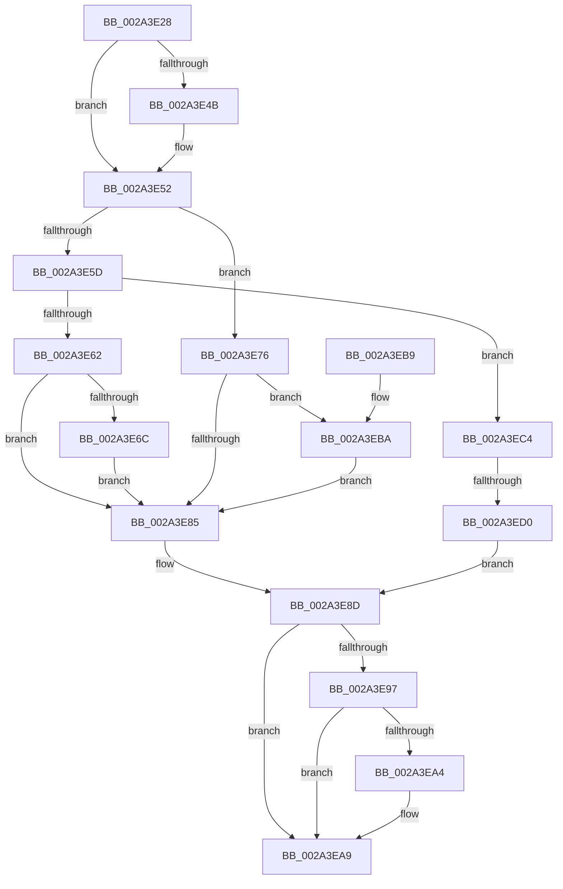

# MiUnlockLoaderEntry

- RVA: `0x002A3E28`–`0x002A3ED9` (길이 `177` bytes)
- VA: `0x00000001402A3E28`
- 실행 섹션: `.text`
- PDB 이름 있음: `예`; PDB Function 태그: `예`
- unwind 정보 RVA: `0x00068830`
- 디코드: `51`개 명령, `177/177` bytes 표시
- 미해석 바이트: `0` (있으면 어셈블리에 `.byte`로 보존)

> 이 문서는 커널 이미지의 기계어와 PDB 기호를 분석해 생성했습니다. 4번과 5번은 함수 원형과 자료형을 바이너리 사용 방식에서 추정한 C 해석이며 원본 소스 복구 결과는 아닙니다.

## 1. Dependencies

- 직접 호출 지점: **5**; 고유 호출 대상: **5**
- 직접 호출자로 확인된 함수: **9**
- RIP 상대 이미지 참조: **0**

### Outgoing calls
- `0x002A3E6F` → [ExfReleasePushLockShared](../26/ExfReleasePushLockShared_function_00263440.md) (function, `0x00263440`)
- `0x002A3E88` → [KeAbPostRelease](../2E/KeAbPostRelease_function_002E1600.md) (function, `0x002E1600`)
- `0x002A3EA4` → [KiCheckForKernelApcDelivery](../2E/KiCheckForKernelApcDelivery_function_002E2C80.md) (function, `0x002E2C80`)
- `0x002A3EBD` → [ExfTryToWakePushLock](../26/ExfTryToWakePushLock_function_00265DD0.md) (function, `0x00265DD0`)
- `0x002A3ED2` → [ExReleaseAutoExpandPushLockShared](../26/ExReleaseAutoExpandPushLockShared_function_00263660.md) (function, `0x00263660`)

### Direct callers
- [MiUnlockLoadedDataTableEntry](MiUnlockLoadedDataTableEntry_function_002A385C.md) at `0x002A3869`
- [MmUnlockLoadedDataTableEntry](MmUnlockLoadedDataTableEntry_function_002A3C98.md) at `0x002A3C9E`
- [MiEnumerateSystemImages](MiEnumerateSystemImages_function_002A3D40.md) at `0x002A3DB8`
- [MmUnlockLoadedDataTableEntryShared](../4B/MmUnlockLoadedDataTableEntryShared_function_004BE49C.md) at `0x004BE4A5`
- [sub_005AB009](../5A/Unknown_function_005AB009.md) at `0x005AB056`
- [MiProtectDriverSectionPte](../67/MiProtectDriverSectionPte_function_006706C0.md) at `0x00670770`
- [MiBackSystemImageWithPagefile](../../page/7F/MiBackSystemImageWithPagefile_function_007F86E8.md) at `0x007F87C2`
- [MiBackSystemImageWithPagefile](../../page/7F/MiBackSystemImageWithPagefile_function_007F86E8.md) at `0x007F883E`
- [MiBackSystemImageWithPagefile](../../page/7F/MiBackSystemImageWithPagefile_function_007F86E8.md) at `0x007F884E`
- [MiSplitDriverPage](../../page/7F/MiSplitDriverPage_function_007F8EB8.md) at `0x007F8F26`
- [MmFreeDriverInitialization](../../page/A4/MmFreeDriverInitialization_function_00A4AD08.md) at `0x00A4AD34`

### Static image references
- 디코드된 RIP-relative 메모리 참조가 없습니다.

## 2. Other-region calls and transfers

- 다른 실행 섹션으로 향하는 call: **0**
- call이 아닌 외부 분기/꼬리 이동: **1**
  - `0x002A3ECA` → [sub_006DAE7C](../6D/Unknown_function_006DAE7C.md) (`tail-transfer`)

## 3. Assembly (complete function range)

```asm
002A3E28  48 89 5C 24 10                  mov qword ptr [rsp + 0x10], rbx
002A3E2D  48 89 74 24 18                  mov qword ptr [rsp + 0x18], rsi
002A3E32  57                              push rdi
002A3E33  48 83 EC 20                     sub rsp, 0x20
002A3E37  65 48 8B 3C 25 88 01 00 00      mov rdi, qword ptr gs:[0x188]
002A3E40  45 33 C0                        xor r8d, r8d
002A3E43  41 8D 70 01                     lea esi, [r8 + 1]
002A3E47  3B D6                           cmp edx, esi
002A3E49  7F 07                           jg 0x1402a3e52
002A3E4B  4C 89 81 F0 00 00 00            mov qword ptr [rcx + 0xf0], r8
002A3E52  48 8D 99 E8 00 00 00            lea rbx, [rcx + 0xe8]
002A3E59  85 D2                           test edx, edx
002A3E5B  74 19                           je 0x1402a3e76
002A3E5D  83 FA 02                        cmp edx, 2
002A3E60  75 62                           jne 0x1402a3ec4
002A3E62  8D 42 0F                        lea eax, [rdx + 0xf]
002A3E65  F0 4C 0F B1 03                  lock cmpxchg qword ptr [rbx], r8
002A3E6A  74 19                           je 0x1402a3e85
002A3E6C  48 8B CB                        mov rcx, rbx
002A3E6F  E8 CC F5 FB FF                  call 0x140263440
002A3E74  EB 0F                           jmp 0x1402a3e85
002A3E76  48 83 C8 FF                     or rax, 0xffffffffffffffff
002A3E7A  F0 48 0F C1 03                  lock xadd qword ptr [rbx], rax
002A3E7F  24 06                           and al, 6
002A3E81  3C 02                           cmp al, 2
002A3E83  74 35                           je 0x1402a3eba
002A3E85  48 8B CB                        mov rcx, rbx
002A3E88  E8 73 D7 03 00                  call 0x1402e1600
002A3E8D  90                              nop
002A3E8E  66 01 B7 E6 01 00 00            add word ptr [rdi + 0x1e6], si
002A3E95  75 12                           jne 0x1402a3ea9
002A3E97  48 8D 87 98 00 00 00            lea rax, [rdi + 0x98]
002A3E9E  90                              nop
002A3E9F  48 39 00                        cmp qword ptr [rax], rax
002A3EA2  74 05                           je 0x1402a3ea9
002A3EA4  E8 D7 ED 03 00                  call 0x1402e2c80
002A3EA9  48 8B 5C 24 38                  mov rbx, qword ptr [rsp + 0x38]
002A3EAE  48 8B 74 24 40                  mov rsi, qword ptr [rsp + 0x40]
002A3EB3  48 83 C4 20                     add rsp, 0x20
002A3EB7  5F                              pop rdi
002A3EB8  C3                              ret
002A3EB9  CC                              int3
002A3EBA  48 8B CB                        mov rcx, rbx
002A3EBD  E8 0E 1F FC FF                  call 0x140265dd0
002A3EC2  EB C1                           jmp 0x1402a3e85
002A3EC4  48 8B CB                        mov rcx, rbx
002A3EC7  83 FA 03                        cmp edx, 3
002A3ECA  0F 85 AC 6F 43 00               jne 0x1406dae7c
002A3ED0  33 D2                           xor edx, edx
002A3ED2  E8 89 F7 FB FF                  call 0x140263660
002A3ED7  EB B4                           jmp 0x1402a3e8d
```

## 4. C-style interpretation (structured pseudocode)

```c
__int64 __fastcall MiUnlockLoaderEntry(__int64 a1, __int64 a2, int a3)
{
    __int64 result;
    __int64 v_rsp;
    unsigned __int64 v_stack_p10;
    unsigned __int64 v_stack_p18;

    v_stack_p10 = v_rbx;
    v_stack_p18 = v_rsi;
    v_rsp = (v_rsp) - (32);
    a3 = 0;
    if (((unsigned int)(a2)) <= ((unsigned int)(a3 + 1))) {
        *(unsigned __int64 *)(a1 + 240) = 0;
    }
    if ((unsigned int)(a2) == 0) goto loc_002A3E76;
    if (((unsigned int)(a2)) != 2) goto loc_002A3EC4;
    if (((unsigned int)(a2)) == 2) goto loc_002A3E85;
    result = ExfReleasePushLockShared(a1 + 232, a2, a3, a4);
    goto loc_002A3E85;
loc_002A3E76:
    result = (result) | (-1);
    result = (unsigned __int8)((result) & (6));
    if (((unsigned __int8)(result)) == 2) goto loc_002A3EBA;
loc_002A3E85:
    result = KeAbPostRelease(a1 + 232, a2, a3, a4);
loc_002A3E8D:
    if (((unsigned __int8)(result)) != 2) goto loc_002A3EA9;
    result = *(unsigned __int64 *)(gs_base + (0 + 392)) + 152;
    if ((*(unsigned __int64 *)(*(unsigned __int64 *)(gs_base + (0 + 392)) + 152)) != (*(unsigned __int64 *)(gs_base + (0 + 392)) + 152)) {
        result = KiCheckForKernelApcDelivery(a1 + 232, a2, a3, a4);
    }
    v_rsp = (v_rsp) + (32);
    return result;
loc_002A3EBA:
    result = ExfTryToWakePushLock(v_stack_p10, a2, a3, a4);
    goto loc_002A3E85;
loc_002A3EC4:
    a2 = 0;
    result = ExReleaseAutoExpandPushLockShared(v_stack_p10, a2, a3, a4);
    goto loc_002A3E8D;
}
```

## 5. (Beta) C Style

```c
int64_t MiUnlockLoaderEntry(void *Arg1, int64_t Arg2, int32_t Arg3)
{
    uint8_t *arg1 = (uint8_t *)Arg1;

    int64_t result;
    int64_t local_rsp;
    uint64_t v_stack_p10;
    uint64_t v_stack_p18;

    v_stack_p10 = local_rbx;
    v_stack_p18 = local_rsi;
    local_rsp = (local_rsp) - (32);
    Arg3 = 0;
    if (((uint32_t)(Arg2)) <= ((uint32_t)(Arg3 + 1))) {
        *(uint64_t *)(arg1 + 0xF0) = 0;
    }
    if ((uint32_t)(Arg2) == 0) goto loc_002A3E76;
    if (((uint32_t)(Arg2)) != 2) goto loc_002A3EC4;
    if (((uint32_t)(Arg2)) == 2) goto loc_002A3E85;
    result = ExfReleasePushLockShared(Arg1 + 232, Arg2, Arg3, a4);
    goto loc_002A3E85;
loc_002A3E76:
    result = (result) | (-1);
    result = (uint8_t)((result) & (6));
    if (((uint8_t)(result)) == 2) goto loc_002A3EBA;
loc_002A3E85:
    result = KeAbPostRelease(Arg1 + 232, Arg2, Arg3, a4);
loc_002A3E8D:
    if (((uint8_t)(result)) != 2) goto loc_002A3EA9;
    result = *(uint64_t *)(gs_base + (0 + 0x188)) + 152;
    if ((*(uint64_t *)(*(uint64_t *)(gs_base + (0 + 0x188)) + 0x98)) != (*(uint64_t *)(gs_base + (0 + 0x188)) + 152)) {
        result = KiCheckForKernelApcDelivery(Arg1 + 232, Arg2, Arg3, a4);
    }
    local_rsp = (local_rsp) + (32);
    return result;
loc_002A3EBA:
    result = ExfTryToWakePushLock(v_stack_p10, Arg2, Arg3, a4);
    goto loc_002A3E85;
loc_002A3EC4:
    Arg2 = 0;
    result = ExReleaseAutoExpandPushLockShared(v_stack_p10, Arg2, Arg3, a4);
    goto loc_002A3E8D;
}
```

### 관측된 메모리 오프셋

구조체 형식이 확인되지 않은 접근은 인자 기준의 오프셋으로만 기록했습니다.

| 기준 인자 | 오프셋 표현 | 폭 (bit) | 접근 |
|---|---:|---:|---|
| `Arg1` | `+ 0x0` | `64` | `R` |
| `Arg1` | `+ 0x0` | `64` | `R/W` |
| `Arg1` | `+ 0xE8` | `64` | `R` |
| `Arg1` | `+ 0xF0` | `64` | `W` |

## 6. Execution-region graph

[열기: 2D/3D 그래프와 함수 탐색 컨트롤 패널](../../../control-panel.html?section=text&rva=0x002A3E28&view=graph)

- 2D 그래프는 위에서 아래로 흐르고, 3D 그래프는 빈 공간을 드래그해 회전합니다. Shift+드래그는 이동, 휠은 확대·축소, 함수 노드 선택은 대상 보고서 이동입니다.

### Static fallback


