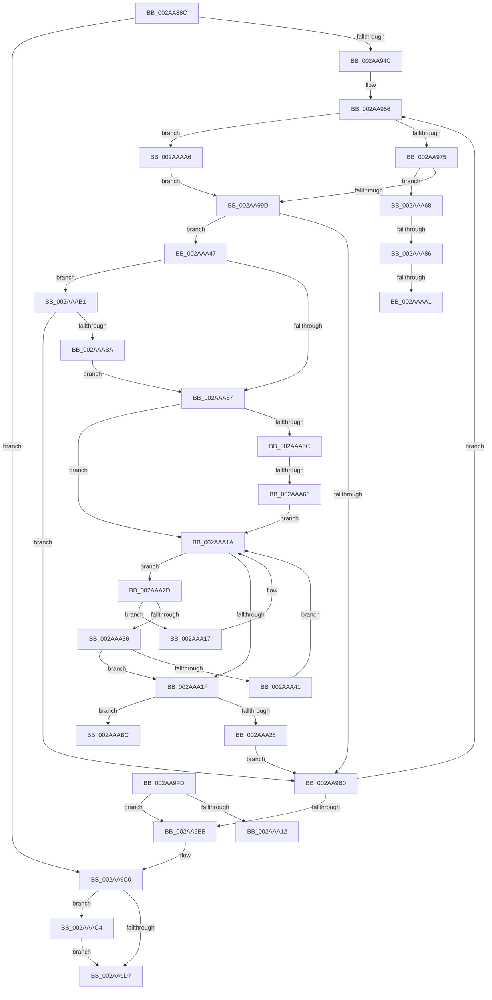

# MiUnlockOpportunisticPagesInPageTable

- RVA: `0x002AA88C`–`0x002AAAFC` (길이 `624` bytes)
- VA: `0x00000001402AA88C`
- 실행 섹션: `.text`
- PDB 이름 있음: `예`; PDB Function 태그: `예`
- unwind 정보 RVA: `0x0006CFCC`
- 디코드: `153`개 명령, `624/624` bytes 표시
- 미해석 바이트: `0` (있으면 어셈블리에 `.byte`로 보존)

> 이 문서는 커널 이미지의 기계어와 PDB 기호를 분석해 생성했습니다. 4번과 5번은 함수 원형과 자료형을 바이너리 사용 방식에서 추정한 C 해석이며 원본 소스 복구 결과는 아닙니다.

## 1. Dependencies

- 직접 호출 지점: **11**; 고유 호출 대상: **11**
- 직접 호출자로 확인된 함수: **2**
- RIP 상대 이미지 참조: **3**

### Outgoing calls
- `0x002AA8D0` → [memset](../6C/memset_function_006C6C40.md) (function, `0x006C6C40`)
- `0x002AA919` → [MiInitializeTbFlushList](../29/MiInitializeTbFlushList_function_00294F00.md) (function, `0x00294F00`)
- `0x002AA940` → [MiLockIoPfnTree](MiLockIoPfnTree_function_002AC8A4.md) (function, `0x002AC8A4`)
- `0x002AA959` → [MI_READ_PTE_LOCK_FREE](../28/MI_READ_PTE_LOCK_FREE_function_002828A0.md) (function, `0x002828A0`)
- `0x002AA9C7` → [MiUnlockIoPfnTree](MiUnlockIoPfnTree_function_002AC7F8.md) (function, `0x002AC7F8`)
- `0x002AA9E5` → [_security_check_cookie](../6A/_security_check_cookie_function_006AC640.md) (function, `0x006AC640`)
- `0x002AAACA` → [MiUnlockPageTable](../21/MiUnlockPageTable_function_00216EC0.md) (function, `0x00216EC0`)
- `0x002AAAD5` → [MiUnlockWorkingSetShared](../27/MiUnlockWorkingSetShared_function_0027D690.md) (function, `0x0027D690`)
- `0x002AAADF` → [MiInvokeIoReleasePages](../4E/MiInvokeIoReleasePages_function_004E3E40.md) (function, `0x004E3E40`)
- `0x002AAAE7` → [MiLockWorkingSetShared](../27/MiLockWorkingSetShared_function_0027CBF0.md) (function, `0x0027CBF0`)
- `0x002AAAF2` → [MiLockNestedPageTable](../23/MiLockNestedPageTable_function_0023E890.md) (function, `0x0023E890`)

### Direct callers
- [MiReplaceRotateWithDemandZeroNoCopy](MiReplaceRotateWithDemandZeroNoCopy_function_002AAB04.md) at `0x002AADFB`
- [MiReplaceRotateWithDemandZeroNoCopy](MiReplaceRotateWithDemandZeroNoCopy_function_002AAB04.md) at `0x002AAE10`
- [MiSwitchToTransition](../4C/MiSwitchToTransition_function_004C0F5C.md) at `0x004C126C`
- [MiSwitchToTransition](../4C/MiSwitchToTransition_function_004C0F5C.md) at `0x004C128A`

### Static image references
- `0x002AA89F` → RVA `0x00E0A740` (`.data`; read)
- `0x002AA968` → RVA `0x00E2DCE0` (`.data`; read)
- `0x002AA99D` → RVA `0x00E37280` (`.data`; read)

## 2. Other-region calls and transfers

- 다른 실행 섹션으로 향하는 call: **0**
- call이 아닌 외부 분기/꼬리 이동: **6**
  - `0x002AAA12` → [sub_006DB1E0 + 0x47](../6D/Unknown_function_006DB1E0.md) (`tail-transfer`)
  - `0x002AAA60` → [sub_006DB1E0 + 0x1A](../6D/Unknown_function_006DB1E0.md) (`tail-transfer`)
  - `0x002AAA80` → [sub_006DB1E0](../6D/Unknown_function_006DB1E0.md) (`tail-transfer`)
  - `0x002AAA9B` → [sub_006DB1E0](../6D/Unknown_function_006DB1E0.md) (`tail-transfer`)
  - `0x002AAAA1` → [sub_006DB1E0 + 0x6](../6D/Unknown_function_006DB1E0.md) (`tail-transfer`)
  - `0x002AAABF` → [sub_006DB1E0 + 0x1A](../6D/Unknown_function_006DB1E0.md) (`tail-transfer`)

## 3. Assembly (complete function range)

```asm
002AA88C  40 53                           push rbx
002AA88E  56                              push rsi
002AA88F  57                              push rdi
002AA890  41 54                           push r12
002AA892  41 55                           push r13
002AA894  41 56                           push r14
002AA896  41 57                           push r15
002AA898  48 81 EC 30 01 00 00            sub rsp, 0x130
002AA89F  48 8B 05 9A FE B5 00            mov rax, qword ptr [rip + 0xb5fe9a]
002AA8A6  48 33 C4                        xor rax, rsp
002AA8A9  48 89 84 24 20 01 00 00         mov qword ptr [rsp + 0x120], rax
002AA8B1  4D 8B F0                        mov r14, r8
002AA8B4  88 54 24 30                     mov byte ptr [rsp + 0x30], dl
002AA8B8  40 8A FA                        mov dil, dl
002AA8BB  4C 89 4C 24 38                  mov qword ptr [rsp + 0x38], r9
002AA8C0  48 8B F1                        mov rsi, rcx
002AA8C3  33 D2                           xor edx, edx
002AA8C5  41 B8 C8 00 00 00               mov r8d, 0xc8
002AA8CB  48 8D 4C 24 50                  lea rcx, [rsp + 0x50]
002AA8D0  E8 6B C3 41 00                  call 0x1406c6c40
002AA8D5  4D 8B E6                        mov r12, r14
002AA8D8  33 C9                           xor ecx, ecx
002AA8DA  49 C1 EC 09                     shr r12, 9
002AA8DE  48 B8 F8 FF FF FF 7F 00 00 00   movabs rax, 0x7ffffffff8
002AA8E8  4C 23 E0                        and r12, rax
002AA8EB  44 8B F9                        mov r15d, ecx
002AA8EE  48 B8 00 00 00 00 80 F6 FF FF   movabs rax, 0xfffff68000000000
002AA8F8  44 8D 49 18                     lea r9d, [rcx + 0x18]
002AA8FC  C7 44 24 20 01 00 00 00         mov dword ptr [rsp + 0x20], 1
002AA904  44 8D 41 14                     lea r8d, [rcx + 0x14]
002AA908  8B D9                           mov ebx, ecx
002AA90A  48 8D 4C 24 50                  lea rcx, [rsp + 0x50]
002AA90F  48 8B D6                        mov rdx, rsi
002AA912  4C 03 E0                        add r12, rax
002AA915  49 83 CD FF                     or r13, 0xffffffffffffffff
002AA919  E8 E2 A5 FE FF                  call 0x140294f00
002AA91E  48 8B 44 24 38                  mov rax, qword ptr [rsp + 0x38]
002AA923  49 8B CE                        mov rcx, r14
002AA926  48 83 E1 F8                     and rcx, 0xfffffffffffffff8
002AA92A  48 81 C9 F8 0F 00 00            or rcx, 0xff8
002AA931  48 3B C1                        cmp rax, rcx
002AA934  48 0F 47 C1                     cmova rax, rcx
002AA938  8D 4B 05                        lea ecx, [rbx + 5]
002AA93B  48 89 44 24 38                  mov qword ptr [rsp + 0x38], rax
002AA940  E8 5F 1F 00 00                  call 0x1402ac8a4
002AA945  4C 3B 74 24 38                  cmp r14, qword ptr [rsp + 0x38]
002AA94A  77 74                           ja 0x1402aa9c0
002AA94C  48 BF FF FF FF FF FF 00 00 00   movabs rdi, 0xffffffffff
002AA956  49 8B CE                        mov rcx, r14
002AA959  E8 42 7F FD FF                  call 0x1402828a0
002AA95E  48 8B D0                        mov rdx, rax
002AA961  48 C1 EA 0C                     shr rdx, 0xc
002AA965  48 23 D7                        and rdx, rdi
002AA968  48 3B 15 71 33 B8 00            cmp rdx, qword ptr [rip + 0xb83371]
002AA96F  0F 87 31 01 00 00               ja 0x1402aaaa6
002AA975  48 8D 0C 52                     lea rcx, [rdx + rdx*2]
002AA979  48 03 C9                        add rcx, rcx
002AA97C  48 B8 28 00 00 00 00 DE FF FF   movabs rax, 0xffffde0000000028
002AA986  48 8B 04 C8                     mov rax, qword ptr [rax + rcx*8]
002AA98A  41 BB 01 00 00 00               mov r11d, 1
002AA990  48 C1 E8 36                     shr rax, 0x36
002AA994  41 85 C3                        test r11d, eax
002AA997  0F 85 CB 00 00 00               jne 0x1402aaa68
002AA99D  48 8B 0D DC C8 B8 00            mov rcx, qword ptr [rip + 0xb8c8dc]
002AA9A4  45 33 C9                        xor r9d, r9d
002AA9A7  48 85 C9                        test rcx, rcx
002AA9AA  0F 85 97 00 00 00               jne 0x1402aaa47
002AA9B0  49 83 C6 08                     add r14, 8
002AA9B4  4C 3B 74 24 38                  cmp r14, qword ptr [rsp + 0x38]
002AA9B9  76 9B                           jbe 0x1402aa956
002AA9BB  40 8A 7C 24 30                  mov dil, byte ptr [rsp + 0x30]
002AA9C0  BA 05 00 00 00                  mov edx, 5
002AA9C5  B1 11                           mov cl, 0x11
002AA9C7  E8 2C 1E 00 00                  call 0x1402ac7f8
002AA9CC  83 7C 24 6C 00                  cmp dword ptr [rsp + 0x6c], 0
002AA9D1  0F 85 ED 00 00 00               jne 0x1402aaac4
002AA9D7  49 8B C7                        mov rax, r15
002AA9DA  48 8B 8C 24 20 01 00 00         mov rcx, qword ptr [rsp + 0x120]
002AA9E2  48 33 CC                        xor rcx, rsp
002AA9E5  E8 56 1C 40 00                  call 0x1406ac640
002AA9EA  48 81 C4 30 01 00 00            add rsp, 0x130
002AA9F1  41 5F                           pop r15
002AA9F3  41 5E                           pop r14
002AA9F5  41 5D                           pop r13
002AA9F7  41 5C                           pop r12
002AA9F9  5F                              pop rdi
002AA9FA  5E                              pop rsi
002AA9FB  5B                              pop rbx
002AA9FC  C3                              ret
002AA9FD  CC                              int3
002AA9FE  4D 85 FF                        test r15, r15
002AAA01  49 8B FE                        mov rdi, r14
002AAA04  49 0F 45 FF                     cmovne rdi, r15
002AAA08  80 7C 24 30 11                  cmp byte ptr [rsp + 0x30], 0x11
002AAA0D  4C 8B FF                        mov r15, rdi
002AAA10  74 A9                           je 0x1402aa9bb
002AAA12  E9 10 08 43 00                  jmp 0x1406db227
002AAA17  48 8B 09                        mov rcx, qword ptr [rcx]
002AAA1A  48 85 C9                        test rcx, rcx
002AAA1D  75 0E                           jne 0x1402aaa2d
002AAA1F  48 85 C9                        test rcx, rcx
002AAA22  0F 85 94 00 00 00               jne 0x1402aaabc
002AAA28  4D 8B E8                        mov r13, r8
002AAA2B  EB 83                           jmp 0x1402aa9b0
002AAA2D  48 8B 41 18                     mov rax, qword ptr [rcx + 0x18]
002AAA31  48 3B D0                        cmp rdx, rax
002AAA34  72 E1                           jb 0x1402aaa17
002AAA36  48 05 00 02 00 00               add rax, 0x200
002AAA3C  48 3B D0                        cmp rdx, rax
002AAA3F  72 DE                           jb 0x1402aaa1f
002AAA41  48 8B 49 08                     mov rcx, qword ptr [rcx + 8]
002AAA45  EB D3                           jmp 0x1402aaa1a
002AAA47  4C 8B C2                        mov r8, rdx
002AAA4A  49 81 E0 00 FE FF FF            and r8, 0xfffffffffffffe00
002AAA51  49 83 FD FF                     cmp r13, -1
002AAA55  75 5A                           jne 0x1402aaab1
002AAA57  48 85 DB                        test rbx, rbx
002AAA5A  74 BE                           je 0x1402aaa1a
002AAA5C  4C 39 43 18                     cmp qword ptr [rbx + 0x18], r8
002AAA60  0F 84 94 07 43 00               je 0x1406db1fa
002AAA66  EB B2                           jmp 0x1402aaa1a
002AAA68  49 BA 00 00 00 00 00 DE FF FF   movabs r10, 0xffffde0000000000
002AAA72  49 8B 44 CA 28                  mov rax, qword ptr [r10 + rcx*8 + 0x28]
002AAA77  45 0F B7 C3                     movzx r8d, r11w
002AAA7B  48 0F BA E0 28                  bt rax, 0x28
002AAA80  0F 82 5A 07 43 00               jb 0x1406db1e0
002AAA86  49 8B 44 CA 28                  mov rax, qword ptr [r10 + rcx*8 + 0x28]
002AAA8B  49 B9 FE FF FF FF 3F 00 00 00   movabs r9, 0x3ffffffffe
002AAA95  48 23 C7                        and rax, rdi
002AAA98  49 3B C1                        cmp rax, r9
002AAA9B  0F 84 3F 07 43 00               je 0x1406db1e0
002AAAA1  E9 40 07 43 00                  jmp 0x1406db1e6
002AAAA6  41 BB 01 00 00 00               mov r11d, 1
002AAAAC  E9 EC FE FF FF                  jmp 0x1402aa99d
002AAAB1  4D 3B E8                        cmp r13, r8
002AAAB4  0F 84 F6 FE FF FF               je 0x1402aa9b0
002AAABA  EB 9B                           jmp 0x1402aaa57
002AAABC  48 8B D9                        mov rbx, rcx
002AAABF  E9 36 07 43 00                  jmp 0x1406db1fa
002AAAC4  49 8B D4                        mov rdx, r12
002AAAC7  48 8B CE                        mov rcx, rsi
002AAACA  E8 F1 C3 F6 FF                  call 0x140216ec0
002AAACF  40 8A D7                        mov dl, dil
002AAAD2  48 8B CE                        mov rcx, rsi
002AAAD5  E8 B6 2B FD FF                  call 0x14027d690
002AAADA  48 8D 4C 24 50                  lea rcx, [rsp + 0x50]
002AAADF  E8 5C 93 23 00                  call 0x1404e3e40
002AAAE4  48 8B CE                        mov rcx, rsi
002AAAE7  E8 04 21 FD FF                  call 0x14027cbf0
002AAAEC  49 8B D4                        mov rdx, r12
002AAAEF  48 8B CE                        mov rcx, rsi
002AAAF2  E8 99 3D F9 FF                  call 0x14023e890
002AAAF7  E9 DB FE FF FF                  jmp 0x1402aa9d7
```

## 4. C-style interpretation (structured pseudocode)

```c
__int64 __fastcall MiUnlockOpportunisticPagesInPageTable(__int64 a1, int a2, __int64 a3, __int64 a4)
{
    __int64 result;
    __int64 v_r12;
    __int64 v_r13;
    __int64 v_r14;
    __int64 v_rsp;
    unsigned __int64 v_stack_m118;
    unsigned __int64 v_stack_m130;
    unsigned __int8 v_stack_m138;
    unsigned int v_stack_m148;
    unsigned __int64 v_stack_m48;
    unsigned int v_stack_mFC;
    unsigned __int8 v_stack_p30;
    unsigned __int64 v_stack_p50;

    v_rsp = (v_rsp) - (304);
    result = (*(unsigned __int64 *)(v_rip + 11927194)) ^ (v_rsp);
    v_stack_m48 = result;
    v_stack_m138 = (unsigned __int8)(a2);
    v_stack_m130 = a4;
    a2 = 0;
    result = memset(v_stack_m118, a2, 200, a4);
    a1 = 0;
    v_r12 = (a3) >> (9);
    v_r12 = (v_r12) & (result);
    v_stack_m148 = 1;
    v_r12 = (v_r12) + (result);
    v_r13 = (v_r13) | (-1);
    result = MiInitializeTbFlushList(v_stack_m118, 0, a1 + 20, a1 + 24);
    a1 = (a3) & (-8);
    a1 = (a1) | (0xFF8ULL);
    result = v_stack_m130;
    if (v_stack_m130 > a1) { result = a1; }
    v_stack_m130 = result;
    result = MiLockIoPfnTree(0 + 5, 0, a1 + 20, a1 + 24);
    if (a3 > v_stack_m130) goto loc_002AA9C0;
loc_002AA956:
    result = MI_READ_PTE_LOCK_FREE(a3, 0, a1 + 20, a1 + 24);
    a2 = (result) >> (12);
    a2 = (a2) & ((unsigned __int8)(a2));
    if (a2 > (*(unsigned __int64 *)(v_rip + 12071793))) goto loc_002AAAA6;
    a1 = (a2 + a2 * 2) + (a2 + a2 * 2);
    result = (*(unsigned __int64 *)(result + a1 * 8)) >> (54);
    if (((1) & ((unsigned int)(result))) != 0) goto loc_002AAA68;
loc_002AA99D:
    a4 = 0;
    if (*(unsigned __int64 *)(v_rip + 12110044) != 0) goto loc_002AAA47;
loc_002AA9B0:
    v_r14 = (a3) + (8);
    if (v_r14 <= v_stack_m130) goto loc_002AA956;
loc_002AA9BB:
loc_002AA9C0:
    result = MiUnlockIoPfnTree(17, 5, a1 + 20, a4);
    if (v_stack_mFC != 0) goto loc_002AAAC4;
loc_002AA9D7:
    a1 = (v_stack_m48) ^ (v_rsp);
    result = _security_check_cookie(a1, 5, a1 + 20, a4);
    v_rsp = (v_rsp) + (304);
    return result;
loc_002AAA17:
loc_002AAA1A:
    if (*(unsigned __int64 *)(a1) != 0) goto loc_002AAA2D;
loc_002AAA1F:
    if (*(unsigned __int64 *)(a1) != 0) goto loc_002AAABC;
    goto loc_002AA9B0;
loc_002AAA2D:
    if (5 < (*(unsigned __int64 *)(*(unsigned __int64 *)(a1) + 24))) goto loc_002AAA17;
    result = (*(unsigned __int64 *)(*(unsigned __int64 *)(a1) + 24)) + (512);
    if (5 < result) goto loc_002AAA1F;
    goto loc_002AAA1A;
loc_002AAA47:
    a3 = (5) & (-512);
    if ((a1 + 20) != -1) goto loc_002AAAB1;
loc_002AAA57:
    if (0 == 0) goto loc_002AAA1A;
    goto loc_002AAA1A;
loc_002AAA68:
    result = (*(unsigned __int64 *)(v_r10 + *(unsigned __int64 *)(*(unsigned __int64 *)(a1) + 8) * 8 + 40)) & (v_stack_m138);
loc_002AAAA6:
    goto loc_002AA99D;
loc_002AAAB1:
    if ((a1 + 20) == 1) goto loc_002AA9B0;
    goto loc_002AAA57;
loc_002AAABC:
loc_002AAAC4:
    result = MiUnlockPageTable(a1, v_r12, 1, a4);
    result = MiUnlockWorkingSetShared(a1, (unsigned __int8)(v_stack_m138), 1, a4);
    result = MiInvokeIoReleasePages(v_stack_p50, (unsigned __int8)(v_stack_m138), 1, a4);
    result = MiLockWorkingSetShared(a1, (unsigned __int8)(v_stack_m138), 1, a4);
    result = MiLockNestedPageTable(a1, v_r12, 1, a4);
    goto loc_002AA9D7;
}
```

## 5. (Beta) C Style

```c
int64_t MiUnlockOpportunisticPagesInPageTable(int64_t Arg1, int32_t Arg2, int64_t Arg3, int64_t Arg4)
{
    int64_t result;
    int64_t local_r12;
    int64_t local_r13;
    int64_t local_r14;
    int64_t local_rsp;
    uint64_t v_stack_m118;
    uint64_t v_stack_m130;
    uint8_t v_stack_m138;
    uint32_t v_stack_m148;
    uint64_t v_stack_m48;
    uint32_t v_stack_mFC;
    uint8_t v_stack_p30;
    uint64_t v_stack_p50;

    local_rsp = (local_rsp) - (304);
    result = (*(uint64_t *)(v_rip + 0xB5FE9A)) ^ (local_rsp);
    v_stack_m48 = result;
    v_stack_m138 = (uint8_t)(Arg2);
    v_stack_m130 = Arg4;
    Arg2 = 0;
    result = memset(v_stack_m118, Arg2, 200, Arg4);
    Arg1 = 0;
    local_r12 = (Arg3) >> (9);
    local_r12 = (local_r12) & (result);
    v_stack_m148 = 1;
    local_r12 = (local_r12) + (result);
    local_r13 = (local_r13) | (-1);
    result = MiInitializeTbFlushList(v_stack_m118, 0, Arg1 + 20, Arg1 + 24);
    Arg1 = (Arg3) & (-8);
    Arg1 = (Arg1) | (0xFF8ULL);
    result = v_stack_m130;
    if (v_stack_m130 > Arg1) { result = Arg1; }
    v_stack_m130 = result;
    result = MiLockIoPfnTree(0 + 5, 0, Arg1 + 20, Arg1 + 24);
    if (Arg3 > v_stack_m130) goto loc_002AA9C0;
loc_002AA956:
    result = MI_READ_PTE_LOCK_FREE(Arg3, 0, Arg1 + 20, Arg1 + 24);
    Arg2 = (result) >> (12);
    Arg2 = (Arg2) & ((uint8_t)(Arg2));
    if (Arg2 > (*(uint64_t *)(v_rip + 0xB83371))) goto loc_002AAAA6;
    Arg1 = (Arg2 + Arg2 * 2) + (Arg2 + Arg2 * 2);
    result = (*(uint64_t *)(result + Arg1 * 8)) >> (54);
    if (((1) & ((uint32_t)(result))) != 0) goto loc_002AAA68;
loc_002AA99D:
    Arg4 = 0;
    if (*(uint64_t *)(v_rip + 0xB8C8DC) != 0) goto loc_002AAA47;
loc_002AA9B0:
    local_r14 = (Arg3) + (8);
    if (local_r14 <= v_stack_m130) goto loc_002AA956;
loc_002AA9BB:
loc_002AA9C0:
    result = MiUnlockIoPfnTree(17, 5, Arg1 + 20, Arg4);
    if (v_stack_mFC != 0) goto loc_002AAAC4;
loc_002AA9D7:
    Arg1 = (v_stack_m48) ^ (local_rsp);
    result = _security_check_cookie(Arg1, 5, Arg1 + 20, Arg4);
    local_rsp = (local_rsp) + (304);
    return result;
loc_002AAA17:
loc_002AAA1A:
    if (*(uint64_t *)(Arg1) != 0) goto loc_002AAA2D;
loc_002AAA1F:
    if (*(uint64_t *)(Arg1) != 0) goto loc_002AAABC;
    goto loc_002AA9B0;
loc_002AAA2D:
    if (5 < (*(uint64_t *)(*(uint64_t *)(Arg1) + 0x18))) goto loc_002AAA17;
    result = (*(uint64_t *)(*(uint64_t *)(Arg1) + 0x18)) + (512);
    if (5 < result) goto loc_002AAA1F;
    goto loc_002AAA1A;
loc_002AAA47:
    Arg3 = (5) & (-512);
    if ((Arg1 + 20) != -1) goto loc_002AAAB1;
loc_002AAA57:
    if (0 == 0) goto loc_002AAA1A;
    goto loc_002AAA1A;
loc_002AAA68:
    result = (*(uint64_t *)(local_r10 + *(uint64_t *)(*(uint64_t *)(Arg1) + 0x8) * 8 + 0x28)) & (v_stack_m138);
loc_002AAAA6:
    goto loc_002AA99D;
loc_002AAAB1:
    if ((Arg1 + 20) == 1) goto loc_002AA9B0;
    goto loc_002AAA57;
loc_002AAABC:
loc_002AAAC4:
    result = MiUnlockPageTable(Arg1, local_r12, 1, Arg4);
    result = MiUnlockWorkingSetShared(Arg1, (uint8_t)(v_stack_m138), 1, Arg4);
    result = MiInvokeIoReleasePages(v_stack_p50, (uint8_t)(v_stack_m138), 1, Arg4);
    result = MiLockWorkingSetShared(Arg1, (uint8_t)(v_stack_m138), 1, Arg4);
    result = MiLockNestedPageTable(Arg1, local_r12, 1, Arg4);
    goto loc_002AA9D7;
}
```

## 6. Execution-region graph

[열기: 2D/3D 그래프와 함수 탐색 컨트롤 패널](../../../control-panel.html?section=text&rva=0x002AA88C&view=graph)

- 2D 그래프는 위에서 아래로 흐르고, 3D 그래프는 빈 공간을 드래그해 회전합니다. Shift+드래그는 이동, 휠은 확대·축소, 함수 노드 선택은 대상 보고서 이동입니다.

### Static fallback


